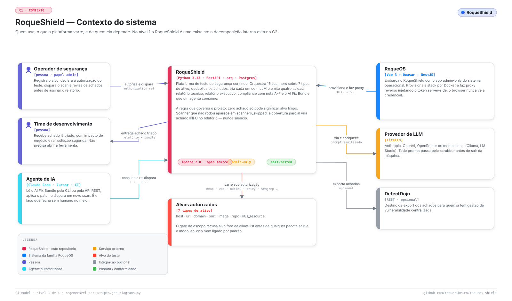
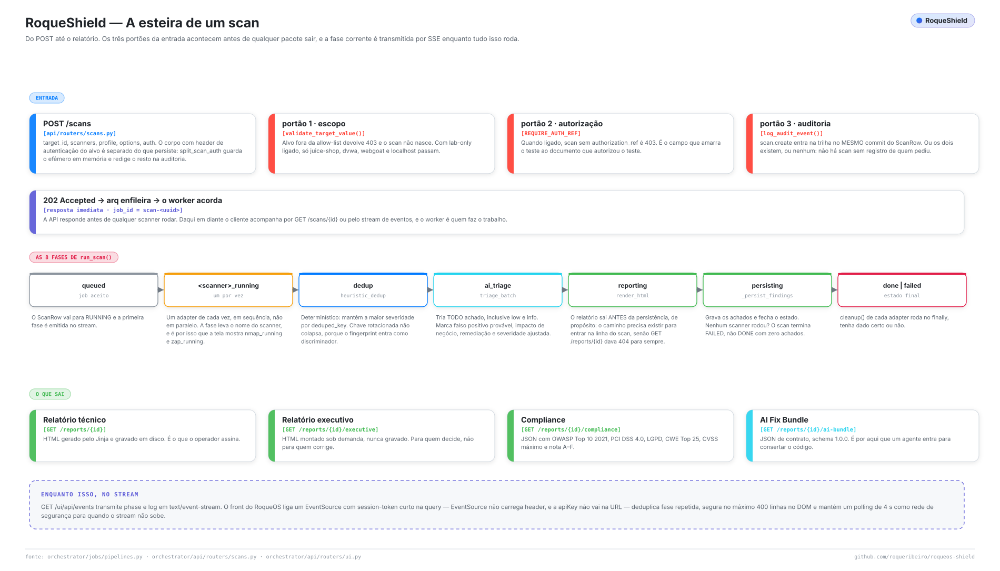
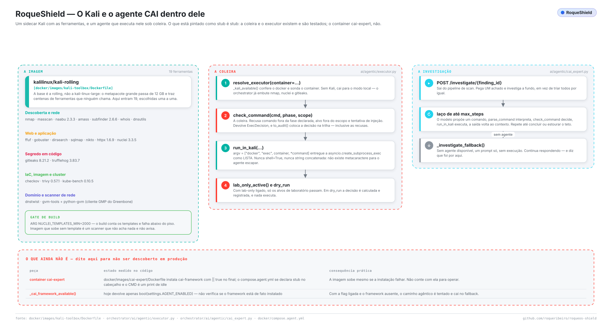
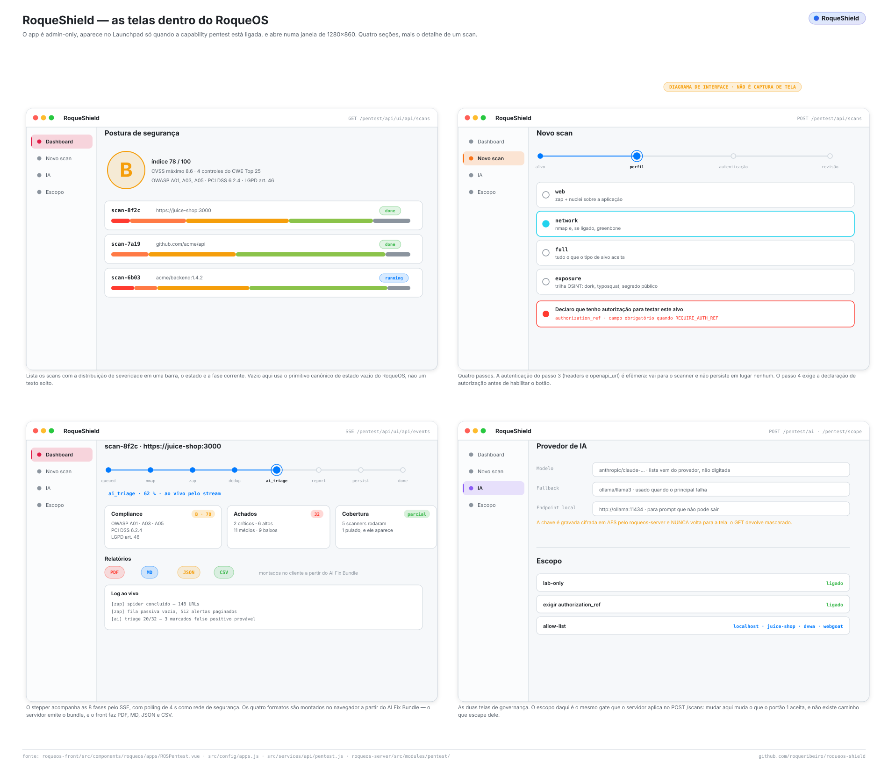
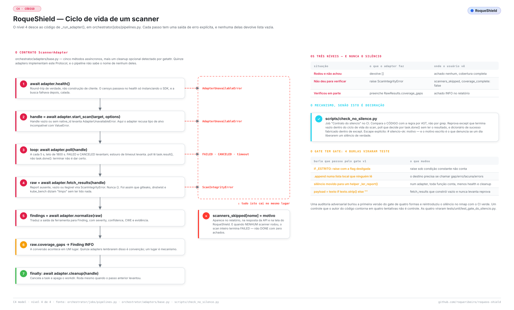
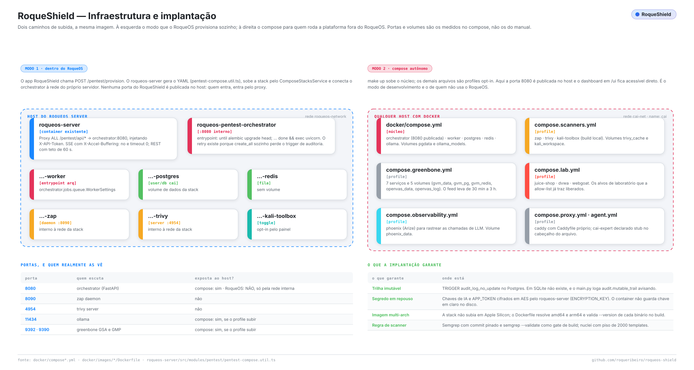

<div align="center">


# RoqueShield

**Continuous security testing that refuses to be silent.**

Fifteen scanners behind one adapter contract, LLM triage over scrubbed evidence,
an agent that confirms findings inside a Kali sidecar under a leash, and an
**AI Fix Bundle** another agent consumes to patch the code.

[](LICENSE)
[](https://www.python.org/downloads/release/python-3130/)
[](https://github.com/roqueribeiro/roqueos-shield/actions/workflows/ci.yml)
[](#status)

[Português (Brasil)](README.pt-BR.md) · [C4 model](docs/c4-model.md) · [Integrations](docs/integrations.md) · [Architecture](docs/architecture.md)

</div>

---

## Why this exists

A broken scanner and a clean target produce **exactly the same output: zero
findings.** In a report that goes to a bank's audit committee, that is the only
difference that matters — and it was the difference this tool could not make.

Nine adapters had the same shape of bug: an exception swallowed, an empty report
read as `{}`, a `poll()` that called a dead process "done", a scanner handed a URL
where it expected a directory. Every one of them closed the scan with zero findings
and a green checkmark.

So the project has one governing rule, and two CI gates that execute it:

> **Zero findings here — does it mean *clean*, or does it mean *did not run*?
> If there is no way to tell, a signal is missing.**

Everything else in this repository exists to serve that sentence.

---

## The system in one picture

<picture>
  <source media="(prefers-color-scheme: dark)" srcset="docs/assets/diagrams/c1-context-dark.svg">
  
</picture>

Four more levels of detail — containers, components, the adapter lifecycle,
infrastructure, the scan pipeline, the Kali agent and the UI — are in
**[docs/c4-model.md](docs/c4-model.md)**.

---

## What it does

| Stage | What happens | Where |
| --- | --- | --- |
| **Scan** | The right tool for the target type. Semgrep reads source; Gitleaks and Trufflehog hunt secrets; Trivy covers CVEs in images and dependencies; Checkov covers IaC; ZAP and Nuclei probe the running app; Nmap and Greenbone cover the network. | `orchestrator/adapters/` |
| **Deduplicate** | Deterministic merge by `deduped_key`, keeping the highest severity. A rotated credential does not collapse into one finding, because the fingerprint discriminates. | `orchestrator/domain/dedup.py` |
| **Triage** | An LLM re-ranks severity, flags likely false positives, maps to OWASP and CWE and proposes remediation — over evidence a PII/PCI scrubber cleaned first. | `orchestrator/ai/analyzer.py` |
| **Investigate** | On demand, a ReAct agent takes one finding and tries to **confirm** it: runs a real tool in the Kali sidecar, reads the output, decides the next step. Every command passes the leash first. | `orchestrator/ai/agentic/` |
| **Hand off** | An **AI Fix Bundle** — stable IDs, priority, file and line, tech-stack hints, verification steps — that Claude Code, Cursor or a CI step consumes to propose the patch. | `orchestrator/reporting/exporters/` |

### The scan pipeline, phase by phase

<picture>
  <source media="(prefers-color-scheme: dark)" srcset="docs/assets/diagrams/esteira-scan-dark.svg">
  
</picture>

---

## The leash is the part that matters

If you plan to point this at anything real, read this section before the quickstart.

The agent's scope is **not a sentence in a prompt.** Prompts do not constrain a
process that has a shell. It is code in
[`orchestrator/ai/agentic/executor.py`](orchestrator/ai/agentic/executor.py),
checked before every command: an allowlist per phase, the target validated by the
same validator the scanners use, `argv` passed as a **list** to
`asyncio.create_subprocess_exec` — never a shell, so there is no metacharacter to
escape — refusal of flags that write to disk, hard timeouts, a `lab_only` mode that
ships **on**, and a `dry_run` that plans and audits without executing. Every
decision, including every refusal, goes to the audit trail through
`ExecDecision.to_audit()`.

<picture>
  <source media="(prefers-color-scheme: dark)" srcset="docs/assets/diagrams/kali-cai-agente-dark.svg">
  
</picture>

**What is not there yet, said here so nobody finds out in production:** the
`cai-expert` container is a declared stub — its Dockerfile ends the install with
`|| true` and its compose file says so in the header — and
`_cai_framework_available()` currently returns only `bool(settings.AGENT_ENABLED)`
without checking that the framework is actually installed. The executor and the
leash are real and tested; the packaged agent container is not.

---

## Quickstart

Prerequisites: Docker Desktop (WSL2 on Windows) or Docker Engine, 8 GB of free RAM,
optionally an Anthropic/OpenAI key — or none at all, if you point it at a local
model.

```bash
git clone https://github.com/roqueribeiro/roqueos-shield.git
cd roqueos-shield
cp .env.example .env
# fill in APP_TOKEN, POSTGRES_PASSWORD, ZAP_API_KEY (any random strings)
# optional: ANTHROPIC_API_KEY or OPENAI_API_KEY

make build       # build the orchestrator image
make up          # postgres + redis + orchestrator + worker + zap + lab targets
make migrate     # alembic upgrade head
make smoke       # end-to-end: scan Juice Shop, produce an HTML report
```

Then `http://127.0.0.1:8080/ui/` for the dashboard, or `/docs` for the OpenAPI spec.

**Data sovereignty is a switch, not a hope.** With a local model (Ollama or LM
Studio) and `ALLOW_CLOUD_FALLBACK=false`, a failing local model fails the scan
instead of shipping your findings to a cloud provider.

---

## Inside RoqueOS

RoqueShield is also a first-class app inside [RoqueOS](https://roqueos.com.br):
admin-only, container-backed, with a live scan stepper over SSE, guided AI-provider
configuration, an immutable audit trail and AES-encrypted secrets. The RoqueOS
server provisions the whole stack over Docker and reverse-proxies the API, injecting
the service token server-side — **the browser never sees a credential.**

<picture>
  <source media="(prefers-color-scheme: dark)" srcset="docs/assets/diagrams/telas-roqueos-dark.svg">
  
</picture>

> The figure above is an **interface diagram, not a screenshot.**

---

## Plugging it into agents, APIs and pipelines

Three surfaces exist today, and they are enough to close the loop
scan → fix → re-scan without a human in the middle:

| Surface | Entry point | Good for |
| --- | --- | --- |
| **CLI** | `cai scan` · `cai exposure` · `cai bundle` | an agent that already has a shell — Claude Code, Cursor, a CI step |
| **REST** | 33 routes, OpenAPI at `/docs`, SSE at `/ui/api/events` | a service integrating over the network |
| **AI Fix Bundle** | `GET /reports/{scan_id}/ai-bundle`, schema `1.0.0` | the agent that writes the patch |

<picture>
  <source media="(prefers-color-scheme: dark)" srcset="docs/assets/diagrams/integracoes-agente-dark.svg">
  
</picture>

The stopping condition is not "the agent said it was done". It is the **next scan**
not finding what the previous one found, with `coverage_complete` still true. A
scanner that stopped running between rounds invalidates both — and shows up in
`scanners_skipped` instead of turning into zero findings.

An **MCP server** and a **reusable GitHub Action** are designed in
[docs/integrations.md](docs/integrations.md) and are **not implemented**. They are
marked as roadmap in the figure above, and you will not find them in the code.

---

## Adapters

Fifteen adapters implement one `ScannerAdapter` Protocol. Nine are reachable through
the scan factory; six more are instantiated directly by the OSINT trail.

| Adapter | Scanner | Type | Wired through |
| --- | --- | --- | --- |
| `semgrep_adapter` | Semgrep | **SAST** — reads the source | scan factory |
| `nmap_adapter` | Nmap | Network | scan factory |
| `zap_adapter` | OWASP ZAP | Web app (DAST) | scan factory |
| `nuclei_adapter` | Nuclei | Templated vuln scan | scan factory |
| `trivy_adapter` | Trivy | Container / IaC / FS | scan factory |
| `checkov_adapter` | Checkov | IaC misconfiguration | scan factory |
| `gitleaks_adapter` | Gitleaks | Secret scan | scan factory · OSINT |
| `trufflehog_adapter` | Trufflehog | Verified-secret scan | scan factory · OSINT |
| `greenbone_adapter` | Greenbone / OpenVAS | Network vuln | scan factory |
| `dnstwist_adapter` | dnstwist | Typosquatting | OSINT |
| `subdomain_takeover_adapter` | subfinder + httpx + nuclei | Subdomain takeover | OSINT |
| `shodan_adapter` | Shodan | Internet exposure | OSINT |
| `github_exposure_adapter` | GitHub Search | Code / secret leaks | OSINT |
| `censys_adapter` | Censys | Internet exposure | **not wired** |
| `kube_bench_adapter` | kube-bench | CIS Kubernetes | **not wired** |

The last two are honest bookkeeping: they are implemented and unit-tested, and **no
production path constructs them today** — neither `_build_adapters()` nor the OSINT
trail references them. Previous versions of this table listed them as if they ran.

---

## What keeps it honest

| Situation | What the adapter does | What the report says |
| --- | --- | --- |
| Ran, found nothing | returns `[]` | no findings, coverage complete |
| Could not verify | raises `ScanIntegrityError` | listed in `scanners_skipped`, `coverage_complete: false` |
| Verified only in part | fills `RawResults.coverage_gaps` | an **INFO** finding naming the gap |

<picture>
  <source media="(prefers-color-scheme: dark)" srcset="docs/assets/diagrams/c4-code-dark.svg">
  
</picture>

Two CI gates hold the two halves of that promise, and **both were validated by
mutation testing** — deliberately breaking the code and confirming the gate fails:

- **`silencio`** ([`scripts/check_no_silence.py`](scripts/check_no_silence.py))
  parses the adapters' AST and rejects an `except` in the scan lifecycle that ends
  in an empty result, a `poll()` that decides on `task.done()` without reading
  `task.result()`, and a fabricated success payload. `# silencio-ok: reason` is the
  only way past — and the written reason is what exposes it if a real silence is
  ever waved through.
- **`efetividade`** (`tests/integration/test_efetividade_e2e.py`) builds a repository
  with known flaws — command injection, tainted SQL, `pickle`, MD5, Flask
  `debug=True`, a public S3 bucket, a `0.0.0.0/0` security group, an unencrypted
  volume — runs the whole pipeline and requires a real finding from every layer,
  while checking that a missing scanner shows up as skipped. Without it, a tool that
  only raised exceptions would pass every other test, because "zero findings" is the
  natural output of a broken scanner.

**And the gate has a gate.** An adversarial audit bypassed the first version four
different ways and reintroduced silence into the nmap adapter with CI green. A
control the author can walk around in four tries is not a control. The four became
`tests/unit/test_gate_do_silencio.py`, and the gate was hardened against each.

The full rule, with the nine historical cases that produced it, is in
[`.claude/rules/60-contrato-do-silencio.md`](.claude/rules/60-contrato-do-silencio.md) (pt-BR).

### SAST works with egress closed

Semgrep's `--config auto` is incompatible with the `--metrics off` this project runs
for data sovereignty, and `p/...` packs are downloaded from the registry on every
scan — which silently yields **zero rules** on a restricted corporate network, the
normal environment for this tool's target. The image therefore ships the
`semgrep-rules` set (LGPL-2.1) at `/opt/semgrep-rules`, pinned by commit and
validated at build time, and the adapter loads only the language directories present
in the checkout. Point `SEMGREP_RULES_DIR` elsewhere to use your own ruleset.

Nuclei gets the same treatment from the other direction: the image build counts the
templates and **fails below a floor of 2000**, because an image that ships without
templates is a scanner that finds nothing and does not say so.

---

## Deployment

<picture>
  <source media="(prefers-color-scheme: dark)" srcset="docs/assets/diagrams/infra-deploy-dark.svg">
  
</picture>

Two paths, one image: the RoqueOS server provisions the stack and publishes **no
port** on the host, or `docker compose` brings it up with `8080` published for local
work. Ports, volumes and profiles are in [docs/runbook.md](docs/runbook.md).

---

## Status

**Alpha, pre-1.0.** Interfaces and the database schema may break. Production use
against real assets is gated by the compliance checks in [SECURITY.md](SECURITY.md)
and the threat model in [docs/threat-model.md](docs/threat-model.md).

Known inconsistencies, listed rather than hidden:

| What | Where | Effect |
| --- | --- | --- |
| Three different version numbers | `pyproject.toml` says `0.1.0`, `main.py` says `0.4.0`, the AI Fix Bundle emits `"version": "0.3.0"` | a consumer of the bundle cannot tell which build produced it |
| `render_pdf()` has no caller | `orchestrator/reporting/renderer.py` | the `[pdf]` extra installs WeasyPrint and nothing invokes it |
| Markdown and CSV reports | not in this repository | the RoqueOS front builds those four formats client-side from the AI Fix Bundle |

---

## Documentation

| Document | Language | What it covers |
| --- | --- | --- |
| [docs/c4-model.md](docs/c4-model.md) | EN | the nine architecture diagrams, level by level |
| [docs/integrations.md](docs/integrations.md) | EN | CLI, REST, AI Fix Bundle, the agent loop, and the MCP/Action roadmap |
| [docs/architecture.md](docs/architecture.md) | pt-BR | internal layout, flows, security and compliance |
| [docs/usage.md](docs/usage.md) | pt-BR | end-to-end recipes |
| [docs/runbook.md](docs/runbook.md) | pt-BR | operations, troubleshooting, common pitfalls |
| [docs/threat-model.md](docs/threat-model.md) | pt-BR | actors, scenarios, mitigations |
| [docs/ai-fix-bundle-spec.md](docs/ai-fix-bundle-spec.md) | pt-BR | the bundle contract, schema 1.0.0 |

### Regenerating the diagrams

Every figure in this documentation is generated from code in
[`scripts/diagrams/`](scripts/diagrams/), not drawn by hand:

```bash
python scripts/gen_diagrams.py           # regenerate all 18 SVGs
python scripts/gen_diagrams.py --check   # CI: fail if any is stale, missing or orphaned
```

A diagram that only exists as an image dies at the first refactor: nobody knows how
to redraw it, and it becomes an old photograph of the architecture hanging in the
README. The `--check` mode is what stops that, and it is wired into CI.

---

## A note on the name

The product is **RoqueShield**. The Python package is still `cai-orchestrator`, the
command is still `cai`, and the container names still carry the `cai-` prefix. That
is deliberate for now: the published Docker image and every existing RoqueOS
installation reference the old names, and renaming them without a migration path
would break the stack on the next `install.sh --update`. The rename is tracked, not
forgotten.

## Contributing

Issues and PRs are welcome — please read [CONTRIBUTING.md](CONTRIBUTING.md) and the
[Code of Conduct](CODE_OF_CONDUCT.md) first. For security reports, follow
[SECURITY.md](SECURITY.md) (private channel).

## License

Apache License 2.0 — see [LICENSE](LICENSE) and [NOTICE](NOTICE). RoqueShield bundles
or invokes third-party software under their respective licenses; see `NOTICE` and
`pyproject.toml`.
