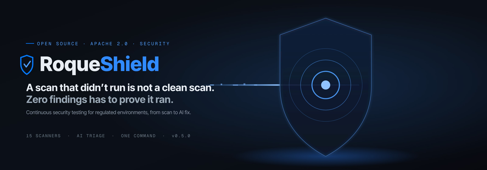
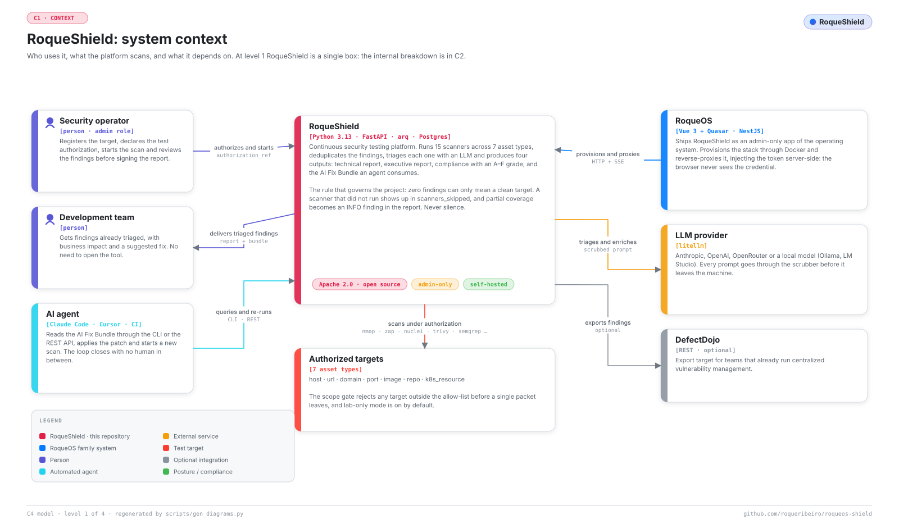
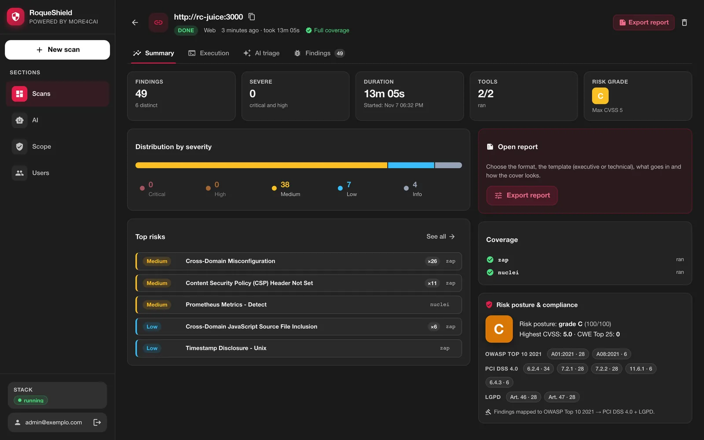
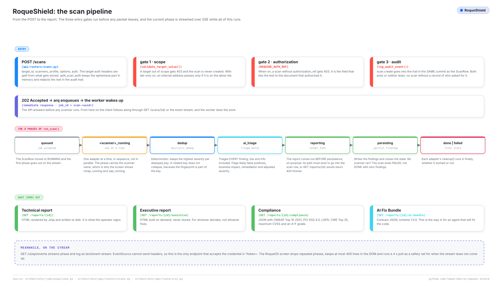
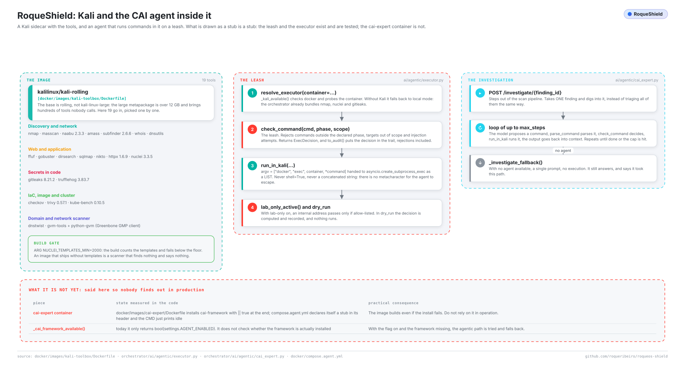
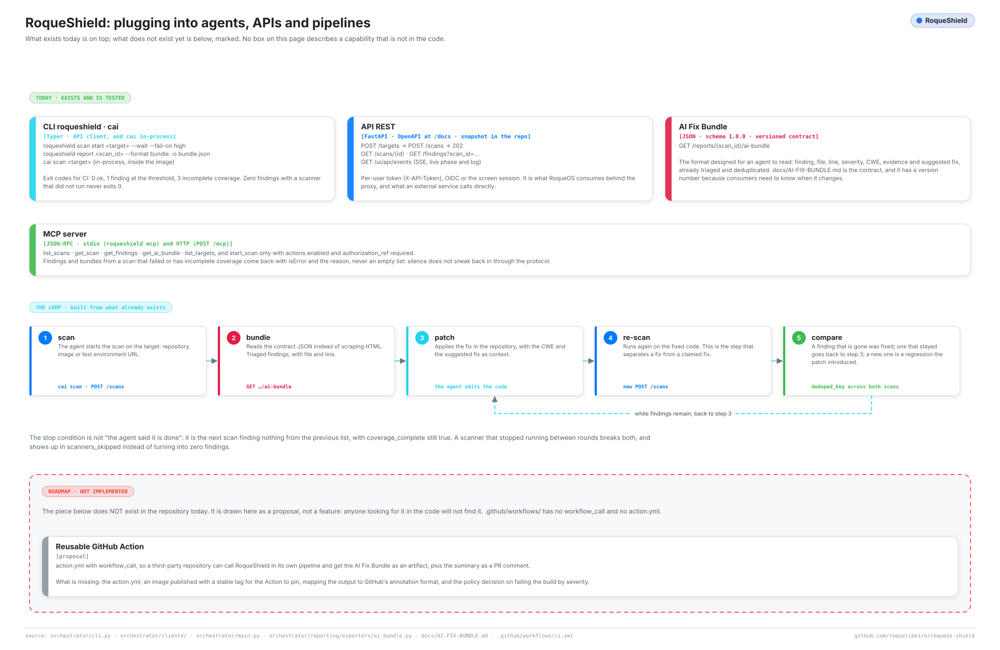
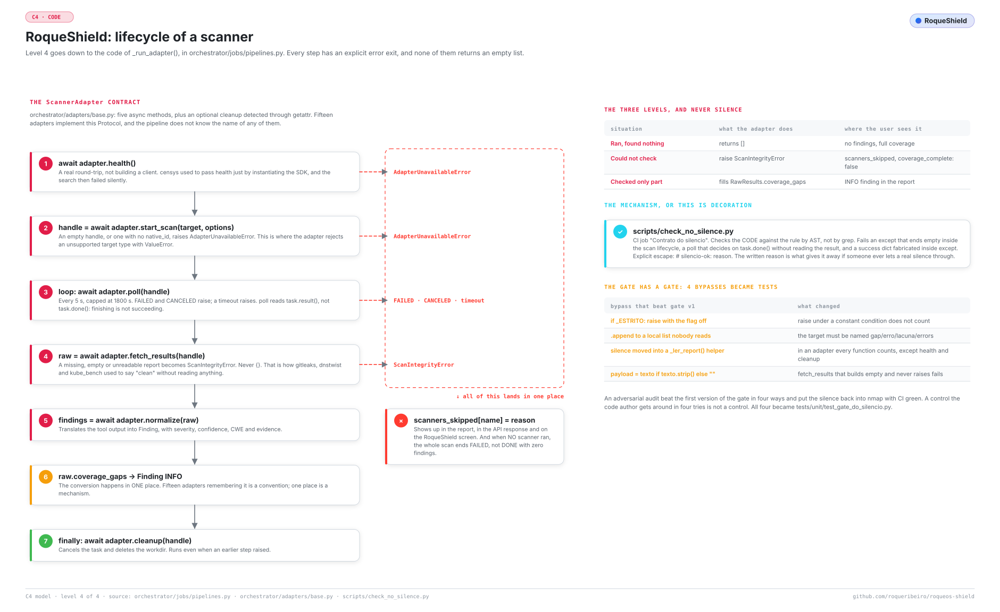
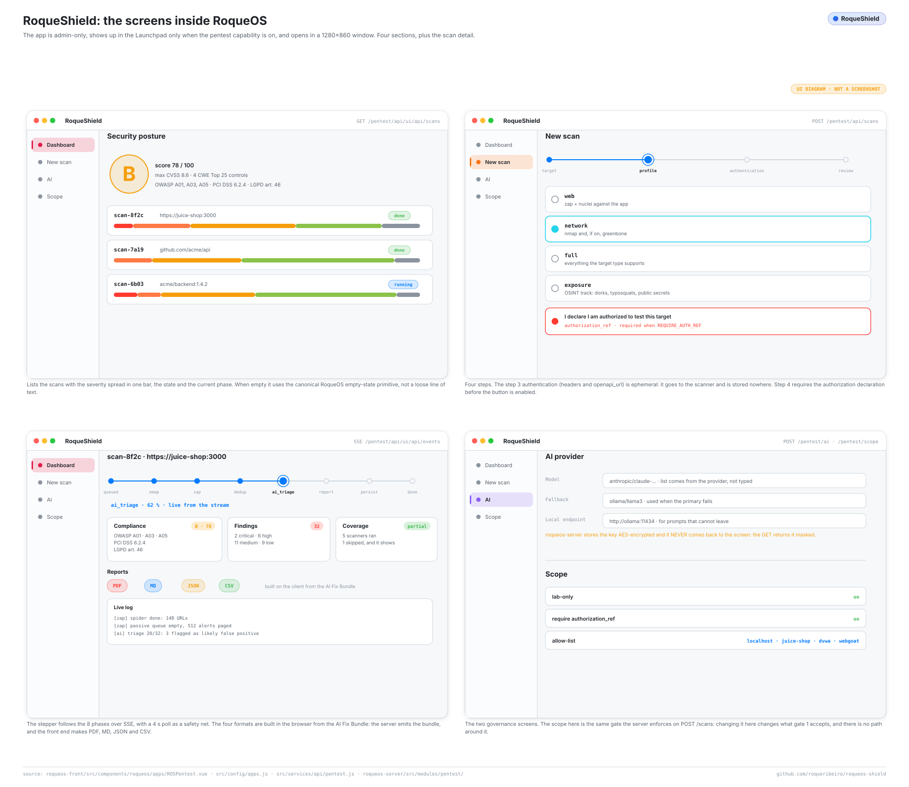

<p align="center">
  <a href="https://github.com/roqueribeiro/roqueos-shield"></a>
</p>

<p align="center">
  <a href="https://github.com/roqueribeiro/roqueos-shield/actions/workflows/ci.yml"></a>
  <a href="https://github.com/roqueribeiro/roqueos-shield/tags"></a>
  <a href="LICENSE"></a>
  
  
  
  <a href="#project-status"></a>
</p>

<p align="center">
  <a href="docs/GETTING-STARTED.md"><b>Get started</b></a> ·
  <a href="docs/INTEGRATIONS.md"><b>Integrations</b></a> ·
  <a href="docs/INDEX.md">Documentation</a> ·
  <a href="docs/REFERENCE.md">Reference</a> ·
  <a href="docs/ARCHITECTURE.md">Architecture</a> ·
  <a href="README.pt-BR.md">Português (Brasil)</a>
</p>

---

> [!TIP]
> **New here?** [GETTING-STARTED.md](docs/GETTING-STARTED.md) takes you from one command to a finished Web scan of a lab target, with the screens you should see at each step. A first scan takes 8 to 13 minutes.

**RoqueShield runs fifteen scanners behind one adapter contract, triages what they find with an LLM over scrubbed evidence, lets an agent confirm a finding inside a Kali sidecar under a leash, and hands the fix to another agent as an AI Fix Bundle.** It installs as one container with a web UI, a REST API, a CLI and an MCP server, and it refuses to call a scan clean when a scanner did not actually run.

> [!NOTE]
> **Version 0.5.1, alpha.** Everything described here exists and has tests; what was measured, when and on what is in [Project status](#project-status). Interfaces and the database schema may still break between minor versions. Use against real assets only with written authorization, under the controls in [SECURITY.md](SECURITY.md).

<picture>
  <source media="(prefers-color-scheme: dark)" srcset="docs/assets/diagramas/contexto.en.escuro.svg">
  
</picture>

## Contents

- [Get started in one minute](#get-started-in-one-minute)
- [Why it exists](#why-it-exists)
- [How it works](#how-it-works)
- [The leash is the part that matters](#the-leash-is-the-part-that-matters)
- [Plugging it into agents, APIs and pipelines](#plugging-it-into-agents-apis-and-pipelines)
- [Scanners that ship](#scanners-that-ship)
- [What keeps it honest](#what-keeps-it-honest)
- [Inside RoqueOS](#inside-roqueos)
- [Project status](#project-status)
- [Known limits](#known-limits)
- [Documentation](#documentation)
- [Contributing, security and license](#contributing-security-and-license)
- [Languages](#languages)

## Get started in one minute

On macOS, Linux or Windows WSL, with Docker running:

```bash
curl -fsSL https://raw.githubusercontent.com/roqueribeiro/roqueos-shield/main/install.sh | sh
```

It checks Docker and its memory, starts one container on `127.0.0.1`, waits until it is healthy and opens your browser at `http://localhost:8080` with the first-run code already filled in. You pick an e-mail and a password, then **New scan**, the address, and only what you are authorized to test. To test an app on your own machine, use `host.docker.internal` instead of `localhost`: the screen explains it and swaps it for you.

That container is the whole product: the engine, the web UI, the API with Swagger, the MCP server, Redis and OWASP ZAP. Nothing else to install.

Rather read what will run first? [install.sh](install.sh) is short and commented. The step-by-step path, with what you should see on screen, is [GETTING-STARTED.md](docs/GETTING-STARTED.md); updating, backup, the production compose and the manual `docker run` are in [OPERATIONS.md](docs/OPERATIONS.md).



**Data sovereignty is a switch, not a hope.** With a local model (Ollama or LM Studio) and `ALLOW_CLOUD_FALLBACK=false`, a failing local model fails the triage instead of sending your findings to a cloud provider. Without any model configured, the scan still runs, without triage.

## Why it exists

A broken scanner and a clean target produce **exactly the same output: zero findings.** In a report that goes to a bank's audit committee, that is the only difference that matters, and it was the difference this tool could not make.

Nine adapters had the same shape of bug: an exception swallowed, an empty report read as `{}`, a `poll()` that called a dead process "done", a scanner handed a URL where it expected a directory. Every one of them closed the scan with zero findings and a green checkmark.

So the project has one governing rule, and two CI gates that execute it:

> **Zero findings here: does it mean *clean*, or does it mean *did not run*? If there is no way to tell, a signal is missing.**

Everything else in this repository exists to serve that sentence.

## How it works

| Stage | What happens | Where |
| --- | --- | --- |
| **Scan** | The right tool for the target type. Semgrep reads source; Gitleaks and Trufflehog hunt secrets; Trivy covers CVEs in images and dependencies; Checkov covers IaC; ZAP and Nuclei probe the running app; Nmap and Greenbone cover the network. | `orchestrator/adapters/` |
| **Deduplicate** | Deterministic merge by `deduped_key`, keeping the highest severity. A rotated credential does not collapse into one finding, because the fingerprint discriminates. | `orchestrator/domain/dedup.py` |
| **Triage** | An LLM re-ranks severity, flags likely false positives, maps to OWASP and CWE and proposes remediation, over evidence a PII/PCI scrubber cleaned first. | `orchestrator/ai/analyzer.py` |
| **Investigate** | On demand, an agent takes one finding and tries to **confirm** it: plans real commands for the Kali sidecar, reads the output, decides the next step. Every command passes the leash first. | `orchestrator/ai/agentic/` |
| **Hand off** | An **AI Fix Bundle** (stable IDs, priority, file and line, tech-stack hints, verification steps) that Claude Code, Cursor or a CI step consumes to propose the patch. | `orchestrator/reporting/exporters/` |

<picture>
  <source media="(prefers-color-scheme: dark)" srcset="docs/assets/diagramas/esteira.en.escuro.svg">
  
</picture>

Containers, components, the adapter lifecycle and the deployment are in [ARCHITECTURE.md](docs/ARCHITECTURE.md).

## The leash is the part that matters

If you plan to point this at anything real, read this section first.

The agent's scope is **not a sentence in a prompt.** Prompts do not constrain a process that has a shell. It is code in [`orchestrator/ai/agentic/executor.py`](orchestrator/ai/agentic/executor.py), checked before every command:

- an allowlist of binaries per phase, and for `curl` an allowlist of options;
- every host, URL, IP and path in the **whole argv** must be the target itself, checked by the same validator the scanners use (loopback, cloud metadata and other internal ranges are refused even if a name on the allowlist resolves to them);
- `argv` passed as a **list** to `asyncio.create_subprocess_exec`, never a shell, so there is no metacharacter to escape;
- flags that read or write files, redirect the connection or run scripts are refused, and the command runs with a minimal environment and a hard timeout.

On top of that, live execution is **off by default**: with `AGENT_LIVE_EXECUTION=false` the agent only plans and audits. Turned on, running for real (`dry_run=false`) still requires an admin. Every decision, including every refusal, goes to the audit trail.

<picture>
  <source media="(prefers-color-scheme: dark)" srcset="docs/assets/diagramas/agente-kali.en.escuro.svg">
  
</picture>

**Where the agent came from**, said here so nobody has to dig through the history: the agents started on top of [CAI, the Cybersecurity AI framework](https://github.com/aliasrobotics/cai). Today the loop is this project's own: `litellm` plus the executor above. The `agentic` extra that installed `cai-framework` was removed on 2026-10-23, because its latest release (0.5.10) carries GHSA-4996-996j-2m9r and pinned `openai==1.75`, which held `litellm` on a vulnerable version; nothing imports the package anymore. The `cai-expert` container is what is left of that period, and nothing in the pipeline calls it.

## Plugging it into agents, APIs and pipelines

Three surfaces exist today, and they are enough to close the loop scan, fix, re-scan without a human in the middle:

| Surface | Entry point | Good for |
| --- | --- | --- |
| **CLI** | `roqueshield scan start … --wait --fail-on high` | a CI step, or an agent that already has a shell |
| **REST** | OpenAPI at `/docs` (snapshot in [`docs/openapi.json`](docs/openapi.json)), SSE at `/ui/api/events` | a service integrating over the network |
| **MCP** | `roqueshield mcp` (stdio) and `POST /mcp` (HTTP) | Claude Code, Claude Desktop, Cursor |
| **AI Fix Bundle** | `GET /reports/{scan_id}/ai-bundle`, schema `1.0.0` | the agent that writes the patch |

<picture>
  <source media="(prefers-color-scheme: dark)" srcset="docs/assets/diagramas/integracoes.en.escuro.svg">
  
</picture>

The stopping condition is not "the agent said it was done". It is the **next scan** not finding what the previous one found, with `coverage_complete` still true. A scanner that stopped running between rounds invalidates both, and shows up in `scanners_skipped` instead of turning into zero findings. A reusable GitHub Action does not exist yet. Details, commands and the bundle contract: [INTEGRATIONS.md](docs/INTEGRATIONS.md) and [AI-FIX-BUNDLE.md](docs/AI-FIX-BUNDLE.md).

## Scanners that ship

Fifteen adapters implement one `ScannerAdapter` Protocol. Nine are built by the scan factory; four more only by the OSINT trail (which also runs Gitleaks and Trufflehog); two are implemented and tested but not wired.

| Adapter | Scanner | Type | Wired through |
| --- | --- | --- | --- |
| `semgrep_adapter` | Semgrep | **SAST**: reads the source | scan factory |
| `nmap_adapter` | Nmap | Network | scan factory |
| `zap_adapter` | OWASP ZAP | Web app (DAST) | scan factory |
| `nuclei_adapter` | Nuclei | Templated vulnerability scan | scan factory |
| `trivy_adapter` | Trivy | Container, IaC, filesystem | scan factory |
| `checkov_adapter` | Checkov | IaC misconfiguration | scan factory |
| `gitleaks_adapter` | Gitleaks | Secret scan | scan factory and OSINT |
| `trufflehog_adapter` | Trufflehog | Verified-secret scan | scan factory and OSINT |
| `greenbone_adapter` | Greenbone / OpenVAS | Network vulnerabilities | scan factory |
| `dnstwist_adapter` | dnstwist | Typosquatting | OSINT |
| `subdomain_takeover_adapter` | subfinder, httpx, nuclei | Subdomain takeover | OSINT |
| `shodan_adapter` | Shodan | Internet exposure | OSINT |
| `github_exposure_adapter` | GitHub Search | Code and secret leaks | OSINT |
| `censys_adapter` | Censys | Internet exposure | **not wired** |
| `kube_bench_adapter` | kube-bench | CIS Kubernetes | **not wired** |

The last two are honest bookkeeping: implemented and unit-tested, and **no production path constructs them today**. Which scanners each profile runs, and the options each one accepts: [REFERENCE.md](docs/REFERENCE.md). Adding one: [EXTENDING.md](docs/EXTENDING.md).

**SAST works with egress closed.** Semgrep's `--config auto` is incompatible with the `--metrics off` this project runs for data sovereignty, and `p/...` packs are downloaded on every scan, which silently yields **zero rules** on a restricted network. The image ships the `semgrep-rules` set (Semgrep Rules License v1.0, see [NOTICE](NOTICE)) at `/opt/semgrep-rules`, pinned by commit and validated at build time. Nuclei gets the same treatment from the other side: the image build counts the templates and **fails below 2000**.

## What keeps it honest

| Situation | What the adapter does | What the report says |
| --- | --- | --- |
| Ran, found nothing | returns `[]` | no findings, coverage complete |
| Could not verify | raises `ScanIntegrityError` | listed in `scanners_skipped`, `coverage_complete: false` |
| Verified only in part | fills `RawResults.coverage_gaps` | an **INFO** finding naming the gap |

<picture>
  <source media="(prefers-color-scheme: dark)" srcset="docs/assets/diagramas/codigo.en.escuro.svg">
  
</picture>

Two CI gates hold the two halves of that promise, and **both were validated by mutation testing** (breaking the code on purpose and confirming the gate fails):

- **`silencio`** ([`scripts/check_no_silence.py`](scripts/check_no_silence.py)) parses the adapters' AST and rejects an `except` in the scan lifecycle that ends in an empty result, a `poll()` that decides on `task.done()` without reading `task.result()`, and a fabricated success payload. `# silencio-ok: reason` is the only way past, and the written reason is what exposes it if a real silence is ever waved through.
- **`efetividade`** (`tests/integration/test_efetividade_e2e.py`) builds a repository with known flaws (command injection, tainted SQL, `pickle`, MD5, Flask `debug=True`, a public S3 bucket, a `0.0.0.0/0` security group, an unencrypted volume), runs the whole pipeline and requires a real finding from every layer, while checking that a missing scanner shows up as skipped.

**And the gate has a gate.** An adversarial audit bypassed the first version four different ways and reintroduced silence into the nmap adapter with CI green. The four became `tests/unit/test_gate_do_silencio.py`, and the gate was hardened against each. The full rule, with the nine historical cases behind it, is in [`.claude/rules/60-contrato-do-silencio.md`](.claude/rules/60-contrato-do-silencio.md) (Portuguese).

## Inside RoqueOS

RoqueShield is also an app inside [RoqueOS](https://roqueos.com.br): admin-only, container-backed, with a live scan stepper over SSE, guided AI-provider configuration, an immutable audit trail and encrypted secrets. The RoqueOS server provisions the stack over Docker and reverse-proxies the API, injecting the service token on the server side, so **the browser never sees a credential.**

<picture>
  <source media="(prefers-color-scheme: dark)" srcset="docs/assets/diagramas/telas.en.escuro.svg">
  
</picture>

## Project status

| Item | Status | How it was measured |
| --- | --- | --- |
| Test suite (`pytest`) | **610 pass, 0 fail**, 8 skipped | Linux, Python 3.13, 2026-11-08 |
| Continuous integration | green on `main`: lint, types, tests, the silence and effectiveness gates, docs, diagrams, both images build, the standalone UI end to end | GitHub Actions on every pull request |
| Published images | `v0.5.1` and `v0.5.1-standalone`, amd64 and arm64, Trivy clean of CRITICAL/HIGH with a fix | `scripts/release-docker.sh`, 2026-11-08 |
| One-command install and first run | installer, first-run code, allowing a lab target, a Web scan of OWASP Juice Shop (49 findings, 8m35s to 13m), the four result tabs, the PDF, `--update` keeping data and port | macOS, release candidate image, 2026-11-07 |
| Inside RoqueOS | RoqueOS server 1.37.3, which deploys `v0.5.1`, is live on the RoqueOS servers | `/health` answering 1.37.3 on each one, 2026-11-08 |
| Every security fix of the 0.5.1 review | each with a test that fails when the fix is removed (mutation tested) | [CHANGELOG.md](CHANGELOG.md) |
| Installer on Linux desktops and Windows WSL | **not run on a real machine** | the browser opening uses `xdg-open` and `wslview`/`explorer.exe`, read in code only |

There is no compatibility promise between minor versions yet.

## Known limits

- **The CLI help and the API's error messages are in Portuguese.** The UI and the documentation are in English and Brazilian Portuguese.
- **Inside the standalone container, every process runs as the same user.** Isolation between the engine, ZAP and Redis is per process, not per user; see [SECURITY.md](SECURITY.md).
- **The agent's leash is defense in depth, not a sandbox.** Turn on `AGENT_LIVE_EXECUTION` only in an isolated environment.
- **Nuclei is the slow step**: about 8 minutes on Juice Shop.
- **Two adapters are not wired** (Censys, kube-bench), and PDF rendering on the server (`render_pdf()`) has no caller: the PDF in the UI is built in the browser.

## Documentation

Everything starts at [docs/INDEX.md](docs/INDEX.md). Every document exists in English and Brazilian Portuguese.

| I want to... | Read |
| --- | --- |
| Install it and run a first scan | [GETTING-STARTED.md](docs/GETTING-STARTED.md) |
| Run it day to day or in production | [OPERATIONS.md](docs/OPERATIONS.md) |
| Understand a failure | [WHEN-IT-BREAKS.md](docs/WHEN-IT-BREAKS.md) |
| See how it is built | [ARCHITECTURE.md](docs/ARCHITECTURE.md) |
| Look up a command, route, variable or option | [REFERENCE.md](docs/REFERENCE.md) |
| Plug it into an agent or a pipeline | [INTEGRATIONS.md](docs/INTEGRATIONS.md) and [AI-FIX-BUNDLE.md](docs/AI-FIX-BUNDLE.md) |
| Know what it protects | [THREAT-MODEL.md](docs/THREAT-MODEL.md) |
| Work on the code | [DEVELOPMENT.md](docs/DEVELOPMENT.md), [TESTING.md](docs/TESTING.md), [EXTENDING.md](docs/EXTENDING.md) |
| Find a term | [GLOSSARY.md](docs/GLOSSARY.md) |

**A note on the name.** The product is **RoqueShield**, the image is `roqueribeiro1988/roqueos-shield` and the client is `roqueshield`. Some internals still carry the old `cai` name: the Python package (`cai-orchestrator`), the in-process developer command `cai`, and the `cai-` prefix of the containers in the development compose. RoqueOS installations reference those names, so they change only with a migration path.

## Contributing, security and license

Issues and pull requests are welcome: read [CONTRIBUTING.md](CONTRIBUTING.md) and the [Code of Conduct](CODE_OF_CONDUCT.md) first. Security reports go through the private channel in [SECURITY.md](SECURITY.md), never a public issue.

Apache License 2.0: see [LICENSE](LICENSE) and [NOTICE](NOTICE). RoqueShield bundles or invokes third-party software under their own licenses, listed in `NOTICE`.

## Languages

This README and every document under [`docs/`](docs/INDEX.md) exist in English (the main version) and [Brazilian Portuguese](README.pt-BR.md).
