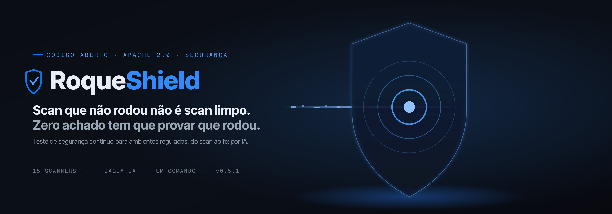
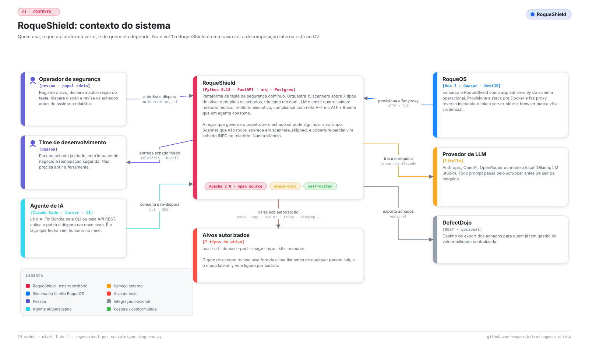
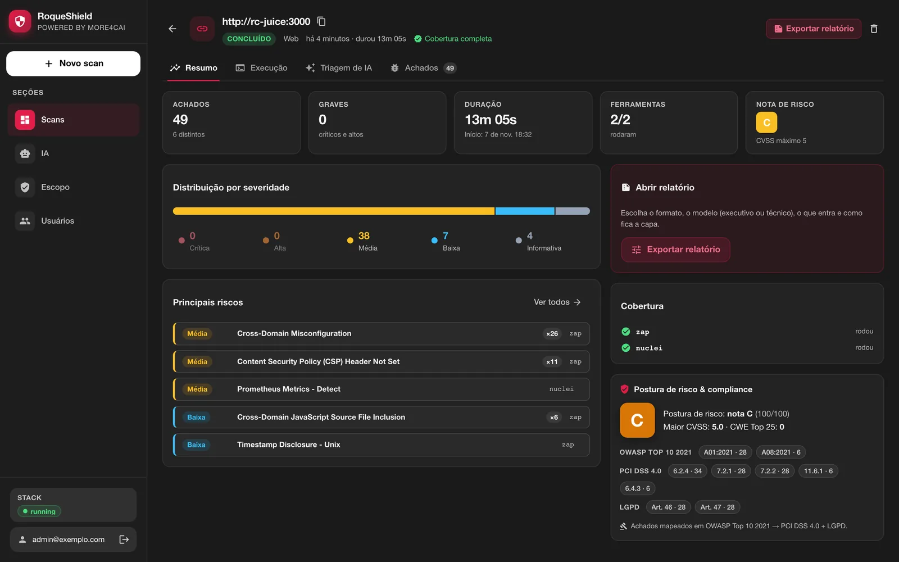
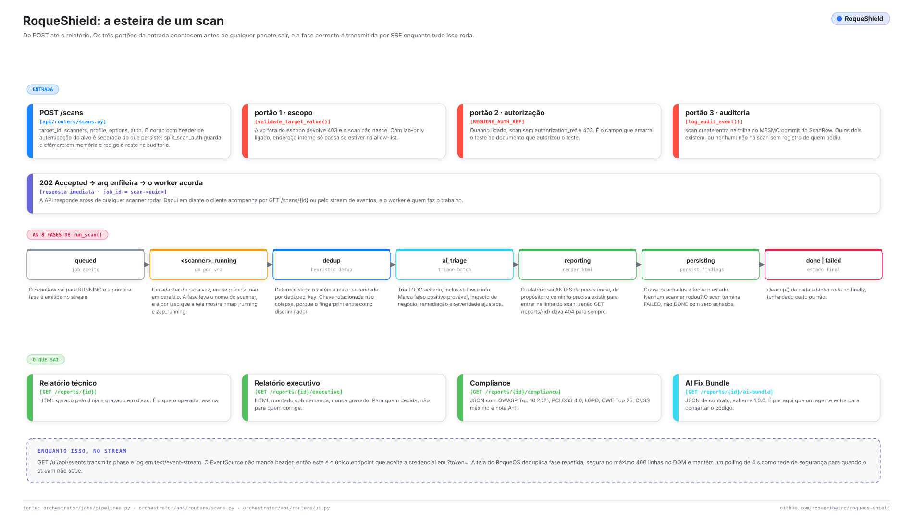
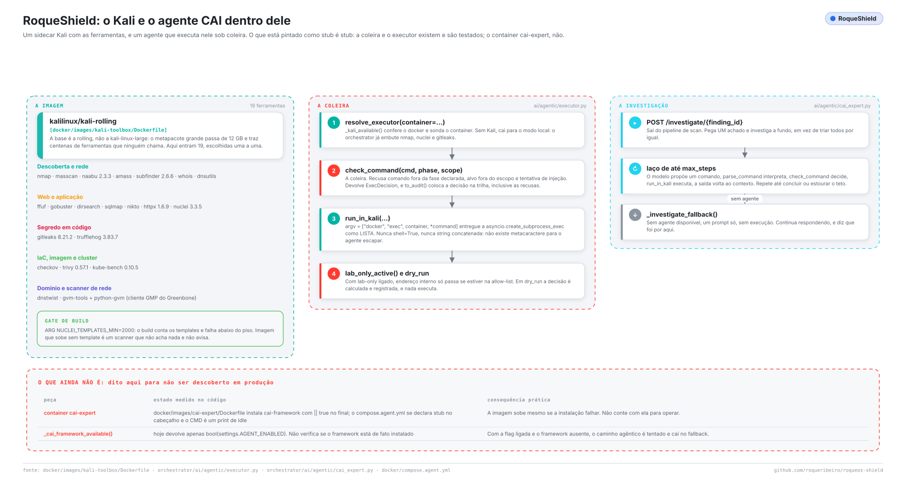
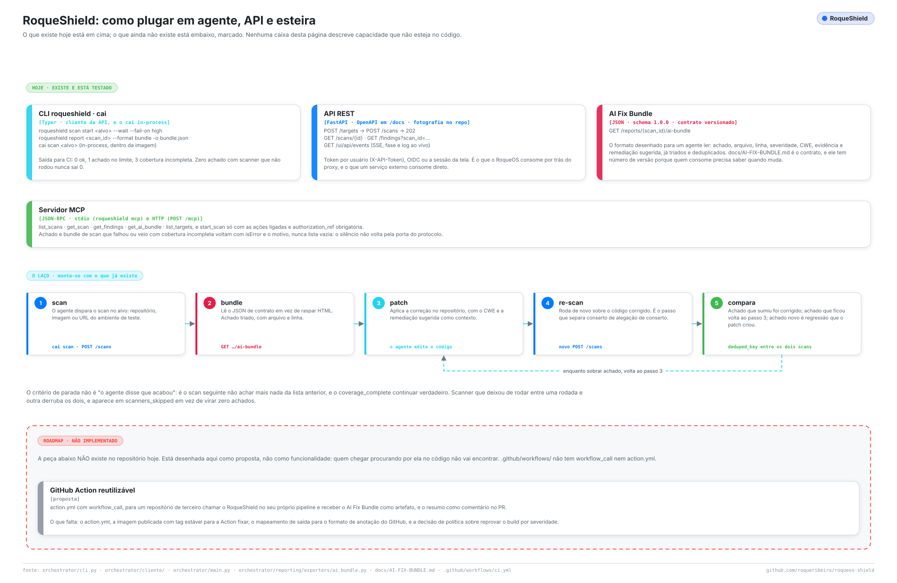
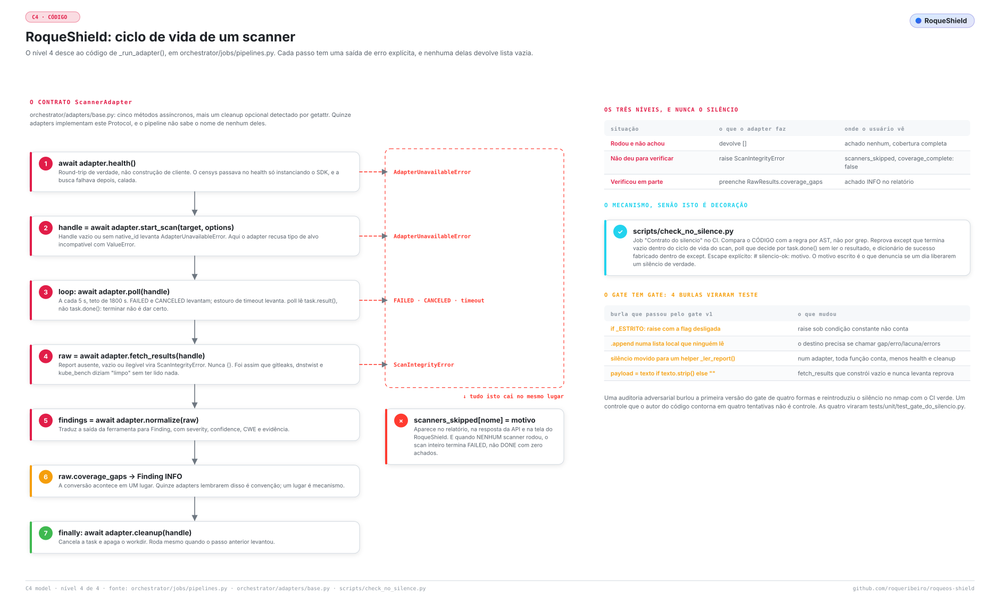
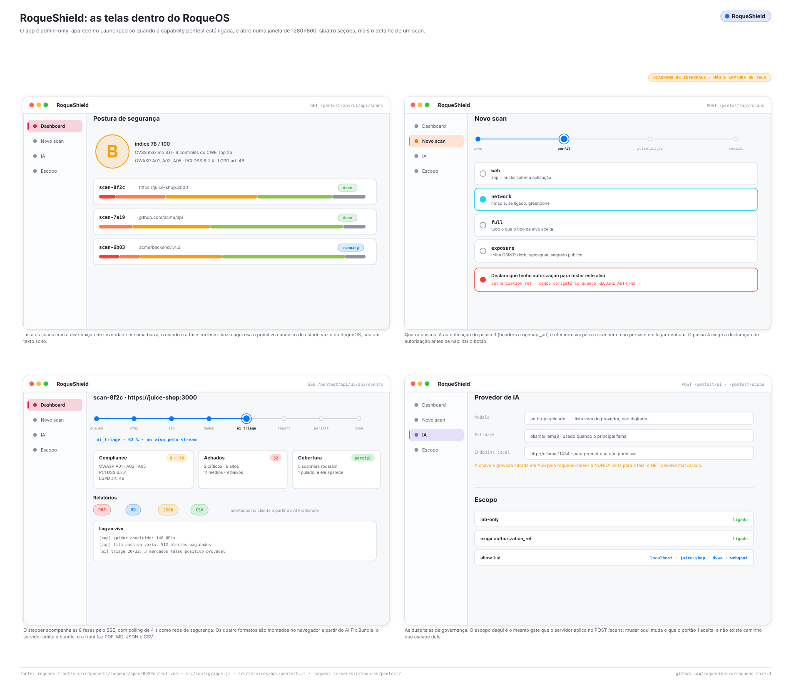

<p align="center">
  <a href="https://github.com/roqueribeiro/roqueos-shield"></a>
</p>

<p align="center">
  <a href="https://github.com/roqueribeiro/roqueos-shield/actions/workflows/ci.yml"></a>
  <a href="https://github.com/roqueribeiro/roqueos-shield/tags"></a>
  <a href="LICENSE"></a>
  
  
  
  <a href="#estado-do-projeto"></a>
</p>

<p align="center">
  <a href="docs/pt-BR/COMECAR.md"><b>Começar</b></a> ·
  <a href="docs/pt-BR/INTEGRACOES.md"><b>Integrações</b></a> ·
  <a href="docs/pt-BR/INDEX.md">Documentação</a> ·
  <a href="docs/pt-BR/REFERENCIA.md">Referência</a> ·
  <a href="docs/pt-BR/ARQUITETURA.md">Arquitetura</a> ·
  <a href="README.md">English</a>
</p>

---

> [!TIP]
> **Chegou agora?** O [COMECAR.md](docs/pt-BR/COMECAR.md) leva de um comando a um scan Web terminado num alvo de laboratório, com as telas que você deve ver em cada passo. Um primeiro scan leva de 8 a 13 minutos.

**O RoqueShield roda quinze scanners atrás de um contrato de adapter, faz a triagem do que eles acham com um LLM sobre evidência higienizada, deixa um agente confirmar o achado dentro de um sidecar Kali sob coleira, e entrega a correção a outro agente como um AI Fix Bundle.** Ele se instala como um container só, com tela web, API REST, CLI e servidor MCP, e se recusa a chamar de limpo um scan em que um scanner não rodou de verdade.

> [!NOTE]
> **Versão 0.5.1, alpha.** Tudo o que está descrito aqui existe e tem teste; o que foi medido, quando e em quê está em [Estado do projeto](#estado-do-projeto). Interfaces e o schema do banco ainda podem quebrar entre versões menores. Use contra ativo real só com autorização por escrito, sob os controles do [SECURITY.md](SECURITY.md) (em inglês).

<picture>
  <source media="(prefers-color-scheme: dark)" srcset="docs/assets/diagramas/contexto.escuro.svg">
  
</picture>

## Sumário

- [Começar em um minuto](#começar-em-um-minuto)
- [Por que existe](#por-que-existe)
- [Como funciona](#como-funciona)
- [A coleira é a parte que importa](#a-coleira-é-a-parte-que-importa)
- [Ligando em agentes, APIs e esteiras](#ligando-em-agentes-apis-e-esteiras)
- [Os scanners que vêm junto](#os-scanners-que-vêm-junto)
- [O que mantém ele honesto](#o-que-mantém-ele-honesto)
- [Dentro do RoqueOS](#dentro-do-roqueos)
- [Estado do projeto](#estado-do-projeto)
- [Limites conhecidos](#limites-conhecidos)
- [Documentação](#documentação)
- [Contribuir, segurança e licença](#contribuir-segurança-e-licença)
- [Idiomas](#idiomas)

## Começar em um minuto

No macOS, no Linux ou no Windows com WSL, com o Docker rodando:

```bash
curl -fsSL https://raw.githubusercontent.com/roqueribeiro/roqueos-shield/main/install.sh | sh
```

Ele confere o Docker e a memória dele, sobe um container em `127.0.0.1`, espera ficar saudável e abre o navegador em `http://localhost:8080` com o código de primeiro uso já preenchido. Você escolhe um e-mail e uma senha, depois **Novo scan**, o endereço, e só o que você tem autorização para testar. Para testar uma aplicação na sua própria máquina, use `host.docker.internal` no lugar de `localhost`: a tela explica e troca para você.

Esse container é o produto inteiro: o motor, a tela, a API com Swagger, o servidor MCP, o Redis e o OWASP ZAP. Nada mais para instalar.

Prefere ler o que vai rodar antes? O [install.sh](install.sh) é curto e comentado. O caminho passo a passo, com o que você deve ver na tela, é o [COMECAR.md](docs/pt-BR/COMECAR.md); atualizar, backup, o compose de produção e o `docker run` manual estão no [OPERACAO.md](docs/pt-BR/OPERACAO.md).



**Soberania de dados é um interruptor, não uma esperança.** Com um modelo local (Ollama ou LM Studio) e `ALLOW_CLOUD_FALLBACK=false`, um modelo local que falha derruba a triagem em vez de mandar seus achados para um provedor de nuvem. Sem modelo nenhum configurado, o scan roda do mesmo jeito, sem triagem.

## Por que existe

Um scanner quebrado e um alvo limpo produzem **exatamente a mesma saída: zero achados.** Num relatório que vai para o comitê de auditoria de um banco, essa é a única diferença que importa, e era a diferença que esta ferramenta não sabia fazer.

Nove adapters tinham a mesma forma de defeito: exceção engolida, report vazio lido como `{}`, um `poll()` que chamava de "pronto" um processo morto, um scanner recebendo URL onde esperava diretório. Todos fechavam o scan com zero achados e um visto verde.

Então o projeto tem uma regra que governa tudo, e dois gates na CI que a executam:

> **Zero achados aqui: significa *limpo*, ou significa *não rodou*? Se não dá para distinguir, falta um sinal.**

Todo o resto deste repositório existe para servir essa frase.

## Como funciona

| Etapa | O que acontece | Onde |
| --- | --- | --- |
| **Varrer** | A ferramenta certa para o tipo de alvo. Semgrep lê o código; Gitleaks e Trufflehog caçam segredo; Trivy cobre CVE em imagem e dependência; Checkov cobre IaC; ZAP e Nuclei sondam a aplicação rodando; Nmap e Greenbone cobrem a rede. | `orchestrator/adapters/` |
| **Deduplicar** | Junção determinística por `deduped_key`, ficando a severidade mais alta. Uma credencial rotacionada não vira um achado só, porque a impressão digital diferencia. | `orchestrator/domain/dedup.py` |
| **Triar** | Um LLM reclassifica a severidade, marca provável falso positivo, mapeia para OWASP e CWE e propõe remediação, sobre evidência que um scrubber de PII/PCI limpou antes. | `orchestrator/ai/analyzer.py` |
| **Investigar** | Sob demanda, um agente pega um achado e tenta **confirmá-lo**: planeja comandos reais para o sidecar Kali, lê a saída, decide o próximo passo. Todo comando passa pela coleira antes. | `orchestrator/ai/agentic/` |
| **Entregar** | Um **AI Fix Bundle** (IDs estáveis, prioridade, arquivo e linha, dicas de stack, passos de verificação) que o Claude Code, o Cursor ou um passo de CI consome para propor o patch. | `orchestrator/reporting/exporters/` |

<picture>
  <source media="(prefers-color-scheme: dark)" srcset="docs/assets/diagramas/esteira.escuro.svg">
  
</picture>

Containers, componentes, o ciclo de vida do adapter e a implantação estão no [ARQUITETURA.md](docs/pt-BR/ARQUITETURA.md).

## A coleira é a parte que importa

Se você pretende apontar isto para algo real, leia esta seção antes.

O escopo do agente **não é uma frase no prompt.** Prompt não segura um processo que tem shell. É código em [`orchestrator/ai/agentic/executor.py`](orchestrator/ai/agentic/executor.py), conferido antes de cada comando:

- uma lista de binários permitidos por fase, e para o `curl` uma lista de opções permitidas;
- todo host, URL, IP e caminho no **argv inteiro** tem que ser o próprio alvo, conferido pelo mesmo validador que os scanners usam (loopback, metadado de nuvem e outras faixas internas são recusados mesmo que um nome da allowlist resolva para eles);
- o `argv` vai como **lista** para o `asyncio.create_subprocess_exec`, nunca por shell, então não existe metacaractere para escapar;
- flags que leem ou escrevem arquivo, redirecionam a conexão ou rodam script são recusadas, e o comando roda com ambiente mínimo e timeout duro.

Por cima disso, a execução ao vivo vem **desligada**: com `AGENT_LIVE_EXECUTION=false` o agente só planeja e audita. Ligada, executar de verdade (`dry_run=false`) continua exigindo admin. Toda decisão, inclusive cada recusa, vai para a trilha de auditoria.

<picture>
  <source media="(prefers-color-scheme: dark)" srcset="docs/assets/diagramas/agente-kali.escuro.svg">
  
</picture>

**De onde o agente veio**, dito aqui para ninguém precisar cavar o histórico: os agentes começaram em cima do [CAI, o framework Cybersecurity AI](https://github.com/aliasrobotics/cai). Hoje o laço é deste projeto: `litellm` mais o executor acima. O extra `agentic` que instalava o `cai-framework` saiu em 23/10/2026, porque a última versão dele (0.5.10) carrega a GHSA-4996-996j-2m9r e fixava `openai==1.75`, o que prendia o `litellm` numa versão vulnerável; nada importa o pacote mais. O container `cai-expert` é o que sobrou daquela época, e nada na esteira chama ele.

## Ligando em agentes, APIs e esteiras

Três superfícies existem hoje, e elas bastam para fechar o laço varrer, corrigir, varrer de novo sem humano no meio:

| Superfície | Ponto de entrada | Serve para |
| --- | --- | --- |
| **CLI** | `roqueshield scan start … --wait --fail-on high` | um passo de CI, ou um agente que já tem shell |
| **REST** | OpenAPI em `/docs` (fotografia em [`docs/openapi.json`](docs/openapi.json)), SSE em `/ui/api/events` | um serviço integrando pela rede |
| **MCP** | `roqueshield mcp` (stdio) e `POST /mcp` (HTTP) | Claude Code, Claude Desktop, Cursor |
| **AI Fix Bundle** | `GET /reports/{scan_id}/ai-bundle`, schema `1.0.0` | o agente que escreve o patch |

<picture>
  <source media="(prefers-color-scheme: dark)" srcset="docs/assets/diagramas/integracoes.escuro.svg">
  
</picture>

A condição de parada não é "o agente disse que terminou". É o **próximo scan** não achar o que o anterior achou, com `coverage_complete` ainda verdadeiro. Um scanner que parou de rodar entre as rodadas invalida as duas, e aparece em `scanners_skipped` em vez de virar zero achados. Uma GitHub Action reutilizável ainda não existe. Detalhes, comandos e o contrato do bundle: [INTEGRACOES.md](docs/pt-BR/INTEGRACOES.md) e [AI-FIX-BUNDLE.md](docs/pt-BR/AI-FIX-BUNDLE.md).

## Os scanners que vêm junto

Quinze adapters implementam um mesmo Protocol `ScannerAdapter`. Nove são construídos pela fábrica do scan; mais quatro só pela trilha OSINT (que também roda Gitleaks e Trufflehog); dois estão implementados e testados mas não ligados.

| Adapter | Scanner | Tipo | Ligado por |
| --- | --- | --- | --- |
| `semgrep_adapter` | Semgrep | **SAST**: lê o código | fábrica do scan |
| `nmap_adapter` | Nmap | Rede | fábrica do scan |
| `zap_adapter` | OWASP ZAP | Aplicação web (DAST) | fábrica do scan |
| `nuclei_adapter` | Nuclei | Varredura por templates | fábrica do scan |
| `trivy_adapter` | Trivy | Container, IaC, sistema de arquivos | fábrica do scan |
| `checkov_adapter` | Checkov | IaC mal configurado | fábrica do scan |
| `gitleaks_adapter` | Gitleaks | Segredos | fábrica do scan e OSINT |
| `trufflehog_adapter` | Trufflehog | Segredos verificados | fábrica do scan e OSINT |
| `greenbone_adapter` | Greenbone / OpenVAS | Vulnerabilidades de rede | fábrica do scan |
| `dnstwist_adapter` | dnstwist | Typosquatting | OSINT |
| `subdomain_takeover_adapter` | subfinder, httpx, nuclei | Tomada de subdomínio | OSINT |
| `shodan_adapter` | Shodan | Exposição na internet | OSINT |
| `github_exposure_adapter` | GitHub Search | Vazamento de código e segredo | OSINT |
| `censys_adapter` | Censys | Exposição na internet | **não ligado** |
| `kube_bench_adapter` | kube-bench | CIS Kubernetes | **não ligado** |

Os dois últimos são contabilidade honesta: implementados e com teste unitário, e **nenhum caminho de produção constrói eles hoje**. Quais scanners cada perfil roda, e as opções que cada um aceita: [REFERENCIA.md](docs/pt-BR/REFERENCIA.md). Para adicionar um: [ESTENDER.md](docs/pt-BR/ESTENDER.md).

**O SAST funciona com a saída de rede fechada.** O `--config auto` do Semgrep é incompatível com o `--metrics off` que este projeto usa por soberania de dados, e os pacotes `p/...` são baixados a cada scan, o que dá **zero regras** em silêncio numa rede restrita. A imagem leva o conjunto `semgrep-rules` (Semgrep Rules License v1.0, veja o [NOTICE](NOTICE)) em `/opt/semgrep-rules`, fixado por commit e validado no build. O Nuclei recebe o mesmo tratamento pelo outro lado: o build da imagem conta os templates e **reprova abaixo de 2000**.

## O que mantém ele honesto

| Situação | O que o adapter faz | O que o relatório diz |
| --- | --- | --- |
| Rodou, não achou nada | devolve `[]` | nenhum achado, cobertura completa |
| Não deu para verificar | levanta `ScanIntegrityError` | listado em `scanners_skipped`, `coverage_complete: false` |
| Verificou só em parte | preenche `RawResults.coverage_gaps` | um achado **INFO** dando nome à lacuna |

<picture>
  <source media="(prefers-color-scheme: dark)" srcset="docs/assets/diagramas/codigo.escuro.svg">
  
</picture>

Dois gates na CI seguram as duas metades dessa promessa, e **os dois foram validados por teste de mutação** (quebrar o código de propósito e confirmar que o gate reprova):

- **`silencio`** ([`scripts/check_no_silence.py`](scripts/check_no_silence.py)) lê a AST dos adapters e recusa um `except` no ciclo do scan que termina em resultado vazio, um `poll()` que decide por `task.done()` sem ler `task.result()`, e um payload de sucesso fabricado. `# silencio-ok: motivo` é a única passagem, e o motivo escrito é o que denuncia se um silêncio de verdade passar um dia.
- **`efetividade`** (`tests/integration/test_efetividade_e2e.py`) monta um repositório com defeitos conhecidos (injeção de comando, SQL por taint, `pickle`, MD5, Flask com `debug=True`, bucket S3 público, security group `0.0.0.0/0`, disco sem cifra), roda a esteira inteira e exige achado real de cada camada, enquanto confere que um scanner ausente aparece como pulado.

**E o gate tem gate.** Uma auditoria adversarial burlou a primeira versão de quatro jeitos e reintroduziu o silêncio no adapter do nmap com a CI verde. As quatro viraram `tests/unit/test_gate_do_silencio.py`, e o gate foi endurecido contra cada uma. A regra inteira, com os nove casos históricos por trás dela, está em [`.claude/rules/60-contrato-do-silencio.md`](.claude/rules/60-contrato-do-silencio.md).

## Dentro do RoqueOS

O RoqueShield também é um app dentro do [RoqueOS](https://roqueos.com.br): só para admin, rodando em container, com acompanhamento do scan ao vivo por SSE, configuração guiada do provedor de IA, trilha de auditoria imutável e segredos cifrados. O servidor do RoqueOS sobe a stack pelo Docker e faz proxy reverso da API, injetando o token de serviço do lado do servidor, então **o navegador nunca vê uma credencial.**

<picture>
  <source media="(prefers-color-scheme: dark)" srcset="docs/assets/diagramas/telas.escuro.svg">
  
</picture>

## Estado do projeto

| Item | Estado | Como foi medido |
| --- | --- | --- |
| Suíte de testes (`pytest`) | **610 passam, 0 falham**, 8 pulados | Linux, Python 3.13, 08/11/2026 |
| Integração contínua | verde na `main`: lint, tipos, testes, os gates de silêncio e efetividade, docs, diagramas, as duas imagens buildando, a tela standalone de ponta a ponta | GitHub Actions em todo pull request |
| Imagens publicadas | `v0.5.1` e `v0.5.1-standalone`, amd64 e arm64, Trivy sem CRITICAL/HIGH com correção | `scripts/release-docker.sh`, 08/11/2026 |
| Instalação em um comando e primeiro uso | instalador, código de primeiro uso, liberar um alvo de laboratório, scan Web no OWASP Juice Shop (49 achados, de 8m35s a 13m), as quatro abas do resultado, o PDF, `--update` mantendo dados e porta | macOS, imagem candidata, 07/11/2026 |
| Dentro do RoqueOS | o servidor do RoqueOS 1.37.3, que implanta a `v0.5.1`, está no ar nos servidores do RoqueOS | `/health` respondendo 1.37.3 em cada um, 08/11/2026 |
| Cada conserto de segurança da revisão da 0.5.1 | cada um com um teste que reprova quando o conserto sai (teste de mutação) | [CHANGELOG.md](CHANGELOG.md) (em inglês) |
| Instalador em Linux com desktop e no Windows WSL | **não rodado numa máquina de verdade** | a abertura do navegador usa `xdg-open` e `wslview`/`explorer.exe`, lida só no código |

Ainda não há promessa de compatibilidade entre versões menores.

## Limites conhecidos

- **A ajuda da CLI e as mensagens de erro da API estão em português.** A tela e a documentação estão em inglês e em português do Brasil.
- **Dentro do container standalone, todos os processos rodam com o mesmo usuário.** O isolamento entre motor, ZAP e Redis é por processo, não por usuário; veja o [SECURITY.md](SECURITY.md).
- **A coleira do agente é defesa em profundidade, não sandbox.** Ligue o `AGENT_LIVE_EXECUTION` só num ambiente isolado.
- **O Nuclei é o passo lento**: uns 8 minutos no Juice Shop.
- **Dois adapters não estão ligados** (Censys, kube-bench), e a renderização de PDF no servidor (`render_pdf()`) não tem quem chame: o PDF da tela é montado no navegador.

## Documentação

Tudo começa no [docs/pt-BR/INDEX.md](docs/pt-BR/INDEX.md). Todo documento existe em inglês e em português do Brasil.

| Quero... | Leia |
| --- | --- |
| Instalar e rodar o primeiro scan | [COMECAR.md](docs/pt-BR/COMECAR.md) |
| Operar no dia a dia ou em produção | [OPERACAO.md](docs/pt-BR/OPERACAO.md) |
| Entender uma falha | [QUANDO-QUEBRA.md](docs/pt-BR/QUANDO-QUEBRA.md) |
| Ver como ele é por dentro | [ARQUITETURA.md](docs/pt-BR/ARQUITETURA.md) |
| Consultar um comando, rota, variável ou opção | [REFERENCIA.md](docs/pt-BR/REFERENCIA.md) |
| Ligar num agente ou numa esteira | [INTEGRACOES.md](docs/pt-BR/INTEGRACOES.md) e [AI-FIX-BUNDLE.md](docs/pt-BR/AI-FIX-BUNDLE.md) |
| Saber o que ele protege | [MODELO-DE-AMEACAS.md](docs/pt-BR/MODELO-DE-AMEACAS.md) |
| Mexer no código | [DESENVOLVIMENTO.md](docs/pt-BR/DESENVOLVIMENTO.md), [CRITERIOS-DE-TESTE.md](docs/pt-BR/CRITERIOS-DE-TESTE.md), [ESTENDER.md](docs/pt-BR/ESTENDER.md) |
| Achar um termo | [GLOSSARIO.md](docs/pt-BR/GLOSSARIO.md) |

**Sobre o nome.** O produto é **RoqueShield**, a imagem é `roqueribeiro1988/roqueos-shield` e o cliente é `roqueshield`. Algumas partes internas ainda levam o nome antigo `cai`: o pacote Python (`cai-orchestrator`), o comando de desenvolvimento `cai`, e o prefixo `cai-` dos containers do compose de desenvolvimento. Instalações do RoqueOS referenciam esses nomes, então eles só mudam com um caminho de migração.

## Contribuir, segurança e licença

Issue e pull request são bem-vindos: leia antes o [CONTRIBUTING.md](docs/pt-BR/CONTRIBUTING.md) e o [Código de Conduta](CODE_OF_CONDUCT.md) (em inglês). Relato de segurança vai pelo canal privado do [SECURITY.md](SECURITY.md), nunca por issue pública.

Apache License 2.0: veja [LICENSE](LICENSE) e [NOTICE](NOTICE). O RoqueShield empacota ou chama software de terceiros sob as licenças deles, listadas no `NOTICE`.

## Idiomas

Este README e todo documento em [`docs/`](docs/pt-BR/INDEX.md) existem em inglês (a versão principal, [README.md](README.md)) e em português do Brasil.
