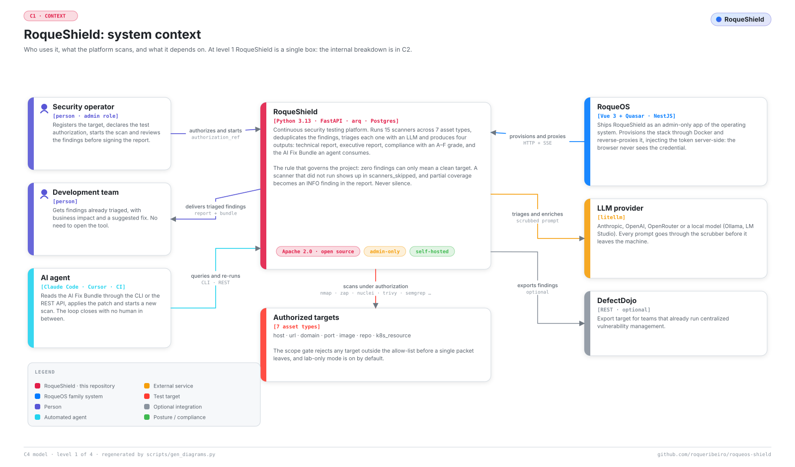
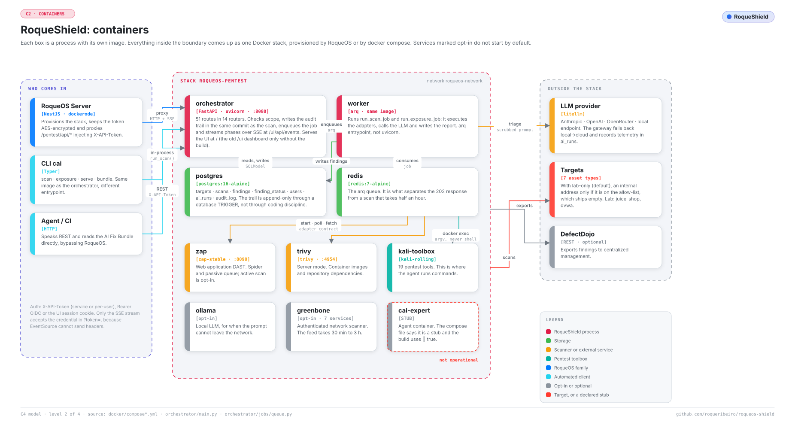
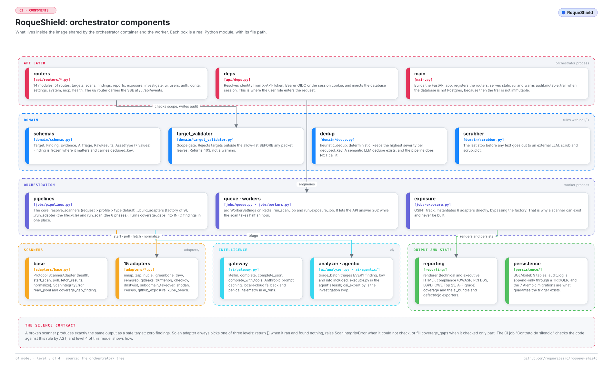
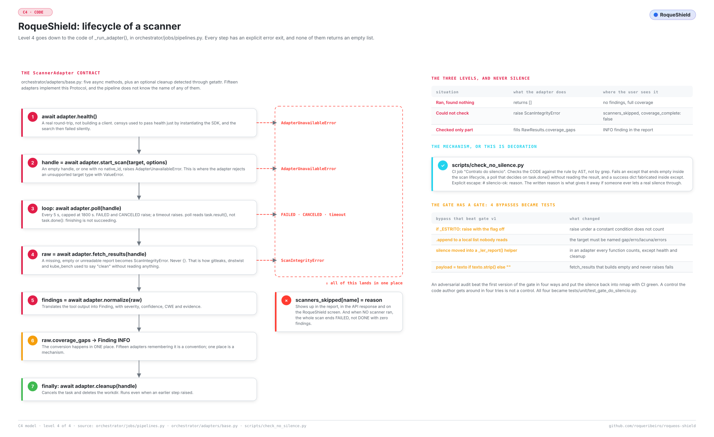
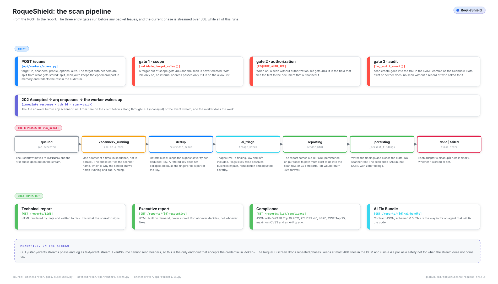
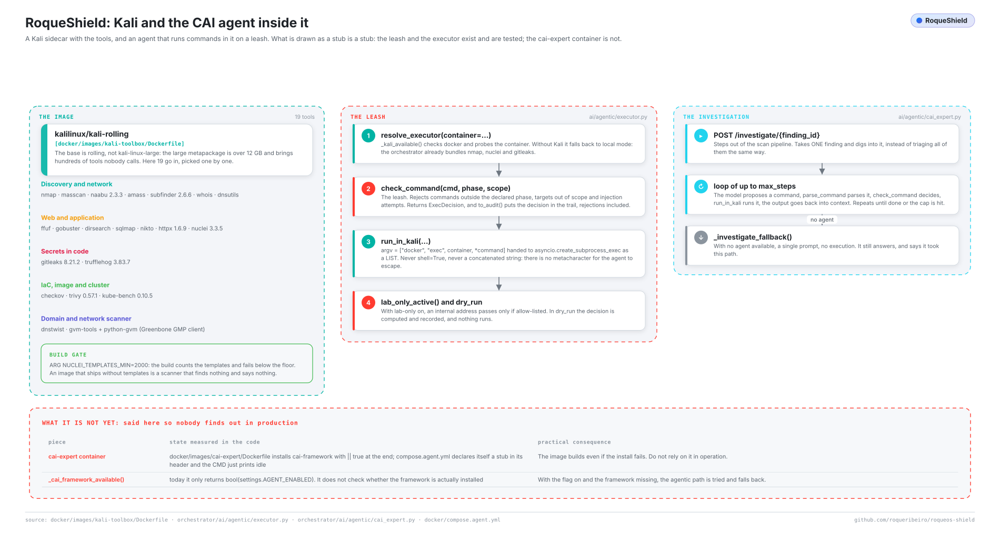
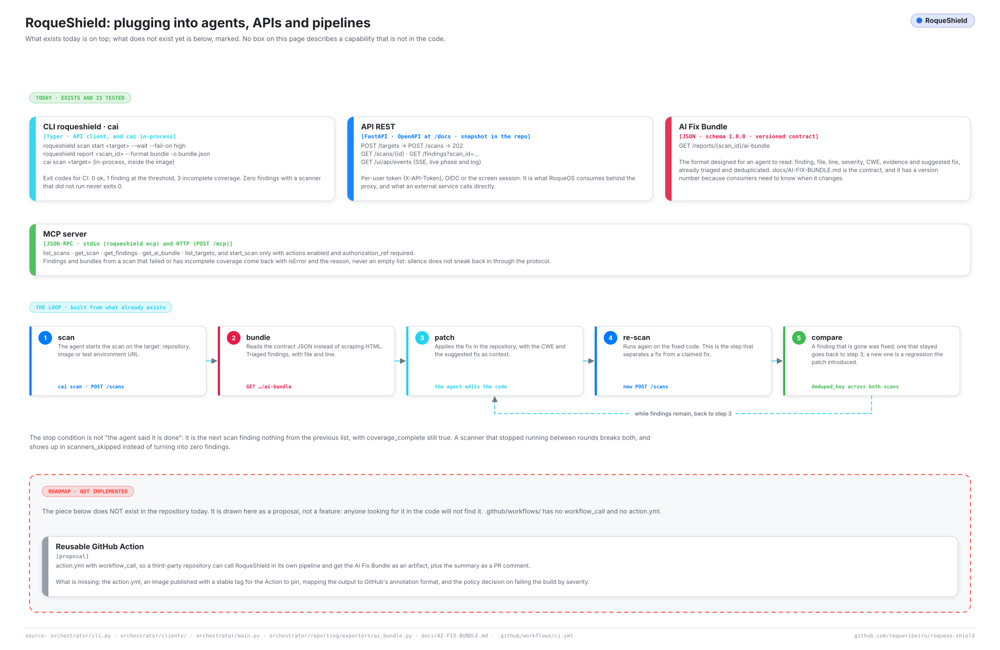
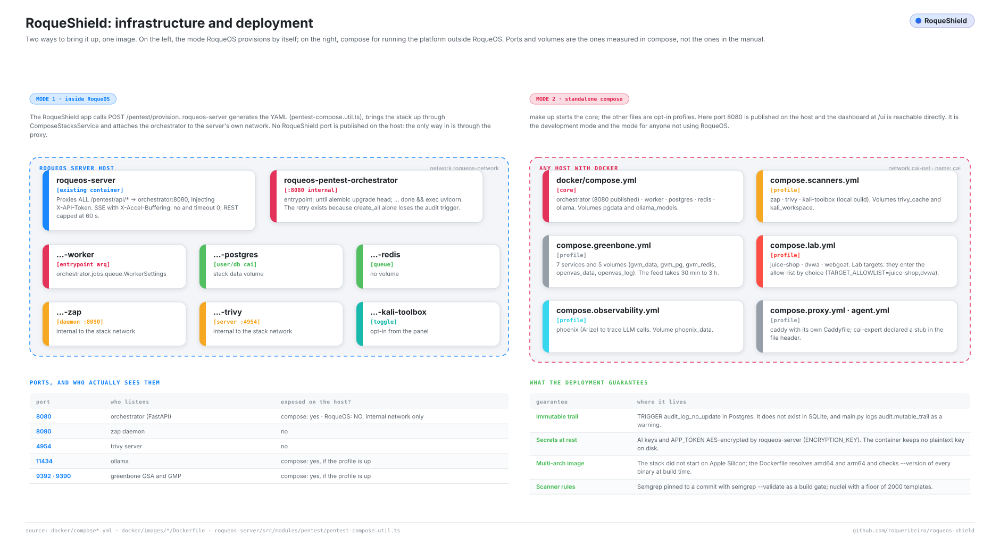
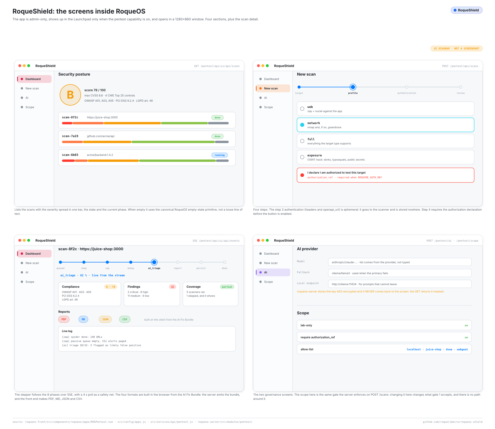
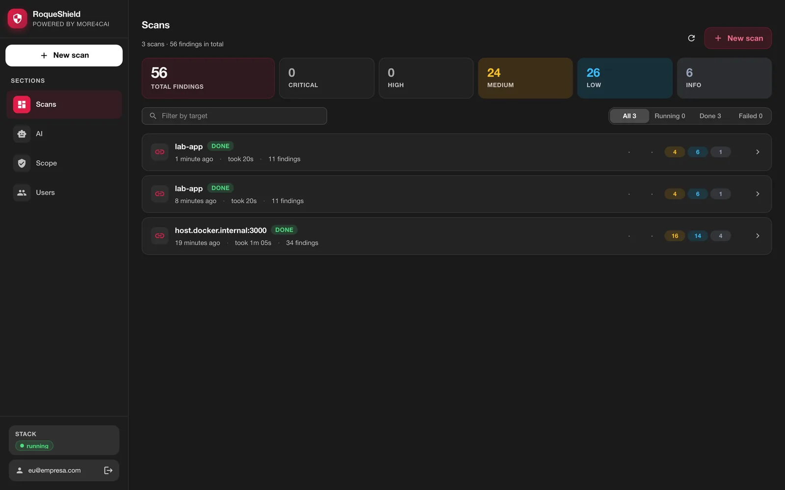

# Architecture

*Also available in [Brazilian Portuguese](pt-BR/ARQUITETURA.md).*

> How RoqueShield is built inside: the processes, the modules, the path of a scan from the `POST` to the report, where each security decision lives and what happens when a scanner fails. For those who will operate, audit, extend or contribute. Every claim here was checked against the code in this repository; where a capability is partial, the text says so.
>
> This document describes the design. For every command, route, field and variable, see the [REFERENCE](REFERENCE.md); to install and run a first scan, [GETTING-STARTED](GETTING-STARTED.md); to add a scanner, [EXTENDING](EXTENDING.md).

A note on names: **RoqueShield** is the product. `cai` is the internal name of the engine and survives in the Python package (`cai-orchestrator`), in the dev containers (`cai-*`) and in the admin CLI (`cai`). The end user CLI is `roqueshield`.

## Table of contents

1. [The idea in one paragraph](#1-the-idea-in-one-paragraph)
2. [Context: who uses it and what it depends on](#2-context-who-uses-it-and-what-it-depends-on)
3. [Containers: the processes](#3-containers-the-processes)
4. [Components: inside the orchestrator image](#4-components-inside-the-orchestrator-image)
5. [The adapter lifecycle and the silence contract](#5-the-adapter-lifecycle-and-the-silence-contract)
6. [The scan pipeline](#6-the-scan-pipeline)
7. [AI triage and the scrubber](#7-ai-triage-and-the-scrubber)
8. [The agent, the Kali sidecar and the leash](#8-the-agent-the-kali-sidecar-and-the-leash)
9. [Integration surfaces](#9-integration-surfaces)
10. [Scope and authorization](#10-scope-and-authorization)
11. [The standalone image and deployment](#11-the-standalone-image-and-deployment)
12. [The product inside RoqueOS](#12-the-product-inside-roqueos)
13. [Security and compliance](#13-security-and-compliance)
14. [Design decisions](#14-design-decisions)
15. [Known limits](#15-known-limits)
16. [How the diagrams are made](#16-how-the-diagrams-are-made)

---

## 1. The idea in one paragraph

A broken scanner produces exactly the same output as a safe target: zero findings. In a report that goes to a bank audit, that is the only difference that matters, so RoqueShield is built around telling the two apart. It runs scanners against an authorized target, normalizes everything into one `Finding` shape, deduplicates, triages each finding with an LLM (after scrubbing personal and card data), and emits a technical report, an executive report, a compliance mapping and the AI Fix Bundle, a versioned JSON that another agent reads to patch the code. A scanner that did not run shows up in `scanners_skipped` with the reason; a partial run becomes an INFO finding; a scan where nothing ran ends `FAILED`. Zero findings only means "clean" when `coverage_complete` is `true`.

## 2. Context: who uses it and what it depends on

<picture>
  <source media="(prefers-color-scheme: dark)" srcset="assets/diagramas/contexto.en.escuro.svg">
  
</picture>

Three kinds of actor reach the system:

- **The security operator** registers the target, declares the authorization (`authorization_ref`), starts the scan and reviews the findings before signing the report.
- **The development team** receives triaged findings with business impact and suggested remediation, without opening the tool.
- **An AI agent** (Claude Code, Cursor, a CI job) reads the AI Fix Bundle through the CLI, the REST API or MCP, patches the code and asks for another scan. This is why the bundle is a versioned contract and not a rendered page.

Outside the boundary: the **targets**, of seven asset types (`host`, `url`, `domain`, `port`, `image`, `repo`, `k8s_resource`, in `orchestrator/domain/schemas.py`); the **LLM provider** (Anthropic, OpenAI, OpenRouter, or a local endpoint such as Ollama or LM Studio, all through `litellm`); **RoqueOS**, which can embed RoqueShield as an admin app; and **DefectDojo**, an optional export target.

## 3. Containers: the processes

<picture>
  <source media="(prefers-color-scheme: dark)" srcset="assets/diagramas/containers.en.escuro.svg">
  
</picture>

| Process | Image | Role |
| --- | --- | --- |
| orchestrator | `docker/images/orchestrator/Dockerfile` | FastAPI on `:8080`. Validates scope, writes the audit record, enqueues the job, streams progress over SSE, serves the web UI |
| worker | same image, `arq orchestrator.jobs.queue.WorkerSettings` | Runs `run_scan_job` and `run_exposure_job`: executes the adapters, calls the LLM, writes the report |
| postgres | `postgres:16-alpine` | `targets`, `scans`, `findings`, `finding_status`, `users`, `ai_runs`, `audit_log`, `app_settings`. SQLite in dev and in the default standalone |
| redis | `redis:7-alpine` | The `arq` queue |
| zap | `zaproxy/zap-stable` | DAST. Spider and passive scan; active scan only with the `full` or `active` profile |
| trivy | `aquasec/trivy` in server mode | Container images and repository dependencies |
| kali-toolbox | `docker/images/kali-toolbox/Dockerfile` | Optional sidecar where the agent's commands run (section 8) |
| greenbone, ollama, phoenix, caddy | `docker/compose.*.yml` | Opt-in: network VAS, local LLM, LLM tracing, TLS proxy |

The split that matters is **orchestrator versus worker**: the same image with a different entrypoint. That is what lets `POST /scans` return `202` in milliseconds while the scan takes half an hour.

`docker/compose.agent.yml` declares a `cai-expert` container from the era when the investigation ran on the external `cai-framework`. It is not operational: the install line in its Dockerfile ends in `|| true`, the compose file runs `sleep infinity`, and nothing in the code calls it. The investigation loop now runs inside the orchestrator (section 8).

## 4. Components: inside the orchestrator image

<picture>
  <source media="(prefers-color-scheme: dark)" srcset="assets/diagramas/componentes.en.escuro.svg">
  
</picture>

| Module | What lives there |
| --- | --- |
| `api/routers/` | 14 routers: `targets`, `scans`, `findings`, `reports`, `exposure`, `investigate`, `health`, `ui`, `users`, `auth`, `conta`, `settings`, `system`, `mcp`. The contract is frozen in `docs/openapi.json` and checked by `scripts/openapi_snapshot.py --check` |
| `api/deps.py` | `get_principal`: resolves `X-API-Token` (service or per-user token), `Authorization: Bearer` (OIDC session) or the `rs_session` cookie of the web UI, and `require_permission` for RBAC |
| `domain/schemas.py` | `Target`, `Finding`, `AITriage`, `RawResults`, `AssetType`. `Finding.deduped_key` is `sha256(target::rule[::discriminator])[:32]` |
| `domain/target_validator.py` | The scope gate (section 10) |
| `domain/scrubber.py` | Redaction before any text goes to an external LLM (section 7) |
| `domain/dedup.py` | `heuristic_dedup`: keeps the highest severity per `deduped_key` (ties: confidence, then tool, rule and id) and returns the list sorted by severity and key, the same for any input order |
| `jobs/pipelines.py` | `resolve_scanners`, the adapter factory in `_build_adapters`, `_run_adapter` (the lifecycle) and `run_scan` |
| `jobs/exposure.py` | The OSINT pipeline, which instantiates its adapters directly |
| `adapters/` | 15 adapters implementing the `ScannerAdapter` Protocol of `adapters/base.py` |
| `ai/` | `gateway.py` (litellm), `analyzer.py` (triage), `agentic/` (the investigation loop and its leash), `observability.py` (log ring buffer and SSE) |
| `reporting/` | `renderer.py` (technical and executive HTML), `compliance.py` (OWASP, PCI DSS, LGPD), `exporters/ai_bundle.py`, `exporters/defectdojo.py` |
| `persistence/` | SQLModel models and the Alembic migrations `0001` to `0009` |
| `audit/logger.py` | `log_audit_event`, append-only |
| `standalone/` | The supervisor and first-boot secrets of the single-container image (section 11) |

**What runs, and when.** The scanner list is never free-form. `resolve_scanners(requested, asset_type, profile)` applies, in order: the caller's explicit list, then the UI profile (`web`, `network`, `full` in `_PROFILE_SCANNERS`), then the default for the asset type (`_DEFAULT_SCANNERS`). The result is always filtered by what each adapter accepts (`_SCANNER_ASSET_SUPPORT`). Before this filter, an incompatible scanner was instantiated, raised `ValueError`, the error was swallowed and the scan closed with zero findings. What stays out (unknown name, incompatible type, a target no scanner accepts) comes back with the reason from `resolve_scanners_com_motivo`: `POST /scans` refuses it with 422, and `run_scan` writes it to `scanners_skipped`. The profile must be one of `PERFIS_DO_SCAN` (`web`, `network`, `full`, `active`, `exposure`); `exposure` hands the target's domain to the OSINT pipeline (`jobs/exposure.py`) and records the result in the same scan. `cai scan` goes through the same gates and the same audit event as `POST /scans` (`gates_do_scan`, `scanners_do_scan`).

The factory builds nine scanners. The other six adapters belong to the OSINT pipeline or to no pipeline at all:

| Scanner | Built by | Asset types | What it finds |
| --- | --- | --- | --- |
| `semgrep` | factory | repo | SAST: injection, SSRF, path traversal, weak crypto, deserialization. The only one that reads the source code |
| `gitleaks` | factory, exposure | repo | Committed secrets |
| `trufflehog` | factory, exposure | repo | Committed secrets, checking whether the credential still works |
| `checkov` | factory | repo | IaC misconfiguration (Terraform, CloudFormation, Kubernetes, Dockerfile) |
| `trivy` | factory | image, repo | CVEs in dependencies and OS packages, embedded secrets, misconfiguration |
| `nmap` | factory | host, port, url, domain | Open ports and service versions |
| `zap` | factory | url, host, domain | DAST; active scan (real injection payloads) only with the `full` or `active` profile |
| `nuclei` | factory | url, host, domain | Templates for known CVEs, exposed panels, default credentials |
| `greenbone` | factory | host, domain | Network VAS (OpenVAS). Needs the Greenbone stack and its feed |
| `github_exposure` | exposure | n/a | Dorks against public GitHub repositories |
| `dnstwist` | exposure | domain | Typosquatting |
| `shodan` | exposure | domain | Internet exposure, needs `SHODAN_API_KEY` |
| `subdomain_takeover` | exposure | domain | Dangling subdomains |
| `censys` | none | n/a | Implemented and tested, not constructed by any production path |
| `kube_bench` | none | k8s_resource | Implemented and tested, not constructed by any production path |

**SAST without the registry.** Semgrep's `--config auto` refuses to run with `--metrics off`, which this project requires; the `p/...` packs are downloaded at scan time and, on a restricted network, Semgrep exits 0 with zero rules. So the image ships `semgrep-rules` in `/opt/semgrep-rules`, pinned by commit, with `semgrep --validate` per language directory as a build gate (`docker/images/orchestrator/Dockerfile`). The adapter loads only the directories for the languages present in the checkout. `SEMGREP_RULES_DIR` points elsewhere for a custom ruleset. Licenses are in `NOTICE` (engine LGPL-2.1, rules under the Semgrep Rules License v1.0).

## 5. The adapter lifecycle and the silence contract

<picture>
  <source media="(prefers-color-scheme: dark)" srcset="assets/diagramas/codigo.en.escuro.svg">
  
</picture>

Every adapter implements five async methods (`health`, `start_scan`, `poll`, `fetch_results`, `normalize`) plus an optional `cleanup`. `_run_adapter` in `jobs/pipelines.py` drives them, and every step has an explicit error exit:

1. `health()` false → `AdapterUnavailableError`. `health()` must do a real round-trip and never raise: constructing an SDK client proves nothing about a credential.
2. `start_scan()` returns a handle without `native_id` → `AdapterUnavailableError`.
3. `poll()` every 5 s, up to 1800 s. `FAILED`, `CANCELED` or timeout → `AdapterUnavailableError`. `poll()` reads the task's result, not just `task.done()`: finishing is not succeeding.
4. `fetch_results()` raises `ScanIntegrityError` on an absent, empty or unparseable report, never returns `{}`.
5. `normalize()` produces canonical `Finding` objects.
6. `RawResults.coverage_gaps` becomes one INFO finding, in this one place.
7. `cleanup()` runs in `finally`, even when a previous step raised.

Every failure lands in `scanners_skipped[name] = reason`, which the API, the report, the AI Fix Bundle and the UI all show.

The three levels, and never silence:

| Situation | What the adapter does | Where the user sees it |
| --- | --- | --- |
| Ran and found nothing | returns `[]` | no findings, complete coverage |
| Could not verify | `raise ScanIntegrityError` | `scanners_skipped`, `coverage_complete: false` |
| Verified in part | fills `RawResults.coverage_gaps` | an INFO finding in the report |

This rule exists because the defect showed up in nine adapters with the same shape: the tool did not run, the error became `[]`, `{}` or a fabricated success dictionary, and the report presented it as a clean target. The history and the concrete rules (read the return code, use `read_jsonl`, paginate, close network egress by default) are in [EXTENDING](EXTENDING.md).

**The mechanism.** `scripts/check_no_silence.py` (CI job "Contrato do silencio") parses the AST of `adapters/`, `jobs/` and `reporting/exporters/` and fails on an `except` that ends empty inside the scan lifecycle, a `poll()` that decides on `task.done()` alone, and a success dictionary fabricated inside `except`. The only escape is `# silencio-ok: <reason>` on the `except` line. The four ways an adversarial audit walked around the first version are tests in `tests/unit/test_gate_do_silencio.py`. The other side, proving the tools actually find things, is the `efetividade` CI job (`tests/integration/test_efetividade_e2e.py`).

**The signal has to reach the screen.** Fixing the adapters was half. `_persist_findings` now writes `scanners_ran`, `scanners_skipped` (migration `0007`), `errors`, `report_path` and `finished_at`, and sets `FAILED` when nothing ran. Coverage tests assert on persisted data (`tests/integration/test_cobertura_persistida.py`), because a mock of the structure once kept the suite green while the API answered `coverage_complete: true` for a scan where nothing ran.

## 6. The scan pipeline

<picture>
  <source media="(prefers-color-scheme: dark)" srcset="assets/diagramas/esteira.en.escuro.svg">
  
</picture>

**Three gates before any packet leaves** (`api/routers/scans.py`):

1. **Scope.** `validate_target_value()` on the target, again at scan time, and on any `openapi_url`. Out of scope is a 403 (`target rejeitado pela policy: ...`, target refused by policy) and the scan is not created.
2. **Authorization.** With `REQUIRE_AUTH_REF=true`, a scan without `authorization_ref` is a 403.
3. **Audit.** `scan.create` goes into `audit_log` in the same commit as the scan row. Either both exist or neither does.

Scanner options go through a closed list (`domain/opcoes.py`, 422 otherwise): a free-form dictionary used to become `nmap` argv and `nuclei` or `semgrep` paths.

Credentials for authenticated scanning (`auth.headers`, `auth.openapi_url`) are split off by `split_scan_auth`: they travel to the worker as an ephemeral job argument, reach only `zap` and `nuclei`, are never written to `scans`, and are redacted in the audit record by `redact_audit_auth`.

Then the API answers `202`, `arq` enqueues `run_scan_job` (job id `scan-<uuid>`) and the worker runs `run_scan`. The phase is written to `scans.current_phase` and emitted on the stream:

| Phase | What happens |
| --- | --- |
| `queued` | The scan row goes to `RUNNING` |
| `<scanner>_running` | One adapter at a time, in sequence. The phase carries the scanner's name (`nmap_running`, `zap_running`) |
| `dedup` | `heuristic_dedup` |
| `ai_triage` | `triage_batch` on every finding, low and info included (section 7) |
| `reporting` | The technical HTML is rendered **before** persistence, on purpose: its path has to exist to be written on the scan row, or `GET /reports/{id}` returns 404 |
| `persisting` | `_persist_findings`: findings, coverage, errors, final state |
| `done` or `failed` | `failed` when scanners were skipped and none ran |

**Outputs.** The technical HTML (written to `REPORTS_DIR`, `GET /reports/{id}`), the executive HTML (built on request, `GET /reports/{id}/executive`, with a coverage block before the posture grade), the compliance JSON (`GET /reports/{id}/compliance`: OWASP Top 10 2021, PCI DSS 4.0, LGPD, CWE Top 25 and a posture grade A to F that is never better than D with an open critical) and the AI Fix Bundle (`GET /reports/{id}/ai-bundle`, schema 1.0.0, see [AI-FIX-BUNDLE](AI-FIX-BUNDLE.md)). PDF, Markdown and CSV are built in the browser by the web UI from the bundle (`web/src/utils/pentest/`); the orchestrator has a `render_pdf()` that nothing calls.

**Live progress.** `GET /ui/api/events` streams `phase` and `log` events as `text/event-stream`. The log events come from a ring buffer of 1000 entries in the orchestrator process (`ai/observability.py`). A `?token=` query parameter is accepted on that route only, and only with the `APP_TOKEN`, because `EventSource` cannot send headers; the standalone UI uses its session cookie instead.

**The exposure scan** (`POST /exposure/scan`, `jobs/exposure.py`) is a separate, read-only pipeline over public data: GitHub dorks, then `gitleaks` and `trufflehog` on the top repositories found, `dnstwist` and `subdomain_takeover` on each domain, `shodan` when there is a key. Each vector that does not run goes to `scanners_skipped`, the same contract.

## 7. AI triage and the scrubber

**The gateway** (`ai/gateway.py`) is the only entry point to an LLM, through `litellm`: `complete`, `complete_json` and `complete_with_tools`. It marks large system prompts for Anthropic prompt caching, omits `response_format` for local endpoints that reject it, and writes every call (model, tokens, latency, success, error) to `ai_runs`, failures included. When the primary model fails with a network or service error, it tries `LLM_FALLBACK_MODEL`. If the primary was local (`LLM_API_BASE` set) and the fallback is cloud, that crossing is logged, and with `ALLOW_CLOUD_FALLBACK=false` it is refused: the triage fails instead of sending findings out.

**Triage** (`ai/analyzer.py`, `triage_batch`) sends findings in batches of 6 and fills `Finding.ai_triage`: adjusted severity, rationale, business impact, suggested remediation, OWASP category, likely false positive. The scanner's own `Finding.severity` is never overwritten. `run_scan` passes `skip_severities=set()`, so every finding is triaged: a hardened target yields only low and info findings, and skipping them meant the AI never ran. Without a key and without a local endpoint, the triage is not attempted; each finding gets a deterministic triage that says the AI was not configured, instead of a red error on every scan.

**The scrubber** (`domain/scrubber.py`) redacts CPF, CNPJ, card numbers (with a Luhn check), CVV, e-mail, Brazilian phone numbers, JWTs, AWS keys, `Authorization` headers and `Cookie` / `Set-Cookie` values. It runs on the free-text fields the triage sends (title, description, evidence), on what the investigation loop sends, on the AI Fix Bundle before it is served, and on audit metadata. With a local model the findings never leave the machine; with a cloud model the scrubber is the barrier. Changing its patterns requires review by the DPO (see `CLAUDE.md`).

**Deduplication.** `heuristic_dedup` is deterministic. A semantic, LLM-based `semantic_dedup` exists in `domain/dedup.py` and is not called by the pipeline.

## 8. The agent, the Kali sidecar and the leash

<picture>
  <source media="(prefers-color-scheme: dark)" srcset="assets/diagramas/agente-kali.en.escuro.svg">
  
</picture>

`POST /investigate/{finding_id}` takes one finding and investigates it in depth. `ai/agentic/cai_expert.py` runs a ReAct loop on `complete_with_tools` (model `LLM_INVESTIGATION_MODEL`, or `LLM_MODEL` when empty): the model proposes a command through the `run_command` tool, the executor decides, the output comes back into the context, and it repeats until the model calls `conclude` or reaches `max_steps` (default 10, capped at 12). With `AGENT_ENABLED=false`, or if the loop raises, it falls back to a single prompt with no tool use.

**Real execution is off by default.** The request's `dry_run` defaults to `true`: commands are planned and returned, never executed. `dry_run=false` requires `AGENT_LIVE_EXECUTION=true`, which defaults to `false`, and a caller with `config:manage` (admin). With the flag off, the route answers 403 with:

```
execução real do agente desligada (AGENT_LIVE_EXECUTION=false): use dry_run=true para ver os comandos planejados
```

(real agent execution is off; use `dry_run=true` to see the planned commands). `run_in_kali` applies the same lock again, for any other caller. The route requires `scans:run`, is rate limited, writes `investigate.run` to the audit trail before running, and writes `investigate.commands` with every decision afterwards.

**The leash** is `ai/agentic/executor.py`, `check_command()`, a pure function. In order:

1. **Binary.** A named deny list in any phase: brute force (`hydra`, `medusa`, `patator`, `ncrack`), undirected exploitation (`msfconsole`, `msfvenom`), heavy fuzzing (`ffuf`, `gobuster`, `dirsearch`, `wfuzz`), DoS (`slowhttptest`, `hping3`, `t50`), destructive commands (`rm`, `dd`, `mkfs`, `shutdown`, `reboot`, `kill`) and shells or interpreters (`bash`, `sh`, `zsh`, `python`, `python3`, `perl`, `ruby`, `nc`, `ncat`). Then a per-phase allow list: `recon` allows `nmap`, `naabu`, `httpx`, `subfinder`, `dig`, `host`, `nslookup`, `whois`, `curl`, `openssl`; `exploit` allows `sqlmap`, `nuclei`, `nikto`, `curl`, `openssl`.
2. **Target required.** No target, no command.
3. **Arguments.** Refused: shell metacharacters (`; | & $ \` > <` and newlines); flags that write to disk, read local files or open a shell, matched by prefix (`-o*`, `--output`, `--os-*`, `--sql-shell`, `--script`, `-iL`, `-iR`, `--proxy`, `--resolve`, `-L`, among others); for `curl`, anything outside an explicit list of permitted options, plus any `@file`; and any URL, host, IP, numeric address form, CIDR or local path in the argv that is not the finding's own target.
4. **Scope.** The target goes through the same `validate_target_value` as the scanners (section 10).

Every decision becomes an `ExecDecision` with the reason, and `to_audit()` puts it in the trail, refusals included.

**Where the command runs.** `resolve_executor()` with `AGENT_EXECUTOR=auto` (default) uses the `cai-kali-toolbox` container when Docker can see it running, and otherwise runs in-process (`local`). Either way the argv is passed as a list to `asyncio.create_subprocess_exec`, never through a shell, with a timeout capped at 180 s and output truncated. In local mode the child gets a minimal environment (`PATH`, `HOME`, `LANG`, `LC_ALL`, `TZ`, `TMPDIR`), so `APP_TOKEN` and the session secret do not reach an `nmap` or a `curl`.

**The sidecar.** `docker/images/kali-toolbox/Dockerfile` starts from `kalilinux/kali-rolling` (not the 12 GB `kali-linux-large` metapackage) and installs a chosen set: nmap, masscan, naabu, amass, subfinder, whois and dnsutils; ffuf, gobuster, dirsearch, sqlmap, nikto, httpx, nuclei; gitleaks, trufflehog; checkov, trivy, kube-bench; dnstwist; gvm-tools and python-gvm. The build fails under 2000 nuclei templates (`NUCLEI_TEMPLATES_MIN`). It comes up with `docker/compose.scanners.yml`; the standalone image and the RoqueOS stack do not include it, so there the agent runs in local mode with the binaries the orchestrator image ships (nmap, nuclei, curl and the scanners).

## 9. Integration surfaces

<picture>
  <source media="(prefers-color-scheme: dark)" srcset="assets/diagramas/integracoes.en.escuro.svg">
  
</picture>

| Surface | Where | Notes |
| --- | --- | --- |
| `roqueshield` CLI | `orchestrator/cliente/cli.py` | API client. `scan start <target> --wait --fail-on high` exits 0 (ok), 1 (findings at or above the threshold), 2 (usage error), 3 (scan did not finish `done` or coverage incomplete) |
| `cai` CLI | `orchestrator/cli.py` | In-process engine, inside the image: `scan`, `exposure`, `serve`, `bundle` |
| REST | `orchestrator/api/` | OpenAPI at `/docs`, snapshot in `docs/openapi.json` |
| AI Fix Bundle | `GET /reports/{id}/ai-bundle` | JSON, schema 1.0.0, stable ids from `uuid5(deduped_key)` |
| MCP | `roqueshield mcp` (stdio) and `POST /mcp` (HTTP) | Tools `list_scans`, `get_scan`, `get_findings`, `get_ai_bundle`, `list_targets`; `start_scan` only with actions on (`MCP_ALLOW_ACTIONS=true` over HTTP, `ROQUESHIELD_MCP_ACTIONS=1` over stdio). A failed or incomplete scan comes back as an error with the reason, not an empty list |
| DefectDojo | `POST /reports/{id}/export/defectdojo` | Generic Findings Import |

The loop an agent builds with these: scan, read the bundle, patch, scan again, compare `deduped_key` between the two runs. A finding that disappeared was fixed; one that stayed goes back to the patch; a new one is a regression. A scanner that stopped running between rounds shows up in `scanners_skipped` instead of looking like a fix. There is no reusable GitHub Action in this repository. Details in [INTEGRATIONS](INTEGRATIONS.md).

## 10. Scope and authorization

`domain/target_validator.py`, `validate_target_value()`, runs before any scan is enqueued, any target is created, and any agent command runs. It refuses:

- a value starting with `-` (argv injection into a scanner subprocess), and values with backslash, whitespace or control characters (parsers disagree on the host of such URLs);
- URL schemes other than `http` and `https`; repository URLs with embedded credentials;
- **always**, whatever `LAB_ONLY` says: link-local addresses (the cloud metadata service, `169.254.169.254`), and loopback unless the allow list carries the loopback address itself (`127.0.0.1`, `::1`, `localhost`). Inside a container, loopback is RoqueShield itself;
- with `LAB_ONLY=true` (default): hosts in private, loopback, link-local, reserved, CGNAT and similar ranges, IPv6 forms that wrap an IPv4, names that resolve to any of those, and names that do not resolve at all (fail closed), unless the host matches `TARGET_ALLOWLIST`.

`LAB_ONLY=true` does not restrict scans to lab targets: a public host that resolves to a public address passes. What it closes is the internal network. `TARGET_ALLOWLIST` accepts hostnames, IPs, CIDRs and `*.domain` wildcards, comma separated or as a JSON array, and is empty by default; in a regulated deployment it holds the written scope of the engagement. The same gate covers repo hosts (`git clone` runs inside the worker's network) and image registries.

`REQUIRE_AUTH_REF=true` makes `authorization_ref` mandatory on `POST /scans`; the value goes into the audit record. It defaults to `false` in `Settings` and to `true` in `docker/compose.prod.yml`.

Scope and the AI settings can be edited at runtime through `PUT /settings/scope` and `PUT /settings/ai` (`runtime_settings.py`, table `app_settings`). **The environment wins:** a variable set in the process environment locks the field, and the API reports it in `locked`. Policy comes from the deployment, not from whoever has access to the screen. The worker applies the stored values at the start of each job.

## 11. The standalone image and deployment

<picture>
  <source media="(prefers-color-scheme: dark)" srcset="assets/diagramas/infra.en.escuro.svg">
  
</picture>

There are three ways to run it, from one engine image:

**Standalone, one container** (`docker/images/standalone/Dockerfile`). Built on top of the engine image so the two never diverge in scanner, rules or version. It adds the web UI (`web/`, Vue 3 and Quasar, served at `/`; `/ui` redirects there), Redis, ZAP with the AJAX spider's Firefox, and a `roqueshield` wrapper. The entrypoint is `orchestrator.standalone.supervisor`, a Python process running as UID 1000 that:

1. creates the first-boot secrets in `/data/secrets` (`APP_TOKEN`, `SESSION_SECRET`, `SECRETS_KEY`, `ZAP_API_KEY`, `REDIS_PASSWORD`, `SETUP_CODE`) without printing them;
2. runs `alembic upgrade head` before the API;
3. starts Redis (127.0.0.1 only), ZAP, the API and the worker, restarting any that falls with growing backoff;
4. keeps `APP_TOKEN`, `SESSION_SECRET` and `SETUP_CODE` out of the worker's environment, because the scanners are the worker's children and process hostile content.

Data lives in the `/data` volume, SQLite by default (`/data/shield.db`). The supported install is `install.sh` at the repository root, which publishes the port on `127.0.0.1` only. A variable already present in the environment wins: an external `REDIS_URL` or `ZAP_BASE_URL` turns off the embedded one.

**Production compose** (`docker/compose.prod.yml`). The same standalone image, split into `shield` (API, which migrates), scalable `worker`s, Postgres, Redis and ZAP, with `cap_drop: [ALL]`, `no-new-privileges`, `REQUIRE_IMMUTABLE_AUDIT=true`, `REQUIRE_AUTH_REF` defaulting to `true` and `ALLOW_CLOUD_FALLBACK` defaulting to `false`.

**Development compose** (`docker/compose.yml` plus the opt-in files `compose.scanners.yml`, `compose.greenbone.yml`, `compose.lab.yml` with Juice Shop, DVWA and WebGoat, `compose.observability.yml`, `compose.proxy.yml`, `compose.agent.yml`). Published ports bind to `127.0.0.1`. See [DEVELOPMENT](DEVELOPMENT.md).

**Under RoqueOS**, `roqueos-server` provisions the stack on its own network and reaches the orchestrator through a reverse proxy that injects `X-API-Token` server side; no RoqueShield port is published on the host. That side lives in the RoqueOS repositories, not here.

The engine image builds for amd64 and arm64 and checks each binary's `--version` during the build; the nuclei templates have the same 2000 floor.

## 12. The product inside RoqueOS

<picture>
  <source media="(prefers-color-scheme: dark)" srcset="assets/diagramas/telas.en.escuro.svg">
  
</picture>

This figure is an interface diagram, not a capture. Inside RoqueOS the app is admin-only and talks to this API through `/pentest/api/*` on `roqueos-server`. The standalone web UI in `web/` is a port of the same screen, served by RoqueShield itself and authenticated by its own session cookie (with the `X-RoqueShield` header required on writes, against CSRF). The sections are the same in both: scans, new scan (with the authorization declaration and `authorization_ref`), scan detail (summary, execution, AI, findings), AI settings and scope, plus users in the standalone. Real captures of the standalone UI:



Two behaviours are security decisions, not UI choices. The stepper follows the phases over SSE with a polling fallback, so a stream that fails to open does not freeze the screen. And the scope screen edits the same gate the server applies at `POST /scans`: there is no path where the screen allows something the server refuses.

## 13. Security and compliance

| Control | Mechanism | Where |
| --- | --- | --- |
| Immutable audit trail | `audit_log` with the `audit_log_no_update` trigger (`audit_log_immutable()`) rejecting `UPDATE` in Postgres; every sensitive action writes before it mutates | migration `0004`, `audit/logger.py` |
| Refuse a mutable trail | On SQLite the trigger does not exist; the boot logs `audit.mutable_trail`, and `REQUIRE_IMMUTABLE_AUDIT=true` refuses to start | `main.py`, `config.py` |
| Refuse an example token | The boot refuses an empty or example `APP_TOKEN`, which maps to a service ADMIN; `ALLOW_INSECURE_APP_TOKEN=true` is the dev-only escape | `config.insecure_boot_errors` |
| Scope | `validate_target_value`, section 10 | `domain/target_validator.py` |
| Authorization reference | `REQUIRE_AUTH_REF` | `api/routers/scans.py` |
| Identity | Service token (`hmac.compare_digest`), per-user tokens stored as SHA-256, OIDC (Entra ID, Keycloak, Okta via authlib), password login with a session cookie in the standalone | `api/deps.py`, `auth/` |
| RBAC | `admin`, `operator` (runs and reads), `auditor` (reads and `audit:read`), `viewer` (reads) | `domain/roles.py` |
| PII and card data | Scrubber before any external LLM, on the bundle and on audit metadata | `domain/scrubber.py` |
| Data sovereignty | Local model via `LLM_API_BASE`; `ALLOW_CLOUD_FALLBACK=false` forbids the local to cloud crossing | `ai/gateway.py` |
| Secrets at rest | AI keys saved through the screen are encrypted with Fernet (`SECRETS_KEY`) and never returned | `runtime_settings.py` |
| Logs | A structlog processor redacts credentials before stdout and the SSE stream | `domain/redaction.py` |
| HTTP headers | CSP on the UI, `X-Frame-Options: DENY`, `nosniff`, `no-referrer` | `main.py` |
| Rate limit | `RATE_LIMIT_PER_MINUTE` (20) per principal on `POST /scans`, `/exposure/scan`, `/investigate` | `api/ratelimit.py` |

Before testing a real asset: written authorization and an agreed window. Metasploit is deliberately not part of the toolset. Threats, actors and data flows are in [THREAT-MODEL](THREAT-MODEL.md); to report a vulnerability, [SECURITY](../SECURITY.md).

## 14. Design decisions

| Decision | Discarded alternative | Why |
| --- | --- | --- |
| Three coverage levels (`[]`, `ScanIntegrityError`, `coverage_gaps`) | Empty list on any failure | A broken scanner and a clean target look the same otherwise |
| `coverage_gaps` turned into a finding in `_run_adapter` only | Each adapter emits its own warning | Fifteen adapters remembering is a convention; one place is a mechanism |
| `FAILED` when nothing ran | `DONE` with zero findings | Green is the colour of a clean target |
| Scanner list resolved and filtered by asset type | Instantiate whatever was asked | The incompatible scanner raised, was swallowed, and closed the scan with zero findings |
| Semgrep ruleset in the image, validated at build | `--config auto` or registry packs | `auto` does not run with metrics off; packs need egress a bank does not have |
| Orchestrator and worker from one image | Separate images | One build, one set of binaries; the API answers 202 while the worker scans |
| Report rendered before persistence | Persist first | The report path has to exist to go on the scan row |
| Triage every finding, low and info included | Skip info | Hardened targets produce only low and info; the AI never ran |
| The leash in the executor, a pure function | Rules in the system prompt | A prompt does not contain an agent with a shell |
| argv list, never a shell | Command string | No shell, no metacharacter to escape into |
| `AGENT_LIVE_EXECUTION` off by default | Live execution on request | Each review round found another way for an argv to read a file or leave the target; in one container the command is born next to the secrets |
| Scope fails closed on DNS failure | Allow what does not resolve | A defence that approves on error is the silence defect again |
| Environment locks runtime settings | Screen overrides everything | Policy comes from the deployment |
| Standalone built on the engine image | A separate image | The two never diverge |
| Diagrams as code with `--check` | Hand-drawn figures | A stale diagram fails CI |

## 15. Known limits

- **Two adapters are never constructed.** `censys` and `kube_bench` exist and are tested, but no production path instantiates them. A `k8s_resource` target therefore has no scanner in the scan pipeline: `POST /scans` refuses it with 422, and a direct `run_scan` ends `FAILED` with the reason under `scanners_skipped`.
- **Sequential adapters, one host.** The pipeline runs one adapter after another; there is no distributed scan. The production compose can run more workers (`--scale worker=N`), which spreads scans, not the adapters of one scan.
- **No scheduling and no diff between runs.** Each scan is one-shot; comparison between runs is left to the caller (the `deduped_key` makes it possible).
- **DNS rebinding.** The scope gate resolves names at validation time; it does not resolve again at scan time.
- **Authenticated scanning** covers headers and an OpenAPI URL for `zap` and `nuclei`. There is no login flow recording, and no multi-tenancy (isolation per organization or project).
- **No API reads the audit log.** The `audit:read` permission exists; reading the trail is done in the database.
- **Live logs.** The SSE ring buffer belongs to the orchestrator process. Worker logs (where the scanners run) do not reach it in the compose stack; the standalone carries every process's output through Redis to the execution tab.
- **The Kali sidecar** uses `|| true` and fallbacks on several installs, and some downloads are pinned to amd64 file names, so a tool can be missing from a build without failing it. The agent's depth with a strong model in production (how many findings it confirms by proof of concept) is not measured.
- **`_cai_framework_available()`** only returns `AGENT_ENABLED`; the name is historical.
- **Unused code:** `render_pdf()` and `semantic_dedup()`. The `cai-expert` container is not operational.
- **Greenbone** needs its stack and a feed sync of 30 minutes to 3 hours. **DefectDojo** export uses the generic import and may need field mapping.
- **No reusable GitHub Action.** CI integration is done with the CLI's exit codes.

## 16. How the diagrams are made

The SVGs in `docs/assets/diagramas/` (light and dark, Portuguese and English) are generated, not drawn by hand:

```bash
python scripts/gen_diagrams.py           # writes the SVGs
python scripts/gen_diagrams.py --check   # fails if an SVG is stale, missing or orphaned
```

- One module per diagram in `scripts/diagrams/` (`d01_context.py` to `d09_telas.py`), on a small drawing library, `c4lib.py`. Each text is a `tr("pt", "en")` pair inside the module, and each module produces four files: `<name>.claro.svg` and `<name>.escuro.svg` (Portuguese), `<name>.en.claro.svg` and `<name>.en.escuro.svg` (English).
- `--check` runs in CI. It fails on a file changed by hand, a missing file, and a file in the folder that no module generates. It disables bytecode caching, because a restored module with a stale `.pyc` once made the check compare against code that was no longer there.
- Text is measured from `scripts/diagrams/metrics.json`, a per-character advance table extracted once from the real fonts and versioned. The same input gives the same SVG on any machine, with or without the font installed.
- If a diagram and the code disagree, the code wins and the diagram is fixed in the same change.

The rest of the documentation is guarded the same way: `scripts/check_docs_fresh.py` (CI job "Documentação em dia") fails when a buildable scanner is not named here or in the README, when the adapter count written here is wrong, when a `Settings` field is missing from `.env.example`, or when the installer, package and web versions diverge.

---

## When something does not work

- A scan ended with zero findings: check `coverage_complete` and `scanners_skipped` before believing it.
- A scanner is in `scanners_skipped`: the reason is the message; [WHEN-IT-BREAKS](WHEN-IT-BREAKS.md) maps the common ones.
- A target is refused: section 10 says which rule; the screen offers "allow in scope" only where that makes sense.
- The investigation only plans: that is `AGENT_LIVE_EXECUTION=false`, the default (section 8).
