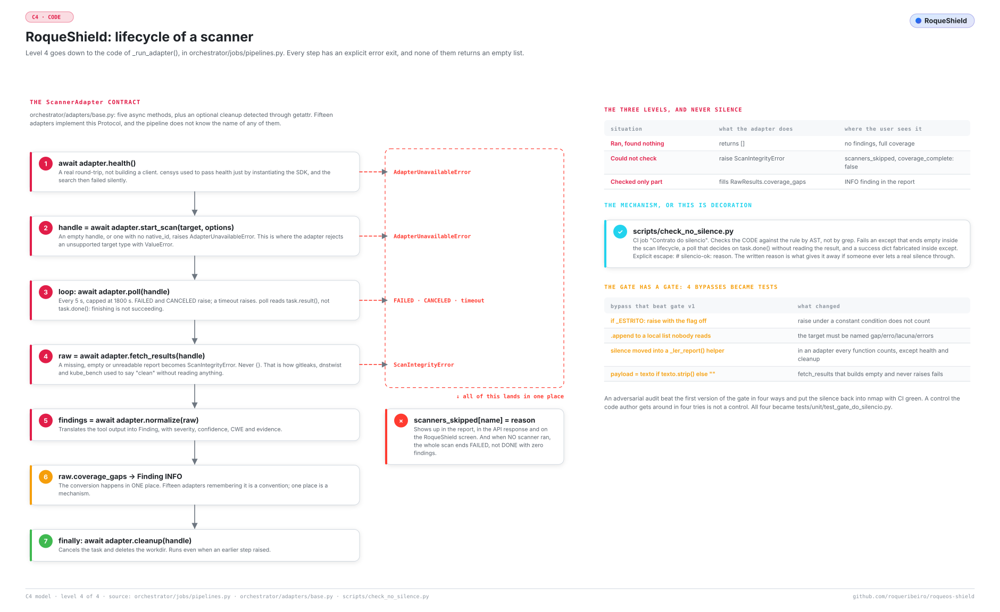

# Extending: adding a scanner

*Also available in [Brazilian Portuguese](pt-BR/ESTENDER.md).*

> For people who want RoqueShield to run a new security tool. What a scanner adapter is, where each piece goes, and what each gate demands at each step. The environment that runs the gates is in [DEVELOPMENT.md](DEVELOPMENT.md); the full list of what a scanner has to prove, in [TESTING.md](TESTING.md); where the adapter sits in the system, in [ARCHITECTURE.md](ARCHITECTURE.md).

## Table of contents

1. [The one rule](#1-the-one-rule)
2. [What is the source of truth](#2-what-is-the-source-of-truth)
3. [The contract](#3-the-contract)
4. [Adding a scanner, step by step](#4-adding-a-scanner-step-by-step)
5. [An OSINT scanner](#5-an-osint-scanner)
6. [Before closing](#6-before-closing)
7. [When something does not work](#7-when-something-does-not-work)

## 1. The one rule

A broken scanner produces exactly the same output as a safe target: zero findings. Nine adapters in this repository had the same bug, an exception swallowed and an empty report presented as a clean target. So every adapter answers one question, and the code has to answer it, not the author:

> **Does zero findings here mean *clean*, or *did not run*? If there is no way to tell, a signal is missing.**

The rule in full, with the nine cases, is `.claude/rules/60-contrato-do-silencio.md` (in Portuguese). Two mechanisms hold it: `scripts/check_no_silence.py` in the CI, and the tests that prove both sides (it does not lie when it fails, and it really finds).

<picture>
  <source media="(prefers-color-scheme: dark)" srcset="assets/diagramas/codigo.en.escuro.svg">
  
</picture>

## 2. What is the source of truth

On the left, what you want to know; on the right, the file that decides. Prose that disagrees with the source is the prose that is wrong.

| The question | The source |
| --- | --- |
| The methods an adapter must have | `ScannerAdapter` Protocol in `orchestrator/adapters/base.py` |
| The shape of a finding | `Finding` in `orchestrator/domain/schemas.py` |
| Which scanners a scan can build | the `factories` dict in `_build_adapters`, `orchestrator/jobs/pipelines.py` |
| Which target types each scanner accepts | `_SCANNER_ASSET_SUPPORT` in the same file |
| What each target type and profile runs | `_DEFAULT_SCANNERS` and `_PROFILE_SCANNERS` in the same file |
| Which options the API accepts per scanner | `ACEITAS` in `orchestrator/domain/opcoes.py` |
| Which binaries the image carries | `docker/images/orchestrator/Dockerfile` |
| Which binaries `/health/full` looks for | `esperados` in `_check_scanners`, `orchestrator/api/routers/health.py` |
| The bundle category of each tool | `_CATEGORY_BY_TOOL` in `orchestrator/reporting/exporters/ai_bundle.py` |
| What the docs gate demands | `scripts/check_docs_fresh.py` |

The scanners run inside the worker, as subprocesses of the orchestrator image. Not in `cai-kali-toolbox`: that container is for the agent. The skill `cai-add-adapter` and the agent `adapter-author` still say "kali-toolbox"; the Dockerfile above is what the scan uses.

## 3. The contract

The Protocol, as it is in `base.py`:

```python
@runtime_checkable
class ScannerAdapter(Protocol):
    name: str

    async def health(self) -> bool: ...
    async def start_scan(self, target: Target, options: dict[str, Any]) -> ScanHandle: ...
    async def poll(self, handle: ScanHandle) -> ScanStatus: ...
    async def fetch_results(self, handle: ScanHandle) -> RawResults: ...
    async def normalize(self, raw: RawResults) -> list[Finding]: ...
```

Plus an optional `async def cleanup(self, handle: ScanHandle) -> None`. When it exists, `_run_adapter` calls it in a `finally`; `orchestrator/adapters/_cleanup.py` has `cleanup_subprocess_handle` for the common case (cancel the task, remove the work directory).

What `_run_adapter` does with each answer:

| The adapter | The pipeline |
| --- | --- |
| `health()` returns False | `AdapterUnavailableError`: the scanner goes to `scanners_skipped` |
| `start_scan()` returns no `native_id` | same |
| `poll()` returns `FAILED` or `CANCELED` | same |
| `poll()` stays `RUNNING` past 1800 s | same, as a timeout |
| any other exception | `scanners_skipped` with `falhou: <error>` (failed) |
| `fetch_results()` sets `RawResults.coverage_gaps` | each gap becomes one INFO finding, "Cobertura incompleta em <name>" (incomplete coverage) |
| `normalize()` returns `[]` | ran and found nothing: complete coverage |

So the adapter picks one of three levels, never silence:

| Situation | What to do | Where the user sees it |
| --- | --- | --- |
| It ran and found nothing | return `[]` | no finding, complete coverage |
| It could not verify | `raise ScanIntegrityError` | `scanners_skipped`, `coverage_complete: false` |
| It verified part of it | fill `RawResults.coverage_gaps` | an INFO finding in the report |

`health()` returns a bool and never raises. It is the only function exempt from the silence gate.

## 4. Adding a scanner, step by step

The name below is `wapiti`, as an example. File `wapiti_adapter.py`, class `WapitiAdapter`, attribute `name = "wapiti"`: the three have to match, and `name` is what appears in `source_tool`, in `scanners_ran` and in the API.

1. **Read the closest adapter.** CLI with JSON output: `nuclei_adapter.py`. CLI with XML: `nmap_adapter.py`. Clone and scan a repository: `gitleaks_adapter.py`. HTTP API with a long lifecycle: `zap_adapter.py`. HTTP API that answers at once: `github_exposure_adapter.py`. Sync SDK wrapped in a thread: `shodan_adapter.py`. Also read `.claude/rules/scanners.md`.

2. **Write `orchestrator/adapters/wapiti_adapter.py`.** `start_scan` does not block: start the subprocess with `asyncio.create_subprocess_exec` (an argv list, never a shell), keep the task in `self._tasks[native_id]`, write output under `tempfile.mkdtemp(prefix="cai-wapiti-")`. Check the target type first and raise `ValueError` for one you do not accept. Read the return code in `poll`:

   ```python
   async def poll(self, handle: ScanHandle) -> ScanStatus:
       task = self._tasks.get(handle.native_id)
       if task is None:
           return ScanStatus.FAILED
       if not task.done():
           return ScanStatus.RUNNING
       rc, _ = task.result()
       return ScanStatus.DONE if rc == 0 else ScanStatus.FAILED
   ```

   For JSONL output, use `read_jsonl(path, adapter=self.name, gaps=gaps)` from `base.py`: it raises when every line is unreadable and declares a gap when only some are. A network tool goes out with egress closed by default (for nuclei, `-duc -ni`).

   **What the gate demands:** `python scripts/check_no_silence.py` reads every function of the adapter by AST (all except `health` and `cleanup`). It fails an `except` that ends in emptiness (`return []`, `return {}`, an empty `RawResults`, `continue`, `pass`) with no `raise` and no gap recorded; a `poll` that decides by `task.done()` without reading `task.result()`; a success payload built inside an `except`; and a `fetch_results` that builds an empty result and never raises. Measured: the `poll` from the template in `.claude/skills/cai-add-adapter/SKILL.md`, which decides by `task.done()` alone, fails this gate with exit 1. The escape is `# silencio-ok: <reason>` on the `except` line, for the empty result that really is correct.

   **And the docs gate:** the count of adapters is the count of `*_adapter.py` files. `check_docs_fresh.py` reads every "N adapters" written in digits in `README.md` and [ARCHITECTURE.md](ARCHITECTURE.md), and a new file fails it until they say the new number. The README writes its count in words ("Fifteen adapters"), which the gate does not read: update that one by hand.

3. **Normalize into the canonical `Finding`.** No variant, no extra field. `source_tool` is `self.name`; `severity` is the scanner's own heuristic, never adjusted for the target's context (that is the AI triage's job, in `ai_triage.adjusted_severity`). Fill `source_rule_id`, `vuln_id`, `cwe` and `evidence` when the tool gives them, and cut huge evidence. When two findings of the same rule are different things (a rotated secret, two commits), set `dedup_discriminator`, or dedup merges them into one.

4. **Register it in the factory.** In `_build_adapters` (`orchestrator/jobs/pipelines.py`), add a line to `factories`:

   ```python
   "wapiti": lambda: WapitiAdapter(),
   ```

   and add it to `_SCANNER_ASSET_SUPPORT` with the target types it accepts. Optionally, put it in `_DEFAULT_SCANNERS` or `_PROFILE_SCANNERS` so a scan with no explicit list runs it.

   A name that is not in `factories` is dropped with only a `scanner.unknown` warning in the log: it does not go to `scanners_skipped`, and the report does not say it was asked for. That is a known limit of the pipeline today. A name missing from `_SCANNER_ASSET_SUPPORT` is not filtered by target type, so it is started against types it may refuse.

   **What the gate demands:** as soon as the name is in `factories`, `check_docs_fresh.py` requires it to appear in `README.md` or in [ARCHITECTURE.md](ARCHITECTURE.md). Measured: a `"wapiti": lambda` line with no docs gives `[scanners] 'wapiti' é construível no pipeline e não aparece no README nem na arquitetura` (buildable in the pipeline and absent from the README and the architecture) and exit 1.

5. **Declare the options in `orchestrator/domain/opcoes.py`.** `ScanIn.options` is a closed list per scanner, with type and range, because a free dict used to become argv. A scanner that is not in `ACEITAS` makes any `options.wapiti` come back 422 `options.wapiti: scanner sem opções configuráveis` (scanner with no configurable options); a field that is not listed comes back 422 with the accepted fields. Use the validators that are there (`_bool`, `_int(min, max)`, `_lista_de(...)`, `_texto(regex)`, `_textos(regex)`) and never accept a disk path or a free URL. With no options at all, `"wapiti": {}` documents that on purpose.

   **What holds it:** `tests/unit/test_escopo_endurecido.py` covers `opcoes_seguras`. Add the dangerous option of the new tool to its parametrized list.

6. **Put the binary in the image.** In `docker/images/orchestrator/Dockerfile`: a pinned version, a download per architecture (amd64 and arm64), and a step that runs `--version` so the build fails when the binary does not execute. A Python tool that conflicts with the app's dependencies goes in its own venv, like checkov. Then add it to `esperados` in `_check_scanners` (`orchestrator/api/routers/health.py`), so `/health/full` reports it as missing instead of staying green.

   **What holds it:** the CI job `standalone-image` builds the image and waits for it to be healthy. For the dependency lock, `uv lock --check` (job `lockfile`) fails a `pyproject.toml` changed without `uv.lock`.

7. **Configuration and secrets.** A key or URL is a field of `Settings` in `orchestrator/config.py`, read through pydantic-settings, never hard-coded, never logged.

   **What the gate demands:** every `Settings` field must appear in `.env.example`, or `check_docs_fresh.py` fails.

8. **Tests.** `tests/unit/test_wapiti_adapter.py`, with no network. The existing adapter tests plant the tool's output in a temporary directory and drive the adapter without the binary (see `_plant` in `test_checkov_adapter.py`); there is no `tests/fixtures/` folder, despite what the skill says. Cover both sides:

   - `normalize` on a real sample of the tool's output produces at least one `Finding` with `source_tool == "wapiti"`;
   - missing output, unreadable output and a non-zero return code each **raise**, not return empty (the pattern is in `tests/unit/test_silencio_adapters.py`, one test per case);
   - a partial result declares a gap.

   Then break your own fix on purpose (return `[]` in the `except`, read only `task.done()`) and confirm the test fails. If the tool covers a layer of [TESTING.md](TESTING.md), add its expected finding to `tests/integration/test_efetividade_e2e.py`.

   **What holds it:** the CI job `test`, with the coverage floor `--cov-fail-under=64`.

9. **Docs and the rest of the wiring.** In the same commit as the code:

   - a row in the adapters table of `README.md` and `README.pt-BR.md`, and the new count;
   - the scanner in [ARCHITECTURE.md](ARCHITECTURE.md) and its pair `docs/pt-BR/ARQUITETURA.md`;
   - its category in `_CATEGORY_BY_TOOL` (`ai_bundle.py`); a tool missing there goes into the AI Fix Bundle as `infra`;
   - the option in `.claude/skills/cai-scan/SKILL.md`;
   - a line under `[Unreleased]` in `CHANGELOG.md`.

## 5. An OSINT scanner

An external exposure scanner (public data, nothing active) does not go in the scan factory. It is called explicitly by `run_exposure_scan` in `orchestrator/jobs/exposure.py`, which today calls `GitHubExposureAdapter`, `GitleaksAdapter` and `TrufflehogAdapter` on the repositories found, `DnstwistAdapter`, `ShodanAdapter` and `SubdomainTakeoverAdapter`. Steps 2, 3, 5, 6, 7, 8 and 9 hold the same; step 4 becomes a call in that function. `health()` needs a round trip: building an SDK client proves no credential. Pagination is coverage: compare with the total the API reports and declare the difference.

The Censys and kube-bench adapters are the counterexample: they exist, have tests and count as adapters, and no production path builds them.

## 6. Before closing

```bash
python scripts/check_no_silence.py
python scripts/check_docs_fresh.py
.venv/bin/pytest tests/unit/test_wapiti_adapter.py -v
.venv/bin/pytest
.venv/bin/ruff check orchestrator tests scripts
.venv/bin/ruff format --check orchestrator tests scripts
```

And, with Docker, `make build` and `make smoke`, then read the report in `reports/` for the new scanner's findings and for an empty `scanners_skipped`.

The rule that holds for everything above: **mutation test**. Break on purpose what you just protected and confirm that the check fails. A check that has never been seen failing is a hope, not a guarantee.

## 7. When something does not work

- **The scanner never runs and nothing says why**: the name is not in `factories`. Look for `scanner.unknown` in the worker log.
- **It always comes out in `scanners_skipped` with "health check falhou"** (health check failed): the binary is not in the image, or the service or credential is missing. `/health/full` lists missing binaries under `ausentes` once the tool is in `esperados`.
- **The API answers 422 on `options`**: the scanner or the field is not in `ACEITAS`.
- **The silence gate fails on a line you consider correct**: decide which of the three levels the case is. If empty is really the result, `# silencio-ok: <reason>` on the `except` line; the written reason is what the review reads.
- **The docs gate fails after the new file**: the adapter count. Update the number in `ARCHITECTURE.md` (and the word in `README.md`).
- **Scans that break once the scanner is in**: [WHEN-IT-BREAKS.md](WHEN-IT-BREAKS.md).
