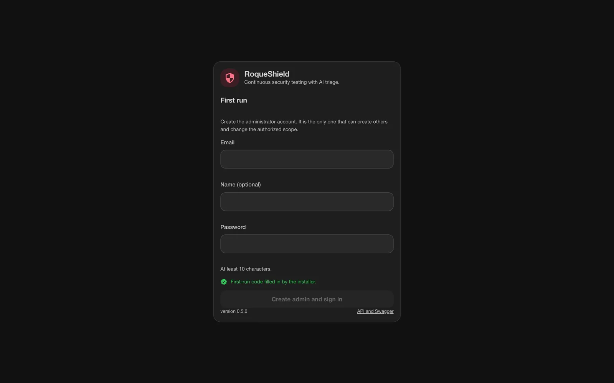
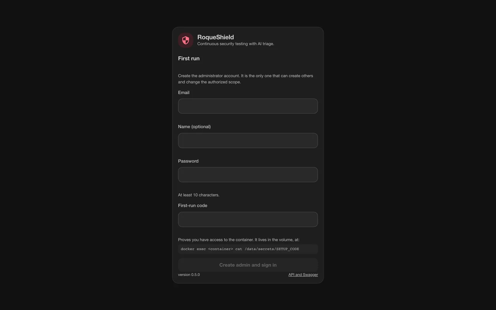
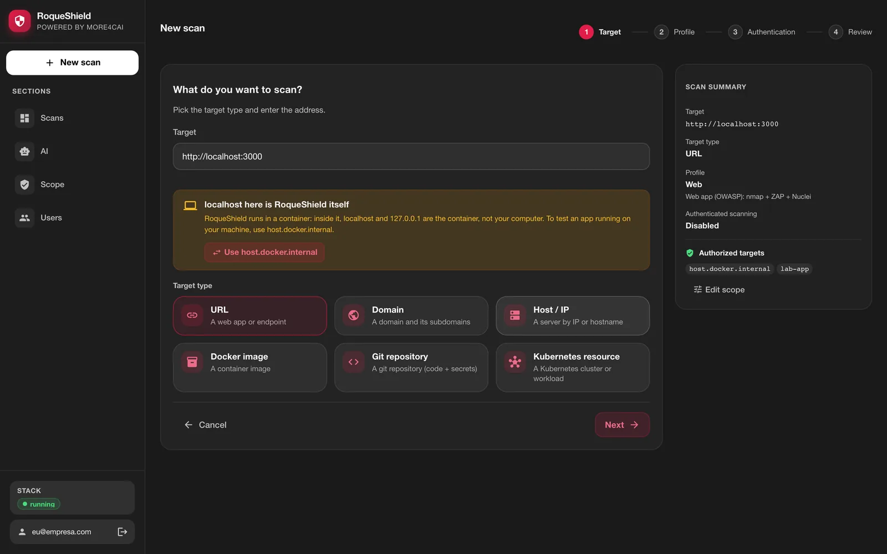
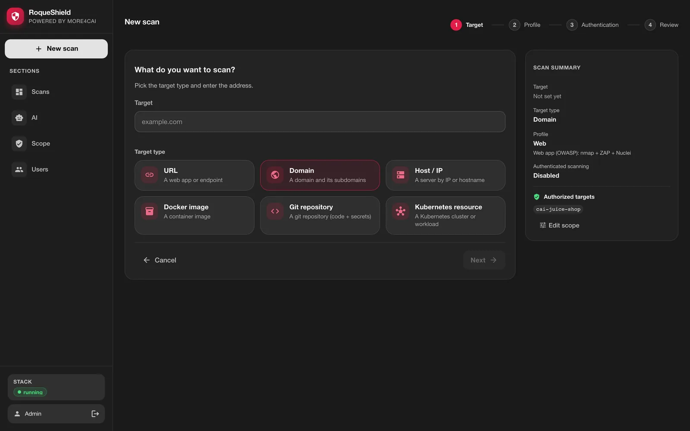
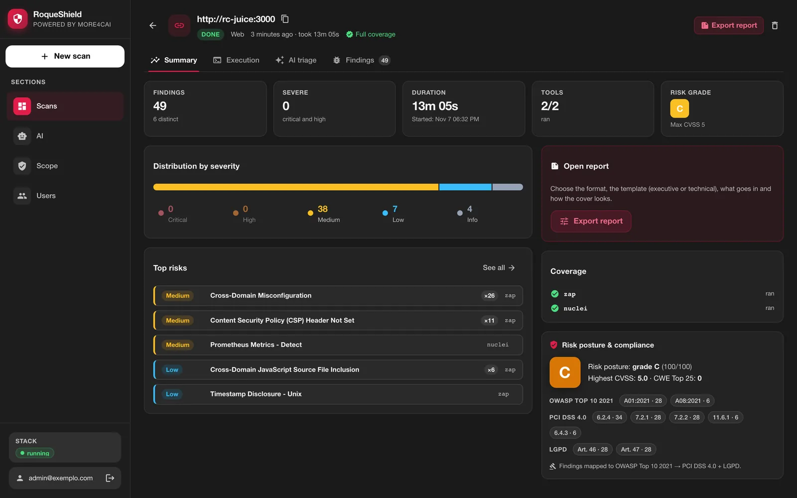
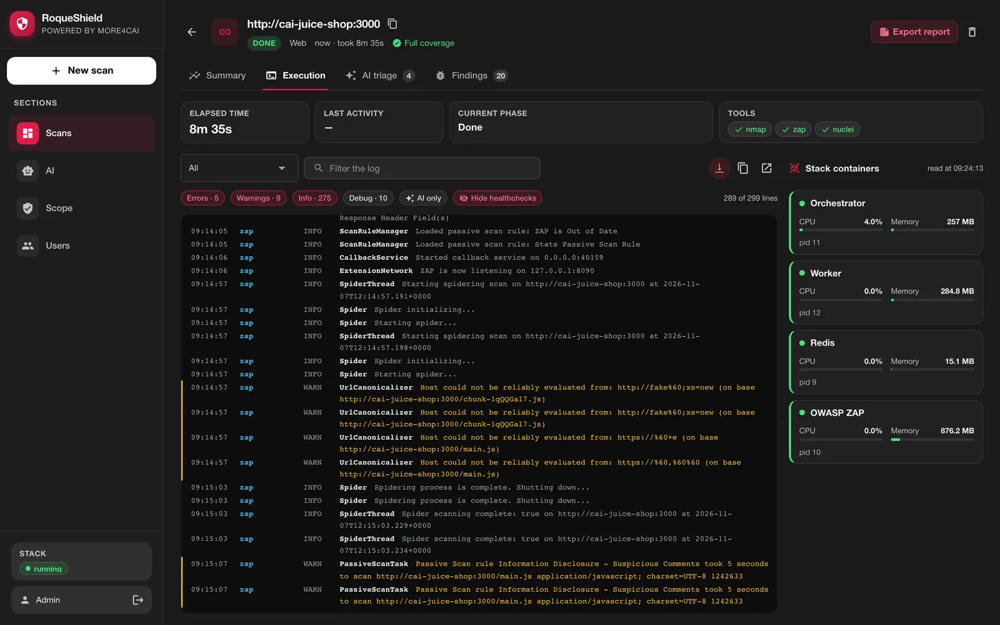
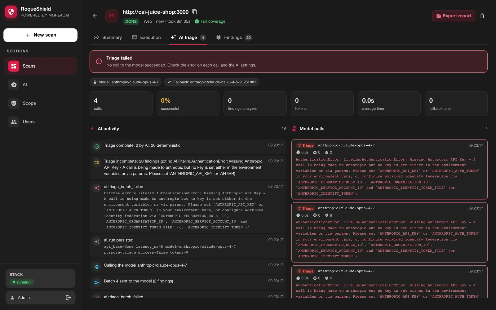
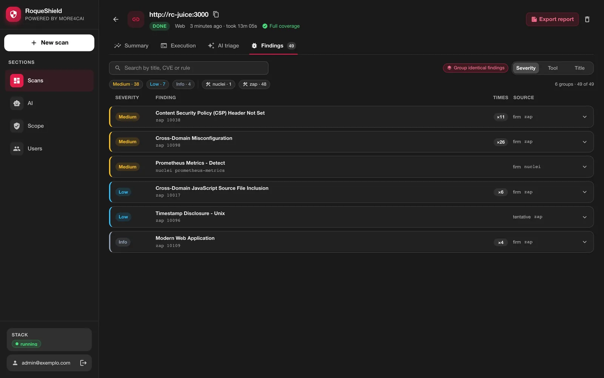

# Getting started: from install to the first report

*Also available in [Brazilian Portuguese](pt-BR/COMECAR.md).*

> **For whom:** whoever is about to run RoqueShield for the first time, on a laptop or a lab machine.
> **What is here:** eight steps, from one install command to a report and an AI Fix Bundle in hand. Each step says what to do, what you should see, and what to do if you do not see it.
> **Where to go for the rest:** running it every day and in production is in [OPERATIONS.md](OPERATIONS.md). Symptoms and fixes are in [WHEN-IT-BREAKS.md](WHEN-IT-BREAKS.md). Every variable and command is in [REFERENCE.md](REFERENCE.md).

**Authorization first.** Scanning systems you do not own, without written permission, is a crime in many countries. Only scan what you are allowed to test, inside the agreed window. RoqueShield records the authorization reference on every scan, but it does not decide for you. This guide uses a vulnerable app that you start yourself, so the first scan has no one else on the other end.

Estimated time: about 20 minutes, most of it the scan itself and the first image download.

**A note on language:** the installer speaks English or Portuguese, depending on your `LANG`. The excerpts below are its English output, captured from the script itself. The `roqueshield` CLI and the API error messages print in Portuguese; when one shows up below, a short English gloss follows. The screenshots are from the English UI.

## Table of contents

1. [What you need](#1-what-you-need)
2. [Install in one command](#2-install-in-one-command)
3. [Create the admin account](#3-create-the-admin-account)
4. [Start a lab target and put it in scope](#4-start-a-lab-target-and-put-it-in-scope)
5. [Run the first Web scan](#5-run-the-first-web-scan)
6. [Read the result in the four tabs](#6-read-the-result-in-the-four-tabs)
7. [Download the report and the AI Fix Bundle](#7-download-the-report-and-the-ai-fix-bundle)
8. [Where to go next](#8-where-to-go-next)

## 1. What you need

**Docker running**, on Mac, Linux or Windows with WSL. Nothing else: no Python, no scanner to install, no account anywhere. The image brings the engine, the scanners, the web UI, Redis and OWASP ZAP.

**6 GB of memory for Docker.** ZAP's AJAX spider and nuclei are the hungry part. On Docker Desktop this is the VM's memory (Settings > Resources > Memory), not the laptop's. The installer measures it and warns below about 5.5 GiB; it does not stop you, but a scanner may be killed mid-scan.

**About 1.2 GB of download** the first time, for the image.

## 2. Install in one command

```bash
curl -fsSL https://raw.githubusercontent.com/roqueribeiro/roqueos-shield/main/install.sh | sh
```

[install.sh](../install.sh) checks that Docker answers and how much memory it has, pulls the image of its own version, starts a container named `roqueshield` listening only on `127.0.0.1:8080`, waits for the healthcheck (up to 3 minutes) and opens your browser on the first-run screen. It does not ask for sudo, does not install Docker and does not publish the port beyond your computer. Running it again is safe: an existing container is only started again, and your data lives in the `roqueshield` volume.

| I want to | Command |
| --- | --- |
| use another port | `curl -fsSL .../install.sh \| ROQUESHIELD_PORT=8081 sh` |
| not open the browser | `curl -fsSL .../install.sh \| sh -s -- --no-browser` |
| install a specific version | `curl -fsSL .../install.sh \| ROQUESHIELD_VERSION=v0.5.1 sh` |

(`...` is `https://raw.githubusercontent.com/roqueribeiro/roqueos-shield/main`. Each variable also has a Portuguese name: `ROQUESHIELD_PORTA`, `ROQUESHIELD_VERSAO`, `ROQUESHIELD_NOME`, `ROQUESHIELD_NAO_ABRIR`. The flags too: `--atualizar`, `--nao-abrir`.)

**What you should see** (a first install, `docker pull` lines shortened):

```
RoqueShield v0.5.1

==> Checking Docker
    ✓ Docker is up
    ✓ Docker memory: 8 GB
==> Downloading the image (about 1.2 GB the first time)
v0.5.1-standalone: Pulling from roqueribeiro1988/roqueos-shield
Status: Downloaded newer image for roqueribeiro1988/roqueos-shield:v0.5.1-standalone
==> Starting container 'roqueshield' on http://localhost:8080
==> Waiting for RoqueShield to be ready
    ✓ ready

Done. Your browser opened http://localhost:8080
  Create the admin account: e-mail and password. If the screen asks for the
  first-run code, get it with:  docker exec roqueshield cat /data/secrets/SETUP_CODE

  Stop:          docker stop roqueshield
  Start again:   run this same command (or docker start roqueshield)
  Update:        curl -fsSL https://raw.githubusercontent.com/roqueribeiro/roqueos-shield/main/install.sh | sh -s -- --update
  Uninstall:     docker rm -f roqueshield   (and docker volume rm roqueshield to delete the data)

  Only test what you are authorized to test.
```

When the browser could not be opened (a server without a display, `--no-browser`), the `Done.` line says `Open http://localhost:8080 in your browser.` and the code command comes on its own line.

With less than 5.5 GiB for Docker, the memory line becomes a warning and the install goes on:

```
    ! Docker has about 4 GB of memory; RoqueShield needs 6 GB.
    ! In Docker Desktop: Settings > Resources > Memory. You can go on, but a scanner
    ! may be killed mid-scan and the scan ends with incomplete coverage.
```

**By hand, or on Windows without WSL** (in PowerShell, use `` ` `` instead of `\`):

```bash
docker run -d --name roqueshield \
  -p 127.0.0.1:8080:8080 --shm-size=1g --stop-timeout 30 --restart unless-stopped \
  --add-host host.docker.internal:host-gateway \
  -v roqueshield:/data \
  roqueribeiro1988/roqueos-shield:v0.5.1-standalone
```

The tag is the version with a `v` plus `-standalone`. `--add-host` makes `host.docker.internal` point at your computer on Linux too, as Docker Desktop already does.

## 3. Create the admin account

The first screen creates the administrator: e-mail, an optional name and a password of at least 10 characters. It also needs the **first-run code**, which proves you have access to the container. Without the code (or the `APP_TOKEN` in the `X-API-Token` header), `POST /setup` is refused, so whoever reaches the port before you cannot become admin.

**What you should see.** Through the installer, the code arrives already filled in and the screen says so instead of showing the field:



The code travels in the address fragment (`#setup=...`). The browser never sends a fragment to the server, so it lands in no access log, and the screen removes it from the address bar as soon as it reads it. It does not go on the browser's command line either, where `ps` would show it to any user of the machine: the installer writes a small local page into a `0700` folder, opens that page, and deletes the folder five minutes later.

Opened by hand, the screen shows the field and where the code lives:



```bash
docker exec roqueshield cat /data/secrets/SETUP_CODE
```

After the account is created, `/setup` answers `410` forever and the UI becomes a login screen. The API and Swagger are at `http://localhost:8080/docs`.

Do this step **before** you publish the port beyond `127.0.0.1`.

## 4. Start a lab target and put it in scope

A first scan needs a target you are allowed to hit. OWASP Juice Shop is a deliberately vulnerable web app made for this. Put it on a Docker network shared with RoqueShield, so nothing is published on your machine:

```bash
docker network create shield-lab
docker run -d --name juice-shop --network shield-lab bkimminich/juice-shop
docker network connect shield-lab roqueshield
```

Inside that network, the target is `http://juice-shop:3000`.

**Why the scope step exists.** `LAB_ONLY=true` is the default: a target that resolves to a private or loopback network (`10.x`, `192.168.x`, a container name, `host.docker.internal`) is only scanned if it is on the authorized target list. `juice-shop` resolves to a private address, so it needs to be allowed once.

In **New scan**, choose **URL** and type `http://juice-shop:3000`. The screen checks the target on this first step, before the review:

- **Internal network address.** An admin sees **Allow juice-shop in the scope**, which asks for confirmation and adds the host to the list. A non-admin is told to ask an admin.
- **localhost here is RoqueShield itself.** If you typed `localhost` or `127.0.0.1`: inside the container, that is RoqueShield, not your computer. For an app that runs on your machine (outside Docker), use `host.docker.internal`; the **Use host.docker.internal** button swaps the address, and then the host is allowed like any internal address.



Loopback and cloud metadata (`169.254.169.254`) never get the **Allow** shortcut. The list can also be edited in **Scope**, and when it comes from the `TARGET_ALLOWLIST` variable the screen shows it locked.

**What you should see:** the warning disappears, the side summary lists `juice-shop` under **Authorized targets**, and **Next** is enabled.

## 5. Run the first Web scan

The wizard has four steps: **Target**, **Profile**, **Authentication** and **Review**.



1. **Profile: Web.** It runs ZAP and nuclei against a URL (plus nmap when the target is a host). **Network** runs only nmap. **Full** runs every scanner that applies to the target type and turns on ZAP's active scan, which sends real attack payloads.
2. **Authentication:** skip it for this first scan. It is where you would give session headers to reach pages behind a login; they are used during the scan and not saved.
3. **Review:** tick **I confirm I am authorized to test this target**. The **Authorization reference** is optional here and becomes mandatory with `REQUIRE_AUTH_REF=true`; for a real target, put the ticket or contract number in it. Then **Start scan**.

**What you should see:** the scan detail opens and the **Execution** tab shows each phase live. A Web scan of Juice Shop took **8 to 13 minutes** in our measurements; most of that is nuclei going through its templates. The capture in the next step took 13 min 05 s.

Without an AI provider configured the scan runs the same way: the scanners do not need AI.

## 6. Read the result in the four tabs

**Summary.** Findings and how many are severe, duration, how many tools ran, the risk grade, the severity distribution, the top risks, coverage per scanner and the compliance posture (OWASP Top 10, PCI DSS 4.0, LGPD).



Look first at the top line. **Full coverage** means every requested scanner ran. When one did not, the line reads **Incomplete coverage**, the **Coverage** card says which scanner and why, and the report says the same. Zero findings with incomplete coverage does not mean a clean target: it means a vector that was not checked.

**Execution.** The log of every process in the container (orchestrator, worker, Redis, ZAP), with the CPU and memory of each.



**AI triage.** What the model did with the findings, call by call. With no provider configured, the tab says **AI not configured** with a shortcut to set one up, and the findings keep the scanner's own classification. With a key and a provider error, it shows the error of each call.



**Findings.** Grouped by rule, filtered by severity, tool and title, with the evidence for each one.



## 7. Download the report and the AI Fix Bundle

**From the UI.** **Export report**, at the top of the scan, asks for the format, the template (executive, technical or custom), which severities and tools go in, and the cover details. The browser downloads the file:

| Format | What you get |
| --- | --- |
| PDF | the report with cover, sections and page numbers |
| Markdown | the filtered findings as text |
| CSV | one row per filtered finding |
| JSON | the AI Fix Bundle, with the filter applied |

**From the CLI, inside the container.** There it needs no login: it uses the local shield and its `APP_TOKEN`.

```bash
docker exec roqueshield roqueshield scan list
docker exec roqueshield roqueshield report <scan_id> --format bundle > bundle.json
docker exec roqueshield roqueshield report <scan_id> --format html > report.html
```

`--format` accepts `bundle`, `compliance`, `html` and `executive`; without `-o`, the report goes to stdout. The AI Fix Bundle is the JSON a coding agent (Claude Code, Cursor, Copilot) reads to fix what was found; its format is in [AI-FIX-BUNDLE.md](AI-FIX-BUNDLE.md).

**What you should see:** a `.pdf`, `.json` or `.html` file with the same findings as the **Findings** tab.

When you are done with the lab target:

```bash
docker rm -f juice-shop && docker network rm shield-lab
```

(`docker network rm` refuses while `roqueshield` is still connected; run `docker network disconnect shield-lab roqueshield` first.)

## 8. Where to go next

- **Configure an AI provider** in **AI** (Anthropic, OpenAI, OpenRouter or a local OpenAI-compatible server such as LM Studio): [OPERATIONS.md](OPERATIONS.md#11-ai-provider-and-a-local-model).
- **Create users and tokens**, put a TLS proxy in front, back up the volume, update: [OPERATIONS.md](OPERATIONS.md).
- **Run it from a pipeline, an IDE or an agent** (CLI with exit codes, MCP, the API): [INTEGRATIONS.md](INTEGRATIONS.md).
- **Run it in production**, with Postgres and separate workers: [OPERATIONS.md](OPERATIONS.md#10-production-compose).

## When something does not work

- The installer says `Docker is installed but did not answer`: Docker is not running yet. Open Docker Desktop (Linux: `sudo systemctl start docker`) and run the command again.
- The browser did not open: open `http://localhost:8080` yourself; the code comes from `docker exec roqueshield cat /data/secrets/SETUP_CODE`.
- The scan ended with **Incomplete coverage**: a scanner did not run. The **Coverage** card and the **Execution** tab say which one and why. Most often it is memory.
- Anything else, by symptom: [WHEN-IT-BREAKS.md](WHEN-IT-BREAKS.md).
