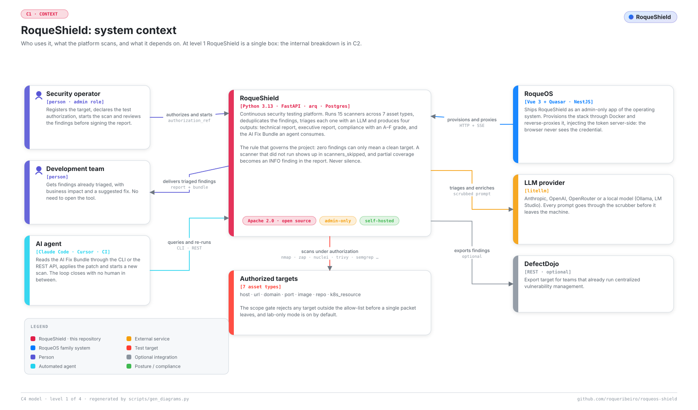

# RoqueShield documentation

*Also available in [Brazilian Portuguese](pt-BR/INDEX.md).*

Where to start depends on what you want. Every document below has a pair under [`docs/pt-BR/`](pt-BR/INDEX.md); the English one is the main version.

| I want to... | Read |
| --- | --- |
| **Install it and run a first scan** | [GETTING-STARTED.md](GETTING-STARTED.md): one command, the first-run code, a lab target, the first Web scan |
| **Run it day to day or in production** | [OPERATIONS.md](OPERATIONS.md): update, backup and restore, production compose, accounts, scope and authorization |
| **Understand a failure** | [WHEN-IT-BREAKS.md](WHEN-IT-BREAKS.md): symptom, cause, what to do |
| **See how it is built inside** | [ARCHITECTURE.md](ARCHITECTURE.md): context, containers, components, the scan pipeline, the agent and its leash, decisions |
| **Look up a command, route, variable or scanner option** | [REFERENCE.md](REFERENCE.md) |
| **Plug it into an AI agent, a CLI or a CI pipeline** | [INTEGRATIONS.md](INTEGRATIONS.md): REST API, the `roqueshield` CLI, the MCP server, the scan, patch and re-scan loop |
| **Consume the AI Fix Bundle from another tool** | [AI-FIX-BUNDLE.md](AI-FIX-BUNDLE.md): the contract, field by field |
| **Know what it protects and what it does not** | [THREAT-MODEL.md](THREAT-MODEL.md) and [../SECURITY.md](../SECURITY.md) |
| **Know what each scanner is expected to find** | [TESTING.md](TESTING.md): test criteria per layer and per target type |
| **Run the development stack** | [DEVELOPMENT.md](DEVELOPMENT.md): the compose stack, the local gates, the CI |
| **Add a scanner** | [EXTENDING.md](EXTENDING.md): the adapter contract and what the gates require |
| **Find a term** | [GLOSSARY.md](GLOSSARY.md) |
| **Contribute** | [../CONTRIBUTING.md](../CONTRIBUTING.md) |
| **Report a vulnerability** | [../SECURITY.md](../SECURITY.md) |
| **See what changed in each version** | [../CHANGELOG.md](../CHANGELOG.md) |

## Diagrams

Every diagram exists in English and Portuguese, light and dark, generated by [`scripts/gen_diagrams.py`](../scripts/gen_diagrams.py) from the code in [`scripts/diagrams/`](../scripts/diagrams/). The CI job "Diagramas em dia" fails when a diagram and its code disagree, so none of them is a stale picture.

| Diagram | Where it is explained |
| --- | --- |
| [System context](assets/diagramas/contexto.en.claro.svg) | [ARCHITECTURE](ARCHITECTURE.md) |
| [Containers](assets/diagramas/containers.en.claro.svg) | [ARCHITECTURE](ARCHITECTURE.md) |
| [Components](assets/diagramas/componentes.en.claro.svg) | [ARCHITECTURE](ARCHITECTURE.md) |
| [Scanner lifecycle](assets/diagramas/codigo.en.claro.svg) | [ARCHITECTURE](ARCHITECTURE.md) and [EXTENDING](EXTENDING.md) |
| [The scan pipeline](assets/diagramas/esteira.en.claro.svg) | [ARCHITECTURE](ARCHITECTURE.md) |
| [The Kali sidecar and the agent](assets/diagramas/agente-kali.en.claro.svg) | [ARCHITECTURE](ARCHITECTURE.md) |
| [Integration surfaces and the agent loop](assets/diagramas/integracoes.en.claro.svg) | [INTEGRATIONS](INTEGRATIONS.md) |
| [Infrastructure and deployment](assets/diagramas/infra.en.claro.svg) | [ARCHITECTURE](ARCHITECTURE.md) and [OPERATIONS](OPERATIONS.md) |
| [The product inside RoqueOS](assets/diagramas/telas.en.claro.svg) | [ARCHITECTURE](ARCHITECTURE.md) |

To show a diagram with the reader's theme, use `<picture>`:

```html
<picture>
  <source media="(prefers-color-scheme: dark)" srcset="assets/diagramas/contexto.en.escuro.svg">
  
</picture>
```

The brand assets (banner, fonts, the art prompt) are in [`assets/marca/`](assets/marca/README.md).
