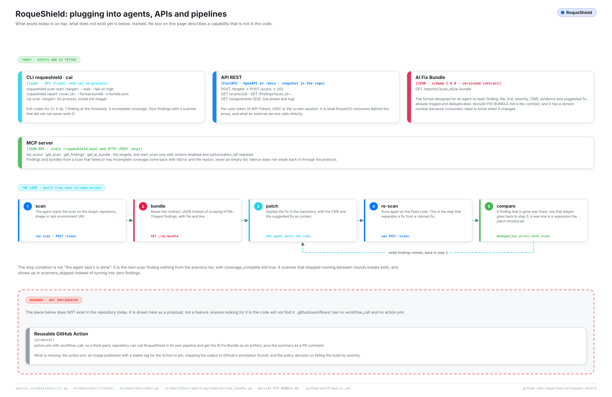

# Integrations

*Also available in [Brazilian Portuguese](pt-BR/INTEGRACOES.md).*

> How to drive RoqueShield from something that is not a person: a coding agent, a service, a CI job. Everything here was checked against the code and, where it can run without a live shield, run in this repository. What does not exist is in [section 9](#9-what-does-not-exist), stated as missing.
>
> For every route, flag and variable, see the [REFERENCE](REFERENCE.md). For the contract the agent reads, see [AI-FIX-BUNDLE.md](AI-FIX-BUNDLE.md). For installing a shield first, [GETTING-STARTED.md](GETTING-STARTED.md).

## Table of contents

1. [The surfaces at a glance](#1-the-surfaces-at-a-glance)
2. [Credentials](#2-credentials)
3. [The CLI](#3-the-cli)
4. [The REST API](#4-the-rest-api)
5. [Live progress over SSE](#5-live-progress-over-sse)
6. [The MCP server](#6-the-mcp-server)
7. [The loop: scan, patch, re-scan](#7-the-loop-scan-patch-re-scan)
8. [CI](#8-ci)
9. [What does not exist](#9-what-does-not-exist)

---

## 1. The surfaces at a glance

<picture>
  <source media="(prefers-color-scheme: dark)" srcset="assets/diagramas/integracoes.en.escuro.svg">
  
</picture>

| Surface | For | Where in the code |
| --- | --- | --- |
| CLI `roqueshield` | Shell scripts, CI, a coding agent with a terminal | `orchestrator/cliente/cli.py` |
| REST API | Any service; the other surfaces are clients of it | `orchestrator/api/routers/` |
| SSE `GET /ui/api/events` | Live phase and log lines | `orchestrator/api/routers/ui.py` |
| MCP over stdio (`roqueshield mcp`) | Claude Code, Claude Desktop, Cursor on the same machine as the CLI | `orchestrator/cliente/mcp_stdio.py` |
| MCP over HTTP (`POST /mcp`) | An MCP client that reaches the shield over the network | `orchestrator/api/routers/mcp.py` |
| AI Fix Bundle | The JSON contract a patching agent consumes | `orchestrator/reporting/exporters/ai_bundle.py` |

All of them end up in the REST API with the caller's credential, so the role of that credential (RBAC) decides what each one can do. There is no side door.

A word on names: the product is RoqueShield. `cai` is the internal name of the engine (package `cai-orchestrator`, containers `cai-*`, and an admin CLI called `cai` that runs the pipeline in-process). Integrations use `roqueshield`, which is a client of a running shield.

## 2. Credentials

The API accepts, in this order (`orchestrator/api/deps.py`):

1. `X-API-Token` equal to the `APP_TOKEN`: a service principal with the `admin` role.
2. `X-API-Token` with a per-user token, created in **Users** on the web UI or with `POST /users`. The shield stores only its hash.
3. `Authorization: Bearer <session-jwt>` from the OIDC login.
4. The `rs_session` cookie from the password login of the web UI. Writes with the cookie also need the `X-RoqueShield` header (CSRF).

Give integrations a per-user token with the smallest role that works:

| Role | Can |
| --- | --- |
| `viewer` | read scans, findings, reports and the bundle |
| `auditor` | the same, plus the audit log |
| `operator` | the same as `viewer`, plus create targets, start and delete scans, mark findings resolved |
| `admin` | everything, including scope, AI settings and users |

The `APP_TOKEN` is an admin key for the container itself. Do not hand it to a CI job.

The CLI and the stdio MCP server read the credential in this order (`orchestrator/cliente/api.py`): the variables `ROQUESHIELD_URL` and `ROQUESHIELD_TOKEN`, then the file written by `roqueshield login` (`~/.config/roqueshield/config.json`, mode `0600`), and last, inside the standalone container, the local shield with the `APP_TOKEN` from `$DATA_DIR/secrets`. That last step is what makes `docker exec roqueshield roqueshield status` work with nothing configured. The token is never printed.

## 3. The CLI

```
$ roqueshield --help
 Usage: roqueshield [OPTIONS] COMMAND [ARGS]...

 Cliente do RoqueShield: scans, achados, relatórios e o servidor MCP.

╭─ Commands ───────────────────────────────────────────────────────────────────╮
│ login           Guarda o endereço e o token (crie o token na tela, em        │
│                 Usuários, ou em POST /users).                                │
│ status          Versão do shield, quem está logado e o estado de cada        │
│                 dependência.                                                 │
│ findings        Os achados de um scan.                                       │
│ report          Baixa um relatório. `bundle` é o AI Fix Bundle que outro     │
│                 agente consome para corrigir.                                │
│ reset-password  Troca a senha de uma conta. Pede a senha nova sem eco.       │
│ logs            Log de um serviço do container (credencial já vem redigida). │
│ mcp             Servidor MCP por stdio, para Claude Desktop, Claude Code ou  │
│                 Cursor.                                                      │
│ scan            Disparar, acompanhar e apagar scans.                         │
│ settings        Configuração de IA e de escopo.                              │
╰──────────────────────────────────────────────────────────────────────────────╯
```

The help is in Portuguese. In short: `login` saves the address and token, `status` shows the version and dependencies, `findings` lists a scan's findings, `report` downloads a report (`bundle` is the AI Fix Bundle), `reset-password` changes an account's password, `logs` reads a service log, `mcp` is the stdio MCP server, `scan` starts, follows and deletes scans, `settings` shows AI and scope configuration.

The options an integration uses, from `roqueshield scan start --help`, `report --help` and `findings --help`:

| Command | Options |
| --- | --- |
| `scan start <alvo>` | `--type url\|domain\|host\|image\|repo\|k8s_resource` (default `url`), `--profile web\|network\|full` (default `web`), `--scanner` (repeat for more), `--auth-ref` (authorization reference), `--wait`, `--fail-on info\|low\|medium\|high\|critical`, `--intervalo` (poll seconds, default 5), `--prazo` (give-up seconds, default 7200) |
| `scan watch <scan_id>` | `--fail-on`, `--intervalo`, `--prazo` |
| `scan show <scan_id>` | `--json` |
| `findings <scan_id>` | `--severity`, `--limit` (default 200), `--json` |
| `report <scan_id>` | `--format bundle\|compliance\|html\|executive` (default `bundle`), `--output/-o` (without it, stdout) |

The full list is in [REFERENCE.md](REFERENCE.md).

```bash
roqueshield login --server https://shield.example          # asks for the token without echo
roqueshield scan start https://staging.example.com --auth-ref CHG-123 --wait --fail-on high
roqueshield scan start https://github.com/acme/api.git --type repo --profile full --wait
roqueshield scan show <scan_id> --json
roqueshield report <scan_id> --format bundle -o bundle.json
```

`scan start` prints `scan <id> criado (<profile>)` ("scan created"). With `--wait`, and always with `scan watch`, the command exits by a contract meant for pipelines:

| Code | When |
| --- | --- |
| `0` | finished, coverage complete, nothing at or above `--fail-on` |
| `1` | finished, coverage complete, a finding at or above `--fail-on` |
| `2` | usage, connection or credential error |
| `3` | the scan failed, coverage is incomplete (a scanner did not run), or `--prazo` ran out |

`3` beats `0` and `1` on purpose: zero findings from a scanner that did not run is an unverified vector, not a clean target. Without `--fail-on`, a complete scan exits `0` whatever it found.

What the errors look like, run here:

```
$ roqueshield scan start x --fail-on bogus; echo $?
--fail-on aceita: info, low, medium, high, critical
2
$ roqueshield status; echo $?        # no variables, no login
sem servidor ou token: rode `roqueshield login --server URL`, ou defina
ROQUESHIELD_URL e ROQUESHIELD_TOKEN
2
$ ROQUESHIELD_URL=http://127.0.0.1:9 ROQUESHIELD_TOKEN=x roqueshield status; echo $?
sem conexão com o RoqueShield: ConnectError: [Errno 111] Connection refused
2
```

(`--fail-on` accepts only the five severities; "no server or token: run login or set the two variables"; "no connection to RoqueShield".) An API refusal prints `a API recusou (<status>): <detail>` ("the API refused") and also exits `2`.

Two behaviors to know. `findings` lists whatever exists and does not look at coverage; use `scan show`, `scan watch` or the MCP tools when "zero" has to mean something. And the API also accepts `--type port` (`host:port/proto`), although the CLI help does not list it.

Getting the CLI: inside the container it is already there. Outside, run it from the image with nothing to install:

```bash
docker run --rm -it --entrypoint roqueshield \
  -e ROQUESHIELD_URL=https://shield.example -e ROQUESHIELD_TOKEN \
  roqueribeiro1988/roqueos-shield:v0.5.1-standalone status
```

or install it from the repository (Python 3.13 or newer; it is not on PyPI and brings the engine's dependencies along):

```bash
pip install "git+https://github.com/roqueribeiro/roqueos-shield@v0.5.1"
```

## 4. The REST API

The OpenAPI page is at `/docs` on the shield. The calls an integration needs:

| Step | Call | Role |
| --- | --- | --- |
| Check a target without creating it | `POST /targets/check` | `operator` |
| Register the target | `POST /targets` → `201` | `operator` |
| Start the scan | `POST /scans` → `202` with the scan `id` | `operator` |
| Follow it | `GET /ui/api/scans/{id}` (state, phase, `coverage_complete`, `scanners_skipped`) | `viewer` |
| Read the findings | `GET /ui/api/findings?scan_id=…`, or `GET /findings/queue` (paged, one item per problem) | `viewer` |
| Compliance posture | `GET /reports/{id}/compliance` | `viewer` |
| The AI Fix Bundle | `GET /reports/{id}/ai-bundle` | `viewer` |
| Mark a problem resolved | `POST /findings/resolve` with `deduped_key` and `status` | `operator` |

`POST /scans` refuses before anything is queued: a target outside the scope (`403`), a missing `authorization_ref` when `REQUIRE_AUTH_REF=true` (`403`), and any scanner option outside the closed list for that scanner (`422`, naming the field). Details in [THREAT-MODEL.md](THREAT-MODEL.md#4-scope-and-target-validation).

`GET /ui/api/scans/{id}` is what the CLI and the MCP server read, because it carries the coverage. `GET /scans/{id}` exists too, but returns only state, dates, report path and errors.

Every route, body and status code: [REFERENCE, section 4](REFERENCE.md#4-rest-api).

## 5. Live progress over SSE

`GET /ui/api/events?scan_id=<id>` answers `text/event-stream` with two event types: `phase` (the scan's phase and progress) and `log` (one log entry as JSON), plus `: keepalive` comments. It takes any API credential with `scans:read`: the `X-API-Token` header, a Bearer session or the cookie.

A browser `EventSource` cannot send headers, which is why the web UI uses the cookie. There is also a legacy `?token=` parameter, accepted only on this route and only with the `APP_TOKEN`; any other route refuses it with `401` so the token does not end up in logs and `Referer` headers. Do not build on it.

```bash
curl -N -H "X-API-Token: $ROQUESHIELD_TOKEN" \
  "https://shield.example/ui/api/events?scan_id=$SCAN"
```

## 6. The MCP server

Written against the protocol directly (`orchestrator/cliente/mcp_nucleo.py`), not with the `mcp` SDK, because the lockfile already carries two incompatible versions of that SDK through optional extras. It answers `initialize`, `ping`, `tools/list` and `tools/call`, and offers the protocol versions `2025-06-18`, `2025-03-26` and `2024-11-05`.

**Over stdio**, one JSON-RPC message per line; logs go to stderr, never stdout:

```bash
claude mcp add roqueshield \
  -e ROQUESHIELD_URL=https://shield.example -e ROQUESHIELD_TOKEN=<token> \
  -- roqueshield mcp
```

A real session, run here against an address with nothing listening (`initialize` and `tools/list` do not touch the API):

```
$ printf '%s\n' '{"jsonrpc":"2.0","id":1,"method":"initialize","params":{"protocolVersion":"2025-06-18"}}' \
    '{"jsonrpc":"2.0","id":2,"method":"tools/list"}' | roqueshield mcp
roqueshield mcp: http://127.0.0.1:9 (ações desligadas)
{"jsonrpc": "2.0", "id": 1, "result": {"protocolVersion": "2025-06-18", "capabilities": {"tools": {"listChanged": false}}, "serverInfo": {"name": "roqueshield", "version": "0.5.1"}, ...}}
{"jsonrpc": "2.0", "id": 2, "result": {"tools": [{"name": "list_scans", ...
```

The first line is stderr: the server it talks to, and "actions off". `--server` overrides the saved address.

**Over HTTP**, `POST /mcp` with one JSON-RPC message per request and the response as JSON (Streamable HTTP without the server stream: `GET /mcp` answers `405`, and a batch gets the error `-32600`). It authenticates like the rest of the API, with `X-API-Token` or `Authorization: Bearer`, and each tool calls the API inside the same process passing that credential along.

```bash
curl -s -X POST https://shield.example/mcp \
  -H "X-API-Token: $ROQUESHIELD_TOKEN" -H "Content-Type: application/json" \
  -d '{"jsonrpc":"2.0","id":1,"method":"tools/list"}'
```

The tools:

| Tool | Arguments | Returns |
| --- | --- | --- |
| `list_scans` | `limit` (1 to 200) | recent scans with state, phase and counts |
| `get_scan` | `scan_id` | the detail, including which scanners ran, which did not, and why |
| `get_findings` | `scan_id`, `severity`, `limit` (1 to 500) | the findings, or an error (below) |
| `get_ai_bundle` | `scan_id` | the AI Fix Bundle, or an error (below) |
| `list_targets` | none | registered targets |
| `start_scan` | `target`, `asset_type`, `profile`, `authorization_ref` (required, 3+ characters) | only when actions are on |

**A tool does not return an empty list for a scan that did not verify.** `get_findings` and `get_ai_bundle` on a scan that failed, is still running or has incomplete coverage come back with `isError: true`, the reason and the partial data. Run here with a fake API returning a finished scan where ZAP was skipped:

```json
{"content": [{"type": "text", "text": "{\"erro\": \"cobertura INCOMPLETA, estes vetores não foram verificados: zap: ZAP fora do ar\", \"achados_parciais\": []}"}], "isError": true}
```

("Incomplete coverage, these vectors were not verified: zap: ZAP down", with the partial findings.) An agent that reads `[]` concludes "clean"; this is what stops it.

**Actions.** `start_scan` is not even listed unless actions are on, and calling it anyway is a protocol error (`ferramenta desconhecida: start_scan`, "unknown tool"). Who turns actions on depends on the transport:

- `POST /mcp`: the server, with `MCP_ALLOW_ACTIONS=true` (default `false`).
- stdio: the client, with `ROQUESHIELD_MCP_ACTIONS=1` in the environment of `roqueshield mcp`.

So on stdio the real control is the token's role. For a read-only agent, give it a `viewer` or `auditor` token: those cannot start a scan by any path. Variables: [REFERENCE, section 5](REFERENCE.md#5-mcp-server) and [section 6](REFERENCE.md#6-environment-variables).

## 7. The loop: scan, patch, re-scan

The surfaces above close the loop without a person in the middle:

1. **Scan** the repository, image or staging URL.
2. **Read the bundle** (`GET /reports/{id}/ai-bundle`), structured, not scraped.
3. **Patch** the code, with the CWE and the remediation as context.
4. **Re-scan** the corrected code. This is the step that separates a fix from a claim of a fix.
5. **Compare** the two bundles by `deduped_key`: what disappeared was fixed, what remains goes back to step 3, what is new is a regression the patch introduced.

**The stopping condition** is not "the agent reported success". The loop ends when the new scan does not find what the old one found **and** its coverage is still complete. A scanner that stopped running between rounds (a closed network, a container that did not come up, an expired credential) produces zero findings for the same reason a clean codebase does. Without the coverage check, "the agent fixed everything" and "the scanner broke" look the same.

So step 5 checks three things, in this order. The field names are the bundle's (`scan.coverage_complete`, `scan.scanners_executed`):

```python
assert novo["scan"]["coverage_complete"], "a scanner stopped running; comparison invalid"
assert set(novo["scan"]["scanners_executed"]) >= set(anterior["scan"]["scanners_executed"])
resolvidos = chaves_anteriores - chaves_novas
regressoes = chaves_novas - chaves_anteriores
```

With the CLI:

```bash
REPO=https://github.com/acme/api.git
BEFORE=$(roqueshield scan start "$REPO" --type repo | awk '/^scan / {print $2}')
roqueshield scan watch "$BEFORE"
roqueshield report "$BEFORE" --format bundle -o bundle.json

# ... the agent patches the repository from bundle.json ...

AFTER=$(roqueshield scan start "$REPO" --type repo | awk '/^scan / {print $2}')
roqueshield scan watch "$AFTER"          # exits 3 if coverage came back incomplete
roqueshield report "$AFTER" --format bundle -o bundle-after.json

jq -s '{
  resolved:    ([.[0].vulnerabilities[].deduped_key] - [.[1].vulnerabilities[].deduped_key]),
  regressions: ([.[1].vulnerabilities[].deduped_key] - [.[0].vulnerabilities[].deduped_key])
}' bundle.json bundle-after.json
```

To record the outcome, `POST /findings/resolve` sets the status of a problem by `deduped_key` (`open`, `in_progress`, `resolved`, `false_positive`, `wont_fix`, `risk_accepted`), writes an audit entry, and the status survives re-scans. The bundle itself does not carry that status; read it from `GET /findings/queue`.

## 8. CI

One shell step against a shield you already run. The token is a CI secret created in **Users** with the `operator` role:

```yaml
- name: RoqueShield
  env:
    ROQUESHIELD_URL: https://shield.example
    ROQUESHIELD_TOKEN: ${{ secrets.ROQUESHIELD_TOKEN }}
  run: |
    docker run --rm -e ROQUESHIELD_URL -e ROQUESHIELD_TOKEN --entrypoint roqueshield \
      roqueribeiro1988/roqueos-shield:v0.5.1-standalone \
      scan start https://staging.example.com --auth-ref "$GITHUB_RUN_ID" --wait --fail-on high
```

`docker run` returns the CLI's exit code, so `1` (findings at `high` or above) and `3` (failed scan or incomplete coverage) fail the step. A scanner that did not run never passes as clean.

This step is not run by this repository's CI (it needs a reachable shield and a target you are authorized to scan). What CI does check is that the image carries the CLI: `.github/workflows/ci.yml` runs `docker exec rs roqueshield --help` against the built standalone image. Pin the image tag; a scanner that changes version between runs without anyone noticing is worse than no scanner.

To keep the bundle as a build artifact, add `roqueshield report <id> --format bundle -o bundle.json` after the scan and upload the file.

## 9. What does not exist

Stated here so nobody finds out in production:

- **No reusable GitHub Action.** `.github/workflows/` has only `ci.yml`, with no `workflow_call`, and there is no `action.yml`. Another project's pipeline uses the shell step of [section 8](#8-ci).
- **No GitHub code annotations or PR comment** from findings, and no SARIF export. The machine output is the AI Fix Bundle and the compliance JSON.
- **No scan comparison tool** (`shield_compare` was proposed and not built). Section 7 does it with `jq`.
- **No server stream on `POST /mcp`** and no batch messages. The server never sends notifications on its own.
- **No PyPI package.** The CLI comes from the image or from `pip install git+…`.

## When something does not work

- The CLI exits `2` with `sem servidor ou token`: set `ROQUESHIELD_URL` and `ROQUESHIELD_TOKEN`, or run `roqueshield login --server URL`.
- `a API recusou (401)` or `(403)`: wrong token, or a role without the permission. Starting a scan needs `operator`.
- `POST /scans` returns `403 target rejeitado pela policy` ("target refused by policy"): the target is outside the scope. Ask the shield why with `POST /targets/check`, and see [OPERATIONS.md](OPERATIONS.md) for the scope.
- `--wait` exits `3` on a scan that "found nothing": run `roqueshield scan show <id>`; the lines `não rodou: <scanner>: <motivo>` ("did not run") say what was not verified. [WHEN-IT-BREAKS.md](WHEN-IT-BREAKS.md) covers the scanners.
- The MCP client does not show `start_scan`: actions are off, which is the default. See [section 6](#6-the-mcp-server).
