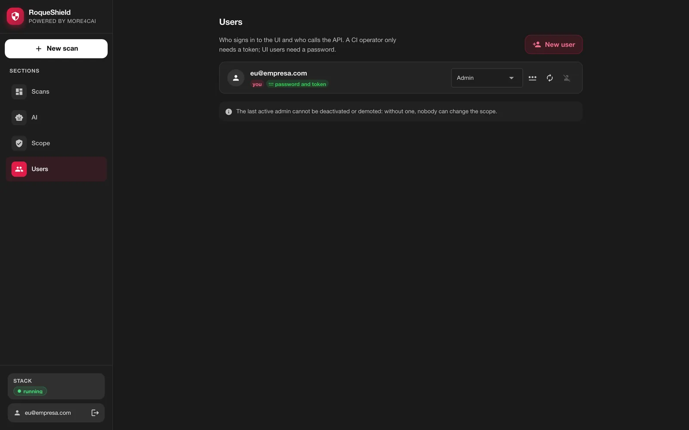
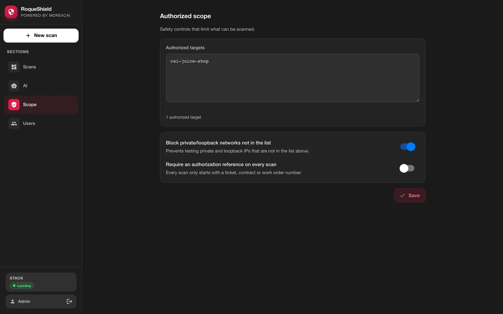
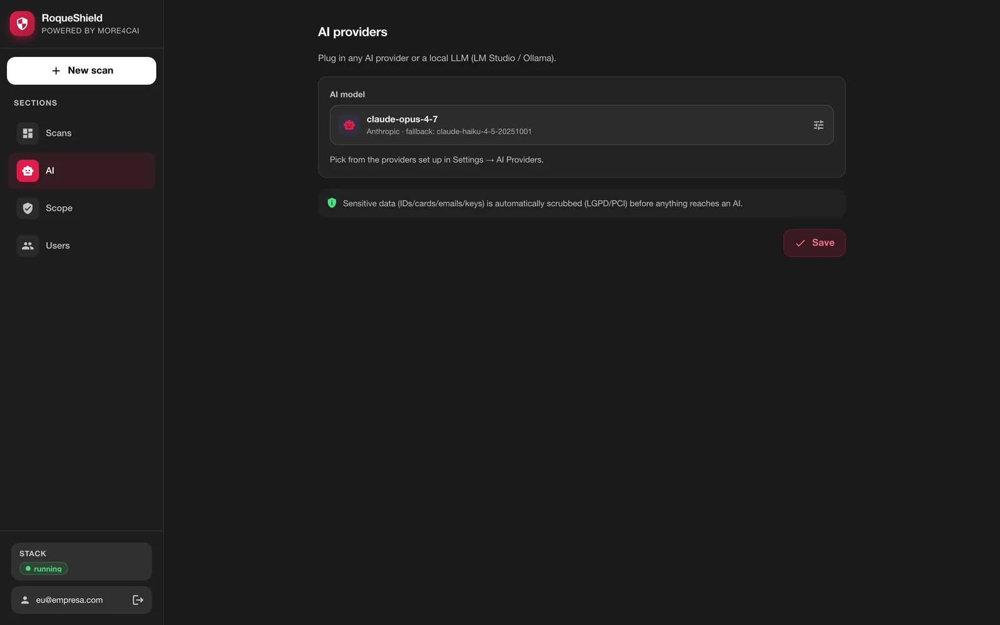

# Operations: running RoqueShield day to day and in production

*Also available in [Brazilian Portuguese](pt-BR/OPERACAO.md).*

> **For whom:** whoever keeps a RoqueShield running after the first scan: the person who updates it, backs it up, gives other people access, and answers for what it scanned.
> **What is here:** the standalone container (one `docker run`) and the production compose (the same image, split into services). Update, backup, secrets, accounts, TLS, scope and authorization, memory, configuration, AI, Greenbone.
> **Where to go for the rest:** the first install is in [GETTING-STARTED.md](GETTING-STARTED.md). Symptoms and fixes are in [WHEN-IT-BREAKS.md](WHEN-IT-BREAKS.md). The full table of variables, commands and routes is in [REFERENCE.md](REFERENCE.md). The development stack (`docker/compose.yml`, `make`) is in [DEVELOPMENT.md](DEVELOPMENT.md).

**A note on names:** the product is RoqueShield. The engine inside it is still called `cai` in the code: the Python package `cai-orchestrator`, the `cai-*` containers of the development stack and the admin CLI `cai`. The CLI you use against a running shield is `roqueshield`. Its messages, like the API's error messages, are in Portuguese; this document glosses them in English.

## Table of contents

1. [What runs inside the container](#1-what-runs-inside-the-container)
2. [Start, stop, update](#2-start-stop-update)
3. [Backup and restore](#3-backup-and-restore)
4. [Secrets](#4-secrets)
5. [Accounts, roles and sessions](#5-accounts-roles-and-sessions)
6. [Beyond localhost](#6-beyond-localhost)
7. [Scope and authorization](#7-scope-and-authorization)
8. [Memory](#8-memory)
9. [Configuration through the environment](#9-configuration-through-the-environment)
10. [Production compose](#10-production-compose)
11. [AI provider and a local model](#11-ai-provider-and-a-local-model)
12. [Greenbone, opt-in](#12-greenbone-opt-in)
13. [Logs and health](#13-logs-and-health)

## 1. What runs inside the container

| Process | What it is | Exposed |
| --- | --- | --- |
| `orchestrator` | API, web UI, Swagger, MCP over HTTP, live progress (SSE) | `:8080` |
| `worker` | runs the scans (nmap, ZAP, nuclei, trivy, semgrep, gitleaks, trufflehog, checkov and the others) | no |
| `redis` | the job queue, with a password | `127.0.0.1` only |
| `zap` | the OWASP ZAP daemon, with the headless Firefox for the AJAX spider | `127.0.0.1` only, with an API key |

A small Python supervisor (`orchestrator/standalone/supervisor.py`) is the entrypoint. On boot it makes sure the secrets exist, runs the database migrations (`alembic upgrade head`, SQLite or Postgres) and only then starts the four processes. It restarts whatever dies, waiting 1 s, 2 s, 4 s and so on up to 60 s. On `docker stop` it stops them in reverse order within 8 seconds in total, which is why the container is created with `--stop-timeout 30`. It runs as UID 1000 and the container needs no capabilities. No Docker socket is mounted.

Each process gets only the secrets it needs. The worker, and the scanners it starts against the target, do not receive the `APP_TOKEN`, the session signing key or the first-run code; Redis and ZAP receive their password and key through `0600` files, not on the command line. This stops accidental leaks (a variable ending up in a log or a report). It does **not** isolate a compromised scanner: the worker and the scanners run as the same user that can read `/data/secrets`. Real isolation, with the worker as another user and no reach to the secrets, is a known limit of this version.

## 2. Start, stop, update

```bash
docker stop roqueshield     # stop
docker start roqueshield    # start again (or run the installer again)
```

**Update.** Run the installer with `--update`. It pulls the image of its own version and, if the container runs a different image, recreates it on the same volume and the same host port. On boot, before the API answers, the supervisor applies the migrations.

```bash
curl -fsSL https://raw.githubusercontent.com/roqueribeiro/roqueos-shield/main/install.sh | sh -s -- --update
```

What you should see (from 0.5.0 to 0.5.1):

```
==> Downloading the image (about 1.2 GB the first time)
==> Updating 'roqueshield': roqueribeiro1988/roqueos-shield:v0.5.0-standalone -> roqueribeiro1988/roqueos-shield:v0.5.1-standalone (the data volume stays)
==> Starting container 'roqueshield' on http://localhost:8080
==> Waiting for RoqueShield to be ready
    ✓ ready
```

Without `--update`, the installer only warns that the container runs an older image and prints the update command. The script on `main` installs the version pinned inside it; to pin another one, set `ROQUESHIELD_VERSION=v<version>`.

The update is over when the shield answers the new version, not when the image is pulled:

```bash
curl -s http://localhost:8080/health
# {"status":"ok","version":"0.5.1"}
```

**Uninstall.** `docker rm -f roqueshield` removes the container and keeps the data. `docker volume rm roqueshield` deletes the data, secrets included. List what is in the volume before you delete it (section 3 shows how to copy it out).

## 3. Backup and restore

The `/data` volume holds everything **together**: the SQLite database (`shield.db`), the reports, the ZAP session, the trivy cache and the secrets. Treat the backup as a secret: whoever has the copy has the `APP_TOKEN` and the `SECRETS_KEY`. Losing the `SECRETS_KEY` makes the stored AI key unreadable; type it again in **AI**.

Backup, with the container stopped so SQLite is consistent:

```bash
docker stop roqueshield
docker run --rm -v roqueshield:/data -v "$PWD":/bkp alpine \
  sh -c 'umask 077 && tar czf /bkp/roqueshield-data.tgz -C /data .'
docker start roqueshield
```

Restore into a new, empty volume (a new machine, or after `docker volume rm`):

```bash
docker volume create roqueshield
docker run --rm -v roqueshield:/data -v "$PWD":/bkp alpine \
  sh -c 'tar xzf /bkp/roqueshield-data.tgz -C /data && chown -R 1000:1000 /data'
```

Then run the installer: it creates the container on the existing volume. The `chown` matters because the container runs as UID 1000 and `alpine` extracts as root.

**In production** (section 10), the data lives in two volumes: Postgres (`pg_data`) and `shield_data` (reports and the first-run code). Back up Postgres with `pg_dump` through compose:

```bash
docker compose -f docker/compose.prod.yml --env-file .env exec -T postgres \
  pg_dump -U roqueshield roqueshield | gzip > roqueshield.sql.gz
```

The secrets there come from your vault, through `.env`, and are backed up in the vault, not with the data.

## 4. Secrets

Six secrets: `APP_TOKEN`, `SESSION_SECRET`, `SECRETS_KEY`, `ZAP_API_KEY`, `REDIS_PASSWORD` and `SETUP_CODE`. For each one the supervisor takes, in this order: the environment variable if it is not empty, the file in `/data/secrets/` if it exists, or a newly generated value written to that file with mode `0600`. Values are never printed. The log says only where each one came from:

```
[supervisor] segredo APP_TOKEN: gerado
[supervisor] segredo SESSION_SECRET: arquivo
```

(`segredo` = secret; `gerado` = generated, `arquivo` = read from the file, `ambiente` = from the environment.)

| Secret | What it is for |
| --- | --- |
| `APP_TOKEN` | a service key with **admin** power. The CLI inside the container uses it. |
| `SESSION_SECRET` | signs the session cookie. Changing it signs everyone out. |
| `SECRETS_KEY` | a Fernet key that encrypts the AI provider key typed in the UI. |
| `ZAP_API_KEY`, `REDIS_PASSWORD` | close ZAP and Redis to anything in the container that is not the worker. |
| `SETUP_CODE` | the first-run code. After the first admin exists, it no longer opens anything. |

The boot refuses an example `APP_TOKEN` (`dev-changeme`, `changeme`, empty and similar), because it grants admin. `ALLOW_INSECURE_APP_TOKEN=true` lifts that, and it exists only for local development.

**Forgot the admin password.** The `APP_TOKEN` is the way back:

```bash
docker exec -it roqueshield roqueshield reset-password admin@example.com
```

It asks for the new password twice, without echo (at least 10 characters), and ends every open session of that account. It prints `senha de admin@example.com trocada; as sessões abertas dessa conta foram encerradas` (password changed; that account's open sessions were ended).

The AI key typed in **AI** is stored encrypted with `SECRETS_KEY` and never goes back to the browser.

## 5. Accounts, roles and sessions



Only admins create users, in **Users** (or `POST /users`). A user without a password signs in only through the API and the CLI, with the token shown **once** at creation; with a password, they can also use the UI. Only admins change passwords, their own included.

| Role | Can |
| --- | --- |
| `admin` | everything: users, scope, AI configuration, scans |
| `operator` | start, read and delete scans |
| `auditor` | read scans, findings and reports, and holds the audit permission |
| `viewer` | read scans, findings and reports |

For an agent or a pipeline that should only read, give it a `viewer` or `auditor` token: neither can start a scan by any path.

- Signing out, changing the password or being deactivated ends **all** of that user's sessions. The last active admin cannot be deactivated or demoted.
- Sessions last `SESSION_TTL_HOURS` (12 by default).
- After 5 wrong passwords in a row for the same e-mail **from the same IP**, login for that pair waits 30 s, and the wait doubles with each new error up to 15 min. The owner, from another IP, still gets in. One IP is only slowed down after 50 errors across all e-mails. The counters live in the API's memory, so restarting the container clears them.
- With the default `-p 127.0.0.1:8080:8080`, every client arrives with the Docker bridge address, so in practice the wait applies per e-mail. Behind a proxy, see section 6.

**SSO.** With `OIDC_ISSUER`, `OIDC_CLIENT_ID` and `OIDC_CLIENT_SECRET` set (and `OIDC_REDIRECT_URI`), login through the identity provider (Entra ID, Keycloak, Okta) appears next to the password login. A user created by SSO gets `OIDC_DEFAULT_ROLE`, `viewer` by default.

## 6. Beyond localhost

The shield does not terminate TLS. To use it from another machine, put a reverse proxy with HTTPS in front (Caddy, Traefik, nginx) and publish only the proxy. Behind it, set one of:

- `FORWARDED_ALLOW_IPS=<proxy ip>`: uvicorn trusts the proxy's `X-Forwarded-For` and `X-Forwarded-Proto`, so the login brake sees the real client IP and the session cookie gets `Secure`;
- `COOKIE_SECURE=true`: forces `Secure` on the cookie when the proxy is not trusted that way.

Without `FORWARDED_ALLOW_IPS`, everyone shows up with the proxy's IP and the login brake treats them as one client.

Do the first run **before** publishing the port beyond `127.0.0.1`. Never publish port 8080 as plain HTTP on a network that is not yours.

## 7. Scope and authorization

RoqueShield helps you record and enforce scope. It does not decide whether you are allowed to scan. That is the operator's responsibility, and before an active scan against anything real you need:

1. **Written scope** from the owner of the target: the URLs, IPs and repositories that may be tested.
2. **An agreed window**, especially for ZAP's active scan (the **Full** profile) and nuclei, which send real requests in volume.
3. **Notice to whoever watches the target.** If a SOC monitors it, warn them, or they will treat you as an attack.
4. **A check for a CDN** (Cloudflare, Fastly, Akamai) in front of the host. An active scan through a CDN can break its terms; scan the origin, or ask the CDN for an allowance.

Tools that change state on the target (ZAP's active scan) only with explicit authorization.

**What the shield enforces.**

| Control | Default | What it does |
| --- | --- | --- |
| `LAB_ONLY` | `true` | a target that resolves to a private, loopback, link-local or reserved network is refused unless it is in the allowlist. A name that does not resolve is refused too (fail closed). |
| `TARGET_ALLOWLIST` | empty | the authorized list: exact names (`juice-shop`), CIDRs (`10.0.0.0/8`) and wildcards (`*.lab.example.com`), comma separated or as a JSON array |
| `REQUIRE_AUTH_REF` | `false` in the container, `true` in the production compose | every scan needs an authorization reference (ticket, contract, work order) |

Two things no setting opens: cloud metadata (`169.254.169.254` and the link-local range) is never a target, and loopback is only a target when the allowlist carries the address itself (`127.0.0.1`, `127.0.0.0/8`, `::1` or `localhost`), never through a name. Inside the container, loopback is RoqueShield itself: API, Redis and ZAP.



The list is edited in **Scope**, in the first step of **New scan** (**Allow {host} in the scope**, admins only), or with the CLI:

```bash
docker exec roqueshield roqueshield settings scope
docker exec roqueshield roqueshield settings scope --allow juice-shop --allow 10.20.0.0/24 --require-auth-ref
```

`--allow` **replaces** the whole list; repeat it for each entry. A field set by an environment variable shows as locked in the UI and cannot be changed by the API.

Every scan creation goes to the audit trail (`audit_log`) with the actor and the authorization reference. That trail is append-only only on Postgres with the migrations applied, where a trigger refuses `UPDATE` and `DELETE`. On the default SQLite it is an ordinary table; `REQUIRE_IMMUTABLE_AUDIT=true` makes the boot refuse SQLite.

## 8. Memory

ZAP's AJAX spider and active scan are the hungry part. Give Docker at least **6 GB** that is really free. On Docker Desktop that is the VM, not the laptop. With less, the kernel kills ZAP mid-scan, and the scan says so: `zap` shows up in `scanners_skipped`, coverage is marked incomplete, and it never becomes "zero findings". The installer warns below 5.5 GiB. In the production compose, the `zap` service has `mem_limit: 6g`.

## 9. Configuration through the environment

The environment wins over the UI. A field set by a variable shows as locked in the UI, with the variable's name, which is what a regulated environment needs: nobody changes in a screen what the deploy decided. The variables you will reach for most often:

| Variable | Default in the container | Effect |
| --- | --- | --- |
| `DATA_DIR` | `/data` | secrets, SQLite, reports, ZAP session, trivy cache |
| `DATABASE_URL` | SQLite at `/data/shield.db` | point to Postgres for an immutable audit trail |
| `REDIS_URL` | the built-in Redis, with password | pointing elsewhere skips the built-in Redis |
| `ZAP_BASE_URL` | the built-in ZAP | pointing elsewhere skips the built-in ZAP |
| `PORT` | `8080` | API port inside the container |
| `SHIELD_SERVICES` | all | processes to start (`orchestrator`, `worker`); how the production compose splits API and workers |
| `LAB_ONLY`, `TARGET_ALLOWLIST`, `REQUIRE_AUTH_REF` | from the UI | lock the authorized scope |
| `LLM_MODEL`, `LLM_API_BASE`, `ANTHROPIC_API_KEY` and the other keys | from the UI | lock the AI configuration |
| `ALLOW_CLOUD_FALLBACK` | `false` | `false` forbids a local model from falling back to a cloud one; `true` allows it |
| `AGENT_LIVE_EXECUTION` | `false` | lets an admin run the AI agent's planned commands for real (`dry_run=false`); off, the agent only plans |
| `MCP_ALLOW_ACTIONS` | `false` | lets `POST /mcp` start scans (always with an authorization reference) |
| `RATE_LIMIT_PER_MINUTE` | `20` | ceiling per user and route on the routes that start expensive work; `0` turns it off |
| `COOKIE_SECURE`, `FORWARDED_ALLOW_IPS` | off | TLS behind a proxy (section 6) |
| `OIDC_*` | off | SSO, next to password login |
| `REQUIRE_IMMUTABLE_AUDIT` | `false` | refuses to boot without an immutable audit trail |

Every variable, with its default and what reads it, is in [REFERENCE.md](REFERENCE.md#6-environment-variables). The annotated template is [.env.example](../.env.example).

## 10. Production compose

`docker/compose.prod.yml` runs the **same image** as the standalone, with each piece in its own service:


- **Postgres** instead of SQLite, so the audit trail is append-only and `REQUIRE_IMMUTABLE_AUDIT=true` holds (the compose sets it).
- **Redis** with a password and **ZAP** as separate services. The supervisor sees `REDIS_URL` and `ZAP_BASE_URL` pointing outside and does not start the built-in ones.
- **`shield`** runs only the API (`SHIELD_SERVICES=orchestrator`) and is the one that migrates the database. **`worker`** runs only workers and can be scaled.
- `REQUIRE_AUTH_REF` defaults to `true` and `ALLOW_CLOUD_FALLBACK` to `false`. Every container has `cap_drop: [ALL]` and `no-new-privileges`.
- `shield` and `worker` run with a **read-only root** (`read_only: true`): they write only to the `/data` volume (which is also their `HOME`) and to `/tmp`, a 2 GB tmpfs where the adapters keep their temporary files and the scanned repository is cloned. `shield` and `zap` have healthchecks; `shield` reuses the image's `/health` check.
- **No secret on a command line.** ZAP and Redis receive their key and password through the environment; their entrypoint writes a `0600` file, unsets the variable and passes only the path (`-configfile` for ZAP, the config file for Redis). Neither shows up in `ps`, `/proc/<pid>/cmdline` or `docker inspect` (`Config.Cmd`), the same mechanism the supervisor uses in the standalone. Before 08/11/2026 the compose passed `-config api.key=...` and `--requirepass ...`.
- **No raw socket, no separate nmap worker.** The nmap adapter does a connect scan (`-sT -Pn`), which needs no `NET_RAW`. Issue #12 considered a dedicated nmap worker on its own network to hold that capability; with no capability to hold, it was dropped (08/11/2026). If a SYN scan is ever needed, the capability goes to a service of its own, never to the worker that runs the other scanners.

```bash
# .env at the repository root, from your secrets vault:
#   SHIELD_VERSION=v0.5.1  POSTGRES_PASSWORD=...  REDIS_PASSWORD=...  APP_TOKEN=...
#   SESSION_SECRET=...  SECRETS_KEY=...  ZAP_API_KEY=...
#   (optional) SHIELD_BIND=127.0.0.1  SHIELD_PORT=8080
docker compose -f docker/compose.prod.yml --env-file .env up -d
docker compose -f docker/compose.prod.yml --env-file .env up -d --scale worker=3
docker compose -f docker/compose.prod.yml --env-file .env exec shield cat /data/secrets/SETUP_CODE
```

`--env-file` is required: with `-f`, compose looks for `.env` next to the compose file, in `docker/`. Every required variable is declared with `:?`, so a missing one stops compose before anything starts. `SECRETS_KEY` is a Fernet key:

```bash
python -c "from cryptography.fernet import Fernet; print(Fernet.generate_key().decode())"
```

**Update in production:** change `SHIELD_VERSION` in `.env` and run `up -d` again. The `shield` service migrates before the API answers. As in the standalone, the update is over when `/health` answers the new version.

## 11. AI provider and a local model

AI is optional. Without it, the scanners run and the findings keep their own classification. With it, the model triages the findings (adjusted severity, false-positive likelihood, remediation) and writes the executive narrative. Before anything goes to an external model, the scrubber redacts personal and card data from the evidence and descriptions: CPF and CNPJ, card numbers and CVV, e-mails, Brazilian phone numbers, JWTs, AWS keys, and `Authorization` and `Cookie` headers.

Configure it in **AI**: Anthropic, OpenAI, OpenRouter, or a local OpenAI-compatible server. The key is stored encrypted and never comes back to the UI. The same fields can be locked by the environment (`LLM_MODEL`, `LLM_FALLBACK_MODEL`, `LLM_API_BASE`, `LLM_API_KEY`, `ANTHROPIC_API_KEY`, `OPENAI_API_KEY`, `OPENROUTER_API_KEY`).



**LM Studio, for data that should not leave the building:**

1. Install LM Studio, load a model and turn on the local server (Developer tab, port 1234).
2. In **AI**, set the local endpoint to `http://host.docker.internal:1234/v1` and pick the model. The model name can be the one LM Studio shows: with a local endpoint, a name without a provider prefix is sent as `openai/<name>`. LM Studio ignores the key; leave it blank.
3. Decide about the fallback. `LLM_FALLBACK_MODEL` is used when the primary model fails. If the primary is local and the fallback is a cloud model, a failure sends the findings to the cloud. `ALLOW_CLOUD_FALLBACK=false` forbids that crossing: the triage fails instead of leaking. In a regulated environment, set it to `false` (the production compose already does).
4. Check it: `docker exec roqueshield roqueshield status` lists `llm_local: ok` when the endpoint answers.

Known quirks of local servers: LM Studio rejects `response_format=json_object`, so the gateway does not send it to a local endpoint and extracts the JSON from the text. Reasoning models (Qwen 3, DeepSeek R1) spend tokens thinking before answering; if the answer comes back empty, raise the context and output limits in LM Studio.

## 12. Greenbone, opt-in

Greenbone (OpenVAS) is a network vulnerability scanner with its own heavy stack: about 20 services and a feed of roughly 5 GB that takes from 30 minutes to 3 hours to sync the first time. It is not in the standalone image and no profile runs it; you ask for it by name, for a `host` or `domain` target:

```bash
docker exec roqueshield roqueshield scan start 10.20.0.15 --type host --scanner greenbone --auth-ref CHG-123
```

RoqueShield talks to it over GMP on TCP, configured by environment:

```bash
GREENBONE_HOST=<host that answers GMP>
GREENBONE_PORT=9390
GREENBONE_USERNAME=admin
GREENBONE_PASSWORD=<the password you set>
```

The repository brings a minimal compose for it, made for the development stack: `make greenbone-up` starts it, `bash scripts/feed-sync.sh` follows the feed, the web console is at `http://127.0.0.1:9392` (plain HTTP: the `cai-gsa` container serves port 80, published only on `127.0.0.1`) and GMP at `127.0.0.1:9390`. The default login is `admin/admin`: **change it** before any scan. For a real environment, use Greenbone's official compose. Both publish on the host's `127.0.0.1`, which the standalone container does not reach through `host.docker.internal` on Linux; put the shield and Greenbone on the same Docker network, or publish GMP where the container can reach it. [DEVELOPMENT.md](DEVELOPMENT.md) has the development side.

## 13. Logs and health

```bash
docker logs roqueshield                                   # everything, as the supervisor prints it
docker exec roqueshield roqueshield status                # version, who is signed in, each dependency
docker exec roqueshield roqueshield logs worker --tail 100
docker exec roqueshield roqueshield logs zap -f
curl -s http://localhost:8080/health                      # liveness, no auth, returns the version
```

`roqueshield logs` takes `orchestrator`, `worker`, `redis` or `zap`, comes with credentials already redacted, and needs the admin permission (inside the container it has it). `/health/full`, the detailed check behind `status`, needs a token. The same logs, with CPU and memory per process, are in the **Execution** tab of any scan.
