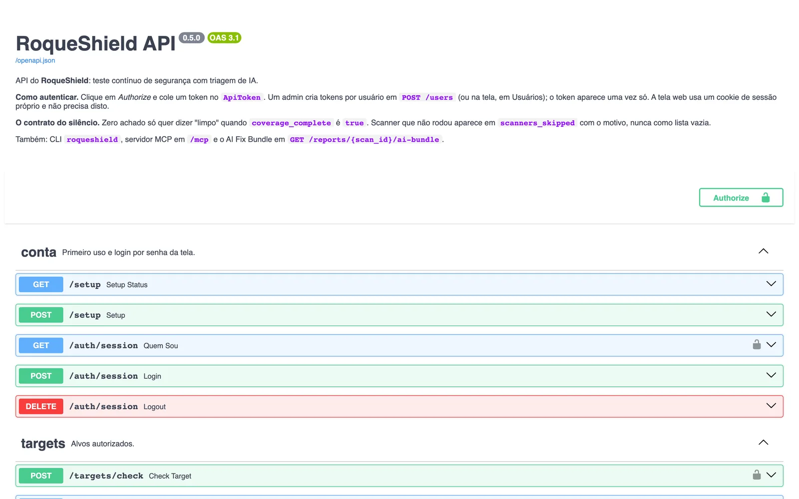

# Reference

*Also available in [Brazilian Portuguese](pt-BR/REFERENCIA.md).*

> Everything RoqueShield exposes, one piece at a time: the installer, the two CLIs, the REST API, the MCP server, every environment variable, the scanners and the options each one accepts, the scan profiles, the roles and the files it writes. It is read from the code (`install.sh`, `orchestrator/`), not from older prose. To install and run a first scan, read [GETTING-STARTED.md](GETTING-STARTED.md). To understand why it is built this way, [ARCHITECTURE.md](ARCHITECTURE.md). For the terms, [GLOSSARY.md](GLOSSARY.md).
>
> The CLIs and the API print their messages in Portuguese, because that is what the programs print. This document quotes them verbatim and explains them in English.

## Table of contents

| Section | What it covers |
| --- | --- |
| [1. The installer (install.sh)](#1-the-installer-installsh) | Flags, variables, what it checks, what it never does |
| [2. The roqueshield CLI](#2-the-roqueshield-cli) | The client: login, scans, findings, reports, MCP; exit codes |
| [3. The cai admin CLI](#3-the-cai-admin-cli) | The engine's in-process CLI: `scan`, `exposure`, `serve`, `bundle` |
| [4. REST API](#4-rest-api) | Authentication, every route with its permission, Swagger |
| [5. MCP server](#5-mcp-server) | stdio and HTTP transports, the tools, how actions turn on |
| [6. Environment variables](#6-environment-variables) | Every variable: default and effect |
| [7. Scanners and their options](#7-scanners-and-their-options) | The 15 adapters, which ones a scan can build, the options the API accepts |
| [8. Scan profiles](#8-scan-profiles) | Which scanners each profile runs per target type |
| [9. Roles and permissions](#9-roles-and-permissions) | The four roles and the five permissions |
| [10. Files and volumes](#10-files-and-volumes) | `/data`, the secrets, reports, the CLI config file |

---

## 1. The installer (install.sh)

A POSIX `sh` script that runs the standalone container. It is pinned to one version: `VERSAO_PADRAO="v0.5.1"` installs the image `roqueribeiro1988/roqueos-shield:v0.5.1-standalone`, and `scripts/check_docs_fresh.py` checks that pin against `pyproject.toml`.

```text
curl -fsSL https://raw.githubusercontent.com/roqueribeiro/roqueos-shield/main/install.sh | sh
curl -fsSL .../install.sh | sh -s -- --update        # move to this script's version, keep the data
curl -fsSL .../install.sh | sh -s -- --no-browser    # do not open the browser
```

| Flag | Effect |
| --- | --- |
| `--update` (or `--atualizar`) | If the container runs a different image, pulls this script's image, removes the container and creates it again on the same port and volume. With the same image it only makes sure the container is running |
| `--no-browser` (or `--nao-abrir`) | Does not open the browser |
| `-h`, `--help` | Prints the header of the script. When piped (`curl ... \| sh`) the script has no file to read and prints its URL instead |
| anything else | Exits 1 with `opção desconhecida: <arg>` (unknown option) |

| Variable (English / Portuguese) | Default | Effect |
| --- | --- | --- |
| `ROQUESHIELD_PORT` / `ROQUESHIELD_PORTA` | `8080` | Port on your computer, published on `127.0.0.1` only. Must be 1 to 65535 |
| `ROQUESHIELD_VERSION` / `ROQUESHIELD_VERSAO` | the script's (`v0.5.1`) | Image tag prefix; `-standalone` is appended |
| `ROQUESHIELD_NAME` / `ROQUESHIELD_NOME` | `roqueshield` | Container name and volume name. Letters, digits, `.`, `-`, `_`, starting with a letter or digit |
| `ROQUESHIELD_NO_BROWSER` / `ROQUESHIELD_NAO_ABRIR` | empty | Any non-empty value skips the browser (including `0`) |

The English name wins when both are set. Messages come out in Portuguese when `LC_ALL`, `LC_MESSAGES` or `LANG` starts with `pt`, and in English otherwise.

What it does, in order:

1. Checks that `docker` exists and answers (`docker info`), with a separate message for "permission denied" on Linux.
2. Reads Docker's memory. Below 5632 MiB it warns that RoqueShield needs 6 GB and that a scanner may be killed mid-scan, ending with incomplete coverage. It does not stop.
3. Pulls the image (about 1.2 GB the first time). If the pull fails and the image is already local, it uses it.
4. Runs the container: `-p 127.0.0.1:<port>:8080`, `--shm-size=1g`, `--stop-timeout 30`, `--restart unless-stopped`, `--add-host host.docker.internal:host-gateway` (so a scan reaches an app on your machine, on Linux too) and `-v <name>:/data`. An existing container is started, unpaused or left running, never recreated without `--update`.
5. Waits up to 3 minutes for the health check (`/health`). On `unhealthy` it prints the last 30 log lines and exits 1.
6. Asks `GET /setup` whether the first admin exists. If not, it reads `/data/secrets/SETUP_CODE` inside the container and opens the browser through a local page (mode 0600, in a folder only you can read, deleted after 5 minutes) that redirects to `http://localhost:<port>/#setup=<code>`. The code rides in the URL fragment, which the browser never sends to the server, and it is never printed nor put on a command line.

What it does not do: publish the port beyond `127.0.0.1`, ask for `sudo`, install Docker, or touch anything outside its container and volume. Every step lives in functions called from `main()` on the last line, so a download cut halfway runs nothing.

## 2. The roqueshield CLI

The client. It talks to a running RoqueShield over HTTP, with the caller's token, so the RBAC of [section 9](#9-roles-and-permissions) applies. It ships in the image (`/usr/local/bin/roqueshield`) and in the Python package (`[project.scripts]` in `pyproject.toml`).

Where it gets the server and the token, in this order:

1. `ROQUESHIELD_URL` and `ROQUESHIELD_TOKEN` in the environment (the CI case).
2. The file that `roqueshield login` writes: `$XDG_CONFIG_HOME/roqueshield/config.json`, or `~/.config/roqueshield/config.json` (file 0600, folder 0700).
3. Inside the standalone container, with neither of the above: `http://127.0.0.1:$PORT` with the `APP_TOKEN` from `$DATA_DIR/secrets/APP_TOKEN` (or from the `APP_TOKEN` variable). That is why `docker exec roqueshield roqueshield status` works with no setup.

Without any of them it exits 2 with `sem servidor ou token: rode roqueshield login --server URL, ou defina ROQUESHIELD_URL e ROQUESHIELD_TOKEN` (no server or token). The token is never printed.

| Command | What it does | Permission it needs |
| --- | --- | --- |
| `login --server/-s URL [--token T]` | Checks the token against `GET /auth/session` and saves server and token. Without `--token` it asks without echo | any valid token |
| `status` | Version, who is logged in, and `GET /health/full` per component | any valid token |
| `scan start ALVO [options]` | Registers the target (`POST /targets`) and starts the scan (`POST /scans`) | `scans:run` |
| `scan watch SCAN_ID [--fail-on S] [--intervalo 5.0] [--prazo 7200.0]` | Follows a scan to the end and exits by the exit-code contract | `scans:read` |
| `scan list [--limit 20]` | The most recent scans | `scans:read` |
| `scan show SCAN_ID [--json]` | State, counts per severity, which scanners ran and which did not, and why | `scans:read` |
| `scan rm SCAN_ID [--yes]` | Deletes the scan and its findings; the deletion stays in the audit trail | `scans:run` |
| `findings SCAN_ID [--severity S] [--limit 200] [--json]` | The findings of a scan | `scans:read` |
| `report SCAN_ID [--format bundle\|compliance\|html\|executive] [--output/-o FILE]` | Downloads a report; `bundle` (default) is the [AI Fix Bundle](AI-FIX-BUNDLE.md). Without `-o`, stdout | `scans:read` |
| `settings ai` | The AI configuration in use, without keys | `config:manage` |
| `settings scope [--allow X ...] [--require-auth-ref/--no-require-auth-ref]` | Shows the scope; with options, replaces it (`PUT /settings/scope`) | `config:manage`, for reading too |
| `reset-password EMAIL` | Sets a new password (10+ characters, asked twice without echo) and closes that account's sessions | `users:manage` |
| `logs SERVICO [--follow/-f] [--tail 100]` | Log of `orchestrator`, `worker`, `redis` or `zap`, with credentials already redacted | `config:manage` |
| `mcp [--server URL]` | MCP server over stdio ([section 5](#5-mcp-server)) | the token's |

`scan start` options:

| Option | Default | Values |
| --- | --- | --- |
| `--type` | `url` | `url`, `domain`, `host`, `image`, `repo`, `k8s_resource` |
| `--profile` | `web` | `web`, `network`, `full` ([section 8](#8-scan-profiles)) |
| `--scanner` | none | repeat for more than one; overrides the profile ([section 7](#7-scanners-and-their-options)) |
| `--auth-ref` | none | the authorization reference (ticket, change); required when `REQUIRE_AUTH_REF=true` |
| `--wait / --no-wait` | `--no-wait` | follow to the end and exit by the contract |
| `--fail-on` | none | `info`, `low`, `medium`, `high`, `critical` |
| `--intervalo` | `5.0` | seconds between reads |
| `--prazo` | `7200.0` | seconds before giving up (exits 3) |

`reset-password` is the way back in when the admin password is lost: inside the container the CLI already uses the `APP_TOKEN`, so `docker exec -it roqueshield roqueshield reset-password admin@example.com` works without copying any token to the screen.

### Exit codes

The contract for a pipeline, from `orchestrator/cliente/cli.py`:

| Code | Meaning |
| --- | --- |
| **0** | The scan finished, coverage is complete, nothing at or above `--fail-on` |
| **1** | The scan finished, coverage is complete, and there is a finding at or above `--fail-on` |
| **2** | Usage, connection or credential error. API refusals print `a API recusou (<status>): <detail>` (the API refused); no connection prints `sem conexão com o RoqueShield` |
| **3** | The scan failed, did not finish within `--prazo`, or coverage came out **incomplete** (some scanner did not run) |

Code 3 beats 0 and 1 on purpose: zero findings with a scanner that did not run is not a clean target, it is an unverified vector. When coverage is incomplete the summary prints `cobertura INCOMPLETA: zero achado aqui não quer dizer alvo limpo` (incomplete coverage: zero findings here does not mean a clean target) and one `não rodou: <scanner>: <reason>` line per skipped scanner.

## 3. The cai admin CLI

`cai` is the internal name of the engine (package `cai-orchestrator`, containers `cai-*`). The `cai` CLI is different from `roqueshield`: it does not call the API, it runs the pipeline **in its own process**. It is for development (`make scan TARGET=...` calls it through the compose stack) and for debugging inside the engine image.

| Command | What it does |
| --- | --- |
| `cai scan TARGET [--asset-type url] [--criticality medium] [--contains-pii/--no-contains-pii] [--skip-ai/--no-skip-ai] [--active-zap/--no-active-zap] [--ajax/--no-ajax]` | Runs the pipeline against `TARGET` and writes the HTML report. With no scanner list, it uses the default for the asset type ([section 8](#8-scan-profiles)). `--ajax` follows `--active-zap` when not given |
| `cai exposure COMPANY_NAME [--domains D ...] [--github-orgs O ...] [--dorks Q ...] [--config-file FILE.yaml] [--skip-ai]` | The OSINT pipeline (GitHub dorks, gitleaks and trufflehog on found repos, dnstwist, shodan, subdomain takeover). Read-only over public data. The YAML overrides the flags |
| `cai serve [--host 0.0.0.0] [--port 8080]` | Starts the REST API with uvicorn |
| `cai bundle SCAN_ID [--out PATH]` | Writes the AI Fix Bundle of a finished scan. Default: `$REPORTS_DIR/scan-<id>/ai-bundle.json` |

Limits that matter, read from `orchestrator/cli.py` and `orchestrator/jobs/pipelines.py`:

- `cai scan` does **not** pass through the gates of `POST /scans`: no target validation against `LAB_ONLY` and the allowlist, no `authorization_ref`, no audit event. It is a tool for whoever already has a shell in the engine. For anything that must be in scope and audited, use `roqueshield scan start` or the API.
- `--asset-type` says `host|url|domain` in its help, but it accepts any asset type of the enum.
- `--contains-pii` says "rota AI local" (local AI route) in its help. In the code it only marks the target and goes to the model as context in the triage payload; it does not change which model is called.

## 4. REST API

FastAPI. The live contract is at `/openapi.json`, with Swagger UI at `/docs` and ReDoc at `/redoc`. A snapshot of the contract is versioned in [`openapi.json`](openapi.json) and kept by `scripts/openapi_snapshot.py --check` (a test fails when the API changes without the snapshot).



### Authentication

`get_principal` (`orchestrator/api/deps.py`) accepts, in this order:

1. `X-API-Token: <APP_TOKEN>`: the service principal, role `admin` (`service@local`).
2. `X-API-Token: <user token>`: a per-user token, stored as SHA-256. Created in `POST /users` or `POST /users/{id}/rotate-token` (shown once).
3. `Authorization: Bearer <session JWT>`: the OIDC session. The user is read again from the database on every request, so deactivation and role changes apply at once.
4. Cookie `rs_session`: the standalone screen's password session (the same JWT). Writes with the cookie also require the `X-RoqueShield` header (CSRF): `escrita por cookie exige o cabeçalho X-RoqueShield`.

Without credentials: 401 `credenciais ausentes` (missing credentials). Without the permission: 403 `permissão insuficiente (<permission>)` (insufficient permission).

`POST /scans`, `POST /exposure/scan` and `POST /investigate/{id}` have a rate limit of `RATE_LIMIT_PER_MINUTE` calls per principal and per route (fixed one-minute window, counted in Redis, in memory if Redis is down). Over it: 429 with `Retry-After`. Login and first setup have their own brake per origin (429 `muitas tentativas`, too many attempts).

### Routes

Permission `public` means no credential; `any` means any valid credential.

| Resource | Method and path | Permission | What it does |
| --- | --- | --- | --- |
| health | `GET /health` | public | `{"status":"ok","version":...}`; what the container health check and the fleet read |
| health | `GET /health/full` | any | Postgres or SQLite, Redis, ZAP, local and cloud LLM, in parallel |
| account | `GET /setup` | public | `needs_setup` and version |
| account | `POST /setup` | public, with `setup_code` or `X-API-Token: APP_TOKEN` | Creates the first admin; 410 `o primeiro uso já foi feito` (first use already done) afterwards |
| account | `POST /auth/session` | public | Password login; sets the `rs_session` cookie |
| account | `GET /auth/session` | any | Who am I |
| account | `DELETE /auth/session` | session cookie | Logout; ends every session of the user |
| auth (OIDC) | `GET /auth/login`, `GET /auth/callback` | public | SSO flow, only when `OIDC_ISSUER`, `OIDC_CLIENT_ID` and `OIDC_CLIENT_SECRET` are set |
| auth (OIDC) | `GET /auth/me` | any | The current identity |
| targets | `POST /targets` | `scans:run` | Registers a target (`asset_type`, `value`, `criticality`, `contains_pii`, `label`, `metadata`); validated against the scope |
| targets | `POST /targets/check` | `scans:run` | Says whether a target passes the scope, without creating it |
| targets | `GET /targets`, `GET /targets/{id}` | `scans:read` | List and detail |
| scans | `POST /scans` | `scans:run` | Starts a scan (202). Body below |
| scans | `GET /scans[?state=]`, `GET /scans/{id}` | `scans:read` | List (last 100) and detail |
| scans | `DELETE /scans/{id}` | `scans:run` | Deletes the scan, its findings and AI runs; audits first |
| findings | `GET /findings` | `scans:read` | Filters `scan_id`, `severity`, `source_tool`, `limit`, `offset` |
| findings | `GET /findings/{id}` | `scans:read` | One finding |
| findings | `GET /findings/queue` | `scans:read` | Queue of unique problems by `deduped_key`, severity first (`status`, `min_severity`, `source_tool`) |
| findings | `GET /findings/summary` | `scans:read` | Counts per severity and status |
| findings | `POST /findings/resolve` | `scans:run` | Sets the status of a problem: `open`, `in_progress`, `resolved`, `false_positive`, `wont_fix`, `risk_accepted` |
| reports | `GET /reports/{scan_id}` | `scans:read` | Technical HTML report |
| reports | `GET /reports/{scan_id}/ai-bundle` | `scans:read` | AI Fix Bundle, schema 1.0.0 |
| reports | `GET /reports/{scan_id}/executive` | `scans:read` | Executive HTML: risk grade A to F and compliance mapping |
| reports | `GET /reports/{scan_id}/compliance` | `scans:read` | Compliance mapping in JSON |
| reports | `POST /reports/{scan_id}/export/defectdojo` | `scans:run` | Exports to DefectDojo (`DEFECTDOJO_URL`, `DEFECTDOJO_API_KEY`) |
| exposure | `POST /exposure/scan` | `scans:run` | Queues the OSINT pipeline (`company_name`, `domains`, `github_orgs`, `dorks`) |
| investigate | `POST /investigate/{finding_id}` | `scans:run`; `dry_run=false` also needs `config:manage` and `AGENT_LIVE_EXECUTION=true` | The investigation agent on one finding. Body: `instructions`, `dry_run` (default `true`), `max_steps` (default 10) |
| settings | `GET`/`PUT /settings/ai` | `config:manage` | Models, API base and keys. Keys are stored encrypted and never returned (`hasApiKey`). Fields set by the environment come back in `locked` |
| settings | `POST /settings/ai/models` | `config:manage` | The models each key reaches, fetched server side |
| settings | `GET`/`PUT /settings/scope` | `config:manage` | `labOnly`, `allowlist`, `requireAuthRef`, `allowCloudFallback`, plus `locked` |
| system | `GET /system/services`, `GET /system/usage` | `config:manage` | One card per process of the container, CPU and memory |
| system | `GET /system/logs/{service}` | `config:manage` | Last lines of a service (`tail` 1 to the cap, `since`) |
| users | `GET`/`POST /users` | `users:manage` | List; create (`email`, `name`, `role` default `viewer`, optional `password`). The token is shown once |
| users | `PATCH /users/{id}/role`, `POST /users/{id}/deactivate`, `POST /users/{id}/rotate-token`, `PUT /users/{id}/password` | `users:manage` | 409 `é o último admin ativo` (it is the last active admin) protects the last admin |
| ui | `GET /ui/api/scans`, `GET /ui/api/scans/{id}`, `GET /ui/api/findings`, `GET /ui/api/ai-runs`, `GET /ui/api/ai-runs/stats` | `scans:read` | The aggregated reads the screen, the CLI and MCP use. The scan detail carries the coverage fields |
| ui | `GET /ui/api/events[?scan_id=]` | `scans:read` | Server-Sent Events: live logs and phases. `?token=` is accepted only here and only with the `APP_TOKEN` |
| mcp | `POST /mcp` | any | MCP over HTTP ([section 5](#5-mcp-server)). `GET /mcp` answers 405 |

`POST /scans` body (`ScanIn`):

| Field | Default | Notes |
| --- | --- | --- |
| `target_id` | required | From `POST /targets` |
| `profile` | `web` | Free string; see [section 8](#8-scan-profiles) for what each value does |
| `scanners` | `null` | Explicit list; wins over the profile. Filtered by what accepts the asset type |
| `options` | `{}` | `{scanner: {field: value}}`, validated against a closed list ([section 7](#7-scanners-and-their-options)); anything else is 422 with the field's name |
| `auth` | `null` | `{headers: {...}, openapi_url}` for authenticated scanning. Header values never reach the `scans` table; they ride only in the job and are redacted in the audit |
| `authorization_ref` | `null` | Required (403) when `REQUIRE_AUTH_REF=true` |
| `actor` | `null` | Accepted and not used: the actor in the audit is the authenticated identity |

Target and `openapi_url` outside the scope: 403 `target rejeitado pela policy: <reason>` (target rejected by the policy).

The scan detail (`GET /ui/api/scans/{id}`) is where coverage lives: `coverage_state` (`completa`, `incompleta` or `desconhecida`: complete, incomplete, unknown), `coverage_complete`, `coverage_note`, `scanners_ran`, `scanners_skipped` (scanner to reason), `scanners_requested`, `state` (`pending`, `running`, `done`, `failed`, `canceled`), `current_phase`, `severity_counts`. A scan in which **no** scanner ran ends as `failed`, not `done`.

## 5. MCP server

One protocol core (`orchestrator/cliente/mcp_nucleo.py`, written by hand: `initialize`, `ping`, `tools/list`, `tools/call`; protocol versions `2025-06-18`, `2025-03-26`, `2024-11-05`) and two transports. Every tool calls the REST API with the caller's credential, so RBAC applies.

| Transport | How to run | Actions turn on with |
| --- | --- | --- |
| stdio | `roqueshield mcp [--server URL]`; for Claude Code: `claude mcp add roqueshield -- roqueshield mcp`. One JSON-RPC message per line; logs go to stderr | `ROQUESHIELD_MCP_ACTIONS=1` in the environment of whoever runs it |
| HTTP | `POST /mcp` with `X-API-Token` or `Authorization: Bearer` (Streamable HTTP, JSON answers, no SSE stream; batches are refused) | `MCP_ALLOW_ACTIONS=true` on the server |

| Tool | Arguments | Notes |
| --- | --- | --- |
| `list_scans` | `limit` (1 to 200) | Recent scans with state, phase and counts |
| `get_scan` | `scan_id` | Detail, including coverage |
| `get_findings` | `scan_id`, `severity`, `limit` (1 to 500) | Comes back with `isError: true` and the partial findings when the scan failed, has not finished or has incomplete coverage |
| `get_ai_bundle` | `scan_id` | Same rule as `get_findings`, with the partial bundle |
| `list_targets` | none | Registered targets |
| `start_scan` | `target`, `authorization_ref` (3+ characters, required), `asset_type`, `profile` (`web`, `network`, `full`, `exposure`) | Only listed when actions are on. Registers the target and starts the scan under the token's RBAC |

The server's `instructions` tell the agent: `Zero achado só é limpo com coverage_complete=true` (zero findings is only clean with `coverage_complete=true`).

## 6. Environment variables

Read by `Settings` (`orchestrator/config.py`, pydantic-settings, case-insensitive, also from a `.env` file). Every field is also in [`.env.example`](../.env.example), and `scripts/check_docs_fresh.py` fails CI when one is missing there. The defaults below are the code's; the standalone container changes a few (marked "standalone").

The AI and scope fields can also be set in the screen (`app_settings` table). **The environment wins**: a variable present in the process environment locks the field, and the API lists it in `locked`.

### AI

| Variable | Default | Effect |
| --- | --- | --- |
| `LLM_MODEL` | `anthropic/claude-opus-4-7` | Triage model, in litellm form `<provider>/<model>` |
| `LLM_FALLBACK_MODEL` | `anthropic/claude-haiku-4-5-20251001` | Model used when the primary fails |
| `LLM_API_BASE` | empty | API base for an OpenAI-compatible local backend (LM Studio, Ollama). Empty uses the provider's default |
| `LLM_API_KEY` | empty | Key for the local backend. Set by the environment, it also locks `LLM_API_BASE` |
| `ALLOW_CLOUD_FALLBACK` | `true` | `false` forbids a failing local model from falling back to a cloud one: the triage fails instead of sending findings out |
| `LLM_INVESTIGATION_MODEL` | empty | Model of the agent loop; empty uses `LLM_MODEL` |
| `ANTHROPIC_API_KEY`, `OPENAI_API_KEY`, `OPENROUTER_API_KEY` | empty | Provider keys |
| `LLM_LOCAL_BASE_URL`, `LLM_LOCAL_MODEL` | `http://ollama:11434/v1`, `ollama/qwen2.5:32b-instruct-q4_K_M` | Legacy aliases, not read by the gateway |
| `PHOENIX_ENABLED` | `false` | Turns on Phoenix tracing (needs the `tracing` extra) |
| `PHOENIX_COLLECTOR_ENDPOINT` | `http://phoenix:6006/v1/traces` | Where traces go |

### Investigation agent

| Variable | Default | Effect |
| --- | --- | --- |
| `AGENT_ENABLED` | `true` | The ReAct loop with real tools. `false` falls back to a single-prompt opinion |
| `AGENT_EXECUTOR` | `auto` | Where the agent's commands run: `auto` (the `cai-kali-toolbox` container if it is up, else in-process), `kali` or `local`. The leash is the same in both |
| `AGENT_LIVE_EXECUTION` | `false` | Allows `dry_run=false`. Off, the agent only plans and shows the commands |

### Scope and compliance

| Variable | Default | Effect |
| --- | --- | --- |
| `LAB_ONLY` | `true` | Blocks private, loopback, link-local and metadata addresses that are not in the allowlist. Loopback and metadata stay blocked even with `false` |
| `TARGET_ALLOWLIST` | empty | Authorized targets: CSV or JSON array of hostnames, IPs, CIDRs, `*.domain` |
| `REQUIRE_AUTH_REF` | `false` | Every `POST /scans` must carry `authorization_ref` |
| `REQUIRE_IMMUTABLE_AUDIT` | `false` | Refuses to boot on SQLite, where the audit trail is editable (the append-only trigger is Postgres only) |
| `RATE_LIMIT_PER_MINUTE` | `20` | Cap per principal and route on the three expensive routes. `0` turns it off |

### Authentication and sessions

| Variable | Default | Effect |
| --- | --- | --- |
| `APP_TOKEN` | `dev-changeme` | Service token, maps to `admin`. The boot refuses example or empty values. Standalone: generated on first boot |
| `ALLOW_INSECURE_APP_TOKEN` | `false` | Lets the example token boot. Local development only |
| `SESSION_SECRET` | empty | HMAC key of the session JWT (HS256). Empty falls back to `APP_TOKEN`. Standalone: generated |
| `SESSION_TTL_HOURS` | `12` | Session and cookie lifetime |
| `COOKIE_SECURE` | `false` | Forces `Secure` on the cookie behind a TLS proxy the server does not recognize (uvicorn's `FORWARDED_ALLOW_IPS`) |
| `SETUP_CODE` | empty | First-run code `POST /setup` requires. Standalone: generated in `/data/secrets/SETUP_CODE` |
| `SECRETS_KEY` | empty | Fernet key that encrypts the AI keys saved from the screen. Empty: the screen cannot save keys. Standalone: generated |
| `OIDC_ISSUER`, `OIDC_CLIENT_ID`, `OIDC_CLIENT_SECRET`, `OIDC_REDIRECT_URI` | empty | SSO (Entra ID, Keycloak, Okta). On only with the first three set |
| `OIDC_DEFAULT_ROLE` | `viewer` | Role of a user created by SSO |
| `MCP_ALLOW_ACTIONS` | `false` | Lists `start_scan` on `POST /mcp` |

### Storage and services

| Variable | Default | Effect |
| --- | --- | --- |
| `DATABASE_URL` | `sqlite+aiosqlite:///./data/cai.db` | Standalone: `sqlite+aiosqlite:////data/shield.db`. Postgres: `postgresql+asyncpg://...` |
| `REDIS_URL` | `redis://redis:6379/0` | arq queue, logs and rate limit. Standalone: the built-in Redis on `127.0.0.1` with password; pointing elsewhere turns the built-in one off |
| `DATA_DIR` | `./data` | Standalone: `/data` |
| `REPORTS_DIR` | `./reports` | Standalone: `/data/reports` |
| `ZAP_BASE_URL` | `http://zap:8090` | Standalone: the built-in ZAP on `127.0.0.1:8090`; pointing elsewhere turns the built-in one off |
| `ZAP_API_KEY` | empty | ZAP API key. Standalone: generated |
| `TRIVY_SERVER_URL` | `http://trivy:4954` | Trivy server. Standalone: empty, client mode with a local cache |
| `SEMGREP_RULES_DIR` | `/opt/semgrep-rules` | Offline ruleset baked in the image. Missing or empty falls back to registry packs |
| `GREENBONE_HOST`, `GREENBONE_PORT`, `GREENBONE_USERNAME`, `GREENBONE_PASSWORD` | empty, `9390`, `admin`, empty | Greenbone/OpenVAS (opt-in) |
| `GITHUB_TOKEN`, `SHODAN_API_KEY`, `CENSYS_API_ID`, `CENSYS_API_SECRET` | empty | OSINT sources |
| `DEFECTDOJO_URL`, `DEFECTDOJO_API_KEY` | empty | DefectDojo export |
| `LOG_LEVEL` | `INFO` | Log level |
| `LOG_FORMAT` | `json` | `json` or console |

### Read outside Settings

| Variable | Read by | Effect |
| --- | --- | --- |
| `PORT` | standalone supervisor, health check, CLI | API port inside the container (`8080`) |
| `SHIELD_SERVICES` | standalone supervisor | Comma list of processes to start (`orchestrator`, `worker`...). How `docker/compose.prod.yml` splits the API from N workers with the same image |
| `REDIS_PASSWORD` | standalone supervisor | Password of the built-in Redis. Generated when absent |
| `TRIVY_CACHE_DIR` | trivy | Standalone: `/data/trivy-cache` |
| `NUCLEI_TEMPLATES_DIR` | nuclei adapter | Default `/opt/nuclei-templates`, baked in the image |
| `ROQUESHIELD_URL`, `ROQUESHIELD_TOKEN` | `roqueshield` CLI | Server and token, ahead of the config file |
| `ROQUESHIELD_MCP_ACTIONS` | `roqueshield mcp` | `1` lists `start_scan` over stdio |
| `XDG_CONFIG_HOME` | `roqueshield` CLI | Base of the config file |
| `SHIELD_VERSION`, `POSTGRES_PASSWORD` | `docker/compose.prod.yml` | Image tag and Postgres password of the production compose |

## 7. Scanners and their options

There are **15** adapters in `orchestrator/adapters/`. A regular scan (`POST /scans`, `roqueshield scan start`, `cai scan`) can build **9** of them (`_build_adapters` in `orchestrator/jobs/pipelines.py`). The OSINT pipeline (`POST /exposure/scan`, `cai exposure`) uses 5 more. Two exist with no pipeline that builds them.

| Scanner | Built by | Asset types it accepts | In the standalone image |
| --- | --- | --- | --- |
| `nmap` | scan | host, url, domain, port | yes |
| `zap` | scan | url, host, domain | yes (built-in daemon) |
| `nuclei` | scan | url, host, domain | yes, with offline templates |
| `trivy` | scan | image, repo | yes, client mode |
| `semgrep` | scan | repo | yes, with offline rules |
| `gitleaks` | scan, exposure | repo | yes |
| `trufflehog` | scan, exposure | repo | yes |
| `checkov` | scan | repo | yes |
| `greenbone` | scan | host, domain | needs an external Greenbone (`docker/compose.greenbone.yml`) |
| `github_exposure` | exposure | n/a | needs `GITHUB_TOKEN` and dorks |
| `dnstwist` | exposure | n/a | yes |
| `shodan` | exposure | n/a | needs `SHODAN_API_KEY` |
| `subdomain_takeover` | exposure | n/a | needs `subfinder` and `httpx`, not in the image |
| `censys` | none | n/a | adapter only |
| `kube_bench` | none | n/a | adapter only |

A scanner asked for a target type it does not accept is dropped from the list before the scan (`scanner.skipped_incompatible` in the log). A scanner that cannot run (health check failed, no valid handle, status failed, timeout, `ScanIntegrityError`) goes to `scanners_skipped` with the reason. An unknown name is dropped with `scanner.unknown`.

### Options the API accepts

`ScanIn.options` goes through a closed list (`orchestrator/domain/opcoes.py`). A scanner or field outside it is refused with 422, for example `options.zap.foo não é aceito (aceitos: active, ajax, max_children)` (not accepted; accepted: ...). Nothing is ignored in silence.

| Scanner | Field | Type and range | Adapter default |
| --- | --- | --- | --- |
| `zap` | `active` | bool | `false` (profiles `full` and `active` turn it on) |
| `zap` | `ajax` | bool | `false` (on with `active` in those profiles) |
| `zap` | `max_children` | int 1 to 100 | `10` |
| `nmap` | none | | `nmap_args` is not accepted from outside |
| `nuclei` | `rate_limit` | int 1 to 500 | `50` |
| `nuclei` | `severity` | CSV of `info`, `low`, `medium`, `high`, `critical` | `low,medium,high,critical` |
| `trivy` | `severity` | CSV of `unknown`, `low`, `medium`, `high`, `critical` | all |
| `trivy` | `scanners` | CSV of `vuln`, `secret`, `misconfig`, `license` | `vuln,secret,misconfig` (set by the pipeline) |
| `semgrep` | `config` | list of up to 10, each `auto` or `p/<pack>` | the offline rules in `SEMGREP_RULES_DIR` |
| `semgrep` | `clone_depth` | int 0 to 1000 | `1` |
| `gitleaks` | `clone_depth` | int 0 to 1000 | `0` (full history) |
| `checkov` | `framework` | `[a-z0-9_]{1,40}` | all |
| `checkov` | `clone_depth` | int 0 to 1000 | `1` |
| `trufflehog` | `only_verified` | bool | `false` |
| `trufflehog` | `since_commit` | hex SHA, 7 to 40 | none |
| `dnstwist` | `ssdeep` | bool | `true` |
| `github_exposure` | `dorks` | list of up to 20 queries | from the request |
| `github_exposure` | `max_results_per_dork` | int 1 to 100 | `30` |
| `censys` | `query`, `pages` | text up to 500; int 1 to 10 | target value; `1` |
| `shodan` | `query`, `limit` | text up to 500; int 1 to 1000 | target value; `100` |
| `greenbone` | `config_id`, `scanner_id`, `port_list_id` | UUID | Full and fast; OpenVAS; none |
| `kube_bench` | `targets` | CSV of `master`, `node`, `etcd`, `policies` | all four |

Query text cannot contain control characters nor start with `-`. Options for `censys` and `kube_bench` pass validation, but no scan builds those adapters.

## 8. Scan profiles

`profile` is a free string on the scan. It does two things: it picks the scanner list when `scanners` is not sent, and `full` or `active` turn on ZAP's active scan and AJAX spider (`apply_profile` in `orchestrator/api/routers/scans.py`). Order of precedence: explicit `scanners`, then the profile, then the default of the asset type, always filtered by what accepts the type and never empty.

| Asset type | `web` | `network` | `full` | Default (no profile match) |
| --- | --- | --- | --- | --- |
| `url` | zap, nuclei | nmap | nmap, zap, nuclei | zap |
| `domain` | zap, nuclei | nmap | nmap, zap, nuclei | zap |
| `host` | nmap, zap, nuclei | nmap | nmap, zap, nuclei | nmap |
| `port` | default | nmap | nmap | nmap |
| `image` | default | default | trivy | trivy |
| `repo` | default | default | semgrep, gitleaks, trufflehog, trivy, checkov | semgrep, gitleaks, trufflehog, trivy, checkov |
| `k8s_resource` | default | default | default | nmap, as a last resort (no scanner declares support for this type) |

`web` is passive ZAP. `full` adds ZAP active (real injection payloads, slower and more intrusive), still under `LAB_ONLY`, the allowlist and `authorization_ref`. `active` is accepted and turns on the active scan, with the scanners of the default column. Any other value, including `exposure` and `cloud`, only labels the scan and uses the default column: the OSINT pipeline runs only from `POST /exposure/scan` or `cai exposure`.

The scanner list actually used is saved in `requested_scanners` and shown as `scanners_requested`.

## 9. Roles and permissions

From `orchestrator/domain/roles.py`. Each role is a fixed set of permissions; there is no implicit hierarchy. An unknown role becomes `viewer` (fail-closed).

| Permission | What it allows |
| --- | --- |
| `users:manage` | Create, list, change role, deactivate, rotate token, set password |
| `scans:run` | Create targets, start and delete scans, resolve findings, OSINT, investigation, DefectDojo export |
| `scans:read` | Read scans, findings, reports and the AI Fix Bundle |
| `audit:read` | Read the audit log |
| `config:manage` | AI configuration, scope and allowlist, system cards and logs, `dry_run=false` in the investigation |

| Role | Permissions |
| --- | --- |
| `admin` | all five. The `APP_TOKEN` service principal is `admin` |
| `operator` | `scans:run`, `scans:read` |
| `auditor` | `scans:read`, `audit:read` |
| `viewer` | `scans:read` |

Separation of duties: an `operator` starts scans but does not manage users or scope; an `auditor` reads but does not start scans. Known limit: no route of the current API checks `audit:read`, so through the API an `auditor` sees what a `viewer` sees. The audit trail itself is the `audit_log` table, append-only on Postgres with the migrations applied.

The last active admin cannot be demoted or deactivated (409).

## 10. Files and volumes

### The standalone container

The image declares `VOLUME /data`, runs as user 1000 with `HOME=/data` and exposes `8080`. The installer mounts a named volume (`roqueshield` by default) on `/data`. Everything that survives an update lives there:

| Path | What it is |
| --- | --- |
| `/data/secrets/` | Folder 0700 with one file 0600 per generated secret: `APP_TOKEN`, `SESSION_SECRET`, `SECRETS_KEY`, `ZAP_API_KEY`, `REDIS_PASSWORD`, `SETUP_CODE`. Generated once, reused on every boot; a variable passed in the environment wins and nothing is generated for it. The log says only the name and the origin (`ambiente`, `arquivo`, `gerado`: environment, file, generated), never the value |
| `/data/secrets/redis.conf`, `/data/secrets/zap.properties` | Password and key of the built-in Redis and ZAP, by file (0600) so they never appear on a process command line |
| `/data/shield.db` | SQLite database (when `DATABASE_URL` is not set) |
| `/data/reports/` | HTML reports: `scan-<id>.html`, `exposure-<id>.html` |
| `/data/trivy-cache/` | Trivy vulnerability database |
| `/data/zap/` | ZAP home |

The API, worker and Redis do not get the same environment: scanners run as children of the worker and process the target's content, so the worker never receives `APP_TOKEN`, `SESSION_SECRET`, `SETUP_CODE` or `REDIS_PASSWORD`.

Backing up is copying the volume; deleting it (`docker volume rm roqueshield`) deletes every scan, user and secret. See [OPERATIONS.md](OPERATIONS.md).

### Outside the container

| Path | What it is |
| --- | --- |
| `~/.config/roqueshield/config.json` | Server and token saved by `roqueshield login` (0600; folder 0700). Honors `XDG_CONFIG_HOME` |
| `./data/`, `./reports/` | Defaults of `DATA_DIR` and `REPORTS_DIR` when the engine runs outside the standalone image |
| `reports/scan-<id>/ai-bundle.json` | Default output of `cai bundle` |
| `.env` | Read by `Settings` from the working directory; template in `.env.example` |
| `docs/openapi.json` | Snapshot of the API contract |

---

## When something does not work

Symptoms, causes and fixes are in [WHEN-IT-BREAKS.md](WHEN-IT-BREAKS.md). For a security problem in RoqueShield itself, follow [../SECURITY.md](../SECURITY.md), not a public issue.
