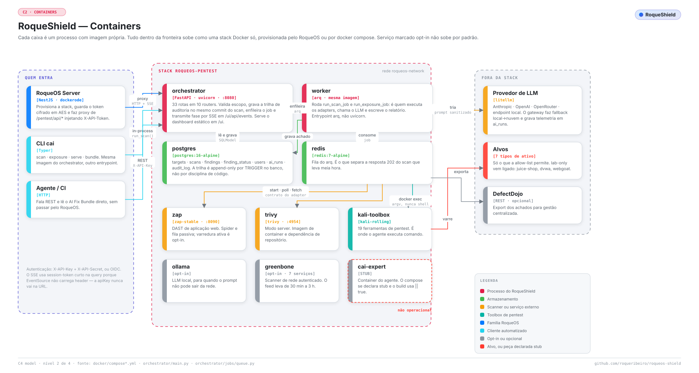
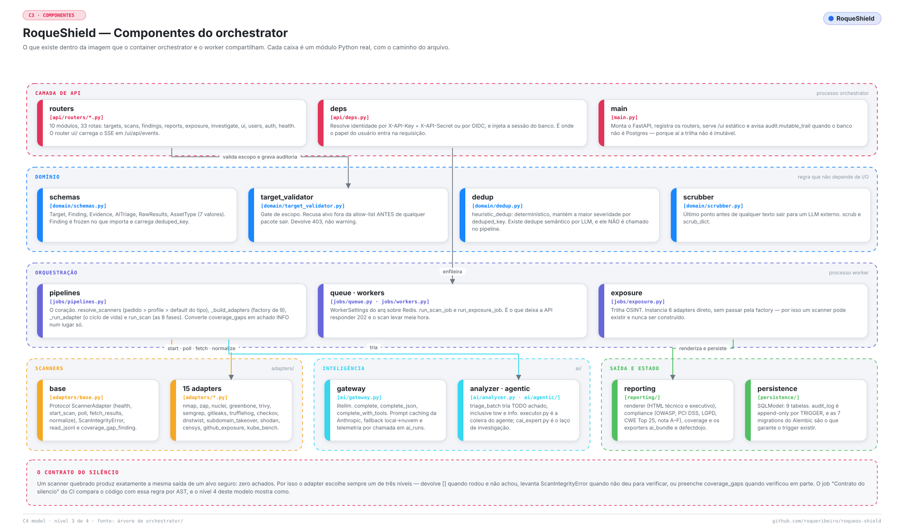

<div align="center">


# RoqueShield — the architecture, level by level

</div>

Nine diagrams, following the [C4 model](https://c4model.com) for the first four
levels and then going where C4 does not: infrastructure, the scan pipeline, the
agent's leash, the integration surfaces and the product UI.

Every figure is **generated from code** in [`../scripts/diagrams/`](../scripts/diagrams/)
and regenerated by `python scripts/gen_diagrams.py`. Every box names a real module,
container or file — nothing in these pages describes a capability that is not in the
repository, and where a capability is partial the diagram says it is partial.

> **Reading rule:** if a diagram and the code disagree, the code wins and the
> diagram is what needs fixing — in the same change.

---

## Level 1 — System Context

*Who uses the platform, what it scans, and what it depends on. At level 1
RoqueShield is a single box; the decomposition is level 2.*

<picture>
  <source media="(prefers-color-scheme: dark)" srcset="assets/diagrams/c1-context-dark.svg">
  
</picture>

Three kinds of actor reach the system, and the third is the one that changes how the
tool is designed. A **security operator** registers the target, declares the
authorization and signs the report. A **development team** receives triaged findings
without ever opening the tool. An **AI agent** reads the AI Fix Bundle, patches the
code and asks for another scan — which is why the bundle is a versioned contract and
not a rendered page.

---

## Level 2 — Containers

*Each box is a process with its own image. Everything inside the boundary comes up
as one Docker stack.*

<picture>
  <source media="(prefers-color-scheme: dark)" srcset="assets/diagrams/c2-containers-dark.svg">
  
</picture>

The split that matters is **orchestrator versus worker**: the same image with a
different entrypoint. The orchestrator answers HTTP and streams SSE; the worker runs
`arq` and is the process that actually executes adapters, calls the LLM and writes
the report. That is what lets `POST /scans` return `202` in milliseconds while the
scan takes half an hour.

Note what the diagram marks in red: `cai-expert` is a **declared stub**. Its compose
file says so in its own header, and its Dockerfile ends the install with `|| true`,
so the image builds even when the install fails.

---

## Level 3 — Components

*What lives inside the image the orchestrator and the worker share.*

<picture>
  <source media="(prefers-color-scheme: dark)" srcset="assets/diagrams/c3-components-dark.svg">
  
</picture>

Two details in this level are worth stopping on.

`jobs/pipelines.py` holds three things that are usually scattered: the scanner
resolution (`resolve_scanners`, precedence **explicit request > profile > default for
the asset type**), the factory (`_build_adapters`, nine entries), and the lifecycle
(`_run_adapter`). Keeping them together is why the conversion of `coverage_gaps` into
an INFO finding happens in exactly one place. Fifteen adapters remembering to do it
would be a convention; one place is a mechanism.

`jobs/exposure.py` does **not** go through the factory — it instantiates six adapters
directly. That is how a scanner can exist, be tested, and never be constructed by any
production path; two of them are in exactly that state today.

---

## Level 4 — Code: the scanner lifecycle

*Every step has an explicit error exit, and none of them returns an empty list.*

<picture>
  <source media="(prefers-color-scheme: dark)" srcset="assets/diagrams/c4-code-dark.svg">
  
</picture>

This is the level where the project's governing rule becomes code. `health()` must
do a real round-trip, because constructing an SDK client proves nothing about a
credential. `poll()` must read `task.result()`, because a process that terminated is
not a process that succeeded. `fetch_results()` must raise on an absent, empty or
unparseable report, because `{}` and "the repository is clean" are the same JSON.

And the enforcement is not a code review habit: `scripts/check_no_silence.py` parses
the AST and fails the build. It was itself hardened after an adversarial audit walked
around the first version four different ways — those four are now
`tests/unit/test_gate_do_silencio.py`.

---

## Infrastructure and deployment

*Two ways to bring it up, one image.*

<picture>
  <source media="(prefers-color-scheme: dark)" srcset="assets/diagrams/infra-deploy-dark.svg">
  
</picture>

Under RoqueOS, **no RoqueShield port is published on the host**: the orchestrator is
reachable only over the internal Docker network, and the only way in is the RoqueOS
reverse proxy, which injects the service token server-side. Standalone, `8080` is
published and `/ui` is directly reachable — which is the right trade-off for a
development machine and the wrong one for a server.

The audit trail's immutability is a **Postgres trigger**, not application discipline.
On SQLite the trigger does not exist, and `main.py` logs `audit.mutable_trail` to say
so out loud rather than let a test environment quietly pretend.

---

## The scan pipeline

*From the POST to the report.*

<picture>
  <source media="(prefers-color-scheme: dark)" srcset="assets/diagrams/esteira-scan-dark.svg">
  
</picture>

Three gates run before a single packet leaves: scope, authorization, audit. The third
one writes `scan.create` to the trail **in the same commit** that creates the scan
row — either both exist or neither does, so there is no scan without a record of who
asked for it.

One ordering decision is deliberate and looks wrong at first: the report is rendered
**before** the findings are persisted. The report path has to exist to go on the scan
row, and without that ordering `GET /reports/{id}` returned 404 forever.

And the terminal state is not cosmetic: when **no** scanner ran, the scan ends
`FAILED`, not `DONE` with zero findings.

---

## The Kali sidecar and the agent inside it

<picture>
  <source media="(prefers-color-scheme: dark)" srcset="assets/diagrams/kali-cai-agente-dark.svg">
  
</picture>

Nineteen tools, chosen one by one — the base is `kali-rolling`, not
`kali-linux-large`, because the big metapackage is over 12 GB of tools nobody calls.

The leash is four checks in `executor.py`, and the third is the one that closes the
whole class of prompt-injection escapes: the command is handed to
`asyncio.create_subprocess_exec` as an **argv list**, never a shell string. There is
no metacharacter for the model to escape, because there is no shell to escape into.

---

## Integration surfaces and the agent loop

<picture>
  <source media="(prefers-color-scheme: dark)" srcset="assets/diagrams/integracoes-agente-dark.svg">
  
</picture>

Full detail in [integrations.md](integrations.md). The short version: three surfaces
exist today — CLI, REST and the AI Fix Bundle — and they are enough to build the
scan → patch → re-scan loop. The MCP server and the GitHub Action in the bottom band
are **proposals, not features.**

---

## The product surface inside RoqueOS

<picture>
  <source media="(prefers-color-scheme: dark)" srcset="assets/diagrams/telas-roqueos-dark.svg">
  
</picture>

> **These are interface diagrams, not screenshots.** No capture of the running UI
> exists in this repository; when one does, it replaces the figure and this note goes
> away.

The app is admin-only, appears in the RoqueOS Launchpad only when the `pentest`
capability is enabled, and opens in a 1280×860 window. Four sections plus a scan
detail. Two behaviours are worth naming because they are security decisions, not UI
choices:

- The scan-detail stepper is driven by **SSE** with a 4-second polling net underneath,
  because a stream that fails to open must not leave the operator staring at a frozen
  progress bar.
- The event stream carries a **short session token in the query string** — never the
  API key — because `EventSource` cannot send headers, and a credential in a URL ends
  up in every proxy log between here and there.

---

## How these diagrams stay true

```bash
python scripts/gen_diagrams.py           # regenerate all 18 SVGs
python scripts/gen_diagrams.py --check   # fail if any is stale, missing or orphaned
```

`--check` runs in CI. It compares the SVG on disk with what the code produces right
now, and fails on three conditions: a file that changed by hand, a file that is
missing, and a file in the folder that no module generates. Mutation-tested — all
three plantings exit 1, and the clean tree exits 0.

The generator needs nothing outside the standard library. Text is measured from
`scripts/diagrams/metrics.json`, a per-character advance table extracted once from the
real font files and versioned alongside the code.

That table is the third attempt, and the two it replaced both failed quietly. The
first estimated character widths by bucket, ran about 7 % low, and produced boxes
whose text overflowed in the render — visible only by looking at the output. The
second measured with the installed font, fixed the overflow, and introduced a worse
problem: the same input produced a different SVG on a machine without Inter, so
`--check` would fail because of the machine rather than because of the drawing.
Turning measurement into arithmetic removed both.
