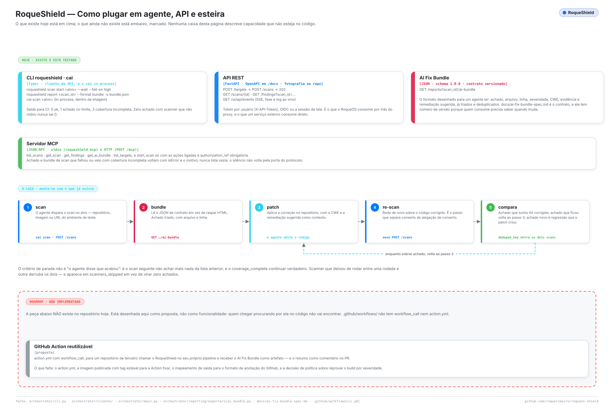

<div align="center">


# RoqueShield — agents, APIs and pipelines

</div>

How to drive RoqueShield from something that is not a human: an AI agent, a service,
a CI job. What exists today is in the first half; what does not exist is in the
second half, labelled, with what is missing to build it.

<picture>
  <source media="(prefers-color-scheme: dark)" srcset="assets/diagrams/integracoes-agente-dark.svg">
  
</picture>

---

## 1. The three surfaces that exist

### CLI — `roqueshield`

A client of the REST API, so it works the same against the container on your laptop
and a shield on another machine. Inside the standalone container it needs no setup;
outside, `ROQUESHIELD_URL` and `ROQUESHIELD_TOKEN` (or `roqueshield login`).

```bash
roqueshield scan start https://staging.example.com --auth-ref CHG-123 --wait --fail-on high
roqueshield scan start https://github.com/acme/api.git --type repo --profile full --wait
roqueshield scan show <scan_id> --json
roqueshield findings <scan_id>
roqueshield report <scan_id> --format bundle -o bundle.json
```

`--wait` exits with the pipeline contract: `0` clean at `--fail-on`, `1` findings at or
above it, `2` usage or connection error, `3` failed scan or incomplete coverage. Without
an AI key the scan still runs; findings keep the scanner's own classification.

### REST — FastAPI

OpenAPI at `/docs`. Authentication is the `X-API-Token` header (a token created in
**Users**, or the `APP_TOKEN`), or the session cookie of the web UI. The routes an
integration actually needs:

| Step | Call |
| --- | --- |
| Register the target | `POST /targets` → `201` |
| Start the scan | `POST /scans` → `202` with the scan id |
| Watch it | `GET /scans/{id}` — or the event stream, below |
| Read the findings | `GET /findings?scan_id=…` |
| Compliance posture | `GET /reports/{id}/compliance` |
| The bundle | `GET /reports/{id}/ai-bundle` |

Live progress is `GET /ui/api/events`, `text/event-stream`, emitting `phase` and
`log` events. It takes the same session cookie or `X-API-Token` header as the rest of
the API. `EventSource` in a browser cannot send headers, so the web UI uses the cookie.

### AI Fix Bundle — the contract for machines

`GET /reports/{scan_id}/ai-bundle`, schema `1.0.0`, specified in
[ai-fix-bundle-spec.md](ai-fix-bundle-spec.md).

This is the surface designed for an agent to read: findings already deduplicated and
triaged, each with a stable id, priority, file and line, CWE, evidence and a
suggested remediation. It has a **schema version** because whoever consumes it needs
to know when it changes — the whole point of a contract is that it is not a rendered
page you scrape.


---

## 2. The loop: scan → patch → re-scan

The three surfaces above are enough to close the loop without a person in the middle.

1. **Scan.** The agent starts a scan against the repository, image or staging URL.
2. **Bundle.** It reads `GET /reports/{id}/ai-bundle` — structured, not scraped.
3. **Patch.** It edits the code with the CWE and the suggested remediation as context.
4. **Re-scan.** It starts a new scan over the corrected code. *This is the step that
   separates a fix from a claim of a fix.*
5. **Compare.** Match the two scans by `deduped_key`: what disappeared was fixed,
   what remains goes back to step 3, and what is **new** is a regression the patch
   introduced.

### The stopping condition

Not "the agent reported success". The loop ends when the next scan does not find what
the previous one found **and** `coverage_complete` is still true.

That second condition is not decoration. A scanner that stopped running between
rounds — a network that closed, a container that did not come up, a credential that
expired — produces zero findings for exactly the same reason a clean codebase does.
Without checking coverage, "the agent fixed everything" and "the scanner stopped
working" are indistinguishable, and the loop would happily declare victory over a
broken tool. That is the same failure the whole project is built to prevent, arriving
through the front door.

So a correct implementation of step 5 checks three things, in this order:

```python
assert novo["coverage_complete"], "scanner deixou de rodar; comparação inválida"
assert set(novo["scanners_ran"]) >= set(anterior["scanners_ran"])
resolvidos = anterior_keys - novo_keys
regressoes = novo_keys - anterior_keys
```

### A worked example, with the CLI

```bash
REPO=https://github.com/acme/api.git
BEFORE=$(roqueshield scan start "$REPO" --type repo | awk '/^scan / {print $2}')
roqueshield scan watch "$BEFORE"
roqueshield report "$BEFORE" --format bundle -o bundle.json

# ... the agent patches the repository from bundle.json ...

AFTER=$(roqueshield scan start "$REPO" --type repo | awk '/^scan / {print $2}')
roqueshield scan watch "$AFTER"
roqueshield report "$AFTER" --format bundle -o bundle-after.json

jq -s '{
  resolved:    ([.[0].vulnerabilities[].deduped_key] - [.[1].vulnerabilities[].deduped_key]),
  regressions: ([.[1].vulnerabilities[].deduped_key] - [.[0].vulnerabilities[].deduped_key])
}' bundle.json bundle-after.json
```

---

## 3. MCP server

**Status: implemented on 2026-11-06**, in `orchestrator/cliente/mcp_nucleo.py`, with two
transports: stdio (`roqueshield mcp`, for Claude Code, Claude Desktop and Cursor) and
HTTP (`POST /mcp`, authenticated like the rest of the API). Written against the
protocol directly rather than the `mcp` SDK, because the lockfile already carries two
incompatible versions of that SDK through optional extras.

| Tool | Arguments | Returns |
| --- | --- | --- |
| `list_scans` | limit | recent scans with state, phase and counts |
| `get_scan` | scan_id | detail, including which scanners ran and which did not, and why |
| `get_findings` | scan_id, severity, limit | the findings; **an error** if the scan failed or coverage is incomplete |
| `get_ai_bundle` | scan_id | the AI Fix Bundle; **an error** under the same conditions |
| `list_targets` | — | registered targets |
| `start_scan` | target, asset_type, profile, authorization_ref | only with actions enabled; the reference is mandatory |

Every tool calls the REST API with the caller's credential, so RBAC applies as usual.
Actions are off by default (`MCP_ALLOW_ACTIONS` on the server, `ROQUESHIELD_MCP_ACTIONS=1`
for stdio): starting a scan against a third party has legal weight. And the test that
was listed as missing exists: `tests/unit/test_mcp.py` proves a failed or incomplete scan
returns an error with the reason, never `[]`, and a mutant that returns the list
silently fails it.

Not built from the original proposal: `shield_compare` (diff between two scans). The CLI
and the bundle cover it with `jq` (section 2).

---

## 4. Not implemented: reusable GitHub Action

**Status: proposal.** Measured on 2026-08-30: `.github/workflows/` contains a single
file, `ci.yml`, with no `workflow_call`, and there is no `action.yml` in the
repository. Nothing here can be called from another project's pipeline today.

The shape it would take:

```yaml
# .github/workflows/security.yml, in the consuming repository
jobs:
  roqueshield:
    uses: roqueribeiro/roqueos-shield/.github/workflows/scan.yml@v1
    with:
      target: .
      asset-type: repo
      profile: full
      fail-on: high          # política, e é uma decisão de produto
    secrets:
      ANTHROPIC_API_KEY: ${{ secrets.ANTHROPIC_API_KEY }}
```

…producing the AI Fix Bundle as a build artifact, the findings as GitHub code
annotations on the changed lines, and a PR comment with the compliance grade.

**What is missing to build it:** the `action.yml` and the `workflow_call` entry
point; a published image with a **stable tag** for the Action to pin, since a
security scanner that silently changes version between runs is worse than no scanner;
the mapping from `Finding` to GitHub's annotation format; and a policy decision on
`fail-on` — which severity blocks a merge — that belongs to whoever owns the
repository, not to this tool.

There is one more requirement, and it is the same one as for MCP: the Action must
fail the build when a scanner did not run. A green check on a scan with
`coverage_complete: false` is the CI version of the silent zero.

---

## 5. Today, without either of them

Both gaps have a working answer right now, which is why neither is urgent.

**In CI**, one shell step against a shield you already run (the token is a CI secret
created in **Users**, with the `operator` role):

```yaml
- name: RoqueShield
  env:
    ROQUESHIELD_URL: https://shield.example
    ROQUESHIELD_TOKEN: ${{ secrets.ROQUESHIELD_TOKEN }}
  run: |
    docker run --rm -e ROQUESHIELD_URL -e ROQUESHIELD_TOKEN --entrypoint roqueshield \
      roqueribeiro1988/roqueos-shield:v0.5.1-standalone \
      scan start https://staging.example.com --auth-ref "$GITHUB_RUN_ID" --wait --fail-on high
```

Exit code `3` (failed or incomplete coverage) fails the step too: a scanner that did
not run never passes as "clean".

**With an agent**, the CLI is already the interface: a coding agent with shell access
runs `roqueshield scan start` and `roqueshield report` directly, and the MCP server
(section 3) does the same for clients without a shell.
