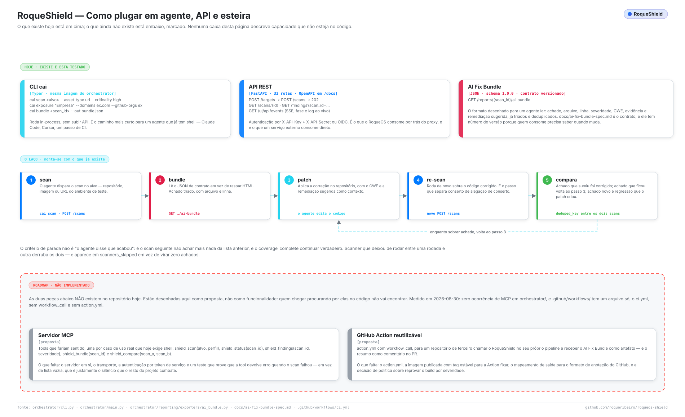

<div align="center">


# RoqueShield — agents, APIs and pipelines

</div>

How to drive RoqueShield from something that is not a human: an AI agent, a service,
a CI job. What exists today is in the first half; what does not exist is in the
second half, labelled, with what is missing to build it.

<picture>
  <source media="(prefers-color-scheme: dark)" srcset="assets/diagrams/integracoes-agente-dark.svg">
  
</picture>

---

## 1. The three surfaces that exist

### CLI — `cai`

A Typer application, four commands, running **in-process**: no API to bring up, no
token to manage. It is the shortest path for an agent that already has a shell.

```bash
cai scan https://staging.example.com --asset-type url --criticality high
cai scan git@github.com:acme/api.git --asset-type repo
cai exposure "Acme Corp" --domains acme.com --github-orgs acme
cai bundle 8f2c1e4a-... --out bundle.json
cai serve --host 0.0.0.0 --port 8080
```

`--skip-ai` runs the scan without the triage step, which is what you want when the
LLM is unavailable and you still need coverage.

### REST — FastAPI, 33 routes

OpenAPI at `/docs`. Authentication is `X-API-Key` + `X-API-Secret`, or OIDC. The
routes an integration actually needs:

| Step | Call |
| --- | --- |
| Register the target | `POST /targets` → `201` |
| Start the scan | `POST /scans` → `202` with the scan id |
| Watch it | `GET /scans/{id}` — or the event stream, below |
| Read the findings | `GET /findings?scan_id=…` |
| Compliance posture | `GET /reports/{id}/compliance` |
| The bundle | `GET /reports/{id}/ai-bundle` |

Live progress is `GET /ui/api/events`, `text/event-stream`, emitting `phase` and
`log` events. `EventSource` cannot send headers, so this endpoint takes a **short
session token in the query string** — never the API key, which would then live in
every proxy log along the path.

### AI Fix Bundle — the contract for machines

`GET /reports/{scan_id}/ai-bundle`, schema `1.0.0`, specified in
[ai-fix-bundle-spec.md](ai-fix-bundle-spec.md).

This is the surface designed for an agent to read: findings already deduplicated and
triaged, each with a stable id, priority, file and line, CWE, evidence and a
suggested remediation. It has a **schema version** because whoever consumes it needs
to know when it changes — the whole point of a contract is that it is not a rendered
page you scrape.

> Known inconsistency, not hidden: the bundle emits `"generator": {"tool": "cai",
> "version": "0.3.0"}` while the application declares `0.4.0` and `pyproject.toml`
> says `0.1.0`. A consumer cannot currently tell which build produced a bundle. The
> fix is to read one source; it is tracked, not done.

---

## 2. The loop: scan → patch → re-scan

The three surfaces above are enough to close the loop without a person in the middle.

1. **Scan.** The agent starts a scan against the repository, image or staging URL.
2. **Bundle.** It reads `GET /reports/{id}/ai-bundle` — structured, not scraped.
3. **Patch.** It edits the code with the CWE and the suggested remediation as context.
4. **Re-scan.** It starts a new scan over the corrected code. *This is the step that
   separates a fix from a claim of a fix.*
5. **Compare.** Match the two scans by `deduped_key`: what disappeared was fixed,
   what remains goes back to step 3, and what is **new** is a regression the patch
   introduced.

### The stopping condition

Not "the agent reported success". The loop ends when the next scan does not find what
the previous one found **and** `coverage_complete` is still true.

That second condition is not decoration. A scanner that stopped running between
rounds — a network that closed, a container that did not come up, a credential that
expired — produces zero findings for exactly the same reason a clean codebase does.
Without checking coverage, "the agent fixed everything" and "the scanner stopped
working" are indistinguishable, and the loop would happily declare victory over a
broken tool. That is the same failure the whole project is built to prevent, arriving
through the front door.

So a correct implementation of step 5 checks three things, in this order:

```python
assert novo["coverage_complete"], "scanner deixou de rodar; comparação inválida"
assert set(novo["scanners_ran"]) >= set(anterior["scanners_ran"])
resolvidos = anterior_keys - novo_keys
regressoes = novo_keys - anterior_keys
```

### A worked example, with the CLI

```bash
BEFORE=$(cai scan git@github.com:acme/api.git --asset-type repo --json | jq -r .scan_id)
cai bundle "$BEFORE" --out bundle.json

# ... the agent patches the repository from bundle.json ...

AFTER=$(cai scan git@github.com:acme/api.git --asset-type repo --json | jq -r .scan_id)
cai bundle "$AFTER" --out bundle-after.json

jq -s '{
  resolvidos: (.[0].findings - .[1].findings),
  regressoes: (.[1].findings - .[0].findings)
}' bundle.json bundle-after.json
```

---

## 3. Not implemented: MCP server

**Status: proposal.** Measured on 2026-08-30: zero occurrences of MCP anywhere under
`orchestrator/`. There is no server, no transport, no tool definition. What exists and
is sometimes mistaken for it: ten Claude Code *skills* under `.claude/skills/`, which
are prompt instructions for one editor, not a protocol server other clients can speak.

The tools that would earn their place — one per use case that today needs a shell:

| Tool | Arguments | Returns |
| --- | --- | --- |
| `shield_scan` | target, asset_type, profile, authorization_ref | scan id, accepted or the reason it was refused |
| `shield_status` | scan_id | state, current phase, progress |
| `shield_findings` | scan_id, min_severity | the triaged findings |
| `shield_bundle` | scan_id | the AI Fix Bundle |
| `shield_compare` | scan_a, scan_b | resolved, remaining, regressions, coverage delta |

**What is missing to build it:** the server process and its transport; authentication
by service token, since MCP clients do not carry the operator's session; a decision
about whether a tool call may start a scan at all, or only read — starting a scan is
a side effect with legal weight when the target is a third party; and a test proving
that every tool **returns an error when the scan failed**, rather than an empty list.
That last one is not a detail. A tool that answers `[]` for a scan that never ran
reintroduces, at the protocol boundary, exactly the silence the rest of this project
spends two CI gates preventing.

---

## 4. Not implemented: reusable GitHub Action

**Status: proposal.** Measured on 2026-08-30: `.github/workflows/` contains a single
file, `ci.yml`, with no `workflow_call`, and there is no `action.yml` in the
repository. Nothing here can be called from another project's pipeline today.

The shape it would take:

```yaml
# .github/workflows/security.yml, in the consuming repository
jobs:
  roqueshield:
    uses: roqueribeiro/roqueos-shield/.github/workflows/scan.yml@v1
    with:
      target: .
      asset-type: repo
      profile: full
      fail-on: high          # política, e é uma decisão de produto
    secrets:
      ANTHROPIC_API_KEY: ${{ secrets.ANTHROPIC_API_KEY }}
```

…producing the AI Fix Bundle as a build artifact, the findings as GitHub code
annotations on the changed lines, and a PR comment with the compliance grade.

**What is missing to build it:** the `action.yml` and the `workflow_call` entry
point; a published image with a **stable tag** for the Action to pin, since a
security scanner that silently changes version between runs is worse than no scanner;
the mapping from `Finding` to GitHub's annotation format; and a policy decision on
`fail-on` — which severity blocks a merge — that belongs to whoever owns the
repository, not to this tool.

There is one more requirement, and it is the same one as for MCP: the Action must
fail the build when a scanner did not run. A green check on a scan with
`coverage_complete: false` is the CI version of the silent zero.

---

## 5. Today, without either of them

Both gaps have a working answer right now, which is why neither is urgent.

**In CI**, one shell step:

```yaml
- name: RoqueShield
  run: |
    docker run --rm -v "$PWD:/src" roqueribeiro1988/roqueos-shield:latest \
      scan /src --asset-type repo --skip-ai > result.json
    python - <<'PY'
    import json, sys
    r = json.load(open("result.json"))
    if not r.get("coverage_complete"):
        sys.exit("scanner nao rodou por completo; resultado nao e conclusivo")
    altos = [f for f in r["findings"] if f["severity"] in ("critical", "high")]
    if altos:
        sys.exit(f"{len(altos)} achado(s) de severidade alta ou critica")
    PY
```

**With an agent**, the CLI is already the interface: a coding agent with shell access
runs `cai scan` and `cai bundle` directly. The MCP server would make that ergonomic
for clients without a shell — it would not unlock anything the CLI cannot do.
