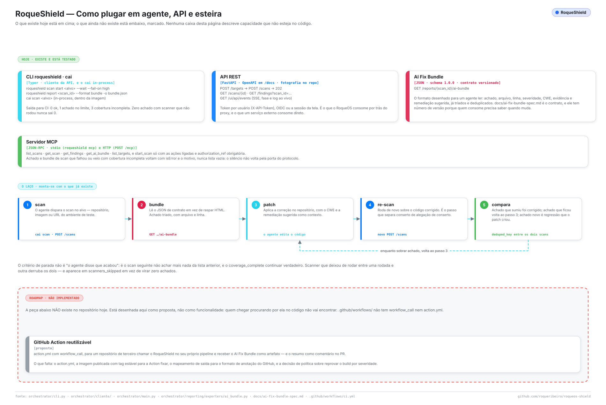

<div align="center">


# RoqueShield — agentes, APIs e esteiras

</div>

Como dirigir o RoqueShield a partir de algo que não é humano: um agente de IA, um
serviço, um job de CI. O que existe hoje está na primeira metade; o que não existe
está na segunda, rotulado, com o que falta para construir.

<picture>
  <source media="(prefers-color-scheme: dark)" srcset="assets/diagrams/integracoes-agente-dark.svg">
  
</picture>

---

## 1. As três superfícies que existem

### CLI — `roqueshield`

Um cliente da API REST, então funciona igual contra o container do seu notebook e contra
um shield em outra máquina. Dentro do container standalone não precisa de configuração;
fora, `ROQUESHIELD_URL` e `ROQUESHIELD_TOKEN` (ou `roqueshield login`).

```bash
roqueshield scan start https://staging.example.com --auth-ref CHG-123 --wait --fail-on high
roqueshield scan start https://github.com/acme/api.git --type repo --profile full --wait
roqueshield scan show <scan_id> --json
roqueshield findings <scan_id>
roqueshield report <scan_id> --format bundle -o bundle.json
```

O `--wait` sai pelo contrato de pipeline: `0` limpo no `--fail-on`, `1` achado nele ou
acima, `2` erro de uso ou de conexão, `3` scan que falhou ou cobertura incompleta. Sem
chave de IA o scan roda do mesmo jeito; os achados ficam com a classificação do scanner.

### REST — FastAPI

OpenAPI em `/docs`. A autenticação é o cabeçalho `X-API-Token` (um token criado em
**Usuários**, ou o `APP_TOKEN`), ou o cookie de sessão da tela. As rotas de que uma
integração precisa:

| Passo | Chamada |
| --- | --- |
| Registrar o alvo | `POST /targets` → `201` |
| Disparar o scan | `POST /scans` → `202` com o id |
| Acompanhar | `GET /scans/{id}` — ou o stream, abaixo |
| Ler os achados | `GET /findings?scan_id=…` |
| Postura de compliance | `GET /reports/{id}/compliance` |
| O bundle | `GET /reports/{id}/ai-bundle` |

O progresso ao vivo é `GET /ui/api/events`, `text/event-stream`, com eventos `phase` e
`log`. Ele aceita o mesmo cookie de sessão ou o cabeçalho `X-API-Token` do resto da API.
O `EventSource` do navegador não manda cabeçalho, então a tela usa o cookie.

### AI Fix Bundle — o contrato para máquina

`GET /reports/{scan_id}/ai-bundle`, schema `1.0.0`, especificado em
[ai-fix-bundle-spec.md](ai-fix-bundle-spec.md).

É a superfície desenhada para um agente ler: achados já deduplicados e triados, cada
um com id estável, prioridade, arquivo e linha, CWE, evidência e remediação sugerida.
Tem **versão de schema** porque quem consome precisa saber quando muda — o sentido de
um contrato é justamente não ser uma página renderizada que alguém raspa.


---

## 2. O laço: scan → conserto → re-scan

As três superfícies acima bastam para fechar o laço sem pessoa no meio.

1. **Scan.** O agente dispara o scan no repositório, imagem ou URL de staging.
2. **Bundle.** Lê `GET /reports/{id}/ai-bundle` — estruturado, não raspado.
3. **Conserto.** Edita o código com o CWE e a remediação sugerida como contexto.
4. **Re-scan.** Dispara um novo scan sobre o código corrigido. *É o passo que separa
   conserto de alegação de conserto.*
5. **Comparação.** Casa os dois scans por `deduped_key`: o que sumiu foi corrigido, o
   que ficou volta ao passo 3, e o que é **novo** é regressão que o patch criou.

### O critério de parada

Não é "o agente relatou sucesso". O laço acaba quando o scan seguinte não acha o que o
anterior achou **e** o `coverage_complete` continua verdadeiro.

Essa segunda condição não é decoração. Um scanner que deixou de rodar entre as
rodadas — rede que fechou, container que não subiu, credencial que expirou — produz
zero achados pelo mesmo motivo que um código limpo produz. Sem conferir cobertura, "o
agente consertou tudo" e "o scanner parou de funcionar" são indistinguíveis, e o laço
declararia vitória em cima de uma ferramenta quebrada. É a mesma falha que o projeto
inteiro existe para impedir, entrando pela porta da frente.

Uma implementação correta do passo 5 confere três coisas, nesta ordem:

```python
assert novo["coverage_complete"], "scanner deixou de rodar; comparação inválida"
assert set(novo["scanners_ran"]) >= set(anterior["scanners_ran"])
resolvidos = anterior_keys - novo_keys
regressoes = novo_keys - anterior_keys
```

### Um exemplo completo, pela CLI

```bash
REPO=https://github.com/acme/api.git
BEFORE=$(roqueshield scan start "$REPO" --type repo | awk '/^scan / {print $2}')
roqueshield scan watch "$BEFORE"
roqueshield report "$BEFORE" --format bundle -o bundle.json

# ... o agente corrige o repositório a partir do bundle.json ...

AFTER=$(roqueshield scan start "$REPO" --type repo | awk '/^scan / {print $2}')
roqueshield scan watch "$AFTER"
roqueshield report "$AFTER" --format bundle -o bundle-after.json

jq -s '{
  resolved:    ([.[0].vulnerabilities[].deduped_key] - [.[1].vulnerabilities[].deduped_key]),
  regressions: ([.[1].vulnerabilities[].deduped_key] - [.[0].vulnerabilities[].deduped_key])
}' bundle.json bundle-after.json
```

---

## 3. Servidor MCP

**Estado: implementado em 06/11/2026**, em `orchestrator/cliente/mcp_nucleo.py`, com dois
transportes: stdio (`roqueshield mcp`, para Claude Code, Claude Desktop e Cursor) e
HTTP (`POST /mcp`, autenticado como o resto da API). Escrito direto sobre o protocolo, e
não com o SDK `mcp`, porque o lockfile já carrega duas versões incompatíveis dele por
extras opcionais.

| Ferramenta | Argumentos | Devolve |
| --- | --- | --- |
| `list_scans` | limit | scans recentes com estado, fase e contagens |
| `get_scan` | scan_id | detalhe, incluindo que scanners rodaram e quais não, e por quê |
| `get_findings` | scan_id, severity, limit | os achados; **erro** se o scan falhou ou a cobertura veio incompleta |
| `get_ai_bundle` | scan_id | o AI Fix Bundle; **erro** nas mesmas condições |
| `list_targets` | — | os alvos registrados |
| `start_scan` | target, asset_type, profile, authorization_ref | só com as ações ligadas; a referência é obrigatória |

Cada ferramenta chama a API REST com a credencial de quem chamou, então o RBAC vale
como sempre. Ações vêm desligadas (`MCP_ALLOW_ACTIONS` no servidor,
`ROQUESHIELD_MCP_ACTIONS=1` no stdio): disparar scan contra terceiro tem peso legal. E o
teste que faltava existe: `tests/unit/test_mcp.py` prova que scan que falhou ou veio
incompleto volta com erro e o motivo, nunca `[]`, e um mutante que devolve a lista em
silêncio reprova.

Fora do que a proposta original pedia: `shield_compare` (diferença entre dois scans). A
CLI e o bundle cobrem isso com `jq` (seção 2).

---

## 4. Não implementado: GitHub Action reutilizável

**Estado: proposta.** Medido em 2026-08-30: `.github/workflows/` tem um arquivo só,
`ci.yml`, sem `workflow_call`, e não existe `action.yml` no repositório. Nada aqui
pode ser chamado da esteira de outro projeto hoje.

A forma que teria:

```yaml
# .github/workflows/security.yml, no repositório que consome
jobs:
  roqueshield:
    uses: roqueribeiro/roqueos-shield/.github/workflows/scan.yml@v1
    with:
      target: .
      asset-type: repo
      profile: full
      fail-on: high          # política, e é decisão de produto
    secrets:
      ANTHROPIC_API_KEY: ${{ secrets.ANTHROPIC_API_KEY }}
```

…produzindo o AI Fix Bundle como artefato do build, os achados como anotação do
GitHub nas linhas alteradas, e um comentário no PR com a nota de compliance.

**O que falta para construir:** o `action.yml` e o ponto de entrada `workflow_call`;
uma imagem publicada com **tag estável** para a Action fixar, porque scanner de
segurança que troca de versão calado entre execuções é pior que scanner nenhum; o
mapeamento de `Finding` para o formato de anotação do GitHub; e uma decisão de
política sobre `fail-on` — qual severidade barra o merge — que pertence a quem é dono
do repositório, não a esta ferramenta.

Há mais um requisito, e é o mesmo do MCP: a Action precisa reprovar o build quando um
scanner não rodou. Tique verde num scan com `coverage_complete: false` é a versão CI
do zero silencioso.

---

## 5. Hoje, sem nenhum dos dois

As duas lacunas têm resposta funcionando agora, e é por isso que nenhuma é urgente.

**No CI**, um passo de shell contra um shield que você já roda (o token é um segredo do
CI criado em **Usuários**, com o papel `operator`):

```yaml
- name: RoqueShield
  env:
    ROQUESHIELD_URL: https://shield.example
    ROQUESHIELD_TOKEN: ${{ secrets.ROQUESHIELD_TOKEN }}
  run: |
    docker run --rm -e ROQUESHIELD_URL -e ROQUESHIELD_TOKEN --entrypoint roqueshield \
      roqueribeiro1988/roqueos-shield:v0.5.1-standalone \
      scan start https://staging.example.com --auth-ref "$GITHUB_RUN_ID" --wait --fail-on high
```

O código `3` (falha ou cobertura incompleta) também reprova o passo: scanner que não
rodou nunca passa como "limpo".

**Com um agente**, a CLI já é a interface: um agente de código com shell roda
`roqueshield scan start` e `roqueshield report` direto, e o servidor MCP (seção 3) faz o
mesmo para cliente sem shell.
