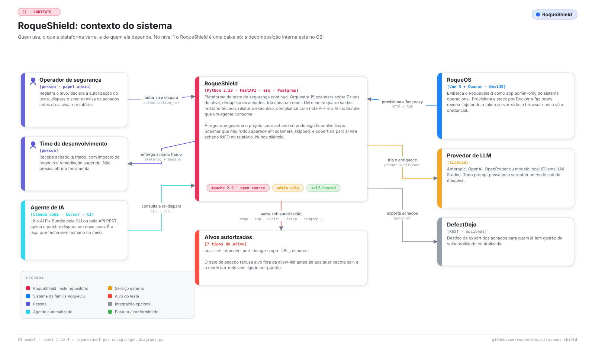
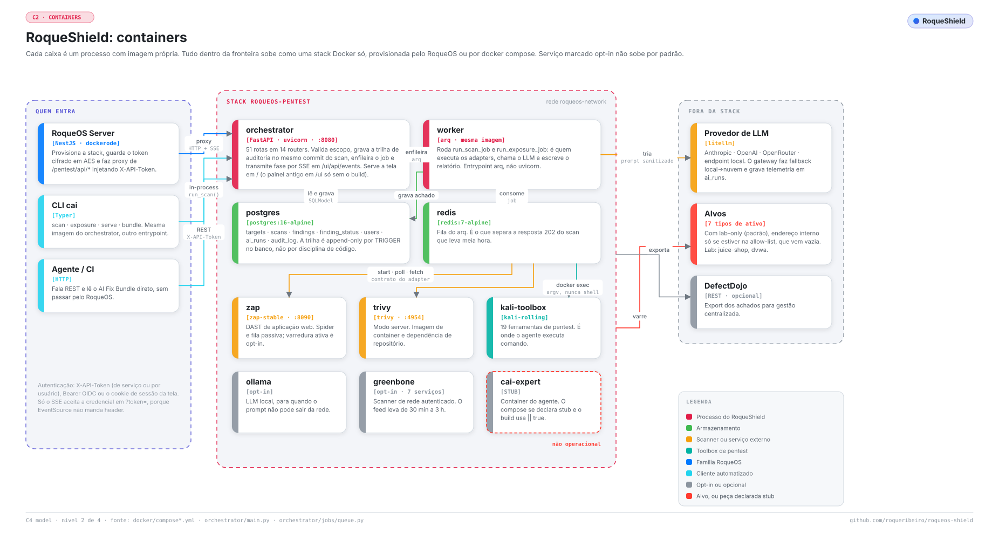
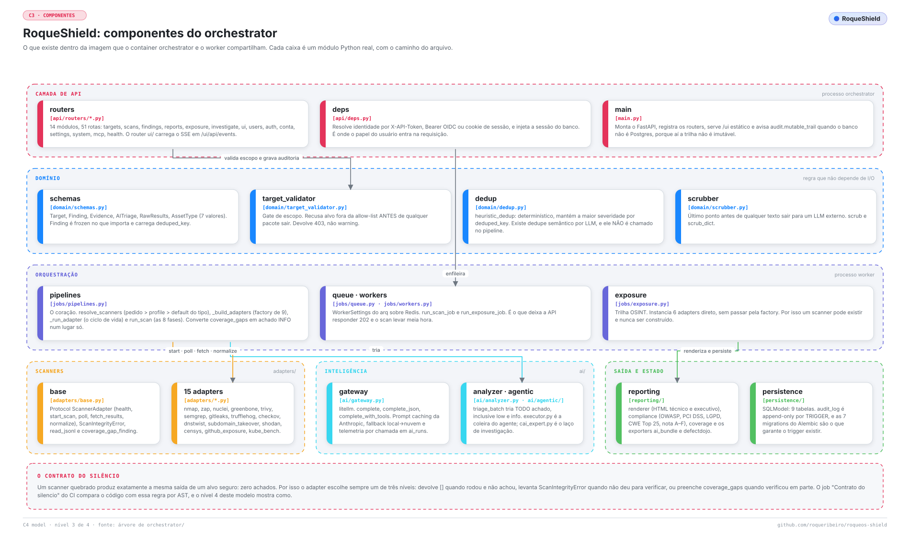
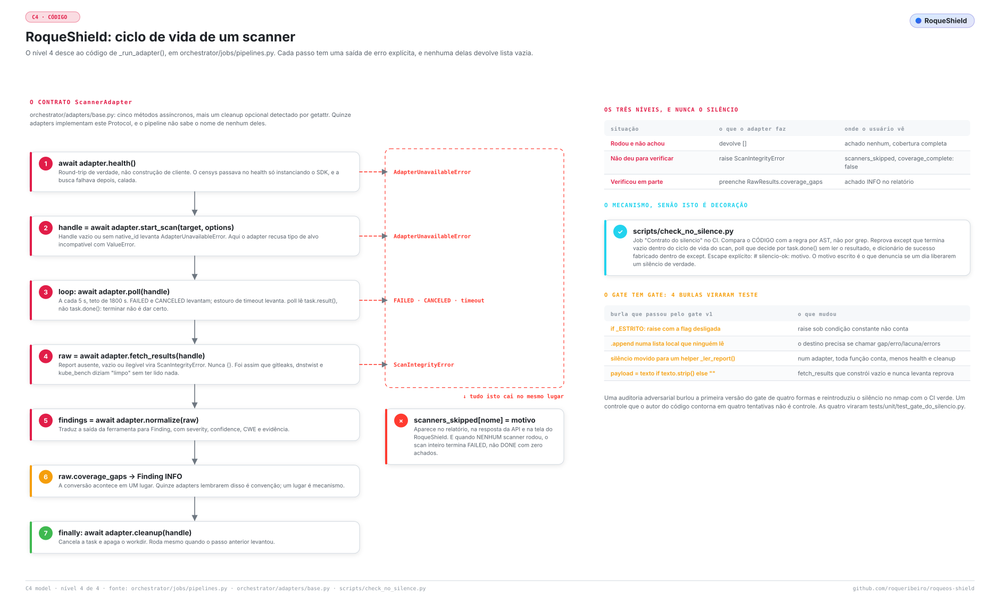
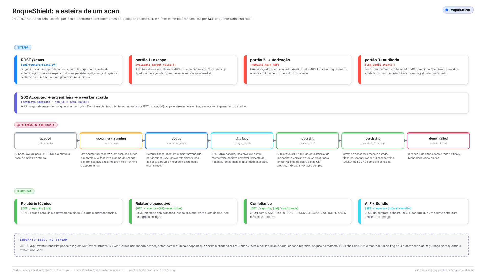
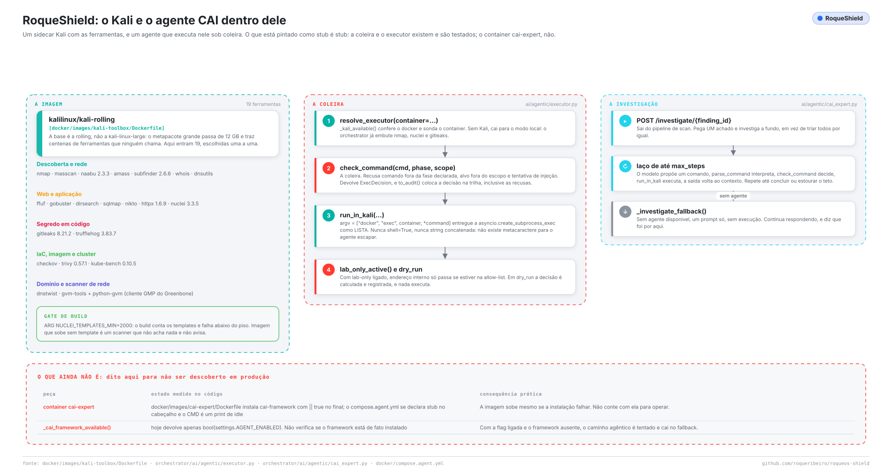
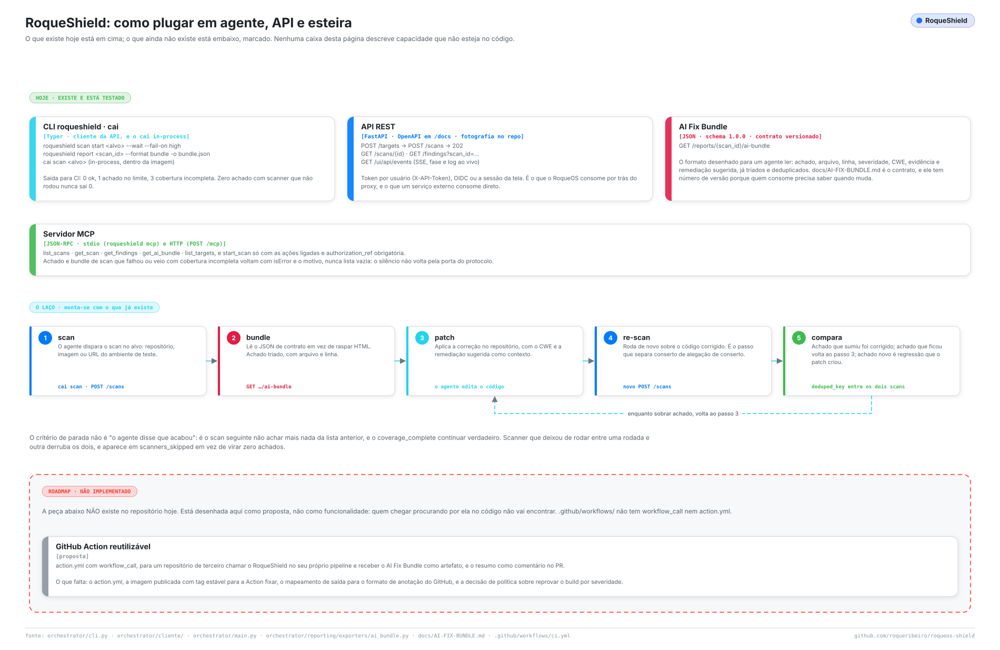
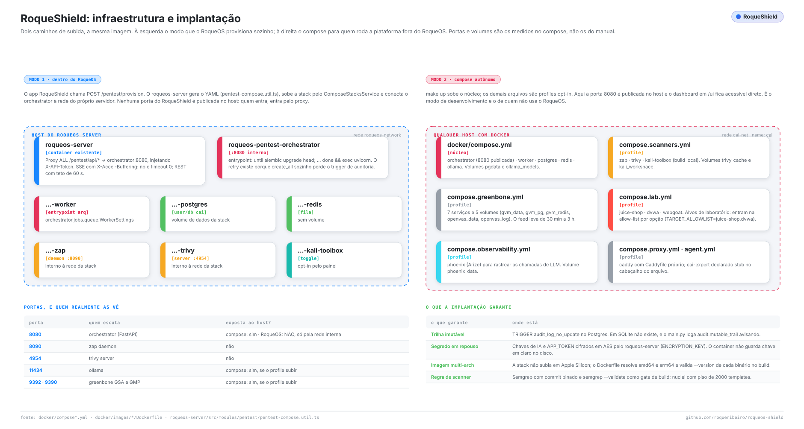
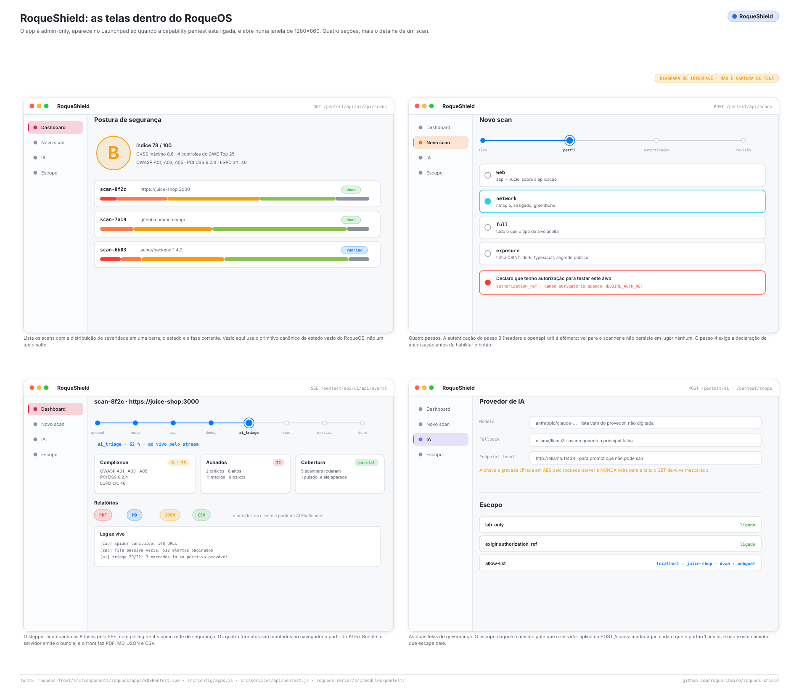
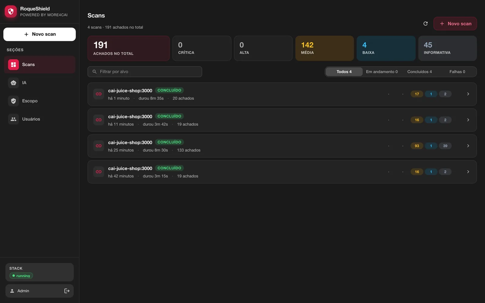

# Arquitetura

*Tradução de [ARCHITECTURE.md](../ARCHITECTURE.md), a versão principal, em inglês. Se as duas divergirem, vale a em inglês.*

> Como o RoqueShield é feito por dentro: os processos, os módulos, o caminho de um scan do `POST` até o relatório, onde mora cada decisão de segurança e o que acontece quando um scanner falha. Para quem vai operar, auditar, estender ou contribuir. Cada afirmação daqui foi conferida no código deste repositório; onde uma capacidade é parcial, o texto diz.
>
> Este documento descreve o desenho. Para cada comando, rota, campo e variável, veja a [REFERÊNCIA](REFERENCIA.md); para instalar e rodar o primeiro scan, [COMEÇAR](COMECAR.md); para adicionar um scanner, [ESTENDER](ESTENDER.md).

Sobre os nomes: **RoqueShield** é o produto. `cai` é o nome interno do motor e sobrevive no pacote Python (`cai-orchestrator`), nos containers de desenvolvimento (`cai-*`) e na CLI de administração (`cai`). A CLI do usuário final é `roqueshield`.

## Sumário

1. [A ideia em um parágrafo](#1-a-ideia-em-um-parágrafo)
2. [Contexto: quem usa e do que depende](#2-contexto-quem-usa-e-do-que-depende)
3. [Containers: os processos](#3-containers-os-processos)
4. [Componentes: dentro da imagem do orchestrator](#4-componentes-dentro-da-imagem-do-orchestrator)
5. [O ciclo de vida do adapter e o contrato do silêncio](#5-o-ciclo-de-vida-do-adapter-e-o-contrato-do-silêncio)
6. [A esteira do scan](#6-a-esteira-do-scan)
7. [Triagem por IA e o scrubber](#7-triagem-por-ia-e-o-scrubber)
8. [O agente, o sidecar Kali e a coleira](#8-o-agente-o-sidecar-kali-e-a-coleira)
9. [Superfícies de integração](#9-superfícies-de-integração)
10. [Escopo e autorização](#10-escopo-e-autorização)
11. [A imagem standalone e o deploy](#11-a-imagem-standalone-e-o-deploy)
12. [O produto dentro do RoqueOS](#12-o-produto-dentro-do-roqueos)
13. [Segurança e compliance](#13-segurança-e-compliance)
14. [Decisões de design](#14-decisões-de-design)
15. [Limites conhecidos](#15-limites-conhecidos)
16. [Como os diagramas são feitos](#16-como-os-diagramas-são-feitos)

---

## 1. A ideia em um parágrafo

Um scanner quebrado produz exatamente a mesma saída de um alvo seguro: zero achados. Num relatório que vai para auditoria de banco, essa é a única diferença que importa, e o RoqueShield é construído em volta de distinguir as duas. Ele roda scanners contra um alvo autorizado, normaliza tudo num formato único de `Finding`, deduplica, tria cada achado com um LLM (depois de redigir dado pessoal e de cartão) e emite um relatório técnico, um relatório executivo, um mapeamento de compliance e o AI Fix Bundle, um JSON versionado que outro agente lê para corrigir o código. Scanner que não rodou aparece em `scanners_skipped` com o motivo; execução parcial vira achado INFO; scan em que nada rodou termina `FAILED`. Zero achado só quer dizer "limpo" quando `coverage_complete` é `true`.

## 2. Contexto: quem usa e do que depende

<picture>
  <source media="(prefers-color-scheme: dark)" srcset="../assets/diagramas/contexto.escuro.svg">
  
</picture>

Três tipos de ator chegam ao sistema:

- **O operador de segurança** registra o alvo, declara a autorização (`authorization_ref`), dispara o scan e revisa os achados antes de assinar o relatório.
- **O time de desenvolvimento** recebe achado já triado, com impacto de negócio e remediação sugerida, sem abrir a ferramenta.
- **Um agente de IA** (Claude Code, Cursor, um job de CI) lê o AI Fix Bundle pela CLI, pela API REST ou por MCP, corrige o código e pede outro scan. É por isso que o bundle é um contrato versionado e não uma página renderizada.

Fora da fronteira: os **alvos**, de sete tipos de ativo (`host`, `url`, `domain`, `port`, `image`, `repo`, `k8s_resource`, em `orchestrator/domain/schemas.py`); o **provedor de LLM** (Anthropic, OpenAI, OpenRouter, ou um endpoint local como Ollama ou LM Studio, todos via `litellm`); o **RoqueOS**, que pode embarcar o RoqueShield como app de admin; e o **DefectDojo**, destino opcional de exportação.

## 3. Containers: os processos

<picture>
  <source media="(prefers-color-scheme: dark)" srcset="../assets/diagramas/containers.escuro.svg">
  
</picture>

| Processo | Imagem | Papel |
| --- | --- | --- |
| orchestrator | `docker/images/orchestrator/Dockerfile` | FastAPI em `:8080`. Valida escopo, grava o registro de auditoria, enfileira o job, transmite o progresso por SSE, serve a tela web |
| worker | mesma imagem, `arq orchestrator.jobs.queue.WorkerSettings` | Roda `run_scan_job` e `run_exposure_job`: executa os adapters, chama o LLM, escreve o relatório |
| postgres | `postgres:16-alpine` | `targets`, `scans`, `findings`, `finding_status`, `users`, `ai_runs`, `audit_log`, `app_settings`. SQLite em desenvolvimento e no standalone padrão |
| redis | `redis:7-alpine` | A fila do `arq` |
| zap | `zaproxy/zap-stable` | DAST. Spider e varredura passiva; varredura ativa só com o profile `full` ou `active` |
| trivy | `aquasec/trivy` em modo server | Imagem de container e dependência de repositório |
| kali-toolbox | `docker/images/kali-toolbox/Dockerfile` | Sidecar opcional onde rodam os comandos do agente (seção 8) |
| greenbone, ollama, phoenix, caddy | `docker/compose.*.yml` | Opt-in: VAS de rede, LLM local, rastreio de chamadas de LLM, proxy TLS |

A divisão que importa é **orchestrator contra worker**: a mesma imagem com outro entrypoint. É o que deixa o `POST /scans` responder `202` em milissegundos enquanto o scan leva meia hora.

O `docker/compose.agent.yml` declara um container `cai-expert` da época em que a investigação rodava no `cai-framework` externo. Ele não é operacional: a linha de instalação do Dockerfile termina em `|| true`, o compose roda `sleep infinity` e nada no código o chama. O laço de investigação roda hoje dentro do orchestrator (seção 8).

## 4. Componentes: dentro da imagem do orchestrator

<picture>
  <source media="(prefers-color-scheme: dark)" srcset="../assets/diagramas/componentes.escuro.svg">
  
</picture>

| Módulo | O que mora ali |
| --- | --- |
| `api/routers/` | 14 routers: `targets`, `scans`, `findings`, `reports`, `exposure`, `investigate`, `health`, `ui`, `users`, `auth`, `conta`, `settings`, `system`, `mcp`. O contrato fica congelado em `docs/openapi.json` e é conferido por `scripts/openapi_snapshot.py --check` |
| `api/deps.py` | `get_principal`: resolve `X-API-Token` (token de serviço ou por usuário), `Authorization: Bearer` (sessão OIDC) ou o cookie `rs_session` da tela, e `require_permission` para o RBAC |
| `domain/schemas.py` | `Target`, `Finding`, `AITriage`, `RawResults`, `AssetType`. O `Finding.deduped_key` é `sha256(alvo::regra[::discriminador])[:32]` |
| `domain/target_validator.py` | O portão de escopo (seção 10) |
| `domain/scrubber.py` | Redação antes de qualquer texto ir para um LLM externo (seção 7) |
| `domain/dedup.py` | `heuristic_dedup`: mantém a maior severidade por `deduped_key` (empate: confidence, depois ferramenta, regra e id) e devolve a lista ordenada por severidade e chave, igual para qualquer ordem de entrada |
| `jobs/pipelines.py` | `resolve_scanners`, a fábrica de adapters em `_build_adapters`, `_run_adapter` (o ciclo de vida) e `run_scan` |
| `jobs/exposure.py` | A esteira OSINT, que instancia os adapters dela diretamente |
| `adapters/` | 15 adapters implementando o Protocol `ScannerAdapter` de `adapters/base.py` |
| `ai/` | `gateway.py` (litellm), `analyzer.py` (triagem), `agentic/` (o laço de investigação e a coleira), `observability.py` (ring buffer de log e SSE) |
| `reporting/` | `renderer.py` (HTML técnico e executivo), `compliance.py` (OWASP, PCI DSS, LGPD), `exporters/ai_bundle.py`, `exporters/defectdojo.py` |
| `persistence/` | Modelos SQLModel e as migrations Alembic `0001` a `0009` |
| `audit/logger.py` | `log_audit_event`, append-only |
| `standalone/` | O supervisor e os segredos de primeiro boot da imagem de container único (seção 11) |

**O que roda, e quando.** A lista de scanners nunca é livre. `resolve_scanners(pedido, asset_type, profile)` aplica, nesta ordem: a lista explícita de quem chamou, depois o profile da tela (`web`, `network`, `full` em `_PROFILE_SCANNERS`), depois o default do tipo de ativo (`_DEFAULT_SCANNERS`). O resultado é sempre filtrado pelo que cada adapter aceita (`_SCANNER_ASSET_SUPPORT`). Antes desse filtro, um scanner incompatível era instanciado, levantava `ValueError`, o erro era engolido e o scan fechava com zero achados. O que fica de fora (nome desconhecido, tipo incompatível, alvo que scanner nenhum aceita) volta com o motivo de `resolve_scanners_com_motivo`: o `POST /scans` recusa com 422, e o `run_scan` grava em `scanners_skipped`. O profile precisa ser um dos `PERFIS_DO_SCAN` (`web`, `network`, `full`, `active`, `exposure`); o `exposure` entrega o domínio do alvo ao pipeline OSINT (`jobs/exposure.py`) e grava o resultado no mesmo scan. O `cai scan` passa pelos mesmos portões e pelo mesmo evento de auditoria do `POST /scans` (`gates_do_scan`, `scanners_do_scan`).

A fábrica constrói nove scanners. Os outros seis adapters pertencem à esteira OSINT ou a esteira nenhuma:

| Scanner | Quem constrói | Tipos de ativo | O que encontra |
| --- | --- | --- | --- |
| `semgrep` | fábrica | repo | SAST: injection, SSRF, path traversal, cripto fraca, desserialização. O único que lê o código-fonte |
| `gitleaks` | fábrica, exposure | repo | Segredo commitado |
| `trufflehog` | fábrica, exposure | repo | Segredo commitado, conferindo se a credencial ainda vale |
| `checkov` | fábrica | repo | Misconfiguração de IaC (Terraform, CloudFormation, Kubernetes, Dockerfile) |
| `trivy` | fábrica | image, repo | CVE de dependência e de pacote do SO, segredo embutido, misconfiguração |
| `nmap` | fábrica | host, port, url, domain | Porta aberta e versão de serviço |
| `zap` | fábrica | url, host, domain | DAST; varredura ativa (payload real de injection) só com o profile `full` ou `active` |
| `nuclei` | fábrica | url, host, domain | Templates de CVE conhecida, painel exposto, credencial padrão |
| `greenbone` | fábrica | host, domain | VAS de rede (OpenVAS). Precisa da stack Greenbone e do feed |
| `github_exposure` | exposure | n/a | Dorks contra repositórios públicos do GitHub |
| `dnstwist` | exposure | domain | Typosquatting |
| `shodan` | exposure | domain | Exposição na internet, precisa de `SHODAN_API_KEY` |
| `subdomain_takeover` | exposure | domain | Subdomínio pendurado |
| `censys` | nenhum | n/a | Implementado e testado, não construído por caminho de produção nenhum |
| `kube_bench` | nenhum | k8s_resource | Implementado e testado, não construído por caminho de produção nenhum |

**SAST sem o registry.** O `--config auto` do Semgrep se recusa a rodar com `--metrics off`, que este projeto exige; os packs `p/...` são baixados na hora do scan e, numa rede restrita, o Semgrep sai com código 0 e zero regras. Por isso a imagem embarca o `semgrep-rules` em `/opt/semgrep-rules`, pinado por commit, com `semgrep --validate` por diretório de linguagem como gate de build (`docker/images/orchestrator/Dockerfile`). O adapter carrega só os diretórios das linguagens presentes no checkout. `SEMGREP_RULES_DIR` aponta para outro lugar quando há ruleset próprio. As licenças estão no `NOTICE` (motor LGPL-2.1, regras sob a Semgrep Rules License v1.0).

## 5. O ciclo de vida do adapter e o contrato do silêncio

<picture>
  <source media="(prefers-color-scheme: dark)" srcset="../assets/diagramas/codigo.escuro.svg">
  
</picture>

Todo adapter implementa cinco métodos assíncronos (`health`, `start_scan`, `poll`, `fetch_results`, `normalize`) e um `cleanup` opcional. O `_run_adapter` de `jobs/pipelines.py` conduz os passos, e cada um tem uma saída de erro explícita:

1. `health()` falso → `AdapterUnavailableError`. O `health()` faz round-trip de verdade e nunca levanta: construir um cliente de SDK não prova nada sobre a credencial.
2. `start_scan()` devolve handle sem `native_id` → `AdapterUnavailableError`.
3. `poll()` a cada 5 s, até 1800 s. `FAILED`, `CANCELED` ou timeout → `AdapterUnavailableError`. O `poll()` lê o resultado da task, não só `task.done()`: terminar não é dar certo.
4. `fetch_results()` levanta `ScanIntegrityError` com report ausente, vazio ou ilegível, nunca devolve `{}`.
5. `normalize()` produz `Finding` canônico.
6. `RawResults.coverage_gaps` vira um achado INFO, neste lugar só.
7. `cleanup()` roda no `finally`, mesmo quando um passo anterior levantou.

Toda falha cai em `scanners_skipped[nome] = motivo`, que a API, o relatório, o AI Fix Bundle e a tela mostram.

Os três níveis, e nunca o silêncio:

| Situação | O que o adapter faz | Onde o usuário vê |
| --- | --- | --- |
| Rodou e não achou | devolve `[]` | achado nenhum, cobertura completa |
| Não deu para verificar | `raise ScanIntegrityError` | `scanners_skipped`, `coverage_complete: false` |
| Verificou em parte | preenche `RawResults.coverage_gaps` | achado INFO no relatório |

A regra existe porque o defeito apareceu em nove adapters com a mesma forma: a ferramenta não rodava, o erro virava `[]`, `{}` ou um dicionário de sucesso fabricado, e o relatório apresentava isso como alvo limpo. A história e as regras concretas (ler o returncode, usar `read_jsonl`, paginar, egress fechado por padrão) estão em [ESTENDER](ESTENDER.md).

**O mecanismo.** O `scripts/check_no_silence.py` (job "Contrato do silencio" no CI) lê a AST de `adapters/`, `jobs/` e `reporting/exporters/` e reprova `except` que termina em vazio dentro do ciclo de vida do scan, `poll()` que decide só por `task.done()` e dicionário de sucesso fabricado dentro de `except`. O único escape é `# silencio-ok: <motivo>` na linha do `except`. As quatro formas com que uma auditoria adversarial burlou a primeira versão viraram testes em `tests/unit/test_gate_do_silencio.py`. O outro lado, provar que as ferramentas acham de verdade, é o job `efetividade` do CI (`tests/integration/test_efetividade_e2e.py`).

**O sinal precisa chegar à tela.** Consertar os adapters foi metade. O `_persist_findings` agora grava `scanners_ran`, `scanners_skipped` (migration `0007`), `errors`, `report_path` e `finished_at`, e põe `FAILED` quando nada rodou. Os testes de cobertura afirmam sobre o dado persistido (`tests/integration/test_cobertura_persistida.py`), porque um mock da estrutura já manteve a suíte verde enquanto a API respondia `coverage_complete: true` para um scan em que nada rodou.

## 6. A esteira do scan

<picture>
  <source media="(prefers-color-scheme: dark)" srcset="../assets/diagramas/esteira.escuro.svg">
  
</picture>

**Três portões antes de qualquer pacote sair** (`api/routers/scans.py`):

1. **Escopo.** `validate_target_value()` no alvo, de novo na hora do scan, e em qualquer `openapi_url`. Fora do escopo é 403 (`target rejeitado pela policy: ...`) e o scan não nasce.
2. **Autorização.** Com `REQUIRE_AUTH_REF=true`, scan sem `authorization_ref` é 403.
3. **Auditoria.** O `scan.create` entra no `audit_log` no mesmo commit da linha do scan. Ou os dois existem, ou nenhum.

As opções de scanner passam por uma lista fechada (`domain/opcoes.py`, 422 caso contrário): um dicionário livre virava argv do `nmap` e caminho do `nuclei` ou do `semgrep`.

A credencial do scan autenticado (`auth.headers`, `auth.openapi_url`) é separada pelo `split_scan_auth`: ela viaja até o worker como argumento efêmero do job, chega só ao `zap` e ao `nuclei`, nunca é gravada em `scans` e sai redigida do registro de auditoria pelo `redact_audit_auth`.

Depois a API responde `202`, o `arq` enfileira o `run_scan_job` (job id `scan-<uuid>`) e o worker roda o `run_scan`. A fase é gravada em `scans.current_phase` e emitida no stream:

| Fase | O que acontece |
| --- | --- |
| `queued` | A linha do scan vai para `RUNNING` |
| `<scanner>_running` | Um adapter de cada vez, em sequência. A fase leva o nome do scanner (`nmap_running`, `zap_running`) |
| `dedup` | `heuristic_dedup` |
| `ai_triage` | `triage_batch` em todo achado, low e info incluídos (seção 7) |
| `reporting` | O HTML técnico é renderizado **antes** da persistência, de propósito: o caminho precisa existir para entrar na linha do scan, senão `GET /reports/{id}` devolve 404 |
| `persisting` | `_persist_findings`: achados, cobertura, erros, estado final |
| `done` ou `failed` | `failed` quando houve scanner pulado e nenhum rodou |

**Saídas.** O HTML técnico (gravado em `REPORTS_DIR`, `GET /reports/{id}`), o HTML executivo (montado sob demanda, `GET /reports/{id}/executive`, com um bloco de cobertura antes da nota de postura), o JSON de compliance (`GET /reports/{id}/compliance`: OWASP Top 10 2021, PCI DSS 4.0, LGPD, CWE Top 25 e uma nota de postura de A a F que nunca é melhor que D com crítico aberto) e o AI Fix Bundle (`GET /reports/{id}/ai-bundle`, schema 1.0.0, veja [AI-FIX-BUNDLE](AI-FIX-BUNDLE.md)). PDF, Markdown e CSV são montados no navegador pela tela, a partir do bundle (`web/src/utils/pentest/`); o orchestrator tem um `render_pdf()` que ninguém chama.

**Progresso ao vivo.** O `GET /ui/api/events` transmite eventos `phase` e `log` em `text/event-stream`. Os eventos de log vêm de um ring buffer de 1000 entradas no processo do orchestrator (`ai/observability.py`). O parâmetro `?token=` é aceito só nessa rota, e só com o `APP_TOKEN`, porque o `EventSource` não manda cabeçalho; a tela standalone usa o cookie de sessão.

**O scan de exposição** (`POST /exposure/scan`, `jobs/exposure.py`) é uma esteira separada, só de leitura, sobre dado público: dorks no GitHub, depois `gitleaks` e `trufflehog` nos principais repositórios achados, `dnstwist` e `subdomain_takeover` em cada domínio, `shodan` quando há chave. Cada vetor que não roda vai para `scanners_skipped`, o mesmo contrato.

## 7. Triagem por IA e o scrubber

**O gateway** (`ai/gateway.py`) é a única porta para um LLM, via `litellm`: `complete`, `complete_json` e `complete_with_tools`. Ele marca system prompts grandes para o prompt caching da Anthropic, omite o `response_format` para endpoint local que o rejeita e grava cada chamada (modelo, tokens, latência, sucesso, erro) em `ai_runs`, falhas incluídas. Quando o modelo primário falha com erro de rede ou de serviço, ele tenta o `LLM_FALLBACK_MODEL`. Se o primário era local (`LLM_API_BASE` definido) e o fallback é nuvem, a travessia é registrada no log e, com `ALLOW_CLOUD_FALLBACK=false`, recusada: a triagem falha em vez de mandar os achados para fora.

**A triagem** (`ai/analyzer.py`, `triage_batch`) manda os achados em lotes de 6 e preenche `Finding.ai_triage`: severidade ajustada, justificativa, impacto de negócio, remediação sugerida, categoria OWASP, provável falso positivo. A `Finding.severity` do próprio scanner nunca é sobrescrita. O `run_scan` passa `skip_severities=set()`, então todo achado é triado: alvo endurecido rende só achado low e info, e pular esses fazia a IA nunca rodar. Sem chave e sem endpoint local, a triagem nem é tentada; cada achado recebe uma triagem determinística que diz que a IA não está configurada, em vez de um erro vermelho em todo scan.

**O scrubber** (`domain/scrubber.py`) redige CPF, CNPJ, número de cartão (com checagem de Luhn), CVV, e-mail, telefone brasileiro, JWT, chave AWS, cabeçalho `Authorization` e valores de `Cookie` / `Set-Cookie`. Ele roda nos campos de texto livre que a triagem envia (título, descrição, evidência), no que o laço de investigação envia, no AI Fix Bundle antes de ser servido e nos metadados da auditoria. Com modelo local, os achados não saem da máquina; com modelo de nuvem, o scrubber é a barreira. Mudar os padrões dele exige revisão do DPO (veja o `CLAUDE.md`).

**Deduplicação.** O `heuristic_dedup` é determinístico. Existe um `semantic_dedup`, por LLM, em `domain/dedup.py`, e a esteira não o chama.

## 8. O agente, o sidecar Kali e a coleira

<picture>
  <source media="(prefers-color-scheme: dark)" srcset="../assets/diagramas/agente-kali.escuro.svg">
  
</picture>

O `POST /investigate/{finding_id}` pega um achado e investiga a fundo. O `ai/agentic/cai_expert.py` roda um laço ReAct sobre o `complete_with_tools` (modelo `LLM_INVESTIGATION_MODEL`, ou `LLM_MODEL` quando vazio): o modelo propõe um comando pela ferramenta `run_command`, o executor decide, a saída volta ao contexto, e repete até o modelo chamar `conclude` ou chegar ao `max_steps` (padrão 10, teto 12). Com `AGENT_ENABLED=false`, ou se o laço levantar, cai para um prompt só, sem ferramenta.

**A execução real vem desligada.** O `dry_run` do pedido é `true` por padrão: os comandos são planejados e devolvidos, nunca executados. `dry_run=false` exige `AGENT_LIVE_EXECUTION=true`, que é `false` por padrão, e quem chama com `config:manage` (admin). Com a flag desligada, a rota responde 403 com:

```
execução real do agente desligada (AGENT_LIVE_EXECUTION=false): use dry_run=true para ver os comandos planejados
```

O `run_in_kali` aplica a mesma trava de novo, para qualquer outro chamador. A rota exige `scans:run`, tem limite de taxa, grava `investigate.run` na trilha antes de rodar e grava `investigate.commands` com cada decisão depois.

**A coleira** é o `ai/agentic/executor.py`, `check_command()`, uma função pura. Na ordem:

1. **Binário.** Uma lista negra nomeada, em qualquer fase: força bruta (`hydra`, `medusa`, `patator`, `ncrack`), exploração não dirigida (`msfconsole`, `msfvenom`), fuzzing pesado (`ffuf`, `gobuster`, `dirsearch`, `wfuzz`), DoS (`slowhttptest`, `hping3`, `t50`), comando destrutivo (`rm`, `dd`, `mkfs`, `shutdown`, `reboot`, `kill`) e shell ou interpretador (`bash`, `sh`, `zsh`, `python`, `python3`, `perl`, `ruby`, `nc`, `ncat`). Depois, uma lista do que pode, por fase: `recon` permite `nmap`, `naabu`, `httpx`, `subfinder`, `dig`, `host`, `nslookup`, `whois`, `curl`, `openssl`; `exploit` permite `sqlmap`, `nuclei`, `nikto`, `curl`, `openssl`.
2. **Alvo obrigatório.** Sem alvo, sem comando.
3. **Argumentos.** Recusados: metacaractere de shell (`; | & $ \` > <` e quebra de linha); flag que escreve em disco, lê arquivo local ou abre shell, casada por prefixo (`-o*`, `--output`, `--os-*`, `--sql-shell`, `--script`, `-iL`, `-iR`, `--proxy`, `--resolve`, `-L`, entre outras); no `curl`, qualquer opção fora de uma lista explícita do que pode, e qualquer `@arquivo`; e qualquer URL, host, IP, forma numérica de endereço, CIDR ou caminho local no argv que não seja o próprio alvo do achado.
4. **Escopo.** O alvo passa pelo mesmo `validate_target_value` dos scanners (seção 10).

Cada decisão vira um `ExecDecision` com o motivo, e o `to_audit()` põe a decisão na trilha, recusas incluídas.

**Onde o comando roda.** O `resolve_executor()` com `AGENT_EXECUTOR=auto` (padrão) usa o container `cai-kali-toolbox` quando o Docker o vê rodando e, senão, roda no próprio processo (`local`). Nos dois casos o argv vai como lista para o `asyncio.create_subprocess_exec`, nunca por shell, com timeout de no máximo 180 s e saída truncada. No modo local o filho recebe um ambiente mínimo (`PATH`, `HOME`, `LANG`, `LC_ALL`, `TZ`, `TMPDIR`), então o `APP_TOKEN` e o segredo da sessão não chegam a um `nmap` ou a um `curl`.

**O sidecar.** O `docker/images/kali-toolbox/Dockerfile` parte do `kalilinux/kali-rolling` (não do metapacote `kali-linux-large`, de 12 GB) e instala um conjunto escolhido: nmap, masscan, naabu, amass, subfinder, whois e dnsutils; ffuf, gobuster, dirsearch, sqlmap, nikto, httpx, nuclei; gitleaks, trufflehog; checkov, trivy, kube-bench; dnstwist; gvm-tools e python-gvm. O build falha abaixo de 2000 templates do nuclei (`NUCLEI_TEMPLATES_MIN`). Ele sobe pelo `docker/compose.scanners.yml`; a imagem standalone e a stack do RoqueOS não o incluem, então ali o agente roda em modo local com os binários que a imagem do orchestrator traz (nmap, nuclei, curl e os scanners).

## 9. Superfícies de integração

<picture>
  <source media="(prefers-color-scheme: dark)" srcset="../assets/diagramas/integracoes.escuro.svg">
  
</picture>

| Superfície | Onde | Observações |
| --- | --- | --- |
| CLI `roqueshield` | `orchestrator/cliente/cli.py` | Cliente da API. `scan start <alvo> --wait --fail-on high` sai com 0 (ok), 1 (achado no limite ou acima), 2 (erro de uso), 3 (scan não terminou `done` ou cobertura incompleta) |
| CLI `cai` | `orchestrator/cli.py` | Motor no próprio processo, dentro da imagem: `scan`, `exposure`, `serve`, `bundle` |
| REST | `orchestrator/api/` | OpenAPI em `/docs`, fotografia em `docs/openapi.json` |
| AI Fix Bundle | `GET /reports/{id}/ai-bundle` | JSON, schema 1.0.0, ids estáveis via `uuid5(deduped_key)` |
| MCP | `roqueshield mcp` (stdio) e `POST /mcp` (HTTP) | Ferramentas `list_scans`, `get_scan`, `get_findings`, `get_ai_bundle`, `list_targets`; `start_scan` só com as ações ligadas (`MCP_ALLOW_ACTIONS=true` no HTTP, `ROQUESHIELD_MCP_ACTIONS=1` no stdio). Scan que falhou ou veio incompleto volta como erro com o motivo, não como lista vazia |
| DefectDojo | `POST /reports/{id}/export/defectdojo` | Generic Findings Import |

O laço que um agente monta com isso: scan, leitura do bundle, conserto, novo scan, comparação do `deduped_key` entre as duas rodadas. Achado que sumiu foi corrigido; achado que ficou volta para o conserto; achado novo é regressão. Scanner que deixou de rodar entre uma rodada e outra aparece em `scanners_skipped` em vez de parecer conserto. Não existe GitHub Action reutilizável neste repositório. Detalhes em [INTEGRAÇÕES](INTEGRACOES.md).

## 10. Escopo e autorização

O `domain/target_validator.py`, `validate_target_value()`, roda antes de qualquer scan entrar na fila, de qualquer alvo ser criado e de qualquer comando do agente rodar. Ele recusa:

- valor que começa com `-` (injeção de argv no subprocesso do scanner), e valor com barra invertida, espaço ou caractere de controle (os parsers discordam sobre o host dessas URLs);
- esquema de URL que não seja `http` ou `https`; URL de repositório com credencial embutida;
- **sempre**, diga o `LAB_ONLY` o que disser: endereço link-local (o serviço de metadata da nuvem, `169.254.169.254`) e loopback, a não ser que a allowlist traga o próprio endereço de loopback (`127.0.0.1`, `::1`, `localhost`). Dentro de um container, loopback é o próprio RoqueShield;
- com `LAB_ONLY=true` (padrão): host em faixa privada, loopback, link-local, reservada, CGNAT e afins, forma IPv6 que embrulha um IPv4, nome que resolve para qualquer uma delas e nome que não resolve (fail closed), a não ser que o host case com a `TARGET_ALLOWLIST`.

`LAB_ONLY=true` não restringe o scan a alvos de laboratório: um host público que resolve para endereço público passa. O que ele fecha é a rede interna. A `TARGET_ALLOWLIST` aceita hostname, IP, CIDR e curinga `*.dominio`, separados por vírgula ou como array JSON, e vem vazia; num deploy regulado ela guarda o escopo escrito do engagement. O mesmo portão cobre o host de repositório (o `git clone` roda dentro da rede do worker) e o registry de imagem.

`REQUIRE_AUTH_REF=true` torna o `authorization_ref` obrigatório no `POST /scans`; o valor entra no registro de auditoria. O padrão é `false` no `Settings` e `true` no `docker/compose.prod.yml`.

O escopo e a configuração de IA podem ser editados em tempo de execução por `PUT /settings/scope` e `PUT /settings/ai` (`runtime_settings.py`, tabela `app_settings`). **O ambiente vence:** variável definida no ambiente do processo trava o campo, e a API informa isso em `locked`. A política vem do deploy, não de quem tem acesso à tela. O worker aplica os valores gravados no começo de cada job.

## 11. A imagem standalone e o deploy

<picture>
  <source media="(prefers-color-scheme: dark)" srcset="../assets/diagramas/infra.escuro.svg">
  
</picture>

São três formas de rodar, a partir de uma imagem de motor:

**Standalone, um container** (`docker/images/standalone/Dockerfile`). Construída por cima da imagem do motor, para as duas nunca divergirem em scanner, regra ou versão. Acrescenta a tela web (`web/`, Vue 3 e Quasar, servida em `/`; `/ui` redireciona para lá), o Redis, o ZAP com o Firefox do AJAX spider e um invólucro `roqueshield`. O entrypoint é o `orchestrator.standalone.supervisor`, um processo Python rodando como UID 1000 que:

1. cria os segredos de primeiro boot em `/data/secrets` (`APP_TOKEN`, `SESSION_SECRET`, `SECRETS_KEY`, `ZAP_API_KEY`, `REDIS_PASSWORD`, `SETUP_CODE`) sem imprimi-los;
2. roda `alembic upgrade head` antes da API;
3. sobe o Redis (só em 127.0.0.1), o ZAP, a API e o worker, e reinicia quem cair, com espera crescente;
4. deixa `APP_TOKEN`, `SESSION_SECRET` e `SETUP_CODE` fora do ambiente do worker, porque os scanners são filhos do worker e processam conteúdo hostil.

Os dados ficam no volume `/data`, em SQLite por padrão (`/data/shield.db`). A instalação suportada é o `install.sh` da raiz do repositório, que publica a porta só em `127.0.0.1`. Variável que já vem no ambiente vence: um `REDIS_URL` ou `ZAP_BASE_URL` de fora desliga o embutido.

**Compose de produção** (`docker/compose.prod.yml`). A mesma imagem standalone, separada em `shield` (a API, que migra), `worker`s escaláveis, Postgres, Redis e ZAP, com `cap_drop: [ALL]`, `no-new-privileges`, `REQUIRE_IMMUTABLE_AUDIT=true`, `REQUIRE_AUTH_REF` com padrão `true` e `ALLOW_CLOUD_FALLBACK` com padrão `false`.

**Compose de desenvolvimento** (`docker/compose.yml` mais os arquivos opt-in `compose.scanners.yml`, `compose.greenbone.yml`, `compose.lab.yml` com Juice Shop, DVWA e WebGoat, `compose.observability.yml`, `compose.proxy.yml`, `compose.agent.yml`). As portas publicadas ficam em `127.0.0.1`. Veja [DESENVOLVIMENTO](DESENVOLVIMENTO.md).

**Dentro do RoqueOS**, o `roqueos-server` provisiona a stack na rede dele e alcança o orchestrator por um proxy reverso que injeta o `X-API-Token` do lado do servidor; nenhuma porta do RoqueShield é publicada no host. Esse lado mora nos repositórios do RoqueOS, não aqui.

A imagem do motor é construída para amd64 e arm64 e confere o `--version` de cada binário no build; os templates do nuclei têm o mesmo piso de 2000.

## 12. O produto dentro do RoqueOS

<picture>
  <source media="(prefers-color-scheme: dark)" srcset="../assets/diagramas/telas.escuro.svg">
  
</picture>

Esta figura é um diagrama de interface, não uma captura. Dentro do RoqueOS o app é só de admin e fala com esta API por `/pentest/api/*` no `roqueos-server`. A tela standalone em `web/` é um porte da mesma tela, servida pelo próprio RoqueShield e autenticada pelo cookie de sessão dela (com o cabeçalho `X-RoqueShield` exigido nas escritas, contra CSRF). As seções são as mesmas nas duas: scans, novo scan (com a declaração de autorização e o `authorization_ref`), detalhe do scan (resumo, execução, IA, achados), configuração de IA e escopo, e usuários no standalone. Captura real da tela standalone:



Dois comportamentos são decisão de segurança, não de interface. O stepper acompanha as fases por SSE com um polling de reserva, para um stream que não abre não congelar a tela. E a tela de escopo edita o mesmo portão que o servidor aplica no `POST /scans`: não existe caminho em que a tela libere algo que o servidor recusa.

## 13. Segurança e compliance

| Controle | Mecanismo | Onde |
| --- | --- | --- |
| Trilha de auditoria imutável | `audit_log` com o trigger `audit_log_no_update` (`audit_log_immutable()`) recusando `UPDATE` no Postgres; toda ação sensível grava antes de mudar o recurso | migration `0004`, `audit/logger.py` |
| Recusar trilha editável | No SQLite o trigger não existe; o boot loga `audit.mutable_trail`, e `REQUIRE_IMMUTABLE_AUDIT=true` se recusa a subir | `main.py`, `config.py` |
| Recusar token de exemplo | O boot recusa `APP_TOKEN` vazio ou de exemplo, que vale ADMIN de serviço; `ALLOW_INSECURE_APP_TOKEN=true` é a saída só para desenvolvimento | `config.insecure_boot_errors` |
| Escopo | `validate_target_value`, seção 10 | `domain/target_validator.py` |
| Referência de autorização | `REQUIRE_AUTH_REF` | `api/routers/scans.py` |
| Identidade | Token de serviço (`hmac.compare_digest`), token por usuário guardado como SHA-256, OIDC (Entra ID, Keycloak, Okta via authlib), login por senha com cookie de sessão no standalone | `api/deps.py`, `auth/` |
| RBAC | `admin`, `operator` (dispara e lê), `auditor` (lê e tem `audit:read`), `viewer` (lê) | `domain/roles.py` |
| Dado pessoal e de cartão | Scrubber antes de qualquer LLM externo, no bundle e nos metadados da auditoria | `domain/scrubber.py` |
| Soberania de dados | Modelo local via `LLM_API_BASE`; `ALLOW_CLOUD_FALLBACK=false` proíbe a travessia local → nuvem | `ai/gateway.py` |
| Segredo em repouso | Chave de IA gravada pela tela é cifrada com Fernet (`SECRETS_KEY`) e nunca volta | `runtime_settings.py` |
| Logs | Um processor do structlog redige credencial antes do stdout e do stream SSE | `domain/redaction.py` |
| Cabeçalhos HTTP | CSP na tela, `X-Frame-Options: DENY`, `nosniff`, `no-referrer` | `main.py` |
| Limite de taxa | `RATE_LIMIT_PER_MINUTE` (20) por principal em `POST /scans`, `/exposure/scan`, `/investigate` | `api/ratelimit.py` |

Antes de testar um ativo real: autorização por escrito e janela combinada. O Metasploit fica de fora do conjunto de ferramentas de propósito. Ameaças, atores e fluxos de dado estão no [MODELO DE AMEAÇAS](MODELO-DE-AMEACAS.md); para relatar uma vulnerabilidade, [SECURITY](../../SECURITY.md).

## 14. Decisões de design

| Decisão | Alternativa descartada | Por quê |
| --- | --- | --- |
| Três níveis de cobertura (`[]`, `ScanIntegrityError`, `coverage_gaps`) | Lista vazia em qualquer falha | Senão scanner quebrado e alvo limpo ficam iguais |
| `coverage_gaps` vira achado só no `_run_adapter` | Cada adapter emite o próprio aviso | Quinze adapters lembrarem é convenção; um lugar é mecanismo |
| `FAILED` quando nada rodou | `DONE` com zero achados | Verde é a cor de alvo limpo |
| Lista de scanners resolvida e filtrada por tipo de ativo | Instanciar o que foi pedido | O scanner incompatível levantava, era engolido e fechava o scan com zero achados |
| Ruleset do Semgrep na imagem, validado no build | `--config auto` ou packs do registry | `auto` não roda com métricas desligadas; os packs precisam de egress que um banco não tem |
| Orchestrator e worker da mesma imagem | Imagens separadas | Um build, um conjunto de binários; a API responde 202 enquanto o worker varre |
| Relatório renderizado antes da persistência | Persistir primeiro | O caminho do relatório precisa existir para entrar na linha do scan |
| Triar todo achado, low e info incluídos | Pular info | Alvo endurecido só rende low e info; a IA nunca rodava |
| A coleira no executor, como função pura | Regras no system prompt | Prompt não contém um agente com shell |
| argv em lista, nunca shell | String de comando | Sem shell, não há metacaractere para escapar |
| `AGENT_LIVE_EXECUTION` desligado por padrão | Execução real a pedido | Cada rodada de revisão achou outro jeito de um argv ler arquivo ou sair do alvo; num container só, o comando nasce ao lado dos segredos |
| Escopo falha fechado quando o DNS falha | Liberar o que não resolve | Uma defesa que aprova no erro é o defeito do silêncio de novo |
| O ambiente trava a configuração de runtime | A tela sobrescreve tudo | A política vem do deploy |
| Standalone construído sobre a imagem do motor | Uma imagem à parte | As duas nunca divergem |
| Diagramas como código, com `--check` | Figuras desenhadas à mão | Diagrama velho reprova no CI |

## 15. Limites conhecidos

- **Dois adapters nunca são construídos.** `censys` e `kube_bench` existem e têm teste, mas caminho de produção nenhum os instancia. Por isso um alvo `k8s_resource` não tem scanner na esteira do scan: o `POST /scans` o recusa com 422, e um `run_scan` direto termina `FAILED` com o motivo em `scanners_skipped`.
- **Adapters em sequência, um host.** A esteira roda um adapter depois do outro; não há scan distribuído. O compose de produção pode rodar mais workers (`--scale worker=N`), o que espalha scans, não os adapters de um scan.
- **Sem agendamento e sem diff entre execuções.** Cada scan é avulso; a comparação entre rodadas fica com quem chama (o `deduped_key` é o que permite).
- **DNS rebinding.** O portão de escopo resolve o nome na validação; não resolve de novo na hora do scan.
- **O scan autenticado** cobre cabeçalhos e uma URL de OpenAPI para `zap` e `nuclei`. Não há gravação de fluxo de login, nem multi-tenancy (isolamento por organização ou projeto).
- **Nenhuma rota da API lê o audit log.** A permissão `audit:read` existe; ler a trilha é feito no banco.
- **Logs ao vivo.** O ring buffer do SSE é do processo do orchestrator. Na stack de compose, o log do worker (onde rodam os scanners) não chega até ele; o standalone leva a saída de cada processo pelo Redis até a aba de execução.
- **O sidecar Kali** usa `|| true` e alternativas em várias instalações, e alguns downloads estão presos a nomes de arquivo amd64, então uma ferramenta pode faltar num build sem reprovar o build. A profundidade do agente com modelo forte em produção (quantos achados ele confirma por prova de conceito) não está medida.
- **`_cai_framework_available()`** só devolve o `AGENT_ENABLED`; o nome é histórico.
- **Código sem uso:** `render_pdf()` e `semantic_dedup()`. O container `cai-expert` não é operacional.
- **Greenbone** precisa da stack dele e de uma sincronização de feed de 30 minutos a 3 horas. A exportação para o **DefectDojo** usa o import genérico e pode precisar de ajuste de campos.
- **Sem GitHub Action reutilizável.** A integração com CI se faz pelos códigos de saída da CLI.

## 16. Como os diagramas são feitos

Os SVGs de `docs/assets/diagramas/` (claro e escuro, em português e em inglês) são gerados, não desenhados à mão:

```bash
python scripts/gen_diagrams.py           # escreve os SVGs
python scripts/gen_diagrams.py --check   # reprova se um SVG está velho, faltando ou órfão
```

- Um módulo por diagrama em `scripts/diagrams/` (`d01_context.py` a `d09_telas.py`), sobre uma pequena biblioteca de desenho, o `c4lib.py`. Cada texto é um par `tr("pt", "en")` dentro do módulo, e cada módulo gera quatro arquivos: `<nome>.claro.svg` e `<nome>.escuro.svg` (português), `<nome>.en.claro.svg` e `<nome>.en.escuro.svg` (inglês).
- O `--check` roda no CI. Reprova arquivo alterado à mão, arquivo faltando e arquivo na pasta que nenhum módulo gera. Ele desliga o cache de bytecode, porque um módulo restaurado com um `.pyc` velho já fez o check comparar contra um código que não estava mais lá.
- O texto é medido pelo `scripts/diagrams/metrics.json`, uma tabela de avanço por caractere extraída uma vez das fontes reais e versionada. A mesma entrada dá o mesmo SVG em qualquer máquina, com ou sem a fonte instalada.
- Se um diagrama e o código discordarem, o código vence e o diagrama é corrigido na mesma mudança.

O resto da documentação é vigiado do mesmo jeito: o `scripts/check_docs_fresh.py` (job "Documentação em dia" no CI) reprova quando um scanner construível não aparece aqui ou no README, quando a contagem de adapters escrita aqui está errada, quando um campo do `Settings` falta no `.env.example`, ou quando as versões do instalador, do pacote e da tela divergem.

---

## Quando algo não funciona

- O scan terminou com zero achados: confira `coverage_complete` e `scanners_skipped` antes de acreditar.
- Um scanner está em `scanners_skipped`: o motivo é a mensagem; o [QUANDO QUEBRA](QUANDO-QUEBRA.md) mapeia os comuns.
- Um alvo foi recusado: a seção 10 diz qual regra; a tela só oferece "liberar no escopo" onde isso faz sentido.
- A investigação só planeja: é o `AGENT_LIVE_EXECUTION=false`, o padrão (seção 8).
