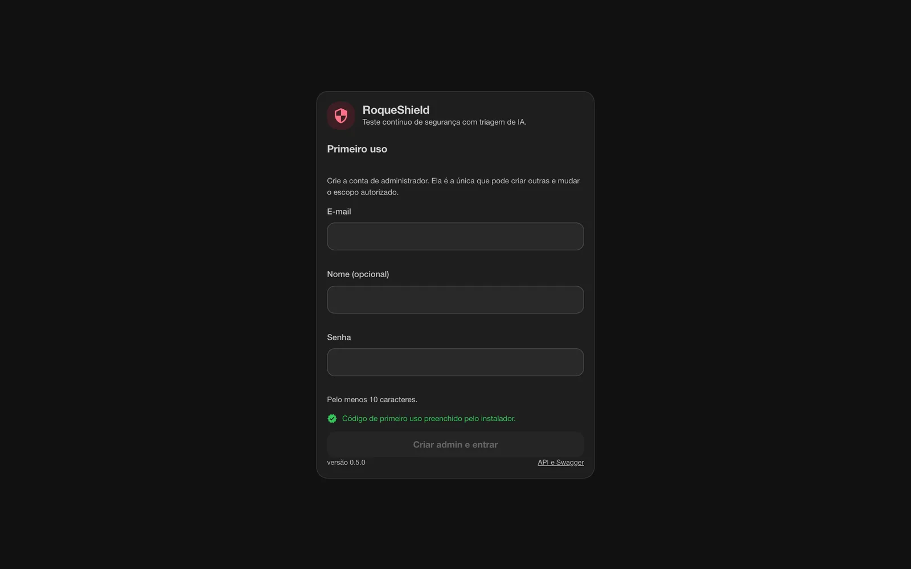
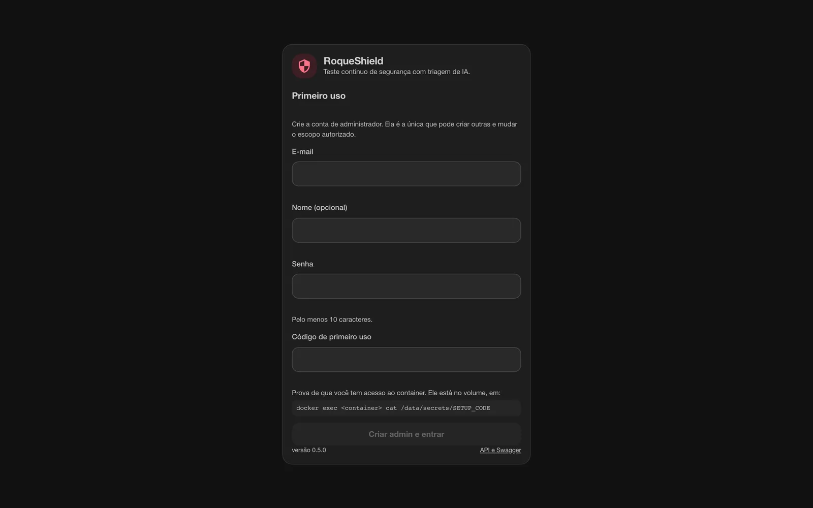
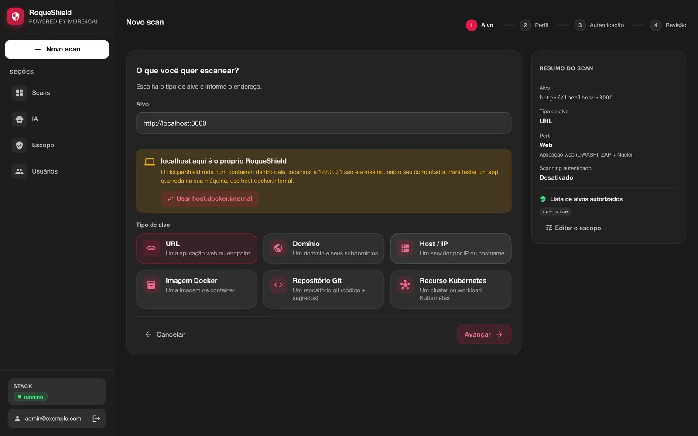
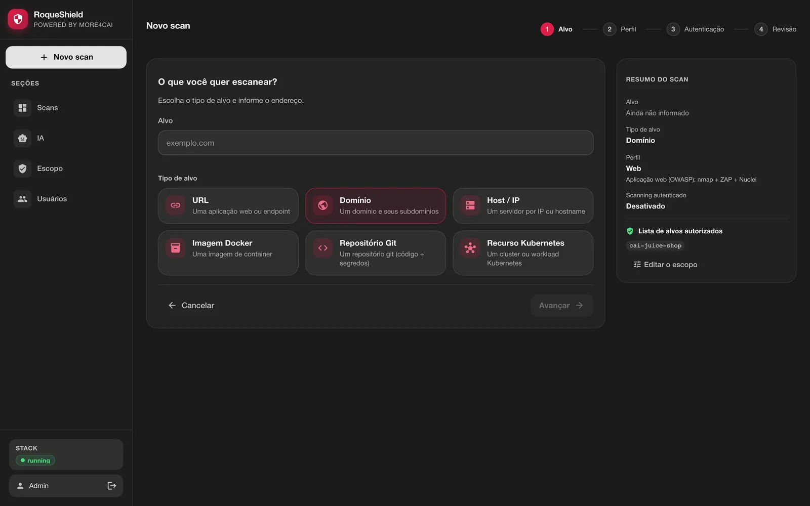
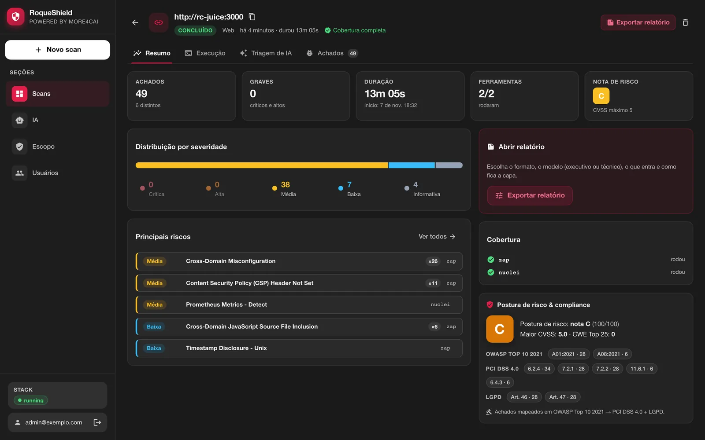
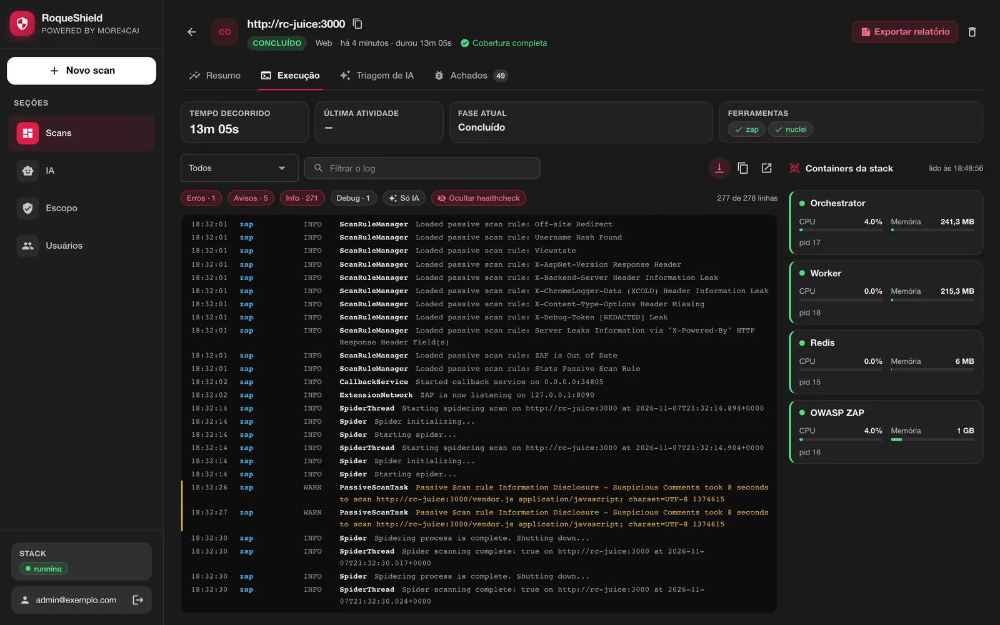
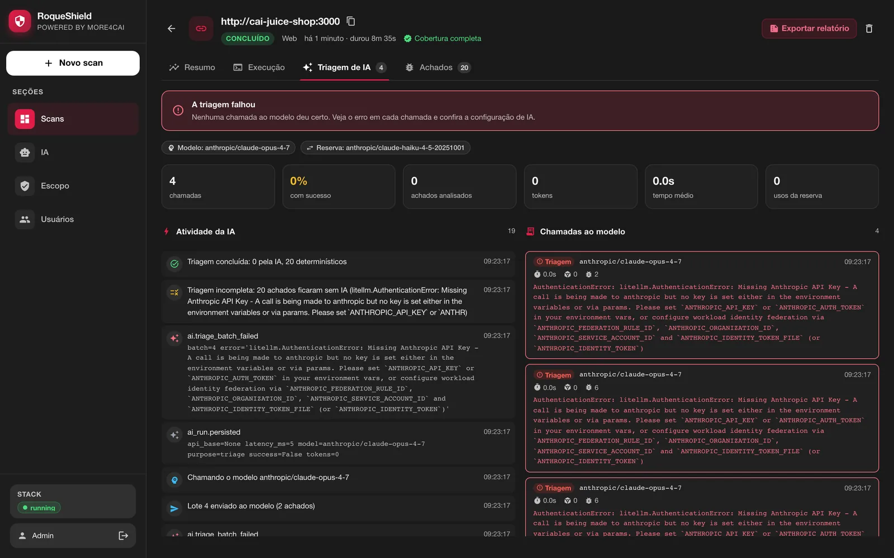
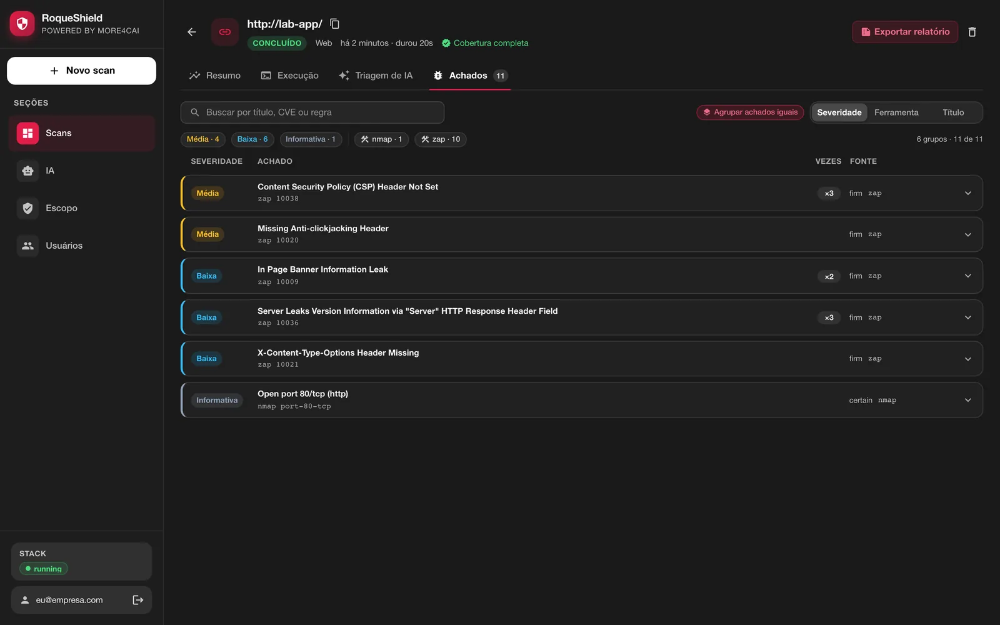

# Começar: da instalação ao primeiro relatório

*Tradução de [GETTING-STARTED.md](../GETTING-STARTED.md), a versão principal, em inglês. Se as duas divergirem, vale a em inglês.*

> **Para quem:** quem vai rodar o RoqueShield pela primeira vez, num notebook ou numa máquina de laboratório.
> **O que tem aqui:** oito passos, de um comando de instalação até um relatório e um AI Fix Bundle na mão. Cada passo diz o que fazer, o que você deve ver e o que fazer se não vir.
> **Onde ir para o resto:** rodar no dia a dia e em produção está em [OPERACAO.md](OPERACAO.md). Sintomas e consertos, em [QUANDO-QUEBRA.md](QUANDO-QUEBRA.md). Toda variável e comando, em [REFERENCIA.md](REFERENCIA.md).

**Autorização primeiro.** Escanear sistema que não é seu, sem permissão por escrito, é crime em muitos países. Só escaneie o que você tem autorização para testar, dentro da janela combinada. O RoqueShield registra a referência da autorização em todo scan, mas não decide por você. Este guia usa uma aplicação vulnerável que você mesmo sobe, então o primeiro scan não tem ninguém do outro lado.

Tempo estimado: uns 20 minutos, a maior parte no próprio scan e no primeiro download da imagem.

**Sobre o idioma:** o instalador fala inglês ou português, conforme o seu `LANG`. Os trechos abaixo são a saída em português, capturada do próprio script. A CLI `roqueshield` e as mensagens de erro da API saem em português. As capturas de tela são da tela em português.

## Sumário

1. [O que você precisa](#1-o-que-você-precisa)
2. [Instale com um comando](#2-instale-com-um-comando)
3. [Crie a conta de administrador](#3-crie-a-conta-de-administrador)
4. [Suba um alvo de laboratório e libere no escopo](#4-suba-um-alvo-de-laboratório-e-libere-no-escopo)
5. [Rode o primeiro scan Web](#5-rode-o-primeiro-scan-web)
6. [Leia o resultado nas quatro abas](#6-leia-o-resultado-nas-quatro-abas)
7. [Baixe o relatório e o AI Fix Bundle](#7-baixe-o-relatório-e-o-ai-fix-bundle)
8. [Para onde ir depois](#8-para-onde-ir-depois)

## 1. O que você precisa

**Docker rodando**, no Mac, no Linux ou no Windows com WSL. Mais nada: nada de Python, de scanner para instalar ou de conta em lugar nenhum. A imagem traz o motor, os scanners, a tela, o Redis e o OWASP ZAP.

**6 GB de memória para o Docker.** O AJAX spider do ZAP e o nuclei são a parte faminta. No Docker Desktop, é a memória da VM (Settings > Resources > Memory), não a do notebook. O instalador mede e avisa abaixo de 5,5 GiB; ele não te impede, mas um scanner pode ser morto no meio do scan.

**Cerca de 1,2 GB de download** na primeira vez, pela imagem.

## 2. Instale com um comando

```bash
curl -fsSL https://raw.githubusercontent.com/roqueribeiro/roqueos-shield/main/install.sh | sh
```

O [install.sh](../../install.sh) confere se o Docker responde e quanta memória ele tem, baixa a imagem da versão do próprio script, sobe um container chamado `roqueshield` escutando só em `127.0.0.1:8080`, espera o healthcheck (até 3 minutos) e abre o navegador na tela de primeiro uso. Ele não pede sudo, não instala o Docker e não publica a porta para fora do seu computador. Rodar de novo é seguro: um container que já existe só é religado, e os seus dados ficam no volume `roqueshield`.

| Quero | Comando |
| --- | --- |
| usar outra porta | `curl -fsSL .../install.sh \| ROQUESHIELD_PORTA=8081 sh` |
| não abrir o navegador | `curl -fsSL .../install.sh \| sh -s -- --nao-abrir` |
| instalar uma versão específica | `curl -fsSL .../install.sh \| ROQUESHIELD_VERSAO=v0.5.1 sh` |

(`...` é `https://raw.githubusercontent.com/roqueribeiro/roqueos-shield/main`. Cada variável tem também o nome em inglês: `ROQUESHIELD_PORT`, `ROQUESHIELD_VERSION`, `ROQUESHIELD_NAME`, `ROQUESHIELD_NO_BROWSER`. As opções também: `--update`, `--no-browser`.)

**O que você deve ver** (uma primeira instalação, linhas do `docker pull` encurtadas):

```
RoqueShield v0.5.1

==> Conferindo o Docker
    ✓ Docker respondendo
    ✓ memória do Docker: 8 GB
==> Baixando a imagem (cerca de 1,2 GB na primeira vez)
v0.5.1-standalone: Pulling from roqueribeiro1988/roqueos-shield
Status: Downloaded newer image for roqueribeiro1988/roqueos-shield:v0.5.1-standalone
==> Subindo o container 'roqueshield' em http://localhost:8080
==> Esperando o RoqueShield ficar pronto
    ✓ pronto

Pronto. O navegador abriu em http://localhost:8080
  Crie a conta de administrador: e-mail e senha. Se a tela pedir o código de
  primeiro uso, ele sai de:  docker exec roqueshield cat /data/secrets/SETUP_CODE

  Parar:         docker stop roqueshield
  Ligar de novo: rode este mesmo comando (ou docker start roqueshield)
  Atualizar:     curl -fsSL https://raw.githubusercontent.com/roqueribeiro/roqueos-shield/main/install.sh | sh -s -- --update
  Desinstalar:   docker rm -f roqueshield   (e docker volume rm roqueshield para apagar os dados)

  Só teste o que você tem autorização para testar.
```

Quando o navegador não pôde ser aberto (um servidor sem tela, `--nao-abrir`), a linha `Pronto.` diz `Abra http://localhost:8080 no navegador.` e o comando do código vem numa linha própria.

Com menos de 5,5 GiB para o Docker, a linha da memória vira aviso e a instalação segue:

```
    ! o Docker tem cerca de 4 GB de memória; o RoqueShield pede 6 GB.
    ! No Docker Desktop: Settings > Resources > Memory. Dá para seguir, mas um scanner
    ! pode ser interrompido no meio e o scan sai com cobertura incompleta.
```

**À mão, ou no Windows sem WSL** (no PowerShell, use `` ` `` no lugar de `\`):

```bash
docker run -d --name roqueshield \
  -p 127.0.0.1:8080:8080 --shm-size=1g --stop-timeout 30 --restart unless-stopped \
  --add-host host.docker.internal:host-gateway \
  -v roqueshield:/data \
  roqueribeiro1988/roqueos-shield:v0.5.1-standalone
```

A tag é a versão com `v` mais `-standalone`. O `--add-host` faz `host.docker.internal` apontar para o seu computador também no Linux, como o Docker Desktop já faz.

## 3. Crie a conta de administrador

A primeira tela cria o administrador: e-mail, um nome opcional e uma senha de pelo menos 10 caracteres. Ela também pede o **código de primeiro uso**, que prova que você tem acesso ao container. Sem o código (ou o `APP_TOKEN` no cabeçalho `X-API-Token`), o `POST /setup` é recusado, e quem alcançar a porta antes de você não vira admin.

**O que você deve ver.** Pelo instalador, o código chega preenchido e a tela diz isso no lugar do campo:



O código viaja no fragmento do endereço (`#setup=...`). O navegador nunca manda o fragmento para o servidor, então ele não cai em log de acesso, e a tela o tira da barra de endereço assim que lê. Ele também não vai na linha de comando do navegador, onde o `ps` o mostraria a qualquer usuário da máquina: o instalador grava uma pequena página local numa pasta `0700`, abre essa página e apaga a pasta cinco minutos depois.

Aberta à mão, a tela mostra o campo e onde o código mora:



```bash
docker exec roqueshield cat /data/secrets/SETUP_CODE
```

Criada a conta, o `/setup` responde `410` para sempre e a tela vira login. A API e o Swagger ficam em `http://localhost:8080/docs`.

Faça este passo **antes** de publicar a porta para além de `127.0.0.1`.

## 4. Suba um alvo de laboratório e libere no escopo

Um primeiro scan precisa de um alvo que você pode atacar. O OWASP Juice Shop é uma aplicação web vulnerável de propósito, feita para isso. Ponha ele numa rede Docker compartilhada com o RoqueShield, assim nada fica publicado na sua máquina:

```bash
docker network create shield-lab
docker run -d --name juice-shop --network shield-lab bkimminich/juice-shop
docker network connect shield-lab roqueshield
```

Dentro dessa rede, o alvo é `http://juice-shop:3000`.

**Por que existe o passo do escopo.** `LAB_ONLY=true` é o padrão: um alvo que resolve para rede privada ou loopback (`10.x`, `192.168.x`, nome de container, `host.docker.internal`) só é escaneado se estiver na lista de alvos autorizados. `juice-shop` resolve para um endereço privado, então precisa ser liberado uma vez.

Em **Novo scan**, escolha **URL** e digite `http://juice-shop:3000`. A tela confere o alvo já neste primeiro passo, antes da revisão:

- **Endereço da rede interna.** Um admin vê **Liberar juice-shop no escopo**, que pede confirmação e põe o host na lista. Quem não é admin recebe o aviso para pedir a um admin.
- **localhost aqui é o próprio RoqueShield.** Se você digitou `localhost` ou `127.0.0.1`: dentro do container, isso é o RoqueShield, não o seu computador. Para uma aplicação que roda na sua máquina (fora do Docker), use `host.docker.internal`; o botão **Usar host.docker.internal** troca o endereço, e o host depois é liberado como qualquer endereço interno.



Loopback e metadata de nuvem (`169.254.169.254`) nunca ganham o atalho de **Liberar**. A lista também é editável em **Escopo**, e quando vem da variável `TARGET_ALLOWLIST` a tela a mostra travada.

**O que você deve ver:** o aviso some, o resumo ao lado mostra `juice-shop` na lista de alvos autorizados, e **Avançar** fica habilitado.

## 5. Rode o primeiro scan Web

O assistente tem quatro passos: **Alvo**, **Perfil**, **Autenticação** e **Revisão**.



1. **Perfil: Web.** Roda ZAP e nuclei contra uma URL (mais o nmap quando o alvo é um host). **Rede** roda só o nmap. **Completo** roda todo scanner que se aplica ao tipo de alvo e liga o active scan do ZAP, que manda payloads de ataque de verdade.
2. **Autenticação:** pule neste primeiro scan. É onde você daria cabeçalhos de sessão para alcançar páginas atrás de login; eles são usados durante o scan e não ficam gravados.
3. **Revisão:** marque **Confirmo que estou autorizado a testar este alvo**. A **Referência de autorização** é opcional aqui e vira obrigatória com `REQUIRE_AUTH_REF=true`; num alvo real, ponha o número do ticket ou do contrato. Depois, **Iniciar scan**.

**O que você deve ver:** o detalhe do scan abre e a aba **Execução** mostra cada fase ao vivo. Um scan Web do Juice Shop levou de **8 a 13 minutos** nas nossas medições; a maior parte é o nuclei passando pelos templates. A captura do próximo passo levou 13 min 05 s.

Sem provedor de IA configurado o scan roda igual: os scanners não precisam de IA.

## 6. Leia o resultado nas quatro abas

**Resumo.** Achados e quantos são graves, duração, quantas ferramentas rodaram, a nota de risco, a distribuição por severidade, os principais riscos, a cobertura por scanner e a postura de conformidade (OWASP Top 10, PCI DSS 4.0, LGPD).



Olhe primeiro a linha de cima. **Cobertura completa** quer dizer que todo scanner pedido rodou. Quando um não rodou, a linha diz **Cobertura incompleta**, o cartão **Cobertura** diz qual scanner e por quê, e o relatório diz o mesmo. Zero achado com cobertura incompleta não quer dizer alvo limpo: quer dizer vetor que não foi verificado.

**Execução.** O log de cada processo do container (orchestrator, worker, Redis, ZAP), com a CPU e a memória de cada um.



**Triagem de IA.** O que o modelo fez com os achados, chamada a chamada. Sem provedor configurado, a aba diz **IA não configurada**, com um atalho para configurar, e os achados ficam com a classificação do próprio scanner. Com chave e erro no provedor, ela mostra o erro de cada chamada.



**Achados.** Agrupados por regra, filtrados por severidade, ferramenta e título, com a evidência de cada um.



## 7. Baixe o relatório e o AI Fix Bundle

**Pela tela.** **Exportar relatório**, no topo do scan, pede o formato, o modelo (executivo, técnico ou personalizado), quais severidades e ferramentas entram, e os dados da capa. O navegador baixa o arquivo:

| Formato | O que vem |
| --- | --- |
| PDF | o laudo com capa, seções e paginação |
| Markdown | os achados filtrados, em texto |
| CSV | uma linha por achado filtrado |
| JSON | o AI Fix Bundle, com o filtro aplicado |

**Pela CLI, dentro do container.** Ali ela não precisa de login: usa o shield local e o `APP_TOKEN` dele.

```bash
docker exec roqueshield roqueshield scan list
docker exec roqueshield roqueshield report <scan_id> --format bundle > bundle.json
docker exec roqueshield roqueshield report <scan_id> --format html > relatorio.html
```

`--format` aceita `bundle`, `compliance`, `html` e `executive`; sem `-o`, o relatório sai no stdout. O AI Fix Bundle é o JSON que um agente de código (Claude Code, Cursor, Copilot) lê para corrigir o que foi achado; o formato está em [AI-FIX-BUNDLE.md](AI-FIX-BUNDLE.md).

**O que você deve ver:** um arquivo `.pdf`, `.json` ou `.html` com os mesmos achados da aba **Achados**.

Quando terminar com o alvo de laboratório:

```bash
docker rm -f juice-shop && docker network rm shield-lab
```

(O `docker network rm` recusa enquanto o `roqueshield` está conectado; rode antes `docker network disconnect shield-lab roqueshield`.)

## 8. Para onde ir depois

- **Configurar um provedor de IA** em **IA** (Anthropic, OpenAI, OpenRouter ou um servidor local compatível com OpenAI, como o LM Studio): [OPERACAO.md](OPERACAO.md#11-provedor-de-ia-e-modelo-local).
- **Criar usuários e tokens**, pôr um proxy TLS na frente, fazer backup do volume, atualizar: [OPERACAO.md](OPERACAO.md).
- **Rodar a partir de uma pipeline, de uma IDE ou de um agente** (CLI com códigos de saída, MCP, a API): [INTEGRACOES.md](INTEGRACOES.md).
- **Rodar em produção**, com Postgres e workers separados: [OPERACAO.md](OPERACAO.md#10-compose-de-produção).

## Quando algo não funciona

- O instalador diz `o Docker está instalado mas não respondeu`: o Docker ainda não está rodando. Abra o Docker Desktop (Linux: `sudo systemctl start docker`) e rode o comando de novo.
- O navegador não abriu: abra `http://localhost:8080` você mesmo; o código sai de `docker exec roqueshield cat /data/secrets/SETUP_CODE`.
- O scan terminou com **Cobertura incompleta**: um scanner não rodou. O cartão **Cobertura** e a aba **Execução** dizem qual e por quê. Na maioria das vezes é memória.
- Qualquer outra coisa, por sintoma: [QUANDO-QUEBRA.md](QUANDO-QUEBRA.md).
