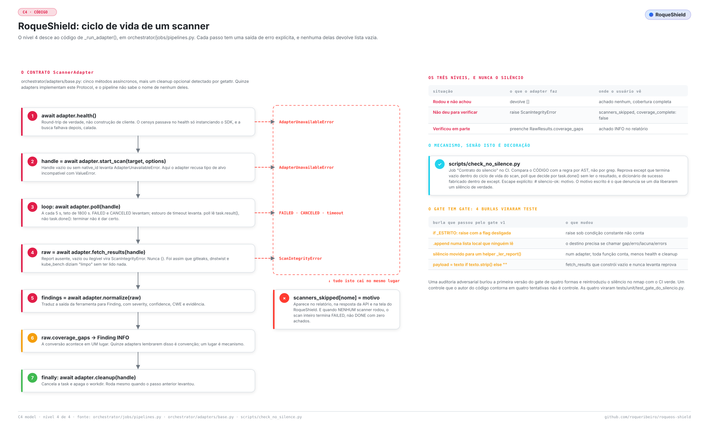

# Estender: adicionar um scanner

*Tradução de [EXTENDING.md](../EXTENDING.md), a versão principal, em inglês. Se as duas divergirem, vale a em inglês.*

> Para quem quer que o RoqueShield rode uma ferramenta de segurança nova. O que é um adapter de scanner, onde vai cada peça, e o que cada gate cobra em cada passo. O ambiente que roda os gates está em [DESENVOLVIMENTO.md](DESENVOLVIMENTO.md); a lista completa do que um scanner tem que provar, em [CRITERIOS-DE-TESTE.md](CRITERIOS-DE-TESTE.md); onde o adapter fica no sistema, em [ARQUITETURA.md](ARQUITETURA.md).

## Sumário

1. [A regra única](#1-a-regra-única)
2. [O que é a fonte da verdade](#2-o-que-é-a-fonte-da-verdade)
3. [O contrato](#3-o-contrato)
4. [Adicionar um scanner, passo a passo](#4-adicionar-um-scanner-passo-a-passo)
5. [Um scanner de OSINT](#5-um-scanner-de-osint)
6. [Antes de fechar](#6-antes-de-fechar)
7. [Quando algo não funciona](#7-quando-algo-não-funciona)

## 1. A regra única

Um scanner quebrado produz exatamente a mesma saída de um alvo seguro: zero achados. Nove adapters deste repositório tiveram o mesmo defeito, exceção engolida e relatório vazio apresentado como alvo limpo. Então todo adapter responde a uma pergunta, e quem responde é o código, não o autor:

> **Zero achados aqui significa *limpo*, ou significa *não rodou*? Se não houver como distinguir, falta um sinal.**

A regra inteira, com os nove casos, está em `.claude/rules/60-contrato-do-silencio.md`. Dois mecanismos a seguram: o `scripts/check_no_silence.py` no CI, e os testes que provam os dois lados (não mente quando falha, e acha de verdade).

<picture>
  <source media="(prefers-color-scheme: dark)" srcset="../assets/diagramas/codigo.escuro.svg">
  
</picture>

## 2. O que é a fonte da verdade

À esquerda, o que você quer saber; à direita, o arquivo que decide. A prosa que discorda da fonte é a prosa que está errada.

| A pergunta | A fonte |
| --- | --- |
| Os métodos que um adapter tem que ter | o Protocol `ScannerAdapter` em `orchestrator/adapters/base.py` |
| O formato de um achado | `Finding` em `orchestrator/domain/schemas.py` |
| Quais scanners um scan consegue construir | o dict `factories` em `_build_adapters`, `orchestrator/jobs/pipelines.py` |
| Que tipos de alvo cada scanner aceita | `_SCANNER_ASSET_SUPPORT` no mesmo arquivo |
| O que cada tipo de alvo e cada perfil rodam | `_DEFAULT_SCANNERS` e `_PROFILE_SCANNERS` no mesmo arquivo |
| Que opções a API aceita por scanner | `ACEITAS` em `orchestrator/domain/opcoes.py` |
| Que binários a imagem leva | `docker/images/orchestrator/Dockerfile` |
| Que binários o `/health/full` procura | `esperados` em `_check_scanners`, `orchestrator/api/routers/health.py` |
| A categoria de cada ferramenta no bundle | `_CATEGORY_BY_TOOL` em `orchestrator/reporting/exporters/ai_bundle.py` |
| O que o gate da doc cobra | `scripts/check_docs_fresh.py` |

Os scanners rodam dentro do worker, como subprocessos da imagem do orchestrator. Não no `cai-kali-toolbox`: esse container é do agente. A skill `cai-add-adapter` e o agente `adapter-author` ainda dizem "kali-toolbox"; o Dockerfile acima é o que o scan usa.

## 3. O contrato

O Protocol, como está no `base.py`:

```python
@runtime_checkable
class ScannerAdapter(Protocol):
    name: str

    async def health(self) -> bool: ...
    async def start_scan(self, target: Target, options: dict[str, Any]) -> ScanHandle: ...
    async def poll(self, handle: ScanHandle) -> ScanStatus: ...
    async def fetch_results(self, handle: ScanHandle) -> RawResults: ...
    async def normalize(self, raw: RawResults) -> list[Finding]: ...
```

Mais um `async def cleanup(self, handle: ScanHandle) -> None` opcional. Quando ele existe, o `_run_adapter` chama num `finally`; o `orchestrator/adapters/_cleanup.py` tem o `cleanup_subprocess_handle` para o caso comum (cancela a task, apaga a pasta de trabalho).

O que o `_run_adapter` faz com cada resposta:

| O adapter | O pipeline |
| --- | --- |
| `health()` devolve False | `AdapterUnavailableError`: o scanner vai para `scanners_skipped` |
| `start_scan()` devolve sem `native_id` | o mesmo |
| `poll()` devolve `FAILED` ou `CANCELED` | o mesmo |
| `poll()` fica `RUNNING` além de 1800 s | o mesmo, como timeout |
| qualquer outra exceção | `scanners_skipped` com `falhou: <erro>` |
| `fetch_results()` preenche `RawResults.coverage_gaps` | cada lacuna vira um achado INFO, "Cobertura incompleta em <nome>" |
| `normalize()` devolve `[]` | rodou e não achou: cobertura completa |

Então o adapter escolhe um de três níveis, nunca o silêncio:

| Situação | O que fazer | Onde o usuário vê |
| --- | --- | --- |
| Rodou e não achou | devolver `[]` | achado nenhum, cobertura completa |
| Não deu para verificar | `raise ScanIntegrityError` | `scanners_skipped`, `coverage_complete: false` |
| Verificou em parte | preencher `RawResults.coverage_gaps` | achado INFO no relatório |

O `health()` devolve bool e nunca levanta. É a única função isenta do gate do silêncio.

## 4. Adicionar um scanner, passo a passo

O nome abaixo é `wapiti`, de exemplo. Arquivo `wapiti_adapter.py`, classe `WapitiAdapter`, atributo `name = "wapiti"`: os três têm que bater, e o `name` é o que aparece em `source_tool`, em `scanners_ran` e na API.

1. **Leia o adapter mais parecido.** CLI com saída JSON: `nuclei_adapter.py`. CLI com XML: `nmap_adapter.py`. Clonar e varrer um repositório: `gitleaks_adapter.py`. API HTTP com ciclo de vida longo: `zap_adapter.py`. API HTTP que responde na hora: `github_exposure_adapter.py`. SDK síncrono embrulhado em thread: `shodan_adapter.py`. Leia também `.claude/rules/scanners.md`.

2. **Escreva `orchestrator/adapters/wapiti_adapter.py`.** O `start_scan` não bloqueia: sobe o subprocesso com `asyncio.create_subprocess_exec` (lista de argv, nunca shell), guarda a task em `self._tasks[native_id]`, escreve a saída em `tempfile.mkdtemp(prefix="cai-wapiti-")`. Confira o tipo de alvo antes e levante `ValueError` para o que você não aceita. Leia o returncode no `poll`:

   ```python
   async def poll(self, handle: ScanHandle) -> ScanStatus:
       task = self._tasks.get(handle.native_id)
       if task is None:
           return ScanStatus.FAILED
       if not task.done():
           return ScanStatus.RUNNING
       rc, _ = task.result()
       return ScanStatus.DONE if rc == 0 else ScanStatus.FAILED
   ```

   Para saída JSONL, use `read_jsonl(path, adapter=self.name, gaps=gaps)` do `base.py`: ele levanta quando toda linha é ilegível e declara a lacuna quando só parte é. Ferramenta de rede vai com o egress fechado por padrão (no nuclei, `-duc -ni`).

   **O que o gate cobra:** o `python scripts/check_no_silence.py` lê por AST toda função do adapter (menos `health` e `cleanup`). Ele reprova `except` que termina em vazio (`return []`, `return {}`, `RawResults` vazio, `continue`, `pass`) sem `raise` nem lacuna registrada; `poll` que decide por `task.done()` sem ler `task.result()`; payload de sucesso montado dentro de `except`; e `fetch_results` que monta resultado vazio e nunca levanta. Medido: o `poll` do template de `.claude/skills/cai-add-adapter/SKILL.md`, que decide só por `task.done()`, reprova neste gate com exit 1. O escape é `# silencio-ok: <motivo>` na linha do `except`, para o vazio que é mesmo o resultado certo.

   **E o gate da doc:** a contagem de adapters é a contagem de arquivos `*_adapter.py`. O `check_docs_fresh.py` lê todo "N adapters" escrito em algarismos no `README.md` e no `docs/ARCHITECTURE.md` (a versão em inglês da [ARQUITETURA.md](ARQUITETURA.md)), e um arquivo novo reprova até eles dizerem o número novo. O README escreve a contagem por extenso ("Fifteen adapters"), que o gate não lê: essa você atualiza à mão.

3. **Normalize para o `Finding` canônico.** Sem variante, sem campo a mais. `source_tool` é `self.name`; `severity` é a heurística do próprio scanner, nunca ajustada pelo contexto do alvo (isso é da triagem de IA, em `ai_triage.adjusted_severity`). Preencha `source_rule_id`, `vuln_id`, `cwe` e `evidence` quando a ferramenta der, e corte evidência enorme. Quando dois achados da mesma regra são coisas diferentes (segredo rotacionado, dois commits), preencha `dedup_discriminator`, ou o dedup junta os dois num só.

4. **Registre na fábrica.** No `_build_adapters` (`orchestrator/jobs/pipelines.py`), uma linha em `factories`:

   ```python
   "wapiti": lambda: WapitiAdapter(),
   ```

   e uma entrada em `_SCANNER_ASSET_SUPPORT` com os tipos de alvo que ele aceita. Se quiser, ponha em `_DEFAULT_SCANNERS` ou em `_PROFILE_SCANNERS` para um scan sem lista explícita rodar ele.

   Nome que não está em `factories` é descartado só com um aviso `scanner.unknown` no log: não vai para `scanners_skipped`, e o relatório não diz que foi pedido. Esse é um limite conhecido do pipeline hoje. Nome ausente de `_SCANNER_ASSET_SUPPORT` não é filtrado por tipo de alvo, então é disparado contra tipos que ele pode recusar.

   **O que o gate cobra:** assim que o nome está em `factories`, o `check_docs_fresh.py` exige que ele apareça no `README.md` ou no `docs/ARCHITECTURE.md`. Medido: uma linha `"wapiti": lambda` sem doc dá `[scanners] 'wapiti' é construível no pipeline e não aparece no README nem na arquitetura` e exit 1.

5. **Declare as opções em `orchestrator/domain/opcoes.py`.** O `ScanIn.options` é uma lista fechada por scanner, com tipo e faixa, porque dict livre virava argv. Scanner fora de `ACEITAS` faz qualquer `options.wapiti` voltar 422 `options.wapiti: scanner sem opções configuráveis`; campo não listado volta 422 com os campos aceitos. Use os validadores que estão lá (`_bool`, `_int(min, max)`, `_lista_de(...)`, `_texto(regex)`, `_textos(regex)`) e nunca aceite caminho de disco nem URL livre. Sem opção nenhuma, `"wapiti": {}` documenta isso de propósito.

   **O que segura:** o `tests/unit/test_escopo_endurecido.py` cobre o `opcoes_seguras`. Ponha a opção perigosa da ferramenta nova na lista parametrizada dele.

6. **Ponha o binário na imagem.** No `docker/images/orchestrator/Dockerfile`: versão pinada, download por arquitetura (amd64 e arm64) e um passo que roda `--version`, para o build falhar quando o binário não executa. Ferramenta Python que conflita com as dependências do app vai num venv próprio, como o checkov. Depois inclua em `esperados` no `_check_scanners` (`orchestrator/api/routers/health.py`), para o `/health/full` reportar a ausência em vez de ficar verde.

   **O que segura:** o job `standalone-image` do CI builda a imagem e espera ela ficar saudável. Para o lock das dependências, o `uv lock --check` (job `lockfile`) reprova `pyproject.toml` alterado sem `uv.lock`.

7. **Configuração e segredos.** Chave ou URL é campo de `Settings` em `orchestrator/config.py`, lido pelo pydantic-settings, nunca fixo no código, nunca em log.

   **O que o gate cobra:** todo campo de `Settings` tem que aparecer no `.env.example`, ou o `check_docs_fresh.py` reprova.

8. **Testes.** `tests/unit/test_wapiti_adapter.py`, sem rede. Os testes de adapter que existem plantam a saída da ferramenta numa pasta temporária e conduzem o adapter sem o binário (veja o `_plant` em `test_checkov_adapter.py`); não existe pasta `tests/fixtures/`, apesar do que a skill diz. Cubra os dois lados:

   - `normalize` numa amostra real da saída da ferramenta produz pelo menos um `Finding` com `source_tool == "wapiti"`;
   - saída ausente, saída ilegível e returncode diferente de zero, cada um **levanta**, não devolve vazio (o padrão está em `tests/unit/test_silencio_adapters.py`, um teste por caso);
   - resultado parcial declara lacuna.

   Depois quebre o seu próprio conserto de propósito (devolva `[]` no `except`, leia só `task.done()`) e confirme que o teste reprova. Se a ferramenta cobre uma camada de [CRITERIOS-DE-TESTE.md](CRITERIOS-DE-TESTE.md), ponha o achado esperado dela no `tests/integration/test_efetividade_e2e.py`.

   **O que segura:** o job `test` do CI, com o piso de cobertura `--cov-fail-under=64`.

9. **Doc e o resto da fiação.** No mesmo commit do código:

   - uma linha na tabela de adapters do `README.md` e do `README.pt-BR.md`, e a contagem nova;
   - o scanner no `docs/ARCHITECTURE.md` e no par [ARQUITETURA.md](ARQUITETURA.md);
   - a categoria em `_CATEGORY_BY_TOOL` (`ai_bundle.py`); ferramenta ausente ali entra no AI Fix Bundle como `infra`;
   - a opção em `.claude/skills/cai-scan/SKILL.md`;
   - uma linha em `[Unreleased]` no `CHANGELOG.md`.

## 5. Um scanner de OSINT

Scanner de exposição externa (dado público, nada ativo) não entra na fábrica do scan. Ele é chamado explicitamente pelo `run_exposure_scan` em `orchestrator/jobs/exposure.py`, que hoje chama `GitHubExposureAdapter`, `GitleaksAdapter` e `TrufflehogAdapter` nos repositórios achados, `DnstwistAdapter`, `ShodanAdapter` e `SubdomainTakeoverAdapter`. Os passos 2, 3, 5, 6, 7, 8 e 9 valem igual; o passo 4 vira uma chamada nessa função. O `health()` precisa de round-trip: construir cliente de SDK não prova credencial. Paginação é cobertura: compare com o total que a API informa e declare a diferença.

Os adapters do Censys e do kube-bench são o contraexemplo: existem, têm teste e contam como adapter, e nenhum caminho de produção os constrói.

## 6. Antes de fechar

```bash
python scripts/check_no_silence.py
python scripts/check_docs_fresh.py
.venv/bin/pytest tests/unit/test_wapiti_adapter.py -v
.venv/bin/pytest
.venv/bin/ruff check orchestrator tests scripts
.venv/bin/ruff format --check orchestrator tests scripts
```

E, com Docker, `make build` e `make smoke`, depois leia o relatório em `reports/` atrás dos achados do scanner novo e de um `scanners_skipped` vazio.

A regra que vale para tudo acima: **teste de mutação**. Quebre de propósito o que você acabou de proteger e confirme que o check reprova. Check que nunca foi visto reprovando é esperança, não garantia.

## 7. Quando algo não funciona

- **O scanner nunca roda e nada diz por quê**: o nome não está em `factories`. Procure `scanner.unknown` no log do worker.
- **Ele sempre sai em `scanners_skipped` com "health check falhou"**: o binário não está na imagem, ou falta o serviço ou a credencial. O `/health/full` lista os binários ausentes em `ausentes` quando a ferramenta está em `esperados`.
- **A API responde 422 em `options`**: o scanner ou o campo não está em `ACEITAS`.
- **O gate do silêncio reprova uma linha que você acha certa**: decida em qual dos três níveis o caso está. Se o vazio é mesmo o resultado, `# silencio-ok: <motivo>` na linha do `except`; o motivo escrito é o que a revisão lê.
- **O gate da doc reprova depois do arquivo novo**: a contagem de adapters. Atualize o número no `docs/ARCHITECTURE.md` (e a palavra no `README.md`).
- **Scan que quebra depois que o scanner entrou**: [QUANDO-QUEBRA.md](QUANDO-QUEBRA.md).
