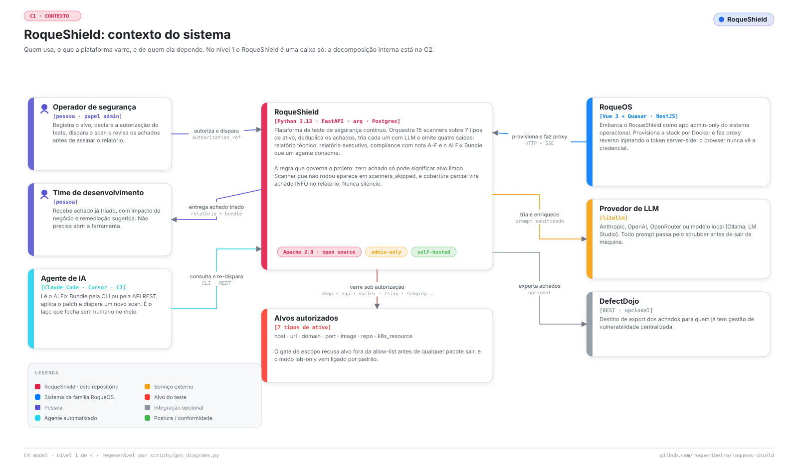

# Documentação do RoqueShield

*Tradução de [INDEX.md](../INDEX.md), a versão principal, em inglês. Se as duas divergirem, vale a em inglês.*

Por onde começar depende do que você quer. Todo documento abaixo tem o par em inglês em [`docs/`](../INDEX.md), que é a versão principal.

| Quero... | Leia |
| --- | --- |
| **Instalar e rodar o primeiro scan** | [COMECAR.md](COMECAR.md): um comando, o código de primeiro uso, um alvo de laboratório, o primeiro scan Web |
| **Operar no dia a dia ou em produção** | [OPERACAO.md](OPERACAO.md): atualizar, backup e restauração, compose de produção, contas, escopo e autorização |
| **Entender uma falha** | [QUANDO-QUEBRA.md](QUANDO-QUEBRA.md): sintoma, causa, o que fazer |
| **Ver como ele é por dentro** | [ARQUITETURA.md](ARQUITETURA.md): contexto, containers, componentes, a esteira do scan, o agente e a coleira, decisões |
| **Consultar um comando, rota, variável ou opção de scanner** | [REFERENCIA.md](REFERENCIA.md) |
| **Ligar num agente de IA, numa CLI ou numa esteira de CI** | [INTEGRACOES.md](INTEGRACOES.md): API REST, a CLI `roqueshield`, o servidor MCP, o laço scan, patch e novo scan |
| **Consumir o AI Fix Bundle de outra ferramenta** | [AI-FIX-BUNDLE.md](AI-FIX-BUNDLE.md): o contrato, campo a campo |
| **Saber o que ele protege e o que não protege** | [MODELO-DE-AMEACAS.md](MODELO-DE-AMEACAS.md) e [../../SECURITY.md](../../SECURITY.md) (em inglês) |
| **Saber o que cada scanner deve achar** | [CRITERIOS-DE-TESTE.md](CRITERIOS-DE-TESTE.md): critérios por camada e por tipo de alvo |
| **Rodar a stack de desenvolvimento** | [DESENVOLVIMENTO.md](DESENVOLVIMENTO.md): o compose, os gates locais, a CI |
| **Adicionar um scanner** | [ESTENDER.md](ESTENDER.md): o contrato do adapter e o que os gates cobram |
| **Achar um termo** | [GLOSSARIO.md](GLOSSARIO.md) |
| **Contribuir** | [CONTRIBUTING.md](CONTRIBUTING.md) |
| **Reportar uma vulnerabilidade** | [../../SECURITY.md](../../SECURITY.md) (em inglês) |
| **Ver o que mudou em cada versão** | [../../CHANGELOG.md](../../CHANGELOG.md) (em inglês) |

## Diagramas

Todo diagrama existe em português e em inglês, claro e escuro, gerado por [`scripts/gen_diagrams.py`](../../scripts/gen_diagrams.py) a partir do código em [`scripts/diagrams/`](../../scripts/diagrams/). O job "Diagramas em dia" da CI reprova quando um diagrama e o código dele discordam, então nenhum é foto velha.

| Diagrama | Onde é explicado |
| --- | --- |
| [Contexto do sistema](../assets/diagramas/contexto.claro.svg) | [ARQUITETURA](ARQUITETURA.md) |
| [Containers](../assets/diagramas/containers.claro.svg) | [ARQUITETURA](ARQUITETURA.md) |
| [Componentes](../assets/diagramas/componentes.claro.svg) | [ARQUITETURA](ARQUITETURA.md) |
| [Ciclo de vida do scanner](../assets/diagramas/codigo.claro.svg) | [ARQUITETURA](ARQUITETURA.md) e [ESTENDER](ESTENDER.md) |
| [A esteira do scan](../assets/diagramas/esteira.claro.svg) | [ARQUITETURA](ARQUITETURA.md) |
| [O sidecar Kali e o agente](../assets/diagramas/agente-kali.claro.svg) | [ARQUITETURA](ARQUITETURA.md) |
| [Superfícies de integração e o laço do agente](../assets/diagramas/integracoes.claro.svg) | [INTEGRACOES](INTEGRACOES.md) |
| [Infraestrutura e implantação](../assets/diagramas/infra.claro.svg) | [ARQUITETURA](ARQUITETURA.md) e [OPERACAO](OPERACAO.md) |
| [O produto dentro do RoqueOS](../assets/diagramas/telas.claro.svg) | [ARQUITETURA](ARQUITETURA.md) |

Para mostrar um diagrama no tema de quem lê, use `<picture>`:

```html
<picture>
  <source media="(prefers-color-scheme: dark)" srcset="../assets/diagramas/contexto.escuro.svg">
  
</picture>
```

A marca (banner, fontes, o prompt da arte) está em [`assets/marca/`](../assets/marca/README.md).
