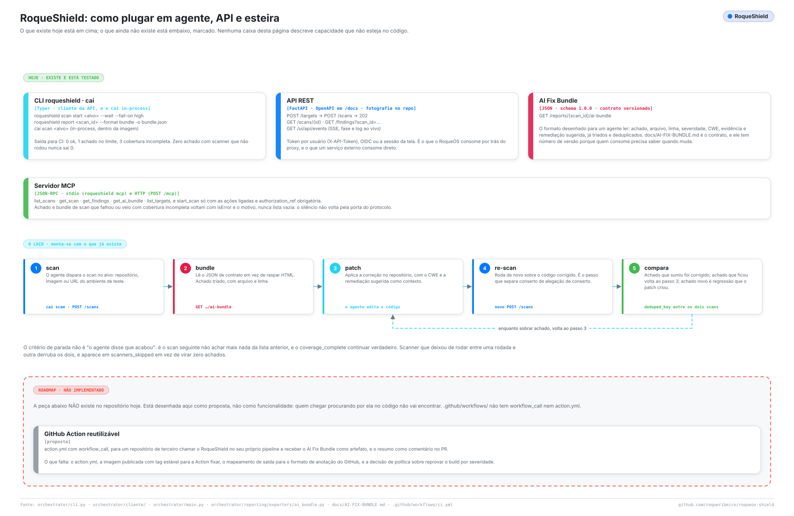

# Integrações

*Tradução de [INTEGRATIONS.md](../INTEGRATIONS.md), a versão principal, em inglês. Se as duas divergirem, vale a em inglês.*

> Como dirigir o RoqueShield a partir de algo que não é uma pessoa: um agente de código, um serviço, um job de CI. Tudo aqui foi conferido no código e, onde dá para rodar sem um shield no ar, rodado neste repositório. O que não existe está na [seção 9](#9-o-que-não-existe), dito como ausente.
>
> Para cada rota, flag e variável, veja a [REFERÊNCIA](REFERENCIA.md). Para o contrato que o agente lê, [AI-FIX-BUNDLE.md](AI-FIX-BUNDLE.md). Para instalar um shield antes, [COMECAR.md](COMECAR.md).

## Sumário

1. [As superfícies num relance](#1-as-superfícies-num-relance)
2. [Credenciais](#2-credenciais)
3. [A CLI](#3-a-cli)
4. [A API REST](#4-a-api-rest)
5. [Progresso ao vivo por SSE](#5-progresso-ao-vivo-por-sse)
6. [O servidor MCP](#6-o-servidor-mcp)
7. [O laço: scan, patch, re-scan](#7-o-laço-scan-patch-re-scan)
8. [CI](#8-ci)
9. [O que não existe](#9-o-que-não-existe)

---

## 1. As superfícies num relance

<picture>
  <source media="(prefers-color-scheme: dark)" srcset="../assets/diagramas/integracoes.escuro.svg">
  
</picture>

| Superfície | Para | Onde no código |
| --- | --- | --- |
| CLI `roqueshield` | Script de shell, CI, agente de código com terminal | `orchestrator/cliente/cli.py` |
| API REST | Qualquer serviço; as outras superfícies são clientes dela | `orchestrator/api/routers/` |
| SSE `GET /ui/api/events` | Fase e linhas de log ao vivo | `orchestrator/api/routers/ui.py` |
| MCP por stdio (`roqueshield mcp`) | Claude Code, Claude Desktop, Cursor na mesma máquina da CLI | `orchestrator/cliente/mcp_stdio.py` |
| MCP por HTTP (`POST /mcp`) | Cliente MCP que alcança o shield pela rede | `orchestrator/api/routers/mcp.py` |
| AI Fix Bundle | O contrato JSON que um agente de correção consome | `orchestrator/reporting/exporters/ai_bundle.py` |

Todas terminam na API REST com a credencial de quem chama, então o papel dessa credencial (RBAC) decide o que cada uma pode fazer. Não há porta lateral.

Sobre nomes: o produto é RoqueShield. `cai` é o nome interno do motor (pacote `cai-orchestrator`, containers `cai-*`, e uma CLI de admin chamada `cai`, que roda o pipeline no próprio processo). Integração usa `roqueshield`, que é cliente de um shield rodando.

## 2. Credenciais

A API aceita, nesta ordem (`orchestrator/api/deps.py`):

1. `X-API-Token` igual ao `APP_TOKEN`: principal de serviço com papel `admin`.
2. `X-API-Token` com token de usuário, criado em **Usuários** na tela ou por `POST /users`. O shield guarda só o hash.
3. `Authorization: Bearer <jwt-de-sessão>` do login OIDC.
4. O cookie `rs_session` do login por senha da tela. Escrita com o cookie também exige o cabeçalho `X-RoqueShield` (CSRF).

Dê à integração um token de usuário com o menor papel que resolve:

| Papel | Pode |
| --- | --- |
| `viewer` | ler scans, achados, relatórios e o bundle |
| `auditor` | o mesmo, mais a trilha de auditoria (`GET /audit`) |
| `operator` | o mesmo do `viewer`, mais criar alvo, disparar e apagar scan, marcar achado como resolvido |
| `admin` | tudo, inclusive escopo, configuração de IA e usuários |

O `APP_TOKEN` é a chave de admin do próprio container. Não entregue a um job de CI.

A CLI e o MCP por stdio leem a credencial nesta ordem (`orchestrator/cliente/api.py`): as variáveis `ROQUESHIELD_URL` e `ROQUESHIELD_TOKEN`, depois o arquivo que o `roqueshield login` grava (`~/.config/roqueshield/config.json`, modo `0600`), e por último, dentro do container standalone, o shield local com o `APP_TOKEN` de `$DATA_DIR/secrets`. É esse último passo que faz `docker exec roqueshield roqueshield status` funcionar sem configurar nada. O token nunca é impresso.

## 3. A CLI

```
$ roqueshield --help
 Usage: roqueshield [OPTIONS] COMMAND [ARGS]...

 Cliente do RoqueShield: scans, achados, relatórios e o servidor MCP.

╭─ Commands ───────────────────────────────────────────────────────────────────╮
│ login           Guarda o endereço e o token (crie o token na tela, em        │
│                 Usuários, ou em POST /users).                                │
│ status          Versão do shield, quem está logado e o estado de cada        │
│                 dependência.                                                 │
│ findings        Os achados de um scan.                                       │
│ report          Baixa um relatório. `bundle` é o AI Fix Bundle que outro     │
│                 agente consome para corrigir.                                │
│ reset-password  Troca a senha de uma conta. Pede a senha nova sem eco.       │
│ logs            Log de um serviço do container (credencial já vem redigida). │
│ mcp             Servidor MCP por stdio, para Claude Desktop, Claude Code ou  │
│                 Cursor.                                                      │
│ scan            Disparar, acompanhar e apagar scans.                         │
│ settings        Configuração de IA e de escopo.                              │
╰──────────────────────────────────────────────────────────────────────────────╯
```

As opções que uma integração usa, de `roqueshield scan start --help`, `report --help` e `findings --help`:

| Comando | Opções |
| --- | --- |
| `scan start <alvo>` | `--type url\|domain\|host\|port\|image\|repo` (padrão `url`), `--profile web\|network\|full\|active\|exposure` (padrão `web`), `--scanner` (repita para mais de um), `--auth-ref` (referência da autorização), `--wait`, `--fail-on info\|low\|medium\|high\|critical`, `--intervalo` (segundos entre leituras, padrão 5), `--prazo` (segundos até desistir, padrão 7200) |
| `scan watch <scan_id>` | `--fail-on`, `--intervalo`, `--prazo` |
| `scan show <scan_id>` | `--json` |
| `findings <scan_id>` | `--severity`, `--limit` (padrão 200), `--json` |
| `report <scan_id>` | `--format bundle\|compliance\|html\|executive` (padrão `bundle`), `--output/-o` (sem ele, stdout) |

A lista completa está na [REFERENCIA.md](REFERENCIA.md).

```bash
roqueshield login --server https://shield.exemplo          # pede o token sem eco
roqueshield scan start https://staging.exemplo.com --auth-ref CHG-123 --wait --fail-on high
roqueshield scan start https://github.com/acme/api.git --type repo --profile full --wait
roqueshield scan show <scan_id> --json
roqueshield report <scan_id> --format bundle -o bundle.json
```

`scan start` imprime `scan <id> criado (<perfil>)`. Com `--wait`, e sempre no `scan watch`, o comando sai por um contrato feito para pipeline:

| Código | Quando |
| --- | --- |
| `0` | terminou, cobertura completa, nada no limite do `--fail-on` ou acima |
| `1` | terminou, cobertura completa, há achado no limite do `--fail-on` ou acima |
| `2` | erro de uso, de conexão ou de credencial |
| `3` | o scan falhou, a cobertura veio incompleta (algum scanner não rodou), ou o `--prazo` acabou |

O `3` vence o `0` e o `1` de propósito: zero achado de scanner que não rodou é vetor não verificado, não alvo limpo. Sem `--fail-on`, um scan completo sai `0` seja o que for que achou.

Como os erros aparecem, rodado aqui:

```
$ roqueshield scan start x --fail-on bogus; echo $?
--fail-on aceita: info, low, medium, high, critical
2
$ roqueshield status; echo $?        # sem variáveis, sem login
sem servidor ou token: rode `roqueshield login --server URL`, ou defina
ROQUESHIELD_URL e ROQUESHIELD_TOKEN
2
$ ROQUESHIELD_URL=http://127.0.0.1:9 ROQUESHIELD_TOKEN=x roqueshield status; echo $?
sem conexão com o RoqueShield: ConnectError: [Errno 111] Connection refused
2
```

Uma recusa da API imprime `a API recusou (<status>): <detalhe>` e também sai `2`.

Dois comportamentos para saber. O `findings` lista o que existe e não olha cobertura; use `scan show`, `scan watch` ou as ferramentas MCP quando "zero" precisar significar alguma coisa. E a API também aceita `--type port` (`host:porta/proto`), embora a ajuda da CLI não o liste.

Para ter a CLI: dentro do container ela já está lá. Fora, rode a partir da imagem, sem instalar nada:

```bash
docker run --rm -it --entrypoint roqueshield \
  -e ROQUESHIELD_URL=https://shield.exemplo -e ROQUESHIELD_TOKEN \
  roqueribeiro1988/roqueos-shield:v0.5.1-standalone status
```

ou instale do repositório (Python 3.13 ou mais novo; não está no PyPI e traz as dependências do motor junto):

```bash
pip install "git+https://github.com/roqueribeiro/roqueos-shield@v0.5.1"
```

## 4. A API REST

A página OpenAPI fica em `/docs` no shield. As chamadas de que uma integração precisa:

| Passo | Chamada | Papel |
| --- | --- | --- |
| Conferir um alvo sem criar | `POST /targets/check` | `operator` |
| Registrar o alvo | `POST /targets` → `201` | `operator` |
| Disparar o scan | `POST /scans` → `202` com o `id` do scan | `operator` |
| Acompanhar | `GET /ui/api/scans/{id}` (estado, fase, `coverage_complete`, `scanners_skipped`) | `viewer` |
| Ler os achados | `GET /ui/api/findings?scan_id=…`, ou `GET /findings/queue` (paginado, um item por problema) | `viewer` |
| Postura de compliance | `GET /reports/{id}/compliance` | `viewer` |
| O AI Fix Bundle | `GET /reports/{id}/ai-bundle` | `viewer` |
| Marcar um problema como resolvido | `POST /findings/resolve` com `deduped_key` e `status` | `operator` |

O `POST /scans` recusa antes de enfileirar qualquer coisa: alvo fora do escopo (`403`), `authorization_ref` ausente com `REQUIRE_AUTH_REF=true` (`403`), e qualquer opção de scanner fora da lista fechada daquele scanner (`422`, com o nome do campo). Detalhes em [MODELO-DE-AMEACAS.md](MODELO-DE-AMEACAS.md#4-escopo-e-validação-do-alvo).

`GET /ui/api/scans/{id}` é o que a CLI e o MCP leem, porque traz a cobertura. `GET /scans/{id}` também existe, mas devolve só estado, datas, caminho do relatório e erros.

Toda rota, corpo e código de status: [REFERÊNCIA, seção 4](REFERENCIA.md#4-api-rest).

## 5. Progresso ao vivo por SSE

`GET /ui/api/events?scan_id=<id>` responde `text/event-stream` com dois tipos de evento: `phase` (fase e progresso do scan) e `log` (uma entrada de log em JSON), mais comentários `: keepalive`. Aceita qualquer credencial da API com `scans:read`: o cabeçalho `X-API-Token`, sessão Bearer ou o cookie.

O `EventSource` do navegador não manda cabeçalho, por isso a tela usa o cookie. Existe ainda um parâmetro legado `?token=`, aceito só nesta rota e só com o `APP_TOKEN`; qualquer outra rota recusa com `401`, para o token não parar em log e em `Referer`. Não construa em cima dele.

```bash
curl -N -H "X-API-Token: $ROQUESHIELD_TOKEN" \
  "https://shield.exemplo/ui/api/events?scan_id=$SCAN"
```

## 6. O servidor MCP

Escrito direto contra o protocolo (`orchestrator/cliente/mcp_nucleo.py`), e não com o SDK `mcp`, porque o lockfile já carrega duas versões incompatíveis desse SDK por extras opcionais. Responde `initialize`, `ping`, `tools/list` e `tools/call`, e oferece as versões de protocolo `2025-06-18`, `2025-03-26` e `2024-11-05`.

**Por stdio**, uma mensagem JSON-RPC por linha; log vai para o stderr, nunca para o stdout:

```bash
claude mcp add roqueshield \
  -e ROQUESHIELD_URL=https://shield.exemplo -e ROQUESHIELD_TOKEN=<token> \
  -- roqueshield mcp
```

Uma sessão real, rodada aqui contra um endereço sem nada escutando (`initialize` e `tools/list` não tocam a API):

```
$ printf '%s\n' '{"jsonrpc":"2.0","id":1,"method":"initialize","params":{"protocolVersion":"2025-06-18"}}' \
    '{"jsonrpc":"2.0","id":2,"method":"tools/list"}' | roqueshield mcp
roqueshield mcp: http://127.0.0.1:9 (ações desligadas)
{"jsonrpc": "2.0", "id": 1, "result": {"protocolVersion": "2025-06-18", "capabilities": {"tools": {"listChanged": false}}, "serverInfo": {"name": "roqueshield", "version": "0.5.1"}, ...}}
{"jsonrpc": "2.0", "id": 2, "result": {"tools": [{"name": "list_scans", ...
```

A primeira linha é o stderr: o servidor com quem fala e "ações desligadas". O `--server` sobrescreve o endereço salvo.

**Por HTTP**, `POST /mcp` com uma mensagem JSON-RPC por requisição e a resposta em JSON (Streamable HTTP sem o stream do servidor: `GET /mcp` responde `405`, e lote recebe o erro `-32600`). Autentica como o resto da API, com `X-API-Token` ou `Authorization: Bearer`, e cada ferramenta chama a API dentro do mesmo processo repassando essa credencial.

```bash
curl -s -X POST https://shield.exemplo/mcp \
  -H "X-API-Token: $ROQUESHIELD_TOKEN" -H "Content-Type: application/json" \
  -d '{"jsonrpc":"2.0","id":1,"method":"tools/list"}'
```

As ferramentas:

| Ferramenta | Argumentos | Devolve |
| --- | --- | --- |
| `list_scans` | `limit` (1 a 200) | scans recentes com estado, fase e contagem |
| `get_scan` | `scan_id` | o detalhe, inclusive que scanners rodaram, quais não, e por quê |
| `get_findings` | `scan_id`, `severity`, `limit` (1 a 500) | os achados, ou um erro (abaixo) |
| `get_ai_bundle` | `scan_id` | o AI Fix Bundle, ou um erro (abaixo) |
| `list_targets` | nenhum | alvos registrados |
| `start_scan` | `target`, `asset_type` (`url`, `domain`, `host`, `port`, `image`, `repo`), `profile` (`web`, `network`, `full`, `active`, `exposure`), `authorization_ref` (obrigatório, 3+ caracteres) | só com as ações ligadas |

**Ferramenta não devolve lista vazia de scan que não verificou.** `get_findings` e `get_ai_bundle` sobre scan que falhou, ainda está rodando ou veio com cobertura incompleta voltam com `isError: true`, o motivo e o dado parcial. Rodado aqui com uma API falsa devolvendo um scan terminado em que o ZAP foi pulado:

```json
{"content": [{"type": "text", "text": "{\"erro\": \"cobertura INCOMPLETA, estes vetores não foram verificados: zap: ZAP fora do ar\", \"achados_parciais\": []}"}], "isError": true}
```

Um agente que lê `[]` conclui "limpo"; é isto que o impede.

**Ações.** O `start_scan` nem aparece na lista se as ações estão desligadas, e chamá-lo assim mesmo é erro de protocolo (`ferramenta desconhecida: start_scan`). Quem liga as ações depende do transporte:

- `POST /mcp`: o servidor, com `MCP_ALLOW_ACTIONS=true` (padrão `false`).
- stdio: o cliente, com `ROQUESHIELD_MCP_ACTIONS=1` no ambiente do `roqueshield mcp`.

Então, no stdio, o controle de verdade é o papel do token. Para agente só de leitura, dê um token `viewer` ou `auditor`: esses não disparam scan por caminho nenhum. Variáveis: [REFERÊNCIA, seção 5](REFERENCIA.md#5-servidor-mcp) e [seção 6](REFERENCIA.md#6-variáveis-de-ambiente).

## 7. O laço: scan, patch, re-scan

As superfícies acima fecham o laço sem uma pessoa no meio:

1. **Escaneie** o repositório, a imagem ou a URL de staging.
2. **Leia o bundle** (`GET /reports/{id}/ai-bundle`), estruturado, não raspado.
3. **Corrija** o código, com o CWE e a remediação como contexto.
4. **Re-escaneie** o código corrigido. É o passo que separa uma correção de uma alegação de correção.
5. **Compare** os dois bundles por `deduped_key`: o que sumiu foi corrigido, o que ficou volta ao passo 3, o que é novo é regressão que o patch introduziu.

**A condição de parada** não é "o agente disse que deu certo". O laço termina quando o scan novo não acha o que o anterior achou **e** a cobertura dele continua completa. Um scanner que parou de rodar entre as rodadas (rede fechada, container que não subiu, credencial vencida) produz zero achado pelo mesmo motivo que um código limpo. Sem conferir a cobertura, "o agente corrigiu tudo" e "o scanner quebrou" ficam iguais.

Por isso o passo 5 confere três coisas, nesta ordem. Os nomes de campo são os do bundle (`scan.coverage_complete`, `scan.scanners_executed`):

```python
assert novo["scan"]["coverage_complete"], "um scanner deixou de rodar; comparação inválida"
assert set(novo["scan"]["scanners_executed"]) >= set(anterior["scan"]["scanners_executed"])
resolvidos = chaves_anteriores - chaves_novas
regressoes = chaves_novas - chaves_anteriores
```

Com a CLI:

```bash
REPO=https://github.com/acme/api.git
ANTES=$(roqueshield scan start "$REPO" --type repo | awk '/^scan / {print $2}')
roqueshield scan watch "$ANTES"
roqueshield report "$ANTES" --format bundle -o bundle.json

# ... o agente corrige o repositório a partir do bundle.json ...

DEPOIS=$(roqueshield scan start "$REPO" --type repo | awk '/^scan / {print $2}')
roqueshield scan watch "$DEPOIS"          # sai 3 se a cobertura voltou incompleta
roqueshield report "$DEPOIS" --format bundle -o bundle-depois.json

jq -s '{
  resolvidos: ([.[0].vulnerabilities[].deduped_key] - [.[1].vulnerabilities[].deduped_key]),
  regressoes: ([.[1].vulnerabilities[].deduped_key] - [.[0].vulnerabilities[].deduped_key])
}' bundle.json bundle-depois.json
```

Para registrar o resultado, `POST /findings/resolve` muda o status de um problema por `deduped_key` (`open`, `in_progress`, `resolved`, `false_positive`, `wont_fix`, `risk_accepted`), grava na trilha de auditoria, e o status sobrevive aos re-scans. O bundle em si não traz esse status; leia em `GET /findings/queue`.

## 8. CI

Um passo de shell contra um shield que você já roda. O token é um segredo do CI criado em **Usuários** com o papel `operator`:

```yaml
- name: RoqueShield
  env:
    ROQUESHIELD_URL: https://shield.exemplo
    ROQUESHIELD_TOKEN: ${{ secrets.ROQUESHIELD_TOKEN }}
  run: |
    docker run --rm -e ROQUESHIELD_URL -e ROQUESHIELD_TOKEN --entrypoint roqueshield \
      roqueribeiro1988/roqueos-shield:v0.5.1-standalone \
      scan start https://staging.exemplo.com --auth-ref "$GITHUB_RUN_ID" --wait --fail-on high
```

O `docker run` devolve o código de saída da CLI, então `1` (achado `high` ou acima) e `3` (scan falhou ou cobertura incompleta) reprovam o passo. Scanner que não rodou nunca passa como limpo.

Este passo não roda no CI deste repositório (precisa de um shield alcançável e de um alvo que você esteja autorizado a escanear). O que o CI confere é que a imagem traz a CLI: `.github/workflows/ci.yml` roda `docker exec rs roqueshield --help` contra a imagem standalone construída. Fixe a tag da imagem; um scanner que muda de versão entre execuções sem ninguém ver é pior que nenhum.

Para guardar o bundle como artefato do build, acrescente `roqueshield report <id> --format bundle -o bundle.json` depois do scan e suba o arquivo.

## 9. O que não existe

Dito aqui para ninguém descobrir em produção:

- **Não há GitHub Action reutilizável.** `.github/workflows/` tem só o `ci.yml`, sem `workflow_call`, e não existe `action.yml`. O pipeline de outro projeto usa o passo de shell da [seção 8](#8-ci).
- **Não há anotação de código no GitHub nem comentário em PR** a partir dos achados, e não há exportação SARIF. A saída para máquina é o AI Fix Bundle e o JSON de compliance.
- **Não há ferramenta de comparação de scans** (o `shield_compare` foi proposto e não construído). A seção 7 faz isso com `jq`.
- **Não há stream do servidor no `POST /mcp`** nem mensagem em lote. O servidor nunca manda notificação por conta própria.
- **Não há pacote no PyPI.** A CLI vem da imagem ou de `pip install git+…`.

## Quando algo não funciona

- A CLI sai `2` com `sem servidor ou token`: defina `ROQUESHIELD_URL` e `ROQUESHIELD_TOKEN`, ou rode `roqueshield login --server URL`.
- `a API recusou (401)` ou `(403)`: token errado, ou papel sem a permissão. Disparar scan exige `operator`.
- `POST /scans` devolve `403 target rejeitado pela policy`: o alvo está fora do escopo. Pergunte ao shield por quê com `POST /targets/check`, e veja o escopo em [OPERACAO.md](OPERACAO.md).
- `--wait` sai `3` num scan que "não achou nada": rode `roqueshield scan show <id>`; as linhas `não rodou: <scanner>: <motivo>` dizem o que não foi verificado. [QUANDO-QUEBRA.md](QUANDO-QUEBRA.md) cobre os scanners.
- O cliente MCP não mostra o `start_scan`: as ações estão desligadas, que é o padrão. Veja a [seção 6](#6-o-servidor-mcp).
