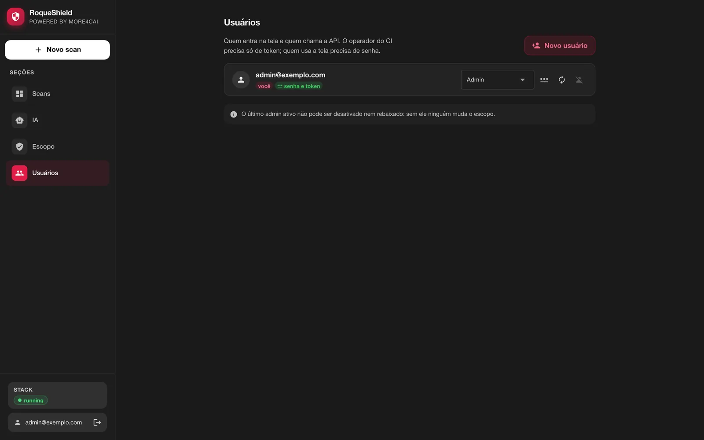
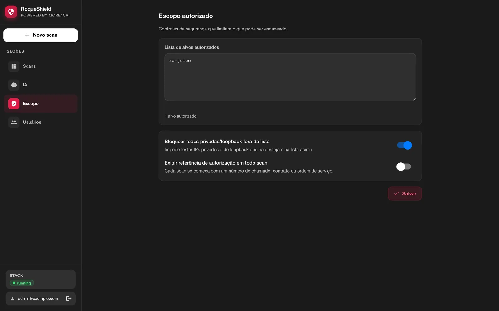
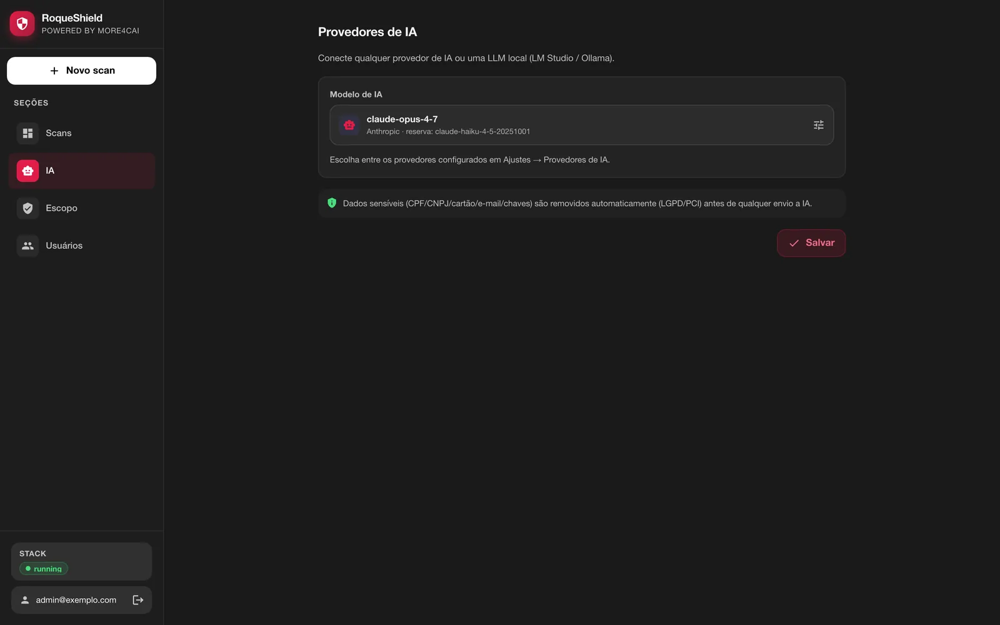

# Operação: o RoqueShield no dia a dia e em produção

*Tradução de [OPERATIONS.md](../OPERATIONS.md), a versão principal, em inglês. Se as duas divergirem, vale a em inglês.*

> **Para quem:** quem mantém um RoqueShield rodando depois do primeiro scan: quem atualiza, faz backup, dá acesso a outras pessoas e responde pelo que ele escaneou.
> **O que tem aqui:** o container standalone (um `docker run`) e o compose de produção (a mesma imagem, separada em serviços). Atualização, backup, segredos, contas, TLS, escopo e autorização, memória, configuração, IA, Greenbone.
> **Onde ir para o resto:** a primeira instalação está em [COMECAR.md](COMECAR.md). Sintomas e consertos, em [QUANDO-QUEBRA.md](QUANDO-QUEBRA.md). A tabela completa de variáveis, comandos e rotas, em [REFERENCIA.md](REFERENCIA.md). A stack de desenvolvimento (`docker/compose.yml`, `make`), em [DESENVOLVIMENTO.md](DESENVOLVIMENTO.md).

**Sobre os nomes:** o produto é RoqueShield. O motor dentro dele ainda se chama `cai` no código: o pacote Python `cai-orchestrator`, os containers `cai-*` da stack de desenvolvimento e a CLI de administração `cai`. A CLI que você usa contra um shield rodando é a `roqueshield`. As mensagens dela, como as de erro da API, saem em português.

## Sumário

1. [O que roda dentro do container](#1-o-que-roda-dentro-do-container)
2. [Ligar, parar, atualizar](#2-ligar-parar-atualizar)
3. [Backup e restauração](#3-backup-e-restauração)
4. [Segredos](#4-segredos)
5. [Contas, papéis e sessões](#5-contas-papéis-e-sessões)
6. [Além do localhost](#6-além-do-localhost)
7. [Escopo e autorização](#7-escopo-e-autorização)
8. [Memória](#8-memória)
9. [Configuração pelo ambiente](#9-configuração-pelo-ambiente)
10. [Compose de produção](#10-compose-de-produção)
11. [Provedor de IA e modelo local](#11-provedor-de-ia-e-modelo-local)
12. [Greenbone, opcional](#12-greenbone-opcional)
13. [Logs e saúde](#13-logs-e-saúde)

## 1. O que roda dentro do container

| Processo | O que é | Exposto |
| --- | --- | --- |
| `orchestrator` | API, tela, Swagger, MCP por HTTP, progresso ao vivo (SSE) | `:8080` |
| `worker` | roda os scans (nmap, ZAP, nuclei, trivy, semgrep, gitleaks, trufflehog, checkov e os demais) | não |
| `redis` | a fila de jobs, com senha | só `127.0.0.1` |
| `zap` | o daemon do OWASP ZAP, com o Firefox headless do AJAX spider | só `127.0.0.1`, com chave de API |

Um pequeno supervisor em Python (`orchestrator/standalone/supervisor.py`) é o entrypoint. No boot ele garante que os segredos existem, roda as migrations do banco (`alembic upgrade head`, SQLite ou Postgres) e só então sobe os quatro processos. Ele reinicia quem cair, esperando 1 s, 2 s, 4 s e assim por diante até 60 s. No `docker stop`, para todos em ordem inversa em até 8 segundos no total, e é por isso que o container nasce com `--stop-timeout 30`. Roda como UID 1000 e o container não precisa de capability nenhuma. Nenhum socket do Docker é montado.

Cada processo recebe só os segredos de que precisa. O worker, e os scanners que ele dispara contra o alvo, não recebem o `APP_TOKEN`, a chave que assina a sessão nem o código de primeiro uso; Redis e ZAP recebem a senha e a chave por arquivos `0600`, não pela linha de comando. Isso evita vazamento acidental (uma variável parando num log ou num relatório). **Não** isola um scanner comprometido: o worker e os scanners rodam como o mesmo usuário que lê `/data/secrets`. Isolamento de verdade, com o worker em outro usuário e sem alcance aos segredos, é um limite conhecido desta versão.

## 2. Ligar, parar, atualizar

```bash
docker stop roqueshield     # parar
docker start roqueshield    # ligar de novo (ou rodar o instalador outra vez)
```

**Atualizar.** Rode o instalador com `--update` (ou `--atualizar`). Ele baixa a imagem da versão do próprio script e, se o container roda outra imagem, recria o container no mesmo volume e na mesma porta do host. No boot, antes de a API responder, o supervisor aplica as migrations.

```bash
curl -fsSL https://raw.githubusercontent.com/roqueribeiro/roqueos-shield/main/install.sh | sh -s -- --update
```

O que você deve ver (da 0.5.0 para a 0.5.1):

```
==> Baixando a imagem (cerca de 1,2 GB na primeira vez)
==> Atualizando 'roqueshield': roqueribeiro1988/roqueos-shield:v0.5.0-standalone -> roqueribeiro1988/roqueos-shield:v0.5.1-standalone (o volume com os dados fica)
==> Subindo o container 'roqueshield' em http://localhost:8080
==> Esperando o RoqueShield ficar pronto
    ✓ pronto
```

Sem `--update`, o instalador só avisa que o container roda uma imagem mais velha e imprime o comando de atualizar. O script da `main` instala a versão fixada dentro dele; para fixar outra, use `ROQUESHIELD_VERSAO=v<versão>`.

A atualização só termina quando o shield responde a versão nova, não quando a imagem foi baixada:

```bash
curl -s http://localhost:8080/health
# {"status":"ok","version":"0.5.1"}
```

**Desinstalar.** `docker rm -f roqueshield` tira o container e mantém os dados. `docker volume rm roqueshield` apaga os dados, segredos inclusive. Liste o que tem no volume antes de apagar (a seção 3 mostra como copiar tudo para fora).

## 3. Backup e restauração

O volume `/data` guarda tudo **junto**: o banco SQLite (`shield.db`), os relatórios, a sessão do ZAP, o cache do trivy e os segredos. Trate o backup como segredo: quem tem a cópia tem o `APP_TOKEN` e a `SECRETS_KEY`. Perder a `SECRETS_KEY` deixa ilegível a chave de IA guardada; digite de novo em **IA**.

Backup, com o container parado para o SQLite ficar consistente:

```bash
docker stop roqueshield
docker run --rm -v roqueshield:/data -v "$PWD":/bkp alpine \
  sh -c 'umask 077 && tar czf /bkp/roqueshield-data.tgz -C /data .'
docker start roqueshield
```

Restaurar num volume novo e vazio (uma máquina nova, ou depois de um `docker volume rm`):

```bash
docker volume create roqueshield
docker run --rm -v roqueshield:/data -v "$PWD":/bkp alpine \
  sh -c 'tar xzf /bkp/roqueshield-data.tgz -C /data && chown -R 1000:1000 /data'
```

Depois rode o instalador: ele cria o container sobre o volume que já existe. O `chown` importa porque o container roda como UID 1000 e o `alpine` extrai como root.

**Em produção** (seção 10), os dados ficam em dois volumes: Postgres (`pg_data`) e `shield_data` (relatórios e o código de primeiro uso). O Postgres sai com `pg_dump` pelo compose:

```bash
docker compose -f docker/compose.prod.yml --env-file .env exec -T postgres \
  pg_dump -U roqueshield roqueshield | gzip > roqueshield.sql.gz
```

Lá os segredos vêm do seu cofre, pelo `.env`, e o backup deles é o do cofre, não o dos dados.

## 4. Segredos

Seis segredos: `APP_TOKEN`, `SESSION_SECRET`, `SECRETS_KEY`, `ZAP_API_KEY`, `REDIS_PASSWORD` e `SETUP_CODE`. Para cada um, o supervisor pega, nesta ordem: a variável de ambiente, se não estiver vazia; o arquivo em `/data/secrets/`, se existir; ou um valor gerado na hora e gravado nesse arquivo com modo `0600`. Os valores nunca são impressos. O log diz só de onde cada um veio:

```
[supervisor] segredo APP_TOKEN: gerado
[supervisor] segredo SESSION_SECRET: arquivo
```

(`gerado`, `arquivo` ou `ambiente`.)

| Segredo | Para que serve |
| --- | --- |
| `APP_TOKEN` | uma chave de serviço com poder de **admin**. A CLI de dentro do container usa ela. |
| `SESSION_SECRET` | assina o cookie de sessão. Trocar desloga todo mundo. |
| `SECRETS_KEY` | uma chave Fernet que cifra a chave do provedor de IA digitada na tela. |
| `ZAP_API_KEY`, `REDIS_PASSWORD` | fecham ZAP e Redis para o que não for o worker dentro do container. |
| `SETUP_CODE` | o código de primeiro uso. Depois que existe o primeiro admin, ele não abre mais nada. |

O boot recusa um `APP_TOKEN` de exemplo (`dev-changeme`, `changeme`, vazio e parecidos), porque ele concede admin. `ALLOW_INSECURE_APP_TOKEN=true` libera, e existe só para desenvolvimento local.

**Esqueci a senha do admin.** O `APP_TOKEN` é o caminho de volta:

```bash
docker exec -it roqueshield roqueshield reset-password admin@example.com
```

Ele pede a senha nova duas vezes, sem eco (pelo menos 10 caracteres), e encerra todas as sessões abertas dessa conta. Imprime `senha de admin@example.com trocada; as sessões abertas dessa conta foram encerradas`.

A chave de IA digitada em **IA** fica guardada cifrada com a `SECRETS_KEY` e nunca volta para o navegador.

## 5. Contas, papéis e sessões



Só admin cria usuário, em **Usuários** (ou `POST /users`). Usuário sem senha entra só pela API e pela CLI, com o token mostrado **uma vez** na criação; com senha, usa também a tela. Só admin troca senha, inclusive a própria.

| Papel | Pode |
| --- | --- |
| `admin` | tudo: usuários, escopo, configuração de IA, scans |
| `operator` | disparar, ler e apagar scans |
| `auditor` | ler scans, achados e relatórios, e tem a permissão de auditoria |
| `viewer` | ler scans, achados e relatórios |

Para um agente ou uma pipeline que só deve ler, dê um token `viewer` ou `auditor`: nenhum dos dois dispara scan por caminho nenhum.

- Sair, trocar a senha ou ser desativado encerra **todas** as sessões daquele usuário. O último admin ativo não pode ser desativado nem rebaixado.
- A sessão dura `SESSION_TTL_HOURS` (12 por padrão).
- Depois de 5 senhas erradas seguidas para o mesmo e-mail **do mesmo IP**, o login desse par espera 30 s, e a espera dobra a cada erro novo até 15 min. O dono, de outro IP, continua entrando. Um IP só é freado depois de 50 erros somando todos os e-mails. Os contadores vivem na memória da API, então reiniciar o container zera.
- Com o `-p 127.0.0.1:8080:8080` padrão, todo cliente chega com o endereço da bridge do Docker, então na prática a espera vale por e-mail. Atrás de proxy, veja a seção 6.

**SSO.** Com `OIDC_ISSUER`, `OIDC_CLIENT_ID` e `OIDC_CLIENT_SECRET` definidos (e `OIDC_REDIRECT_URI`), o login pelo provedor de identidade (Entra ID, Keycloak, Okta) aparece ao lado do login por senha. Usuário criado pelo SSO ganha o `OIDC_DEFAULT_ROLE`, `viewer` por padrão.

## 6. Além do localhost

O shield não termina TLS. Para usar de outra máquina, ponha um proxy reverso com HTTPS na frente (Caddy, Traefik, nginx) e publique só o proxy. Atrás dele, defina um destes:

- `FORWARDED_ALLOW_IPS=<ip do proxy>`: o uvicorn confia no `X-Forwarded-For` e no `X-Forwarded-Proto` do proxy, então o freio de login vê o IP real do cliente e o cookie de sessão ganha `Secure`;
- `COOKIE_SECURE=true`: força o `Secure` no cookie quando o proxy não é confiável desse jeito.

Sem `FORWARDED_ALLOW_IPS`, todo mundo aparece com o IP do proxy e o freio de login trata todos como um cliente só.

Faça o primeiro uso **antes** de publicar a porta para além de `127.0.0.1`. Nunca publique a porta 8080 em HTTP puro numa rede que não é sua.

## 7. Escopo e autorização

O RoqueShield ajuda a registrar e a fazer valer o escopo. Ele não decide se você pode escanear. Isso é responsabilidade de quem opera, e antes de um scan ativo contra qualquer coisa real você precisa de:

1. **Escopo por escrito** do dono do alvo: as URLs, IPs e repositórios que podem ser testados.
2. **Uma janela combinada**, principalmente para o active scan do ZAP (o perfil **Completo**) e o nuclei, que mandam requisições de verdade em volume.
3. **Aviso a quem vigia o alvo.** Se um SOC monitora, avise, ou ele vai tratar você como ataque.
4. **Conferência de CDN** (Cloudflare, Fastly, Akamai) na frente do host. Scan ativo através de CDN pode violar os termos dela; escaneie a origem, ou peça liberação à CDN.

Ferramenta que muda estado no alvo (o active scan do ZAP), só com autorização explícita.

**O que o shield faz valer.**

| Controle | Padrão | O que faz |
| --- | --- | --- |
| `LAB_ONLY` | `true` | um alvo que resolve para rede privada, loopback, link-local ou reservada é recusado se não estiver na lista. Nome que não resolve também é recusado (fail closed). |
| `TARGET_ALLOWLIST` | vazia | a lista autorizada: nomes exatos (`juice-shop`), CIDRs (`10.0.0.0/8`) e curingas (`*.lab.example.com`), separados por vírgula ou como array JSON |
| `REQUIRE_AUTH_REF` | `false` no container, `true` no compose de produção | todo scan precisa de uma referência de autorização (ticket, contrato, ordem de serviço) |

Duas coisas que nenhuma configuração abre: metadata de nuvem (`169.254.169.254` e a faixa link-local) nunca é alvo, e loopback só é alvo quando a lista traz o próprio endereço (`127.0.0.1`, `127.0.0.0/8`, `::1` ou `localhost`), nunca por um nome. Dentro do container, loopback é o próprio RoqueShield: API, Redis e ZAP.



A lista é editada em **Escopo**, no primeiro passo de **Novo scan** (**Liberar {host} no escopo**, só admin), ou pela CLI:

```bash
docker exec roqueshield roqueshield settings scope
docker exec roqueshield roqueshield settings scope --allow juice-shop --allow 10.20.0.0/24 --require-auth-ref
```

O `--allow` **substitui** a lista inteira; repita para cada entrada. Campo definido por variável de ambiente aparece travado na tela e não muda pela API.

Toda criação de scan vai para a trilha de auditoria (`audit_log`) com quem fez e a referência de autorização. Essa trilha só é append-only no Postgres com as migrations aplicadas, onde um trigger recusa `UPDATE` e `DELETE`. No SQLite padrão é uma tabela comum; `REQUIRE_IMMUTABLE_AUDIT=true` faz o boot recusar o SQLite.

## 8. Memória

O AJAX spider e o active scan do ZAP são a parte faminta. Dê ao Docker pelo menos **6 GB** livres de verdade. No Docker Desktop, é a VM, não o notebook. Com menos, o kernel mata o ZAP no meio do scan, e o scan diz isso: o `zap` aparece em `scanners_skipped`, a cobertura sai marcada como incompleta, e isso nunca vira "zero achados". O instalador avisa abaixo de 5,5 GiB. No compose de produção, o serviço `zap` tem `mem_limit: 6g`.

## 9. Configuração pelo ambiente

O ambiente vence a tela. Campo definido por variável aparece travado na tela, com o nome da variável, que é o que um ambiente regulado precisa: ninguém muda numa tela o que o deploy decidiu. As variáveis que você vai usar mais:

| Variável | Padrão no container | Efeito |
| --- | --- | --- |
| `DATA_DIR` | `/data` | segredos, SQLite, relatórios, sessão do ZAP, cache do trivy |
| `DATABASE_URL` | SQLite em `/data/shield.db` | aponte para um Postgres para ter trilha de auditoria imutável |
| `REDIS_URL` | o Redis embutido, com senha | apontar para fora não sobe o Redis embutido |
| `ZAP_BASE_URL` | o ZAP embutido | apontar para fora não sobe o ZAP embutido |
| `PORT` | `8080` | porta da API dentro do container |
| `SHIELD_SERVICES` | todos | processos que sobem (`orchestrator`, `worker`); é como o compose de produção separa API e workers |
| `LAB_ONLY`, `TARGET_ALLOWLIST`, `REQUIRE_AUTH_REF` | da tela | travam o escopo autorizado |
| `LLM_MODEL`, `LLM_API_BASE`, `ANTHROPIC_API_KEY` e as outras chaves | da tela | travam a configuração de IA |
| `ALLOW_CLOUD_FALLBACK` | `false` | `false` proíbe um modelo local de cair num de nuvem; `true` permite |
| `AGENT_LIVE_EXECUTION` | `false` | deixa um admin executar de verdade os comandos que o agente de IA planeja (`dry_run=false`); desligado, o agente só planeja |
| `MCP_ALLOW_ACTIONS` | `false` | deixa o `POST /mcp` disparar scans (sempre com referência de autorização) |
| `RATE_LIMIT_PER_MINUTE` | `20` | teto por usuário e rota nas rotas que disparam trabalho caro; `0` desliga |
| `COOKIE_SECURE`, `FORWARDED_ALLOW_IPS` | desligados | TLS atrás de proxy (seção 6) |
| `OIDC_*` | desligado | SSO, ao lado do login por senha |
| `REQUIRE_IMMUTABLE_AUDIT` | `false` | recusa subir sem trilha de auditoria imutável |

Toda variável, com o padrão e quem lê, está em [REFERENCIA.md](REFERENCIA.md#6-variáveis-de-ambiente). O modelo comentado é o [.env.example](../../.env.example).

## 10. Compose de produção

O `docker/compose.prod.yml` roda a **mesma imagem** do standalone, com cada peça no seu serviço:


- **Postgres** no lugar do SQLite, para a trilha de auditoria ser append-only e o `REQUIRE_IMMUTABLE_AUDIT=true` valer (o compose já liga).
- **Redis** com senha e **ZAP** como serviços separados. O supervisor vê `REDIS_URL` e `ZAP_BASE_URL` apontando para fora e não sobe os embutidos.
- **`shield`** roda só a API (`SHIELD_SERVICES=orchestrator`) e é quem migra o banco. **`worker`** roda só workers e escala.
- `REQUIRE_AUTH_REF` vem `true` por padrão e `ALLOW_CLOUD_FALLBACK`, `false`. Todo container tem `cap_drop: [ALL]` e `no-new-privileges`.
- `shield` e `worker` rodam com a **raiz só de leitura** (`read_only: true`): escrevem só no volume `/data` (que também é o `HOME` deles) e em `/tmp`, um tmpfs de 2 GB onde os adapters guardam os temporários e o repo escaneado é clonado. `shield` e `zap` têm healthcheck; o do `shield` repete o `/health` da imagem.
- **Nenhum segredo em linha de comando.** ZAP e Redis recebem a chave e a senha pelo ambiente; o entrypoint deles grava um arquivo `0600`, apaga a variável e passa só o caminho (`-configfile` no ZAP, o arquivo de config no Redis). Nenhuma das duas aparece no `ps`, no `/proc/<pid>/cmdline` nem no `docker inspect` (`Config.Cmd`): é o mesmo mecanismo que o supervisor usa no standalone. Antes de 08/11/2026 o compose passava `-config api.key=...` e `--requirepass ...`.
- **Sem raw socket e sem worker separado para o nmap.** O adapter do nmap faz connect scan (`-sT -Pn`), que não precisa de `NET_RAW`. A Issue #12 considerou um worker só do nmap, numa rede própria, para segurar essa capability; sem capability para segurar, ele foi descartado (08/11/2026). Se um dia o SYN scan for necessário, a capability vai para um serviço próprio, nunca para o worker que roda os outros scanners.

```bash
# .env na raiz do repositório, vindo do seu cofre de segredos:
#   SHIELD_VERSION=v0.5.1  POSTGRES_PASSWORD=...  REDIS_PASSWORD=...  APP_TOKEN=...
#   SESSION_SECRET=...  SECRETS_KEY=...  ZAP_API_KEY=...
#   (opcional) SHIELD_BIND=127.0.0.1  SHIELD_PORT=8080
docker compose -f docker/compose.prod.yml --env-file .env up -d
docker compose -f docker/compose.prod.yml --env-file .env up -d --scale worker=3
docker compose -f docker/compose.prod.yml --env-file .env exec shield cat /data/secrets/SETUP_CODE
```

O `--env-file` é obrigatório: com `-f`, o compose procura o `.env` ao lado do arquivo de compose, em `docker/`. Toda variável obrigatória está declarada com `:?`, então faltar uma para o compose antes de subir qualquer coisa. A `SECRETS_KEY` é uma chave Fernet:

```bash
python -c "from cryptography.fernet import Fernet; print(Fernet.generate_key().decode())"
```

**Atualizar em produção:** troque o `SHIELD_VERSION` no `.env` e rode `up -d` de novo. O serviço `shield` migra antes de a API responder. Como no standalone, a atualização termina quando o `/health` responde a versão nova.

## 11. Provedor de IA e modelo local

A IA é opcional. Sem ela, os scanners rodam e os achados ficam com a classificação deles. Com ela, o modelo faz a triagem dos achados (severidade ajustada, chance de falso positivo, remediação) e escreve a narrativa executiva. Antes de qualquer coisa ir para um modelo externo, o scrubber redige dado pessoal e de cartão da evidência e da descrição: CPF e CNPJ, número de cartão (validado por Luhn) e CVV, e-mails, telefones brasileiros, JWTs, chaves da AWS, tokens do GitHub (`ghp_`, `gho_`, `ghu_`, `ghs_`, `ghr_`, `github_pat_`), tokens do Slack (`xoxb-`, `xoxp-`, `xoxa-`, `xoxr-`, `xoxs-`), o valor de atribuições de senha e segredo (`password=`, `senha:`, `api_key=`, `client_secret` e afins; a chave fica, só o valor some), e os cabeçalhos `Authorization` e `Cookie`.

Configure em **IA**: Anthropic, OpenAI, OpenRouter, ou um servidor local compatível com OpenAI. A chave fica guardada cifrada e nunca volta para a tela. Os mesmos campos podem ser travados pelo ambiente (`LLM_MODEL`, `LLM_FALLBACK_MODEL`, `LLM_API_BASE`, `LLM_API_KEY`, `ANTHROPIC_API_KEY`, `OPENAI_API_KEY`, `OPENROUTER_API_KEY`).



**LM Studio, para dado que não deve sair do prédio:**

1. Instale o LM Studio, carregue um modelo e ligue o servidor local (aba Developer, porta 1234).
2. Em **IA**, ponha o endpoint local `http://host.docker.internal:1234/v1` e escolha o modelo. O nome pode ser o que o LM Studio mostra: com endpoint local, um nome sem prefixo de provedor vai como `openai/<nome>`. O LM Studio ignora a chave; deixe em branco.
3. Decida sobre a reserva. O `LLM_FALLBACK_MODEL` é usado quando o modelo principal falha. Se o principal é local e a reserva é de nuvem, uma falha manda os achados para a nuvem. `ALLOW_CLOUD_FALLBACK=false` proíbe essa travessia: a triagem falha em vez de vazar. Em ambiente regulado, deixe `false` (o compose de produção já deixa).
4. Confira: `docker exec roqueshield roqueshield status` mostra `llm_local: ok` quando o endpoint responde.

Manias conhecidas de servidor local: o LM Studio recusa `response_format=json_object`, então o gateway não manda isso para endpoint local e extrai o JSON do texto. Modelos de raciocínio (Qwen 3, DeepSeek R1) gastam tokens pensando antes de responder; se a resposta voltar vazia, aumente os limites de contexto e de saída no LM Studio.

## 12. Greenbone, opcional

O Greenbone (OpenVAS) é um scanner de vulnerabilidade de rede com uma stack própria e pesada: uns 20 serviços e um feed de cerca de 5 GB que leva de 30 minutos a 3 horas para sincronizar na primeira vez. Ele não está na imagem standalone e nenhum perfil o roda; você pede pelo nome, para um alvo `host` ou `domain`:

```bash
docker exec roqueshield roqueshield scan start 10.20.0.15 --type host --scanner greenbone --auth-ref CHG-123
```

O RoqueShield fala com ele por GMP sobre TCP, configurado pelo ambiente:

```bash
GREENBONE_HOST=<host que responde GMP>
GREENBONE_PORT=9390
GREENBONE_USERNAME=admin
GREENBONE_PASSWORD=<a senha que você definiu>
```

O repositório traz um compose mínimo para ele, feito para a stack de desenvolvimento: `make greenbone-up` sobe, `bash scripts/feed-sync.sh` acompanha o feed, o console web fica em `http://127.0.0.1:9392` (HTTP simples: o container `cai-gsa` serve a porta 80, publicada só no `127.0.0.1`) e o GMP em `127.0.0.1:9390`. O login padrão é `admin/admin`: **troque** antes de qualquer scan. Para ambiente real, use o compose oficial do Greenbone. Os dois publicam no `127.0.0.1` do host, que o container standalone não alcança por `host.docker.internal` no Linux; ponha o shield e o Greenbone na mesma rede Docker, ou publique o GMP onde o container alcance. O lado de desenvolvimento está em [DESENVOLVIMENTO.md](DESENVOLVIMENTO.md).

## 13. Logs e saúde

```bash
docker logs roqueshield                                   # tudo, como o supervisor imprime
docker exec roqueshield roqueshield status                # versão, quem está logado, cada dependência
docker exec roqueshield roqueshield logs worker --tail 100
docker exec roqueshield roqueshield logs zap -f
curl -s http://localhost:8080/health                      # vivo ou não, sem autenticação, devolve a versão
```

O `roqueshield logs` aceita `orchestrator`, `worker`, `redis` ou `zap`, já vem com as credenciais redigidas e exige a permissão de admin (dentro do container ele tem). O `/health/full`, a checagem detalhada por trás do `status`, exige token. Os mesmos logs, com CPU e memória por processo, estão na aba **Execução** de qualquer scan.
