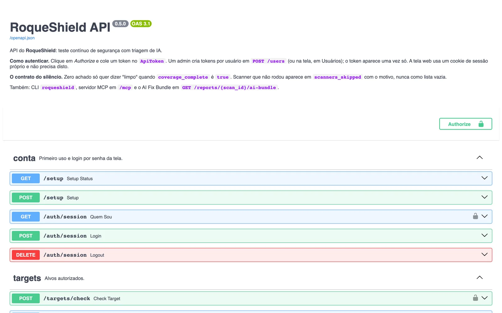

# Referência

*Tradução de [REFERENCE.md](../REFERENCE.md), a versão principal, em inglês. Se as duas divergirem, vale a em inglês.*

> Tudo o que o RoqueShield expõe, uma peça por vez: o instalador, as duas CLIs, a API REST, o servidor MCP, cada variável de ambiente, os scanners e as opções que cada um aceita, os perfis de scan, os papéis e os arquivos que ele grava. Foi lido do código (`install.sh`, `orchestrator/`), não da prosa antiga. Para instalar e rodar o primeiro scan, leia [COMECAR.md](COMECAR.md). Para entender por que é assim, [ARQUITETURA.md](ARQUITETURA.md). Para os termos, [GLOSSARIO.md](GLOSSARIO.md).
>
> As CLIs e a API imprimem as mensagens em português; aqui elas aparecem como saem.

## Sumário

| Seção | O que cobre |
| --- | --- |
| [1. O instalador (install.sh)](#1-o-instalador-installsh) | Flags, variáveis, o que confere, o que nunca faz |
| [2. A CLI roqueshield](#2-a-cli-roqueshield) | O cliente: login, scans, achados, relatórios, MCP; códigos de saída |
| [3. A CLI de administração cai](#3-a-cli-de-administração-cai) | A CLI do motor, no próprio processo: `scan`, `exposure`, `serve`, `bundle` |
| [4. API REST](#4-api-rest) | Autenticação, cada rota com a permissão, Swagger |
| [5. Servidor MCP](#5-servidor-mcp) | Transportes stdio e HTTP, as ferramentas, como ligar as ações |
| [6. Variáveis de ambiente](#6-variáveis-de-ambiente) | Toda variável: default e efeito |
| [7. Scanners e suas opções](#7-scanners-e-suas-opções) | Os 15 adapters, quais um scan constrói, as opções que a API aceita |
| [8. Perfis de scan](#8-perfis-de-scan) | Que scanners cada perfil roda por tipo de alvo |
| [9. Papéis e permissões](#9-papéis-e-permissões) | Os quatro papéis e as cinco permissões |
| [10. Arquivos e volumes](#10-arquivos-e-volumes) | `/data`, os segredos, relatórios, o arquivo de configuração da CLI |

---

## 1. O instalador (install.sh)

Script POSIX `sh` que sobe o container standalone. É fixado numa versão: `VERSAO_PADRAO="v0.5.1"` instala a imagem `roqueribeiro1988/roqueos-shield:v0.5.1-standalone`, e o `scripts/check_docs_fresh.py` confere esse pino contra o `pyproject.toml`.

```text
curl -fsSL https://raw.githubusercontent.com/roqueribeiro/roqueos-shield/main/install.sh | sh
curl -fsSL .../install.sh | sh -s -- --update        # vai para a versão deste script, mantém os dados
curl -fsSL .../install.sh | sh -s -- --no-browser    # não abre o navegador
```

| Flag | Efeito |
| --- | --- |
| `--update` (ou `--atualizar`) | Se o container roda outra imagem, baixa a deste script, remove o container e cria de novo na mesma porta e no mesmo volume. Com a mesma imagem, só garante que ele está rodando |
| `--no-browser` (ou `--nao-abrir`) | Não abre o navegador |
| `-h`, `--help` | Imprime o cabeçalho do script. Pelo pipe (`curl ... \| sh`) o script não tem arquivo para ler e imprime a URL dele |
| qualquer outra | Sai com 1 e `opção desconhecida: <arg>` |

| Variável (inglês / português) | Default | Efeito |
| --- | --- | --- |
| `ROQUESHIELD_PORT` / `ROQUESHIELD_PORTA` | `8080` | Porta no seu computador, publicada só em `127.0.0.1`. De 1 a 65535 |
| `ROQUESHIELD_VERSION` / `ROQUESHIELD_VERSAO` | a do script (`v0.5.1`) | Prefixo da tag da imagem; recebe `-standalone` no fim |
| `ROQUESHIELD_NAME` / `ROQUESHIELD_NOME` | `roqueshield` | Nome do container e do volume. Letras, números, `.`, `-`, `_`, começando por letra ou número |
| `ROQUESHIELD_NO_BROWSER` / `ROQUESHIELD_NAO_ABRIR` | vazio | Qualquer valor não vazio pula o navegador (inclusive `0`) |

Com as duas definidas, vale a em inglês. As mensagens saem em português quando `LC_ALL`, `LC_MESSAGES` ou `LANG` começa com `pt`, e em inglês nos outros casos.

O que ele faz, em ordem:

1. Confere se o `docker` existe e responde (`docker info`), com mensagem própria para "permission denied" no Linux.
2. Lê a memória do Docker. Abaixo de 5632 MiB avisa que o RoqueShield pede 6 GB e que um scanner pode ser interrompido no meio, e o scan sai com cobertura incompleta. Não para.
3. Baixa a imagem (cerca de 1,2 GB na primeira vez). Se o pull falha e a imagem já está no computador, usa ela.
4. Sobe o container: `-p 127.0.0.1:<porta>:8080`, `--shm-size=1g`, `--stop-timeout 30`, `--restart unless-stopped`, `--add-host host.docker.internal:host-gateway` (para um scan alcançar um app na sua máquina, no Linux também) e `-v <nome>:/data`. Container que já existe é ligado, retomado ou deixado rodando; nunca é recriado sem `--update`.
5. Espera até 3 minutos pelo health check (`/health`). Em `unhealthy`, imprime as últimas 30 linhas do log e sai com 1.
6. Pergunta ao `GET /setup` se o primeiro admin já existe. Se não, lê `/data/secrets/SETUP_CODE` dentro do container e abre o navegador por uma página local (modo 0600, numa pasta que só você lê, apagada em 5 minutos) que redireciona para `http://localhost:<porta>/#setup=<código>`. O código vai no fragmento da URL, que o navegador nunca manda ao servidor, e nunca é impresso nem posto numa linha de comando.

O que ele não faz: publicar a porta além de `127.0.0.1`, pedir `sudo`, instalar o Docker, ou mexer em qualquer coisa fora do container e do volume dele. Todo passo mora em funções chamadas por `main()` na última linha, então um download cortado no meio não roda nada.

## 2. A CLI roqueshield

O cliente. Fala com um RoqueShield rodando por HTTP, com o token de quem chama, então vale o RBAC da [seção 9](#9-papéis-e-permissões). Vem na imagem (`/usr/local/bin/roqueshield`) e no pacote Python (`[project.scripts]` do `pyproject.toml`).

De onde ela tira o servidor e o token, nesta ordem:

1. `ROQUESHIELD_URL` e `ROQUESHIELD_TOKEN` no ambiente (o caso do CI).
2. O arquivo que o `roqueshield login` grava: `$XDG_CONFIG_HOME/roqueshield/config.json`, ou `~/.config/roqueshield/config.json` (arquivo 0600, pasta 0700).
3. Dentro do container standalone, sem nenhum dos dois: `http://127.0.0.1:$PORT` com o `APP_TOKEN` de `$DATA_DIR/secrets/APP_TOKEN` (ou da variável `APP_TOKEN`). É por isso que `docker exec roqueshield roqueshield status` funciona sem configurar nada.

Sem nenhum deles, sai com 2 e `sem servidor ou token: rode roqueshield login --server URL, ou defina ROQUESHIELD_URL e ROQUESHIELD_TOKEN`. O token nunca é impresso.

| Comando | O que faz | Permissão que exige |
| --- | --- | --- |
| `login --server/-s URL [--token T]` | Confere o token contra `GET /auth/session` e grava servidor e token. Sem `--token`, pergunta sem eco | qualquer token válido |
| `status` | Versão, quem está logado, e o `GET /health/full` por componente | qualquer token válido |
| `scan start ALVO [opções]` | Registra o alvo (`POST /targets`) e dispara o scan (`POST /scans`) | `scans:run` |
| `scan watch SCAN_ID [--fail-on S] [--intervalo 5.0] [--prazo 7200.0]` | Acompanha um scan até o fim e sai pelo contrato de códigos | `scans:read` |
| `scan list [--limit 20]` | Os scans mais recentes | `scans:read` |
| `scan show SCAN_ID [--json]` | Estado, contagem por severidade, que scanners rodaram, quais não e por quê | `scans:read` |
| `scan rm SCAN_ID [--yes]` | Apaga o scan e os achados dele; a remoção fica na trilha de auditoria | `scans:run` |
| `findings SCAN_ID [--severity S] [--limit 200] [--json]` | Os achados de um scan | `scans:read` |
| `report SCAN_ID [--format bundle\|compliance\|html\|executive] [--output/-o ARQUIVO]` | Baixa um relatório; `bundle` (default) é o [AI Fix Bundle](AI-FIX-BUNDLE.md). Sem `-o`, stdout | `scans:read` |
| `settings ai` | A configuração de IA em uso, sem chave | `config:manage` |
| `settings scope [--allow X ...] [--require-auth-ref/--no-require-auth-ref]` | Mostra o escopo; com opções, troca (`PUT /settings/scope`) | `config:manage`, para ler também |
| `reset-password EMAIL` | Define uma senha nova (10+ caracteres, pedida duas vezes sem eco) e encerra as sessões da conta | `users:manage` |
| `logs SERVICO [--follow/-f] [--tail 100]` | Log de `orchestrator`, `worker`, `redis` ou `zap`, com credencial já redigida | `config:manage` |
| `mcp [--server URL]` | Servidor MCP por stdio ([seção 5](#5-servidor-mcp)) | a do token |

Opções do `scan start`:

| Opção | Default | Valores |
| --- | --- | --- |
| `--type` | `url` | `url`, `domain`, `host`, `port`, `image`, `repo`. O `k8s_resource` se registra como alvo, mas nenhum scanner o aceita e o `POST /scans` o recusa com 422 |
| `--profile` | `web` | `web`, `network`, `full`, `active`, `exposure` ([seção 8](#8-perfis-de-scan)) |
| `--scanner` | nenhum | repetir para mais de um; passa por cima do perfil ([seção 7](#7-scanners-e-suas-opções)) |
| `--auth-ref` | nenhum | a referência da autorização (ticket, mudança); obrigatória com `REQUIRE_AUTH_REF=true` |
| `--wait / --no-wait` | `--no-wait` | acompanha até o fim e sai pelo contrato |
| `--fail-on` | nenhum | `info`, `low`, `medium`, `high`, `critical` |
| `--intervalo` | `5.0` | segundos entre leituras |
| `--prazo` | `7200.0` | segundos até desistir (sai com 3) |

O `reset-password` é o caminho de volta quando a senha do admin se perde: dentro do container a CLI já usa o `APP_TOKEN`, então `docker exec -it roqueshield roqueshield reset-password admin@exemplo.com` resolve sem copiar token nenhum para a tela.

### Códigos de saída

O contrato para pipeline, de `orchestrator/cliente/cli.py`:

| Código | Significado |
| --- | --- |
| **0** | O scan terminou, cobertura completa, nada no limite do `--fail-on` ou acima |
| **1** | O scan terminou, cobertura completa, e há achado no limite do `--fail-on` ou acima |
| **2** | Erro de uso, de conexão ou de credencial. Recusa da API imprime `a API recusou (<status>): <detalhe>`; sem conexão, `sem conexão com o RoqueShield` |
| **3** | O scan falhou, não terminou dentro do `--prazo`, ou a cobertura veio **incompleta** (algum scanner não rodou) |

O 3 vence o 0 e o 1 de propósito: zero achado com scanner que não rodou não é alvo limpo, é vetor não verificado. Com cobertura incompleta, o resumo imprime `cobertura INCOMPLETA: zero achado aqui não quer dizer alvo limpo` e uma linha `não rodou: <scanner>: <motivo>` por scanner pulado.

## 3. A CLI de administração cai

`cai` é o nome interno do motor (pacote `cai-orchestrator`, containers `cai-*`). A CLI `cai` é diferente da `roqueshield`: não chama a API, roda o pipeline **no próprio processo**. Serve ao desenvolvimento (o `make scan TARGET=...` chama ela pela stack do compose) e à depuração dentro da imagem do motor.

| Comando | O que faz |
| --- | --- |
| `cai scan TARGET [--asset-type url] [--criticality medium] [--contains-pii/--no-contains-pii] [--skip-ai/--no-skip-ai] [--active-zap/--no-active-zap] [--ajax/--no-ajax] [--authorization-ref REF]` | Roda o pipeline contra `TARGET` e grava o relatório HTML, depois dos mesmos portões do `POST /scans`. Sem lista de scanners, usa o default do tipo de alvo ([seção 8](#8-perfis-de-scan)). O `--ajax`, quando não informado, acompanha o `--active-zap` |
| `cai exposure COMPANY_NAME [--domains D ...] [--github-orgs O ...] [--dorks Q ...] [--config-file ARQ.yaml] [--skip-ai]` | O pipeline OSINT (dorks no GitHub, gitleaks e trufflehog nos repos achados, dnstwist, shodan, subdomain takeover). Só leitura de dado público. O YAML passa por cima das flags |
| `cai serve [--host 0.0.0.0] [--port 8080]` | Sobe a API REST com uvicorn |
| `cai bundle SCAN_ID [--out CAMINHO]` | Grava o AI Fix Bundle de um scan terminado. Default: `$REPORTS_DIR/scan-<id>/ai-bundle.json` |

Limites que importam, lidos de `orchestrator/cli.py` e `orchestrator/jobs/pipelines.py`:

- O `cai scan` passa pelos mesmos portões do `POST /scans`, pelas mesmas funções (`gates_do_scan` e `scanners_do_scan` em `orchestrator/api/routers/scans.py`): o alvo é conferido contra `LAB_ONLY` e a allowlist, o `--authorization-ref` é obrigatório com `REQUIRE_AUTH_REF=true`, e o `scan.create` vai para a trilha de auditoria antes de o scan começar, com ator `cli:<usuário do sistema>` e `"via": "cai scan"`. Ele lê antes o escopo gravado pela tela, como o worker. Recusa sai com código 2 e `scan recusado (<status>): <motivo>`. Sem banco não há trilha, e então o scan também não roda.
- O `--contains-pii` só marca o alvo e vai ao modelo como contexto no payload da triagem; não muda qual modelo é chamado. Para modelo local, defina `LLM_API_BASE`.

## 4. API REST

FastAPI. O contrato vivo está em `/openapi.json`, com o Swagger UI em `/docs` e o ReDoc em `/redoc`. Uma fotografia do contrato fica versionada em [`openapi.json`](../openapi.json), mantida por `scripts/openapi_snapshot.py --check` (um teste reprova quando a API muda sem a fotografia).



### Autenticação

O `get_principal` (`orchestrator/api/deps.py`) aceita, nesta ordem:

1. `X-API-Token: <APP_TOKEN>`: o principal de serviço, papel `admin` (`service@local`).
2. `X-API-Token: <token de usuário>`: token por usuário, guardado como SHA-256. Criado em `POST /users` ou `POST /users/{id}/rotate-token` (aparece uma vez só).
3. `Authorization: Bearer <JWT de sessão>`: a sessão OIDC. O usuário é relido do banco a cada request, então desativação e troca de papel valem na hora.
4. Cookie `rs_session`: a sessão por senha da tela standalone (o mesmo JWT). Escrita com o cookie exige também o cabeçalho `X-RoqueShield` (CSRF): `escrita por cookie exige o cabeçalho X-RoqueShield`.

Sem credencial: 401 `credenciais ausentes`. Sem a permissão: 403 `permissão insuficiente (<permissão>)`.

`POST /scans`, `POST /exposure/scan` e `POST /investigate/{id}` têm limite de `RATE_LIMIT_PER_MINUTE` chamadas por principal e por rota (janela fixa de um minuto, contada no Redis, em memória se o Redis cair). Acima disso: 429 com `Retry-After`. Login e primeiro uso têm freio próprio por origem (429 `muitas tentativas`).

### Rotas

Permissão `pública` quer dizer sem credencial; `qualquer` quer dizer qualquer credencial válida.

| Recurso | Método e caminho | Permissão | O que faz |
| --- | --- | --- | --- |
| health | `GET /health` | pública | `{"status":"ok","version":...}`; o que o health check do container e a frota leem |
| health | `GET /health/full` | qualquer | Postgres ou SQLite, Redis, ZAP, LLM local e cloud, em paralelo |
| conta | `GET /setup` | pública | `needs_setup` e versão |
| conta | `POST /setup` | pública, com `setup_code` ou `X-API-Token: APP_TOKEN` | Cria o primeiro admin; depois disso, 410 `o primeiro uso já foi feito` |
| conta | `POST /auth/session` | pública | Login por senha; grava o cookie `rs_session` |
| conta | `GET /auth/session` | qualquer | Quem sou eu |
| conta | `DELETE /auth/session` | cookie de sessão | Sai; encerra todas as sessões do usuário |
| auth (OIDC) | `GET /auth/login`, `GET /auth/callback` | pública | Fluxo de SSO, só com `OIDC_ISSUER`, `OIDC_CLIENT_ID` e `OIDC_CLIENT_SECRET` definidos |
| auth (OIDC) | `GET /auth/me` | qualquer | A identidade corrente |
| targets | `POST /targets` | `scans:run` | Registra um alvo (`asset_type`, `value`, `criticality`, `contains_pii`, `label`, `metadata`); validado contra o escopo |
| targets | `POST /targets/check` | `scans:run` | Diz se o alvo passa no escopo, sem criar nada |
| targets | `GET /targets`, `GET /targets/{id}` | `scans:read` | Lista e detalhe |
| scans | `POST /scans` | `scans:run` | Dispara um scan (202). Corpo abaixo |
| scans | `GET /scans[?state=]`, `GET /scans/{id}` | `scans:read` | Lista (últimos 100) e detalhe |
| scans | `DELETE /scans/{id}` | `scans:run` | Apaga o scan, os achados e as chamadas de IA; audita antes |
| findings | `GET /findings` | `scans:read` | Filtros `scan_id`, `severity`, `source_tool`, `limit`, `offset` |
| findings | `GET /findings/{id}` | `scans:read` | Um achado |
| findings | `GET /findings/queue` | `scans:read` | Fila de problemas únicos por `deduped_key`, severidade primeiro (`status`, `min_severity`, `source_tool`) |
| findings | `GET /findings/summary` | `scans:read` | Contagem por severidade e status |
| findings | `POST /findings/resolve` | `scans:run` | Define o status de um problema: `open`, `in_progress`, `resolved`, `false_positive`, `wont_fix`, `risk_accepted` |
| reports | `GET /reports/{scan_id}` | `scans:read` | Relatório técnico HTML |
| reports | `GET /reports/{scan_id}/ai-bundle` | `scans:read` | AI Fix Bundle, schema 1.0.0 |
| reports | `GET /reports/{scan_id}/executive` | `scans:read` | HTML executivo: nota de risco de A a F e mapeamento de conformidade |
| reports | `GET /reports/{scan_id}/compliance` | `scans:read` | Mapeamento de conformidade em JSON |
| reports | `POST /reports/{scan_id}/export/defectdojo` | `scans:run` | Exporta para o DefectDojo (`DEFECTDOJO_URL`, `DEFECTDOJO_API_KEY`). Grava `scan.export.defectdojo` na trilha de auditoria antes de enviar |
| exposure | `POST /exposure/scan` | `scans:run` | Enfileira o pipeline OSINT (`company_name`, `domains`, `github_orgs`, `dorks`). Grava `exposure.scan` na trilha de auditoria antes de enfileirar |
| audit | `GET /audit` | `audit:read` | A trilha de auditoria, mais recente primeiro. Filtros `action`, `actor`, `resource_id`, `authorization_ref`, `since`; `offset`, `limit` (1 a 500, default 100). Só leitura |
| investigate | `POST /investigate/{finding_id}` | `scans:run`; `dry_run=false` exige também `config:manage` e `AGENT_LIVE_EXECUTION=true` | O agente de investigação sobre um achado. Corpo: `instructions`, `dry_run` (default `true`), `max_steps` (default 10) |
| settings | `GET`/`PUT /settings/ai` | `config:manage` | Modelos, API base e chaves. Chave é gravada cifrada e nunca volta (`hasApiKey`). Campo definido pelo ambiente volta em `locked` |
| settings | `POST /settings/ai/models` | `config:manage` | Os modelos que cada chave alcança, buscados do lado do servidor |
| settings | `GET`/`PUT /settings/scope` | `config:manage` | `labOnly`, `allowlist`, `requireAuthRef`, `allowCloudFallback`, mais `locked` |
| system | `GET /system/services`, `GET /system/usage` | `config:manage` | Um cartão por processo do container, CPU e memória |
| system | `GET /system/logs/{service}` | `config:manage` | Últimas linhas de um serviço (`tail` de 1 até o teto, `since`) |
| users | `GET`/`POST /users` | `users:manage` | Lista; cria (`email`, `name`, `role` default `viewer`, `password` opcional). O token aparece uma vez |
| users | `PATCH /users/{id}/role`, `POST /users/{id}/deactivate`, `POST /users/{id}/rotate-token`, `PUT /users/{id}/password` | `users:manage` | 409 `é o último admin ativo` protege o último admin |
| ui | `GET /ui/api/scans`, `GET /ui/api/scans/{id}`, `GET /ui/api/findings`, `GET /ui/api/ai-runs`, `GET /ui/api/ai-runs/stats` | `scans:read` | As leituras agregadas que a tela, a CLI e o MCP usam. O detalhe do scan traz os campos de cobertura |
| ui | `GET /ui/api/events[?scan_id=]` | `scans:read` | Server-Sent Events: logs e fases ao vivo. `?token=` só é aceito aqui, e só com o `APP_TOKEN` |
| mcp | `POST /mcp` | qualquer | MCP por HTTP ([seção 5](#5-servidor-mcp)). `GET /mcp` responde 405 |

Corpo do `POST /scans` (`ScanIn`):

| Campo | Default | Notas |
| --- | --- | --- |
| `target_id` | obrigatório | Vem do `POST /targets` |
| `profile` | `web` | `web`, `network`, `full`, `active` ou `exposure`, sem distinguir maiúscula; outro valor é 422 `profile '<x>' não existe (aceitos: ...)`. Ver a [seção 8](#8-perfis-de-scan) |
| `scanners` | `null` | Lista explícita; vence o perfil. Nome que o pipeline não constrói, ou scanner que não aceita o tipo de alvo, é 422 `scanners recusados: <scanner>: <motivo>` |
| `options` | `{}` | `{scanner: {campo: valor}}`, validado contra uma lista fechada ([seção 7](#7-scanners-e-suas-opções)); o resto é 422 com o nome do campo |
| `auth` | `null` | `{headers: {...}, openapi_url}` para scan autenticado. O valor dos headers nunca chega à tabela `scans`; vai só no job e sai redigido na auditoria |
| `authorization_ref` | `null` | Obrigatório (403) com `REQUIRE_AUTH_REF=true` |
| `actor` | `null` | Aceito e não usado: o ator na auditoria é a identidade autenticada |

Alvo e `openapi_url` fora do escopo: 403 `target rejeitado pela policy: <motivo>`.

O detalhe do scan (`GET /ui/api/scans/{id}`) é onde mora a cobertura: `coverage_state` (`completa`, `incompleta` ou `desconhecida`), `coverage_complete`, `coverage_note`, `scanners_ran`, `scanners_skipped` (scanner para motivo), `scanners_requested`, `state` (`pending`, `running`, `done`, `failed`, `canceled`), `current_phase`, `severity_counts`. Scan em que **nenhum** scanner rodou termina `failed`, não `done`.

## 5. Servidor MCP

Um núcleo de protocolo (`orchestrator/cliente/mcp_nucleo.py`, escrito à mão: `initialize`, `ping`, `tools/list`, `tools/call`; versões de protocolo `2025-06-18`, `2025-03-26`, `2024-11-05`) e dois transportes. Toda ferramenta chama a API REST com a credencial de quem chamou, então vale o RBAC.

| Transporte | Como rodar | As ações ligam com |
| --- | --- | --- |
| stdio | `roqueshield mcp [--server URL]`; no Claude Code: `claude mcp add roqueshield -- roqueshield mcp`. Uma mensagem JSON-RPC por linha; log vai para o stderr | `ROQUESHIELD_MCP_ACTIONS=1` no ambiente de quem roda |
| HTTP | `POST /mcp` com `X-API-Token` ou `Authorization: Bearer` (Streamable HTTP, respostas em JSON, sem stream SSE; lote é recusado) | `MCP_ALLOW_ACTIONS=true` no servidor |

| Ferramenta | Argumentos | Notas |
| --- | --- | --- |
| `list_scans` | `limit` (1 a 200) | Scans recentes com estado, fase e contagem |
| `get_scan` | `scan_id` | Detalhe, com a cobertura |
| `get_findings` | `scan_id`, `severity`, `limit` (1 a 500) | Volta com `isError: true` e os achados parciais quando o scan falhou, não terminou ou tem cobertura incompleta |
| `get_ai_bundle` | `scan_id` | A mesma regra do `get_findings`, com o bundle parcial |
| `list_targets` | nenhum | Alvos registrados |
| `start_scan` | `target`, `authorization_ref` (3+ caracteres, obrigatório), `asset_type` (`url`, `domain`, `host`, `port`, `image`, `repo`), `profile` (`web`, `network`, `full`, `active`, `exposure`) | Só aparece com as ações ligadas. Registra o alvo e dispara o scan sob o RBAC do token |

As `instructions` do servidor dizem ao agente: `Zero achado só é limpo com coverage_complete=true`.

## 6. Variáveis de ambiente

Lidas pelo `Settings` (`orchestrator/config.py`, pydantic-settings, sem diferença de maiúscula, também de um arquivo `.env`). Todo campo está também no [`.env.example`](../../.env.example), e o `scripts/check_docs_fresh.py` reprova o CI quando falta um lá. Os defaults abaixo são os do código; o container standalone muda alguns (marcados "standalone").

Os campos de IA e de escopo também podem ser definidos na tela (tabela `app_settings`). **O ambiente vence**: variável presente no ambiente do processo trava o campo, e a API lista ele em `locked`.

### IA

| Variável | Default | Efeito |
| --- | --- | --- |
| `LLM_MODEL` | `anthropic/claude-opus-4-7` | Modelo da triagem, no formato litellm `<provedor>/<modelo>` |
| `LLM_FALLBACK_MODEL` | `anthropic/claude-haiku-4-5-20251001` | Modelo usado quando o principal falha |
| `LLM_API_BASE` | vazio | API base de um backend local compatível com OpenAI (LM Studio, Ollama). Vazio usa o default do provedor |
| `LLM_API_KEY` | vazio | Chave do backend local. Vinda do ambiente, trava também o `LLM_API_BASE` |
| `ALLOW_CLOUD_FALLBACK` | `false` | Com modelo primário local (`LLM_API_BASE` definido) que falha, a triagem falha em vez de mandar os achados para o `LLM_FALLBACK_MODEL` na nuvem. `true` permite essa travessia, sempre com aviso no log. Fallback de nuvem para nuvem não muda |
| `LLM_INVESTIGATION_MODEL` | vazio | Modelo do loop do agente; vazio usa o `LLM_MODEL` |
| `ANTHROPIC_API_KEY`, `OPENAI_API_KEY`, `OPENROUTER_API_KEY` | vazio | Chaves dos provedores |
| `LLM_LOCAL_BASE_URL`, `LLM_LOCAL_MODEL` | `http://ollama:11434/v1`, `ollama/qwen2.5:32b-instruct-q4_K_M` | Aliases legados, não lidos pelo gateway |
| `PHOENIX_ENABLED` | `false` | Liga o tracing do Phoenix (precisa do extra `tracing`) |
| `PHOENIX_COLLECTOR_ENDPOINT` | `http://phoenix:6006/v1/traces` | Para onde vão os traces |

### Agente de investigação

| Variável | Default | Efeito |
| --- | --- | --- |
| `AGENT_ENABLED` | `true` | O loop ReAct com ferramenta de verdade. `false` volta ao parecer de um prompt só |
| `AGENT_EXECUTOR` | `auto` | Onde rodam os comandos do agente: `auto` (o container `cai-kali-toolbox` se estiver de pé, senão no próprio processo), `kali` ou `local`. A coleira é a mesma nos dois |
| `AGENT_LIVE_EXECUTION` | `false` | Permite `dry_run=false`. Desligado, o agente só planeja e mostra os comandos |

### Escopo e conformidade

| Variável | Default | Efeito |
| --- | --- | --- |
| `LAB_ONLY` | `true` | Bloqueia endereço privado, loopback, link-local e de metadados que não esteja na allowlist. Loopback e metadados seguem bloqueados mesmo com `false` |
| `TARGET_ALLOWLIST` | vazio | Alvos autorizados: CSV ou array JSON de hostnames, IPs, CIDRs, `*.dominio` |
| `REQUIRE_AUTH_REF` | `false` | Todo `POST /scans` precisa levar `authorization_ref` |
| `REQUIRE_IMMUTABLE_AUDIT` | `false` | Recusa subir em SQLite, onde a trilha de auditoria é editável (o trigger append-only é só do Postgres) |
| `RATE_LIMIT_PER_MINUTE` | `20` | Teto por principal e por rota nas três rotas caras. `0` desliga |

### Autenticação e sessão

| Variável | Default | Efeito |
| --- | --- | --- |
| `APP_TOKEN` | `dev-changeme` | Token de serviço, vale `admin`. O boot recusa valor de exemplo ou vazio. Standalone: gerado no primeiro boot |
| `ALLOW_INSECURE_APP_TOKEN` | `false` | Deixa subir com o token de exemplo. Só em dev local |
| `SESSION_SECRET` | vazio | Chave HMAC do JWT de sessão (HS256). Vazio cai no `APP_TOKEN`. Standalone: gerado |
| `SESSION_TTL_HOURS` | `12` | Validade da sessão e do cookie |
| `COOKIE_SECURE` | `false` | Força o `Secure` no cookie atrás de um proxy TLS que o servidor não reconhece (o `FORWARDED_ALLOW_IPS` do uvicorn) |
| `SETUP_CODE` | vazio | Código de primeiro uso que o `POST /setup` exige. Standalone: gerado em `/data/secrets/SETUP_CODE` |
| `SECRETS_KEY` | vazio | Chave Fernet que cifra as chaves de IA gravadas pela tela. Vazio: a tela não grava chave. Standalone: gerado |
| `OIDC_ISSUER`, `OIDC_CLIENT_ID`, `OIDC_CLIENT_SECRET`, `OIDC_REDIRECT_URI` | vazio | SSO (Entra ID, Keycloak, Okta). Liga só com os três primeiros definidos |
| `OIDC_DEFAULT_ROLE` | `viewer` | Papel de um usuário criado pelo SSO |
| `MCP_ALLOW_ACTIONS` | `false` | Lista o `start_scan` no `POST /mcp` |

### Armazenamento e serviços

| Variável | Default | Efeito |
| --- | --- | --- |
| `DATABASE_URL` | `sqlite+aiosqlite:///./data/cai.db` | Standalone: `sqlite+aiosqlite:////data/shield.db`. Postgres: `postgresql+asyncpg://...` |
| `REDIS_URL` | `redis://redis:6379/0` | Fila do arq, logs e rate limit. Standalone: o Redis embutido em `127.0.0.1` com senha; apontar para outro desliga o embutido |
| `DATA_DIR` | `./data` | Standalone: `/data` |
| `REPORTS_DIR` | `./reports` | Standalone: `/data/reports` |
| `ZAP_BASE_URL` | `http://zap:8090` | Standalone: o ZAP embutido em `127.0.0.1:8090`; apontar para outro desliga o embutido |
| `ZAP_API_KEY` | vazio | Chave da API do ZAP. Standalone: gerada |
| `TRIVY_SERVER_URL` | `http://trivy:4954` | Servidor do Trivy. Standalone: vazio, modo cliente com cache local |
| `SEMGREP_RULES_DIR` | `/opt/semgrep-rules` | Ruleset offline embarcado na imagem. Ausente ou vazio cai nos packs do registry |
| `GREENBONE_HOST`, `GREENBONE_PORT`, `GREENBONE_USERNAME`, `GREENBONE_PASSWORD` | vazio, `9390`, `admin`, vazio | Greenbone/OpenVAS (opt-in) |
| `GITHUB_TOKEN`, `SHODAN_API_KEY`, `CENSYS_API_ID`, `CENSYS_API_SECRET` | vazio | Fontes de OSINT |
| `DEFECTDOJO_URL`, `DEFECTDOJO_API_KEY` | vazio | Exportação para o DefectDojo |
| `LOG_LEVEL` | `INFO` | Nível de log |
| `LOG_FORMAT` | `json` | `json` ou console |

### Lidas fora do Settings

| Variável | Quem lê | Efeito |
| --- | --- | --- |
| `PORT` | supervisor do standalone, health check, CLI | Porta da API dentro do container (`8080`) |
| `SHIELD_SERVICES` | supervisor do standalone | Lista separada por vírgula dos processos a subir (`orchestrator`, `worker`...). É como o `docker/compose.prod.yml` separa a API de N workers com a mesma imagem |
| `REDIS_PASSWORD` | supervisor do standalone | Senha do Redis embutido. Gerada quando falta |
| `TRIVY_CACHE_DIR` | trivy | Standalone: `/data/trivy-cache` |
| `NUCLEI_TEMPLATES_DIR` | adapter do nuclei | Default `/opt/nuclei-templates`, embarcado na imagem |
| `ROQUESHIELD_URL`, `ROQUESHIELD_TOKEN` | CLI `roqueshield` | Servidor e token, antes do arquivo de configuração |
| `ROQUESHIELD_MCP_ACTIONS` | `roqueshield mcp` | `1` lista o `start_scan` no stdio |
| `XDG_CONFIG_HOME` | CLI `roqueshield` | Base do arquivo de configuração |
| `SHIELD_VERSION`, `POSTGRES_PASSWORD` | `docker/compose.prod.yml` | Tag da imagem e senha do Postgres do compose de produção |

## 7. Scanners e suas opções

São **15** adapters em `orchestrator/adapters/`. Um scan comum (`POST /scans`, `roqueshield scan start`, `cai scan`) constrói **9** deles (`_build_adapters` em `orchestrator/jobs/pipelines.py`). O pipeline OSINT (`POST /exposure/scan`, `cai exposure`) usa mais 5. Dois existem sem pipeline que os construa.

| Scanner | Construído por | Tipos de alvo que aceita | Na imagem standalone |
| --- | --- | --- | --- |
| `nmap` | scan | host, url, domain, port | sim |
| `zap` | scan | url, host, domain | sim (daemon embutido) |
| `nuclei` | scan | url, host, domain | sim, com templates offline |
| `trivy` | scan | image, repo | sim, modo cliente |
| `semgrep` | scan | repo | sim, com regras offline |
| `gitleaks` | scan, exposure | repo | sim |
| `trufflehog` | scan, exposure | repo | sim |
| `checkov` | scan | repo | sim |
| `greenbone` | scan | host, domain | precisa de um Greenbone externo (`docker/compose.greenbone.yml`) |
| `github_exposure` | exposure | n/a | precisa de `GITHUB_TOKEN` e de dorks |
| `dnstwist` | exposure | n/a | sim |
| `shodan` | exposure | n/a | precisa de `SHODAN_API_KEY` |
| `subdomain_takeover` | exposure | n/a | precisa de `subfinder` e `httpx`, que não estão na imagem |
| `censys` | nenhum | n/a | só o adapter |
| `kube_bench` | nenhum | n/a | só o adapter |

O `POST /scans` recusa com 422 nome de scanner que o pipeline não constrói, scanner pedido para um tipo de alvo que ele não aceita, e alvo que scanner nenhum aceita (`k8s_resource`). Chamado direto (`run_scan`), os mesmos três casos vão para `scanners_skipped` com o motivo, e scan em que nada rodou termina `failed`; quando a lista explícita não tem nada que sirva, roda no lugar o perfil ou o default do tipo. Scanner que não consegue rodar (health check falhou, sem handle válido, status de falha, timeout, `ScanIntegrityError`) vai para `scanners_skipped` com o motivo.

### Opções que a API aceita

O `ScanIn.options` passa por uma lista fechada (`orchestrator/domain/opcoes.py`). Scanner ou campo fora dela é recusado com 422, por exemplo `options.zap.foo não é aceito (aceitos: active, ajax, max_children)`. Nada é ignorado em silêncio.

| Scanner | Campo | Tipo e faixa | Default do adapter |
| --- | --- | --- | --- |
| `zap` | `active` | bool | `false` (os perfis `full` e `active` ligam) |
| `zap` | `ajax` | bool | `false` (liga junto com o `active` nesses perfis) |
| `zap` | `max_children` | int de 1 a 100 | `10` |
| `nmap` | nenhum | | `nmap_args` não é aceito de fora |
| `nuclei` | `rate_limit` | int de 1 a 500 | `50` |
| `nuclei` | `severity` | CSV de `info`, `low`, `medium`, `high`, `critical` | `low,medium,high,critical` |
| `trivy` | `severity` | CSV de `unknown`, `low`, `medium`, `high`, `critical` | todas |
| `trivy` | `scanners` | CSV de `vuln`, `secret`, `misconfig`, `license` | `vuln,secret,misconfig` (definido pelo pipeline) |
| `semgrep` | `config` | lista de até 10, cada um `auto` ou `p/<pack>` | as regras offline do `SEMGREP_RULES_DIR` |
| `semgrep` | `clone_depth` | int de 0 a 1000 | `1` |
| `gitleaks` | `clone_depth` | int de 0 a 1000 | `0` (histórico inteiro) |
| `checkov` | `framework` | `[a-z0-9_]{1,40}` | todos |
| `checkov` | `clone_depth` | int de 0 a 1000 | `1` |
| `trufflehog` | `only_verified` | bool | `false` |
| `trufflehog` | `since_commit` | SHA hex, de 7 a 40 | nenhum |
| `dnstwist` | `ssdeep` | bool | `true` |
| `github_exposure` | `dorks` | lista de até 20 consultas | as do pedido |
| `github_exposure` | `max_results_per_dork` | int de 1 a 100 | `30` |
| `censys` | `query`, `pages` | texto até 500; int de 1 a 10 | valor do alvo; `1` |
| `shodan` | `query`, `limit` | texto até 500; int de 1 a 1000 | valor do alvo; `100` |
| `greenbone` | `config_id`, `scanner_id`, `port_list_id` | UUID | Full and fast; OpenVAS; nenhum |
| `kube_bench` | `targets` | CSV de `master`, `node`, `etcd`, `policies` | os quatro |

Texto de consulta não pode ter caractere de controle nem começar com `-`. Opções de `censys` e `kube_bench` passam na validação, mas nenhum scan constrói esses adapters.

## 8. Perfis de scan

`profile` é um dos `PERFIS_DO_SCAN` (`orchestrator/jobs/pipelines.py`): `web`, `network`, `full`, `active`, `exposure`. Outro valor é recusado com 422, em vez de rodar outra coisa com aquele rótulo. Ele escolhe a lista de scanners quando `scanners` não vem, e `full` ou `active` ligam o active scan e o AJAX spider do ZAP (`apply_profile` em `orchestrator/api/routers/scans.py`). Ordem de precedência: `scanners` explícito, depois o perfil, depois o default do tipo de alvo, sempre filtrado pelo que aceita o tipo.

| Tipo de alvo | `web` | `network` | `full` | Default (perfil sem entrada) |
| --- | --- | --- | --- | --- |
| `url` | zap, nuclei | nmap | nmap, zap, nuclei | zap |
| `domain` | zap, nuclei | nmap | nmap, zap, nuclei | zap |
| `host` | nmap, zap, nuclei | nmap | nmap, zap, nuclei | nmap |
| `port` | default | nmap | nmap | nmap |
| `image` | default | default | trivy | trivy |
| `repo` | default | default | semgrep, gitleaks, trufflehog, trivy, checkov | semgrep, gitleaks, trufflehog, trivy, checkov |
| `k8s_resource` | nenhum | nenhum | nenhum | nenhum: scanner nenhum do pipeline de scan aceita este tipo, e o `POST /scans` o recusa com 422 (o `kube_bench` existe como adapter, sem pipeline que o construa) |

O `web` é ZAP passivo. O `full` acrescenta o ZAP ativo (payloads de injeção de verdade, mais lento e mais intrusivo), ainda sob `LAB_ONLY`, allowlist e `authorization_ref`. O `active` liga o active scan, com os scanners da coluna default.

O `exposure` não usa o pipeline de scan: entrega o alvo ao pipeline OSINT (`orchestrator/jobs/exposure.py`) e grava o resultado no mesmo scan, então tela, cobertura e relatório funcionam como em qualquer scan. Aceita alvo `url`, `domain` e `host` (422 para os outros) e toma o domínio do alvo (o host de uma URL) como domínio da empresa: o `github_exposure` roda a dork `"<domínio>"` (precisa de `GITHUB_TOKEN`), `gitleaks` e `trufflehog` varrem os 5 primeiros repositórios achados, o `dnstwist` procura typosquatting do domínio, o `shodan` busca `org:"<rótulo do alvo ou domínio>"` (precisa de `SHODAN_API_KEY`) e o `subdomain_takeover` enumera o domínio (precisa de `subfinder` e `httpx`). Cada vetor que não roda vai para `scanners_skipped` com o motivo. `scanners` não se aplica a este perfil (422). Para vários domínios, orgs do GitHub ou dorks próprias, use o `POST /exposure/scan` ou o `cai exposure`.

A lista de scanners usada de fato fica gravada em `requested_scanners` e aparece como `scanners_requested`.

## 9. Papéis e permissões

De `orchestrator/domain/roles.py`. Cada papel é um conjunto fixo de permissões; não há hierarquia implícita. Papel desconhecido vira `viewer` (falha fechado).

| Permissão | O que permite |
| --- | --- |
| `users:manage` | Criar, listar, trocar papel, desativar, rotacionar token, definir senha |
| `scans:run` | Criar alvo, disparar e apagar scan, resolver achado, OSINT, investigação, exportar para o DefectDojo |
| `scans:read` | Ler scans, achados, relatórios e o AI Fix Bundle |
| `audit:read` | Ler o log de auditoria |
| `config:manage` | Configuração de IA, escopo e allowlist, cartões e logs do sistema, `dry_run=false` na investigação |

| Papel | Permissões |
| --- | --- |
| `admin` | as cinco. O principal de serviço do `APP_TOKEN` é `admin` |
| `operator` | `scans:run`, `scans:read` |
| `auditor` | `scans:read`, `audit:read` |
| `viewer` | `scans:read` |

Segregação de funções: o `operator` dispara scan mas não gerencia usuário nem escopo; o `auditor` lê mas não dispara. O `GET /audit` é a rota que confere `audit:read`: o `auditor` lê a trilha ali, e `viewer` ou `operator` recebem 403. A trilha em si é a tabela `audit_log`, append-only no Postgres com as migrations aplicadas.

O último admin ativo não pode ser rebaixado nem desativado (409).

## 10. Arquivos e volumes

### O container standalone

A imagem declara `VOLUME /data`, roda como o usuário 1000 com `HOME=/data` e expõe a `8080`. O instalador monta um volume nomeado (`roqueshield` por padrão) em `/data`. Tudo o que sobrevive a uma atualização mora lá:

| Caminho | O que é |
| --- | --- |
| `/data/secrets/` | Pasta 0700 com um arquivo 0600 por segredo gerado: `APP_TOKEN`, `SESSION_SECRET`, `SECRETS_KEY`, `ZAP_API_KEY`, `REDIS_PASSWORD`, `SETUP_CODE`. Gerados uma vez, reaproveitados em todo boot; variável passada no ambiente vence e nada é gerado para ela. O log diz só o nome e a origem (`ambiente`, `arquivo`, `gerado`), nunca o valor |
| `/data/secrets/redis.conf`, `/data/secrets/zap.properties` | Senha e chave do Redis e do ZAP embutidos, por arquivo (0600), para nunca aparecerem na linha de comando de um processo |
| `/data/shield.db` | Banco SQLite (quando `DATABASE_URL` não vem definido) |
| `/data/reports/` | Relatórios HTML: `scan-<id>.html`, `exposure-<id>.html` |
| `/data/trivy-cache/` | Base de vulnerabilidades do Trivy |
| `/data/zap/` | Home do ZAP |

API, worker e Redis não recebem o mesmo ambiente: os scanners rodam como filhos do worker e processam conteúdo do alvo, então o worker nunca recebe `APP_TOKEN`, `SESSION_SECRET`, `SETUP_CODE` nem `REDIS_PASSWORD`.

Backup é copiar o volume; apagar o volume (`docker volume rm roqueshield`) apaga todo scan, usuário e segredo. Veja [OPERACAO.md](OPERACAO.md).

### Fora do container

| Caminho | O que é |
| --- | --- |
| `~/.config/roqueshield/config.json` | Servidor e token gravados pelo `roqueshield login` (0600; pasta 0700). Respeita o `XDG_CONFIG_HOME` |
| `./data/`, `./reports/` | Defaults de `DATA_DIR` e `REPORTS_DIR` quando o motor roda fora da imagem standalone |
| `reports/scan-<id>/ai-bundle.json` | Saída default do `cai bundle` |
| `.env` | Lido pelo `Settings` a partir do diretório de trabalho; modelo no `.env.example` |
| `docs/openapi.json` | Fotografia do contrato da API |

---

## Quando algo não funciona

Sintoma, causa e conserto estão em [QUANDO-QUEBRA.md](QUANDO-QUEBRA.md). Para um problema de segurança no próprio RoqueShield, siga o [../../SECURITY.md](../../SECURITY.md), não uma issue pública.
