# RoqueShield standalone

The whole RoqueShield in one container: the engine and scanners, the web UI, the REST
API with Swagger, the MCP server, Redis and OWASP ZAP. No RoqueOS needed.

> **Authorization first.** Scanning someone else's systems without formal
> authorization is a crime in many countries. Only scan what you have written
> permission to test, inside the agreed window. RoqueShield helps you record it (an
> authorization reference on every scan), but it does not decide for you.

## Install in one command

On Mac, Linux or Windows WSL, with Docker running:

```bash
curl -fsSL https://raw.githubusercontent.com/roqueribeiro/roqueos-shield/main/install.sh | sh
```

[install.sh](../install.sh) checks that Docker answers and has at least 6 GB of memory,
pulls the image, starts the container listening only on `127.0.0.1:8080`, waits for the
healthcheck and opens your browser with the first-run code in the address. Running it
again is safe: if the container exists, it is only started again.

| I want to | Command |
| --- | --- |
| use another port | `curl -fsSL .../install.sh \| ROQUESHIELD_PORT=8081 sh` |
| not open the browser | `curl -fsSL .../install.sh \| sh -s -- --no-browser` |
| update, keeping my data | `curl -fsSL .../install.sh \| sh -s -- --update` |

(`...` is `https://raw.githubusercontent.com/roqueribeiro/roqueos-shield/main`.)

The code goes in the address fragment (`#setup=...`), which the browser never sends to
the server: it does not land in any access log, and the screen removes it from the bar
as soon as it reads it. Nor does it go on the browser's command line, which another
user on the machine could read with `ps`: the installer opens a local page in a `0700`
folder that leads to the address and is deleted five minutes later.

**By hand, or on Windows without WSL** (same in PowerShell, with `` ` `` instead of `\`):

```bash
docker run -d --name roqueshield \
  -p 127.0.0.1:8080:8080 --shm-size=1g --stop-timeout 30 --restart unless-stopped \
  --add-host host.docker.internal:host-gateway \
  -v roqueshield:/data \
  roqueribeiro1988/roqueos-shield:<version>-standalone
```

The tag is the version with a `v` plus `-standalone`, for example `v0.5.0-standalone`.
`--add-host` makes `host.docker.internal` point at your computer on Linux too.

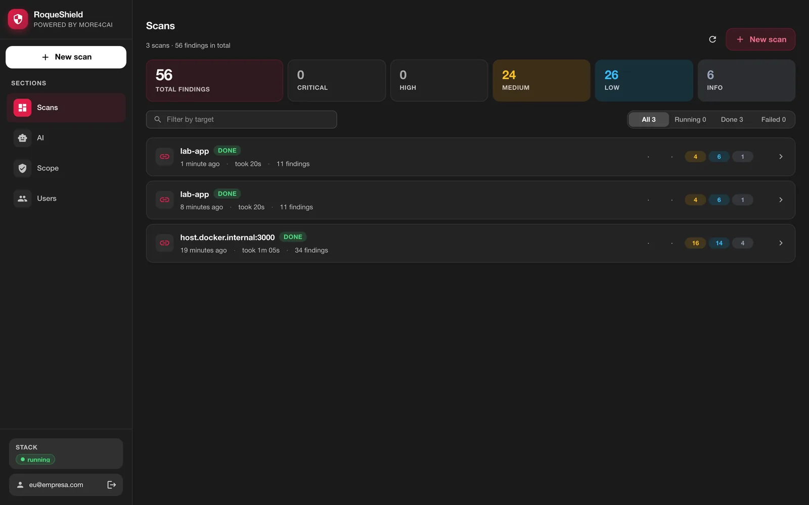

## First run

1. Open `http://localhost:8080` (the installer opens it for you). The first screen
   creates the administrator account: e-mail and password.
2. It needs the **first-run code**, which proves you have access to the container.
   Through the installer it arrives filled in (the screen says so instead of showing
   the field). By hand, get it with:

   ```bash
   docker exec roqueshield cat /data/secrets/SETUP_CODE
   ```

   Without the code (or the `APP_TOKEN` in the `X-API-Token` header), `POST /setup`
   is refused. This stops anyone who reaches the port before you from becoming admin.

   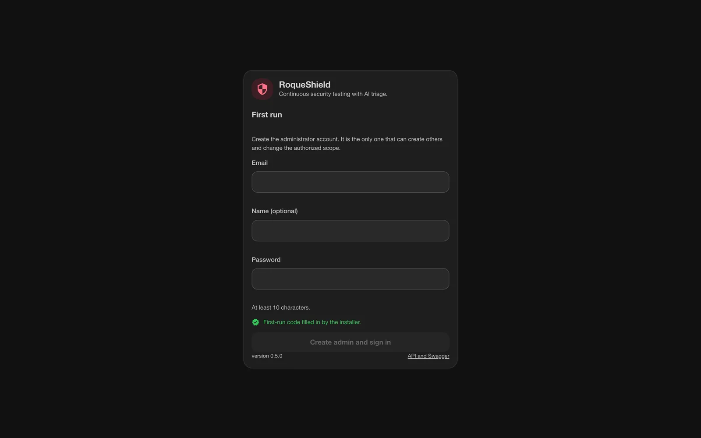

3. After that the UI is a login screen. API and Swagger live at `/docs`.

Do the first run **before** publishing the port beyond `127.0.0.1`.

## The UI

It is the same RoqueShield screen you get inside RoqueOS, with the same sections.

**New scan.** Target type, profile, authentication and review, with a summary on the
side. The authorization reference goes in here. The profile picks the scanners:
**Web** runs ZAP and nuclei (plus nmap for a host), **Network** runs nmap, **Full** runs
everything that applies and turns on ZAP's active scan. A Web scan of a small app took
8 to 13 minutes in our tests against OWASP Juice Shop, most of it nuclei going through
its templates; the **Execution** tab shows it live.

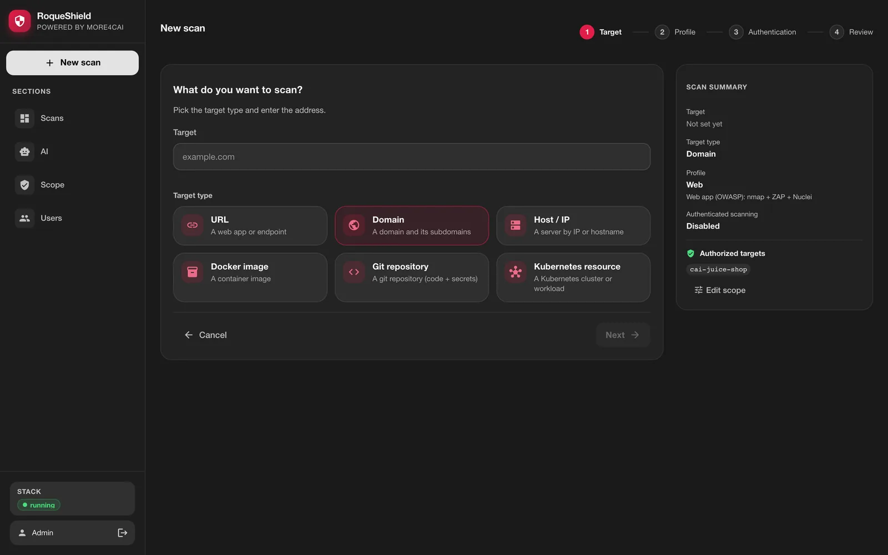

**Scan detail, Summary tab.** Findings, severe ones, duration, which tools ran, the risk
grade, the severity distribution, the top risks and the compliance posture (OWASP, PCI
DSS, LGPD). "Full coverage" at the top says every requested scanner ran; when one did
not, the top says so and so does the report.

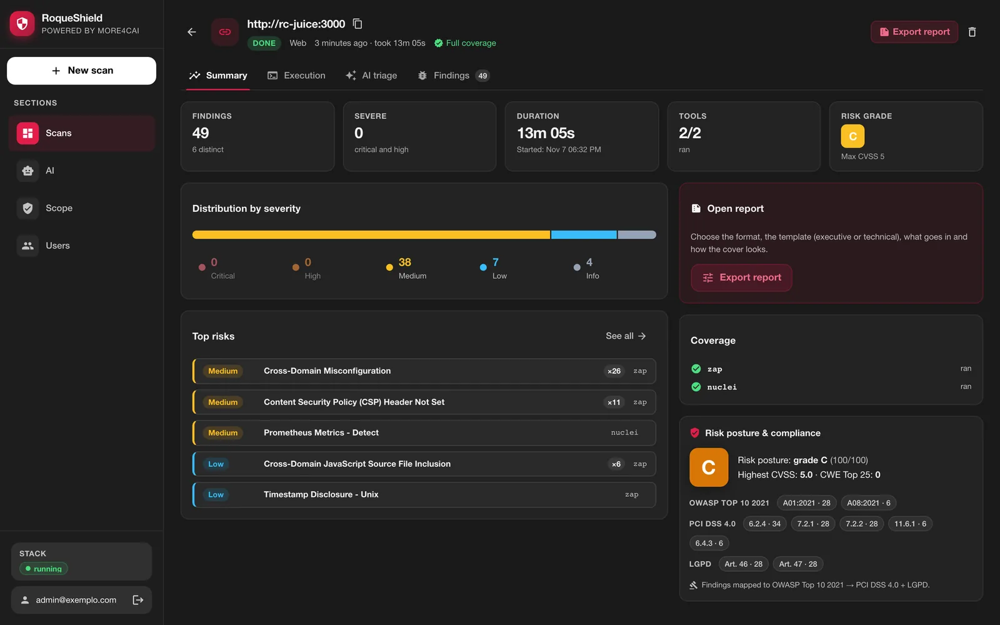

**Findings.** Grouped by rule, filtered by severity, tool and title, with the evidence
for each one.

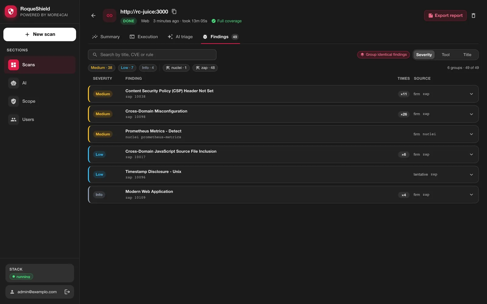

**Execution.** Every container process's log (orchestrator, worker, Redis, ZAP) and the
CPU and memory of each, read from inside the container.

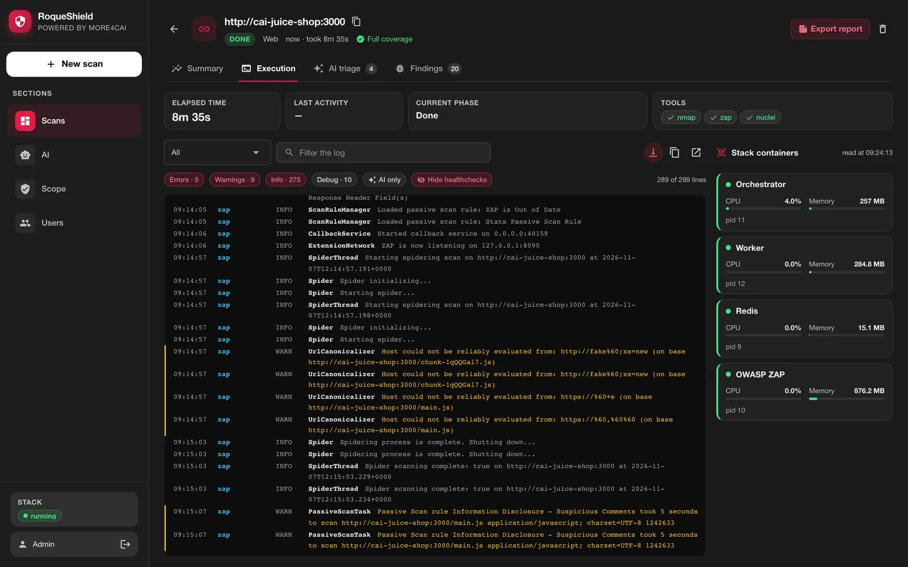

**AI triage.** What the model did with the findings, call by call. In this capture
there is no provider key configured: the shield does not call the model at all, the tab
says "AI not configured" with a shortcut to set it up, and findings keep the tool's own
classification. AI is optional; the scanners run without it. With a key and a provider
error, the tab shows each call's error.

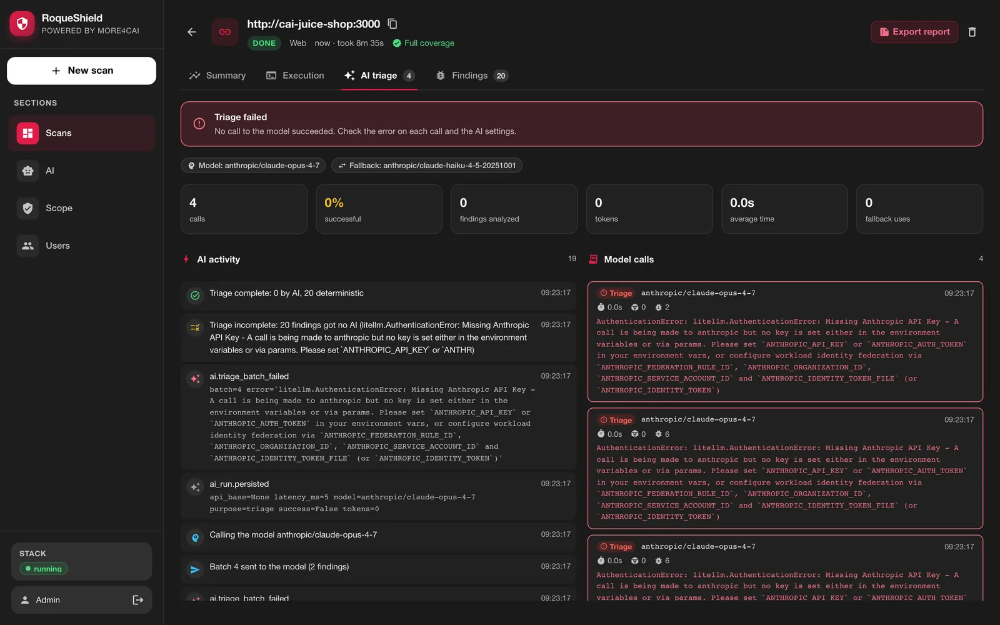

**AI.** The provider and model (Anthropic, OpenAI, OpenRouter or a local
OpenAI-compatible server). The key is stored encrypted in the shield and never comes
back to the UI.

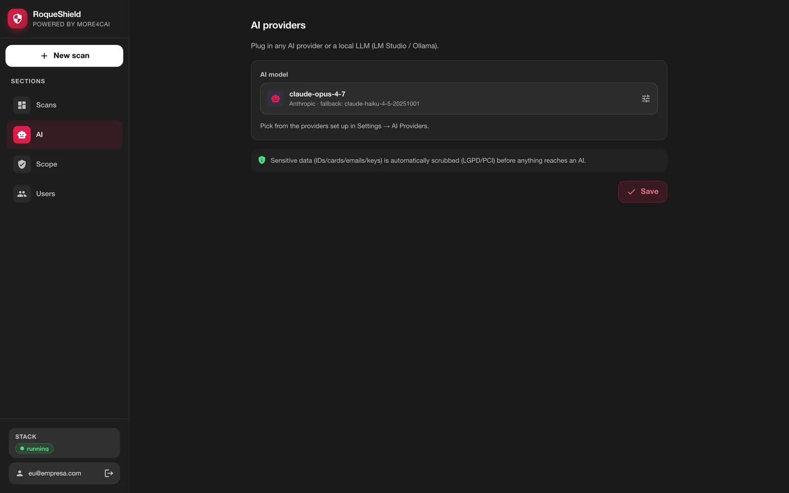

**On a phone.** The same screen, with navigation in a menu.

<p>
  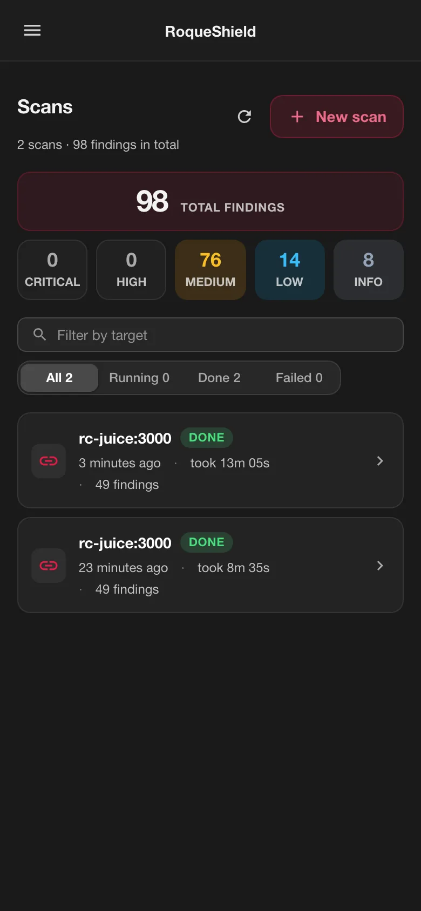
  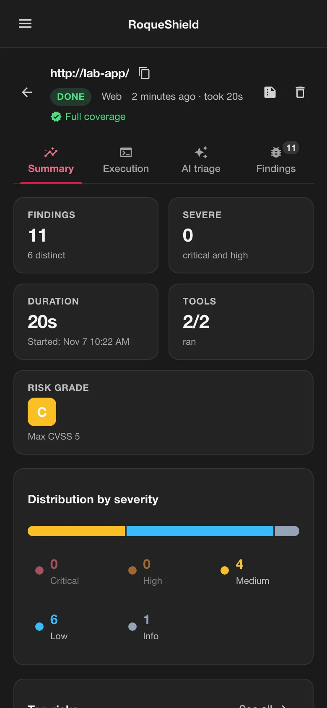
  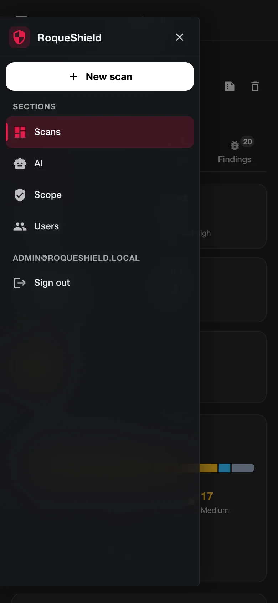
</p>

## What runs inside

| Process | What it is | Exposed |
| --- | --- | --- |
| `orchestrator` | API, UI, Swagger, MCP over HTTP, live progress (SSE) | `:8080` |
| `worker` | runs the scans (nmap, ZAP, nuclei, trivy, semgrep, gitleaks, trufflehog, checkov…) | no |
| `redis` | the job queue, password protected | `127.0.0.1` only |
| `zap` | the OWASP ZAP daemon and the headless Firefox for the AJAX spider | `127.0.0.1` only, with a key |

A small Python supervisor starts all four, restarts whatever dies (1s, 2s, 4s… up to
60s) and, on `docker stop`, stops them in reverse order within 8 seconds in total. The
`--stop-timeout 30` above leaves room for that. It runs as UID 1000; the container
needs no capabilities.

Each process gets only the secrets it needs: the worker, and the scanners it runs
against the target, do not receive the `APP_TOKEN`, the session signing key or the
first-run code. This prevents accidental leaks (a variable ending up in a log or a
report), but it does not isolate a compromised scanner: the worker and scanners run as
the same user that can read `/data/secrets` (and, in `compose.prod.yml`, with the
container's full environment). Real isolation, with the worker as another user and no
reach to the secrets, is a known limit of this version.

The **Execution** tab, in each scan's detail, shows every process's log, CPU and
memory, read from inside the container. No Docker socket is mounted.

## Secrets

Without `APP_TOKEN`, `SESSION_SECRET`, `SECRETS_KEY`, `ZAP_API_KEY`, `REDIS_PASSWORD`
and `SETUP_CODE` in the environment, the first boot generates all six in
`/data/secrets` (mode 0600) and reuses them afterwards. Values are never printed: the
log only says `gerado` (generated), `arquivo` (file) or `ambiente` (environment).
Whatever comes from the environment wins.

The `APP_TOKEN` is a service key with admin power, and the CLI inside the container
already uses it. That is the recovery path when nobody remembers the admin password:

```bash
docker exec -it roqueshield roqueshield reset-password admin@example.com
```

It asks for the new password twice, without echo (at least 10 characters), and ends
every open session of that account.

The AI provider key typed in the UI's **AI** section is stored encrypted with
`SECRETS_KEY` and never goes back to the browser.

## Accounts and sessions

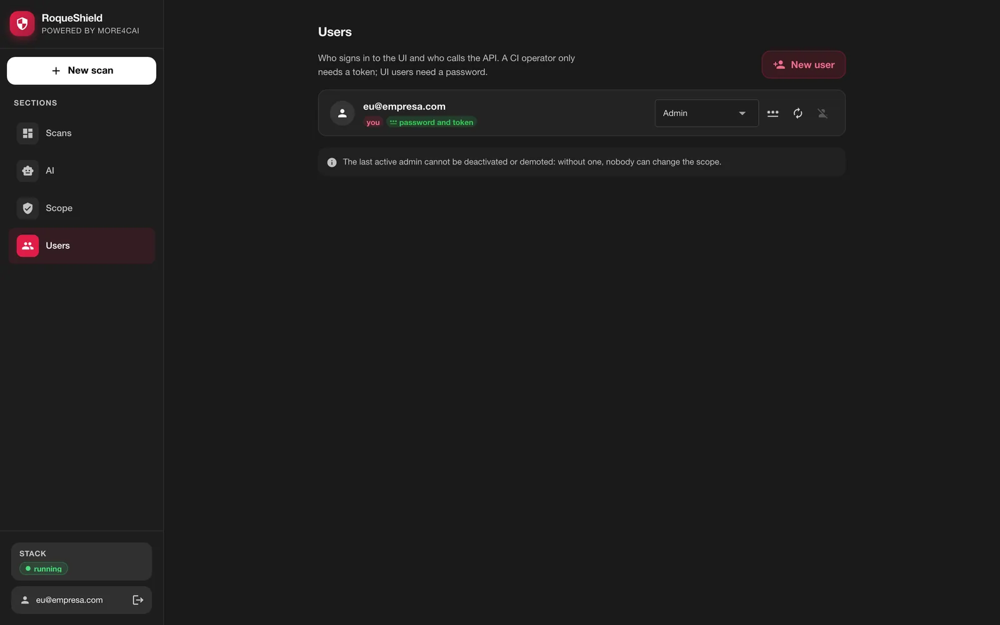


- Only admins create users, in the **Users** section. A user without a password signs
  in only through the API and the CLI, with the token shown **once** at creation.
  With a password, they can also use the UI.
- Only admins change passwords (their own included), also in **Users**.
- Signing out, changing the password or being deactivated ends **all** of that user's
  open sessions. The last active admin cannot be deactivated or demoted.
- After 5 wrong passwords in a row for the same email **from the same IP**, login for
  that email, from that IP, waits 30 s, and the wait doubles with each new error, up to
  15 min. The owner, from another IP, still gets in. A single IP is only slowed down
  after 50 errors across all emails. Behind a proxy, set `FORWARDED_ALLOW_IPS` (below),
  or everyone shows up with the proxy's IP. With the default `-p 127.0.0.1:8080:8080`,
  every client arrives with the Docker bridge address, so in practice the wait applies
  per email; `docker exec -it roqueshield roqueshield reset-password` is always there.

## Beyond localhost

The shield does not terminate TLS. To use it from another machine, put a reverse proxy
with HTTPS in front (Caddy, Traefik, nginx) and publish only the proxy. Behind it:

- `FORWARDED_ALLOW_IPS=<proxy ip>` makes uvicorn trust `X-Forwarded-Proto` and mark the
  session cookie `Secure`;
- or `COOKIE_SECURE=true` forces `Secure` directly.

Never publish port 8080 as plain HTTP on a network that is not yours.

## Scope: the first scan in a lab

`LAB_ONLY=true` is the default: a target on a private or loopback network
(`192.168.x`, `10.x`, `localhost`, a container name) is only scanned if it is on the
authorized target list. The screen checks this on the first step of **New scan**, before
the review:

- **`localhost` or `127.0.0.1`**: inside the container, that is RoqueShield itself. To
  test an app running on your computer, use `host.docker.internal`; the **Use
  host.docker.internal** button swaps the address.
- **Internal network** (`host.docker.internal`, `192.168.x`, `10.x`): an admin sees
  **Allow in the scope**, which asks for confirmation and adds the host to the list.
  Non-admins are told to ask an admin. Loopback and cloud metadata (`169.254.169.254`)
  get no such shortcut.

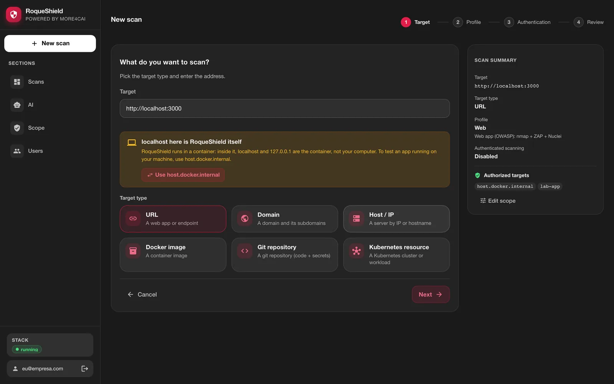

The list can also be edited in the **Scope** section. When it comes from the
`TARGET_ALLOWLIST` variable, the screen shows the field locked and says so.

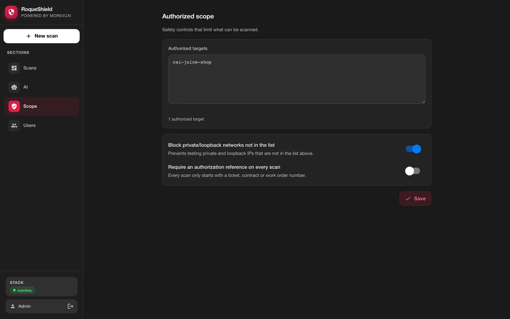

## Memory

ZAP's AJAX spider and active scan are the hungry part. Give the container at least
**6 GB of RAM** that is really free. On Docker Desktop that is the VM, not the laptop:
with less, the kernel kills ZAP mid-scan and the report says so. `zap` shows up in
`scanners_skipped`, coverage is marked incomplete, and it never becomes "zero
findings".

## Everything through the environment

The environment wins over the UI. A field set by a variable shows as locked in the
UI, with the variable's name, which is what a regulated environment needs.

| Variable | Default in this container | Effect |
| --- | --- | --- |
| `DATA_DIR` | `/data` | secrets, SQLite, reports, ZAP session, trivy cache |
| `DATABASE_URL` | SQLite in `/data` | point to Postgres for an immutable audit trail |
| `REDIS_URL` | built in, with password | pointing elsewhere skips the built-in Redis |
| `ZAP_BASE_URL` | built in | pointing elsewhere skips the built-in ZAP |
| `PORT` | `8080` | API port inside the container |
| `SHIELD_SERVICES` | all | processes to start (`orchestrator`, `worker`); how compose splits API and workers |
| `REPORTS_DIR`, `TRIVY_CACHE_DIR` | under `/data` | where reports and the trivy cache live |
| `LAB_ONLY`, `TARGET_ALLOWLIST`, `REQUIRE_AUTH_REF` | from the UI | lock the authorized scope |
| `LLM_MODEL`, `LLM_API_BASE`, `ANTHROPIC_API_KEY`… | from the UI | lock the AI configuration |
| `ALLOW_CLOUD_FALLBACK` | `true` | `false` forbids a local model from falling back to a cloud one |
| `MCP_ALLOW_ACTIONS` | `false` | lets `POST /mcp` start scans (always with an authorization reference) |
| `COOKIE_SECURE` | `false` | forces `Secure` on the session cookie |
| `OIDC_*` | off | SSO, next to password login |

For production, `docker/compose.prod.yml` runs the same image with Postgres (an
append-only audit trail), Redis with a password and ZAP as separate services, and
workers you can scale:

```bash
# .env at the repository root, from your secrets vault:
#   SHIELD_VERSION=v<version>  POSTGRES_PASSWORD=...  REDIS_PASSWORD=...  APP_TOKEN=...
#   SESSION_SECRET=...  SECRETS_KEY=...  ZAP_API_KEY=...
#   (optional) SHIELD_BIND=127.0.0.1  SHIELD_PORT=8080
docker compose -f docker/compose.prod.yml --env-file .env up -d
docker compose -f docker/compose.prod.yml --env-file .env up -d --scale worker=3
docker compose -f docker/compose.prod.yml --env-file .env exec shield cat /data/secrets/SETUP_CODE
```

`--env-file` is required: with `-f`, compose looks for `.env` next to the compose file.
`SECRETS_KEY` is a Fernet key (`python -c "from cryptography.fernet import Fernet;
print(Fernet.generate_key().decode())"`).

## Backup and upgrade

The `/data` volume holds the SQLite database, the reports and the secrets
**together**. Treat the backup as a secret: whoever has the copy has the `APP_TOKEN`
and the `SECRETS_KEY`. Losing the `SECRETS_KEY` makes the stored AI key unreadable
(just type it again).

```bash
docker stop roqueshield
docker run --rm -v roqueshield:/data -v "$PWD":/bkp alpine \
  sh -c 'umask 077 && tar czf /bkp/roqueshield-data.tgz -C /data .'
docker start roqueshield
```

Restoring into a new, empty volume:

```bash
docker volume create roqueshield
docker run --rm -v roqueshield:/data -v "$PWD":/bkp alpine \
  sh -c 'tar xzf /bkp/roqueshield-data.tgz -C /data && chown -R 1000:1000 /data'
```

To upgrade, run the installer with `--update`. It pulls the image of its version and
recreates the container on the same volume and port; on boot, before the API starts,
the supervisor applies the database migrations (SQLite or Postgres).

```bash
curl -fsSL https://raw.githubusercontent.com/roqueribeiro/roqueos-shield/main/install.sh | sh -s -- --update
```

## When something goes wrong

| What you see | What to do |
| --- | --- |
| `Docker is installed but did not answer` | Open Docker Desktop and wait for it to finish starting (Linux: `sudo systemctl start docker`). |
| `your user has no permission to use Docker` | Linux: `sudo usermod -aG docker $USER`, log out and back in. |
| `the container did not start` / port in use | Another program uses 8080: `ROQUESHIELD_PORT=8081` (see the table above). |
| The browser did not open, or opened a blank page | Open `http://localhost:8080` yourself; the first-run code comes from `docker exec roqueshield cat /data/secrets/SETUP_CODE`. |
| "localhost here is RoqueShield itself" | Your app runs on your computer, not in the container: use `host.docker.internal` (the button does it). |
| "Internal network address" | Only an admin can allow it, in the same screen or in **Scope**. |
| "AI not configured" | Optional. Findings keep the scanner's classification; set a provider in **AI** for analysis and remediation. |
| "Coverage incomplete" | A scanner did not run; the scan's **Execution** tab says which and why. Often memory: give Docker 6 GB. |
| Forgot the admin password | `docker exec -it roqueshield roqueshield reset-password <email>` |
| Anything else | `docker logs roqueshield`, or the **Execution** tab of a scan. Issues are welcome (see [CONTRIBUTING](../CONTRIBUTING.md)). |

## API and Swagger

Everything the UI does goes through the REST API, documented at `/docs` (Swagger) and
versioned in [docs/openapi.json](openapi.json). Authentication with the `X-API-Token`
header.

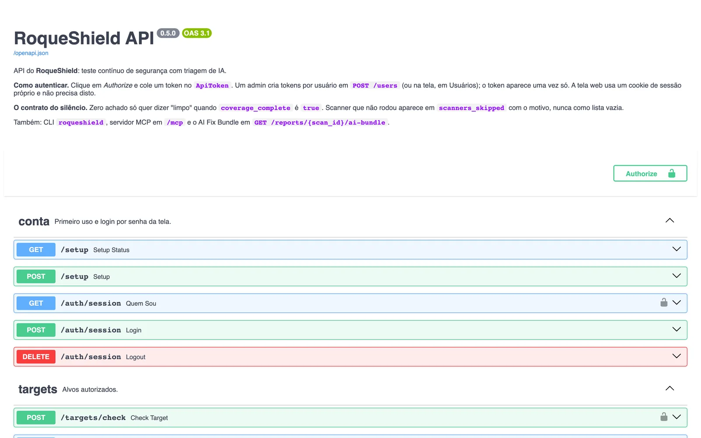

## CLI

`roqueshield` talks to a running shield through the API. Inside the container there is
nothing to configure, it uses the local shield and the `APP_TOKEN`:

```bash
docker exec roqueshield roqueshield status
```

Outside the container, the easiest way is the image itself, with nothing to install:

```bash
docker run --rm -it --entrypoint roqueshield \
  -e ROQUESHIELD_URL=https://shield.example -e ROQUESHIELD_TOKEN \
  roqueribeiro1988/roqueos-shield:<version>-standalone status
```

Or install it from the repository (Python 3.13 or newer; it is not on PyPI, and it
brings the engine's dependencies along):

```bash
pip install "git+https://github.com/roqueribeiro/roqueos-shield@v<version>"
```

With a token created in **Users**:

```bash
roqueshield login --server https://shield.example   # asks for the token, no echo
roqueshield scan start https://app.example --auth-ref CHG-123 --wait --fail-on high
roqueshield report <scan_id> --format bundle -o bundle.json
```

Exit codes for pipelines:

| Code | When |
| --- | --- |
| `0` | finished and clean at the `--fail-on` threshold |
| `1` | a finding at `--fail-on` or above |
| `2` | usage error, connection error or rejected credentials |
| `3` | the scan failed, coverage is incomplete, or `--wait` ran past `--prazo` (7200 s) |

`3` wins: zero findings from a scanner that did not run never exits `0`.
`ROQUESHIELD_URL` and `ROQUESHIELD_TOKEN` replace `login` in CI.

## MCP

For Claude Code, Claude Desktop or Cursor, over stdio:

```bash
claude mcp add roqueshield \
  -e ROQUESHIELD_URL=https://shield.example -e ROQUESHIELD_TOKEN=<token> \
  -- roqueshield mcp
```

Or over HTTP, `POST /mcp` with the `X-API-Token` header. Tools: `list_scans`,
`get_scan`, `get_findings`, `get_ai_bundle`, `list_targets`, and `start_scan`.

`start_scan` only shows up with actions on, and who turns them on depends on the
transport: for `POST /mcp` it is the server (`MCP_ALLOW_ACTIONS=true`); over stdio it
is the client (`ROQUESHIELD_MCP_ACTIONS=1`), and what the server controls is the
token's role. For a read-only agent, give it a `viewer` or `auditor` token: those
cannot start scans by any path.

A scan that failed, came back incomplete or is still running returns as an error with
the reason (and the partial data), never as an empty list.
