# RoqueShield standalone

O RoqueShield inteiro num container: o motor e os scanners, a tela, a API REST com
Swagger, o servidor MCP, o Redis e o OWASP ZAP. Sem RoqueOS.

> **Autorização antes de tudo.** Escanear sistema de terceiro sem autorização formal
> é crime em muitos países, inclusive no Brasil. Rode só contra o que você tem
> autorização escrita para testar, dentro da janela combinada. O RoqueShield ajuda a
> registrar isso (referência de autorização em cada scan), mas não decide por você.

## Instalar em um comando

No Mac, no Linux ou no WSL do Windows, com o Docker aberto:

```bash
curl -fsSL https://raw.githubusercontent.com/roqueribeiro/roqueos-shield/main/install.sh | sh
```

O [install.sh](../install.sh) confere se o Docker responde e se tem pelo menos 6 GB de
memória, baixa a imagem, sobe o container escutando só em `127.0.0.1:8080`, espera o
healthcheck e abre o navegador com o código de primeiro uso no endereço. Rodar de novo
é seguro: se o container existe, ele só é religado.

| Quero | Comando |
| --- | --- |
| outra porta | `curl -fsSL .../install.sh \| ROQUESHIELD_PORT=8081 sh` |
| não abrir o navegador | `curl -fsSL .../install.sh \| sh -s -- --no-browser` |
| atualizar, mantendo os dados | `curl -fsSL .../install.sh \| sh -s -- --update` |

(`...` é `https://raw.githubusercontent.com/roqueribeiro/roqueos-shield/main`. Os nomes
em português, `ROQUESHIELD_PORTA` e `ROQUESHIELD_NAO_ABRIR`, também valem.)

O código vai no fragmento do endereço (`#setup=...`), que o navegador não manda ao
servidor: não aparece em log de acesso, e a tela apaga ele da barra assim que lê. Ele
também não vai na linha de comando do navegador, que outro usuário da máquina veria no
`ps`: o instalador abre uma página local numa pasta `0700`, que leva ao endereço e é
apagada em cinco minutos.

**À mão, ou no Windows sem WSL** (PowerShell igual, trocando `\` por `` ` ``):

```bash
docker run -d --name roqueshield \
  -p 127.0.0.1:8080:8080 --shm-size=1g --stop-timeout 30 --restart unless-stopped \
  --add-host host.docker.internal:host-gateway \
  -v roqueshield:/data \
  roqueribeiro1988/roqueos-shield:<versão>-standalone
```

A tag é a versão com `v` mais `-standalone`, por exemplo `v0.5.0-standalone`. O
`--add-host` faz `host.docker.internal` apontar para o seu computador também no Linux.

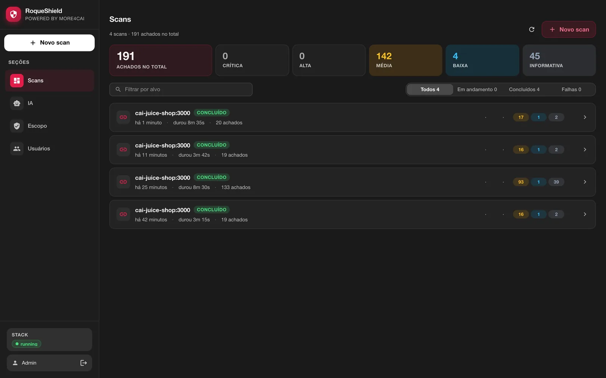

## Primeiro uso

1. Abra `http://localhost:8080` (o instalador já abre). A primeira tela cria a conta de
   administrador: e-mail e senha.
2. Ela precisa do **código de primeiro uso**, que prova que você tem acesso ao
   container. Pelo instalador ele chega preenchido (a tela diz isso no lugar do campo).
   À mão, ele sai de:

   ```bash
   docker exec roqueshield cat /data/secrets/SETUP_CODE
   ```

   Sem o código (ou o `APP_TOKEN` no cabeçalho `X-API-Token`), o `POST /setup` é
   recusado. Isso impede que alguém que alcance a porta antes de você vire admin.

   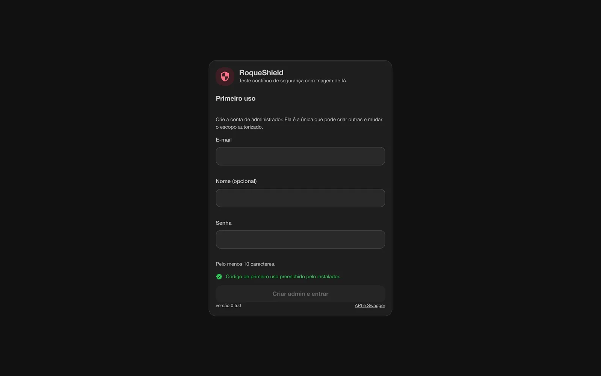

3. Depois disso a tela é de login. API e Swagger ficam em `/docs`.

Faça o primeiro uso **antes** de publicar a porta fora do `127.0.0.1`.

## A tela

É a mesma tela do RoqueShield dentro do RoqueOS, com as mesmas seções.

**Novo scan.** Tipo de alvo, perfil, autenticação e revisão, com o resumo ao lado. A
referência de autorização entra aqui. O perfil escolhe os scanners: **Web** roda ZAP e
nuclei (mais nmap quando o alvo é host), **Rede** roda nmap, **Completo** roda tudo o que
se aplica e liga o active scan do ZAP. Um scan Web de uma aplicação pequena levou de 8 a 13
minutos nos nossos testes contra o OWASP Juice Shop, a maior parte o nuclei passando pelos
templates; a aba **Execução** mostra ao vivo.

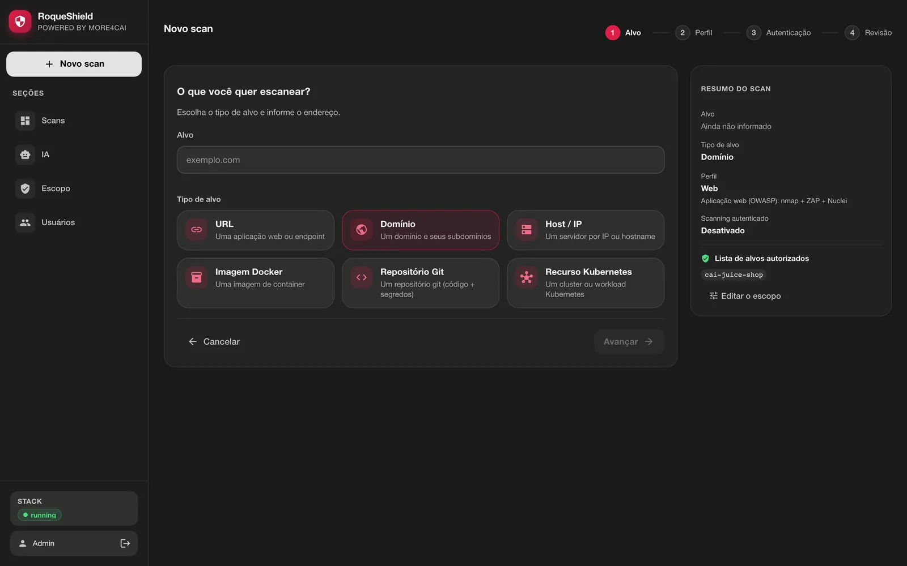

**Detalhe do scan, aba Resumo.** Achados, graves, duração, quais ferramentas rodaram, a
nota de risco, a distribuição por severidade, os principais riscos e a postura de
compliance (OWASP, PCI DSS, LGPD). "Cobertura completa" no topo diz que todos os
scanners pedidos rodaram; quando um não roda, o topo diz isso e o relatório também.

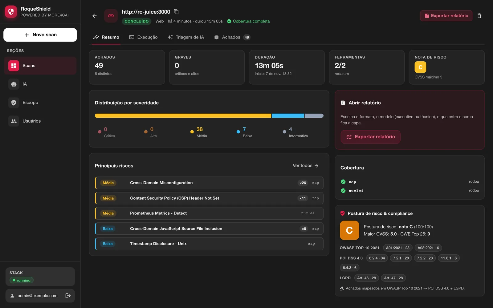

**Achados.** Agrupados por regra, com filtro por severidade, ferramenta e título, e a
evidência de cada um.

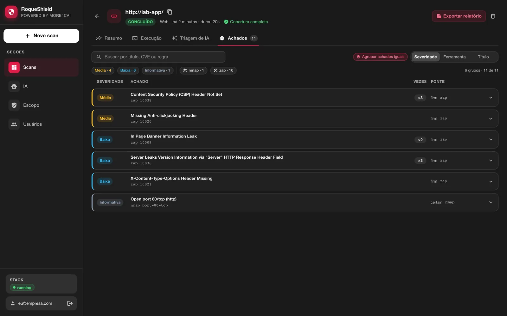

**Execução.** O log de cada processo do container (orchestrator, worker, Redis, ZAP) e
CPU e memória de cada um, lidos de dentro do container.

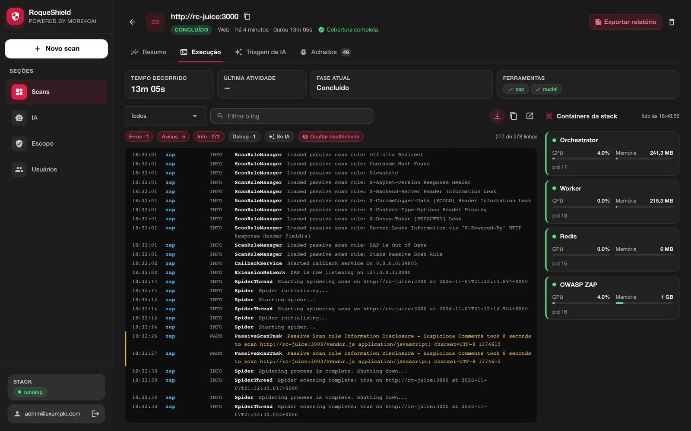

**Triagem de IA.** O que o modelo fez com os achados, chamada a chamada. Nesta captura
não há chave de provedor configurada: o shield nem chama o modelo, a aba diz "IA não
configurada" com o atalho para configurar, e os achados ficam com a classificação da
ferramenta. A IA é opcional; os scanners rodam sem ela. Com chave e erro do provedor, a
aba mostra o erro de cada chamada.

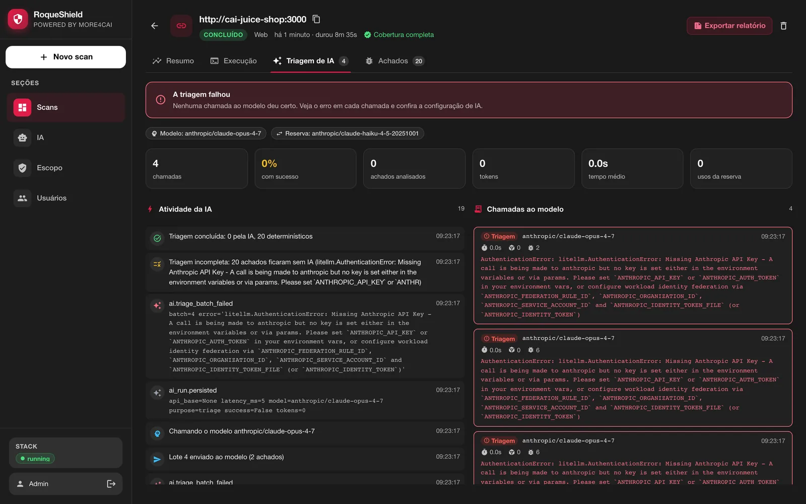

**IA.** O provedor e o modelo (Anthropic, OpenAI, OpenRouter ou um servidor local
compatível com OpenAI). A chave fica cifrada no shield e não volta para a tela.

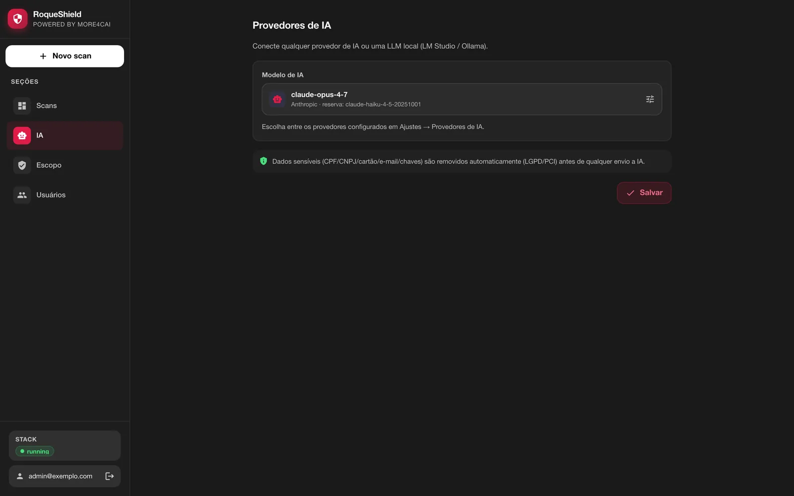

**No celular.** A mesma tela, com a navegação num menu.

<p>
  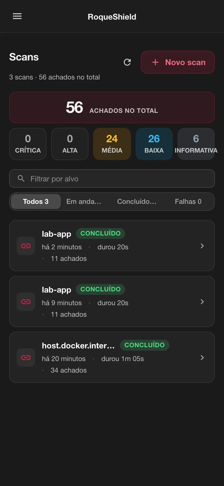
  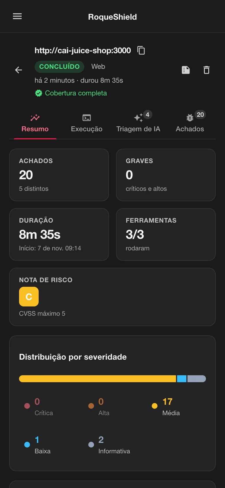
  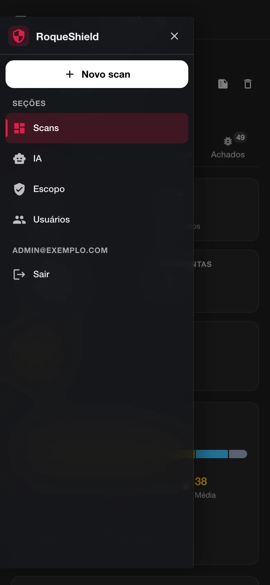
</p>

## O que roda dentro

| Processo | O que é | Exposto |
| --- | --- | --- |
| `orchestrator` | API, tela, Swagger, MCP por HTTP, progresso ao vivo (SSE) | `:8080` |
| `worker` | roda os scans (nmap, ZAP, nuclei, trivy, semgrep, gitleaks, trufflehog, checkov…) | não |
| `redis` | a fila dos jobs, com senha | só `127.0.0.1` |
| `zap` | o daemon do OWASP ZAP e o Firefox headless do AJAX spider | só `127.0.0.1`, com chave |

Um supervisor pequeno, em Python, sobe os quatro, reinicia quem cair (1s, 2s, 4s…
até 60s) e, no `docker stop`, para todos em ordem inversa em até 8 segundos no
total. O `--stop-timeout 30` do exemplo dá folga a isso. Roda como UID 1000; o
container não precisa de capability nenhuma.

Cada processo recebe só os segredos de que precisa: o worker, e os scanners que ele
roda contra o alvo, não recebem o `APP_TOKEN`, a chave que assina sessão nem o código
de primeiro uso. Isso evita vazamento acidental (variável parando num log ou num
relatório), mas não isola um scanner comprometido: worker e scanners rodam com o mesmo
usuário que lê `/data/secrets` (e, no `compose.prod.yml`, com o mesmo ambiente do
container). Isolamento de verdade, com o worker em outro usuário e sem alcance aos
segredos, é limite conhecido desta versão.

A aba **Execução**, no detalhe de cada scan, mostra o log de cada processo, CPU e
memória, lidos de dentro do container. Não há socket do Docker montado.

## Segredos

Sem `APP_TOKEN`, `SESSION_SECRET`, `SECRETS_KEY`, `ZAP_API_KEY`, `REDIS_PASSWORD` e
`SETUP_CODE` no ambiente, o primeiro boot gera os seis em `/data/secrets` (modo 0600)
e reaproveita depois. O valor nunca é impresso: o log diz só `gerado`, `arquivo` ou
`ambiente`. O que vier no ambiente vence.

O `APP_TOKEN` é uma chave de serviço com poder de admin, e a CLI de dentro do container
já usa ele. É o caminho de recuperação quando ninguém lembra a senha do admin:

```bash
docker exec -it roqueshield roqueshield reset-password admin@empresa.com
```

Ela pede a senha nova duas vezes, sem eco (pelo menos 10 caracteres), e encerra todas
as sessões abertas dessa conta.

A chave do provedor de IA digitada na seção **IA** da tela é guardada cifrada com a
`SECRETS_KEY` e nunca volta para o navegador.

## Contas e sessão

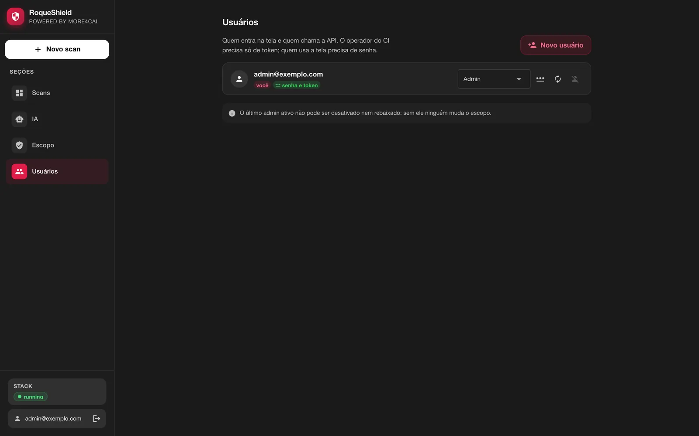


- Só o admin cria usuários, na seção **Usuários**. Usuário sem senha entra só pela API
  e pelo CLI, com o token que aparece **uma vez** na criação. Com senha, entra também
  na tela.
- Só o admin troca senha (inclusive a própria), também em **Usuários**.
- Sair, trocar a senha ou ser desativado derruba **todas** as sessões abertas daquele
  usuário. O último admin ativo não pode ser desativado nem rebaixado.
- Depois de 5 senhas erradas seguidas para o mesmo e-mail **vindas do mesmo IP**, o
  login daquele e-mail, daquele IP, espera 30 s, e a espera dobra a cada erro novo,
  até 15 min. O dono, de outro IP, continua entrando. Um IP sozinho só é freado depois
  de 50 erros somando todos os e-mails. Atrás de proxy, configure
  `FORWARDED_ALLOW_IPS` (abaixo), senão todo mundo aparece com o IP do proxy. Com o
  `-p 127.0.0.1:8080:8080` padrão, todo cliente chega com o endereço da ponte do Docker,
  então na prática a espera vale por e-mail; o `docker exec -it roqueshield roqueshield
  reset-password` continua lá.

## Fora do localhost

O shield não termina TLS. Para usar de outra máquina, ponha um proxy reverso com
HTTPS na frente (Caddy, Traefik, nginx) e publique só o proxy. Atrás dele:

- `FORWARDED_ALLOW_IPS=<ip do proxy>` faz o uvicorn confiar no `X-Forwarded-Proto` e
  marcar o cookie de sessão como `Secure`;
- ou `COOKIE_SECURE=true` força o `Secure` direto.

Nunca publique a porta 8080 em HTTP aberto numa rede que não é sua.

## Escopo: o primeiro scan num lab

`LAB_ONLY=true` é o padrão: alvo em rede privada ou loopback (`192.168.x`, `10.x`,
`localhost`, nome de container) só é escaneado se estiver na lista de alvos
autorizados. A tela confere isso no primeiro passo do **Novo scan**, antes da revisão:

- **`localhost` ou `127.0.0.1`**: dentro do container, é o próprio RoqueShield. Para
  testar um app que roda no seu computador, use `host.docker.internal`; o botão
  **Usar host.docker.internal** troca o endereço.
- **Rede interna** (`host.docker.internal`, `192.168.x`, `10.x`): o admin vê **Liberar
  no escopo**, que pede confirmação e põe o host na lista. Quem não é admin vê o
  pedido para um admin liberar. Loopback e metadata de nuvem (`169.254.169.254`) não
  têm esse atalho.

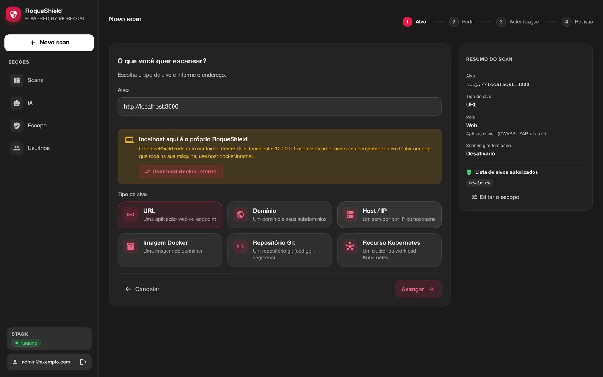

A lista também se edita na seção **Escopo**. Quando ela vem da variável
`TARGET_ALLOWLIST`, a tela mostra o campo travado e diz isso.

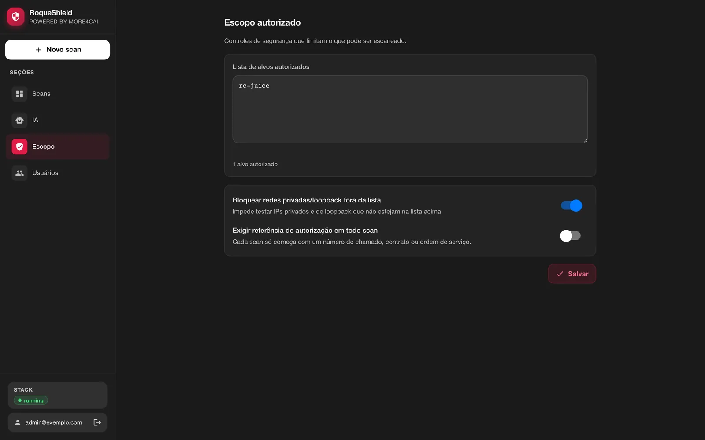

## Memória

O AJAX spider e o active scan do ZAP são a parte faminta. Dê ao container pelo menos
**6 GB de RAM** livres de verdade. No Docker Desktop isso é a VM, não o notebook: com
menos, o kernel mata o ZAP no meio do scan e o relatório diz isso. O `zap` aparece em
`scanners_skipped`, a cobertura fica incompleta, e não vira "zero achado".

## Tudo pelo ambiente

O ambiente vence a tela. Campo definido por variável aparece travado na tela com o
nome da variável, que é o que um ambiente regulado precisa.

| Variável | Padrão neste container | Efeito |
| --- | --- | --- |
| `DATA_DIR` | `/data` | segredos, SQLite, relatórios, sessão do ZAP, cache do trivy |
| `DATABASE_URL` | SQLite em `/data` | aponte para Postgres para ter trilha de auditoria imutável |
| `REDIS_URL` | embutido, com senha | apontando para fora, o Redis embutido não sobe |
| `ZAP_BASE_URL` | embutido | apontando para fora, o ZAP embutido não sobe |
| `PORT` | `8080` | porta da API dentro do container |
| `SHIELD_SERVICES` | todos | processos a subir (`orchestrator`, `worker`); é como o compose separa API e workers |
| `REPORTS_DIR`, `TRIVY_CACHE_DIR` | dentro de `/data` | onde ficam relatórios e o cache do trivy |
| `LAB_ONLY`, `TARGET_ALLOWLIST`, `REQUIRE_AUTH_REF` | pela tela | travam o escopo autorizado |
| `LLM_MODEL`, `LLM_API_BASE`, `ANTHROPIC_API_KEY`… | pela tela | travam a configuração de IA |
| `ALLOW_CLOUD_FALLBACK` | `true` | `false` proíbe o modelo local de cair num de nuvem |
| `AGENT_LIVE_EXECUTION` | `false` | deixa um admin executar de verdade os comandos que o agente de IA planeja (`dry_run=false`); desligado, o agente só planeja |
| `MCP_ALLOW_ACTIONS` | `false` | deixa o `POST /mcp` disparar scan (sempre com referência de autorização) |
| `COOKIE_SECURE` | `false` | força o `Secure` no cookie de sessão |
| `OIDC_*` | desligado | SSO, ao lado do login por senha |

Para produção, o `docker/compose.prod.yml` roda a mesma imagem com Postgres (trilha de
auditoria só de inclusão), Redis com senha e ZAP em serviços separados, e workers que
escalam:

```bash
# .env na raiz do repositório, vindo do seu cofre:
#   SHIELD_VERSION=v<versão>  POSTGRES_PASSWORD=...  REDIS_PASSWORD=...  APP_TOKEN=...
#   SESSION_SECRET=...  SECRETS_KEY=...  ZAP_API_KEY=...
#   (opcional) SHIELD_BIND=127.0.0.1  SHIELD_PORT=8080
docker compose -f docker/compose.prod.yml --env-file .env up -d
docker compose -f docker/compose.prod.yml --env-file .env up -d --scale worker=3
docker compose -f docker/compose.prod.yml --env-file .env exec shield cat /data/secrets/SETUP_CODE
```

O `--env-file` é obrigatório: com `-f`, o compose procura o `.env` ao lado do arquivo.
A `SECRETS_KEY` é uma chave Fernet (`python -c "from cryptography.fernet import Fernet;
print(Fernet.generate_key().decode())"`).

## Backup e atualização

O volume `/data` guarda **juntos** o banco SQLite, os relatórios e os segredos. Trate
o backup como segredo: quem tem a cópia tem o `APP_TOKEN` e a `SECRETS_KEY`. Perder a
`SECRETS_KEY` torna ilegível a chave de IA guardada (é só digitar de novo).

```bash
docker stop roqueshield
docker run --rm -v roqueshield:/data -v "$PWD":/bkp alpine \
  sh -c 'umask 077 && tar czf /bkp/roqueshield-data.tgz -C /data .'
docker start roqueshield
```

Para restaurar num volume novo e vazio:

```bash
docker volume create roqueshield
docker run --rm -v roqueshield:/data -v "$PWD":/bkp alpine \
  sh -c 'tar xzf /bkp/roqueshield-data.tgz -C /data && chown -R 1000:1000 /data'
```

Para atualizar, rode o instalador com `--update`. Ele baixa a imagem da versão dele e
recria o container no mesmo volume e na mesma porta:

```bash
curl -fsSL https://raw.githubusercontent.com/roqueribeiro/roqueos-shield/main/install.sh | sh -s -- --update
```

No boot, antes
de a API subir, o supervisor aplica as migrations do banco (SQLite ou Postgres).

## Quando algo dá errado

| O que aparece | O que fazer |
| --- | --- |
| `o Docker está instalado mas não respondeu` | Abra o Docker Desktop e espere terminar de iniciar (Linux: `sudo systemctl start docker`). |
| `seu usuário não tem permissão no Docker` | Linux: `sudo usermod -aG docker $USER`, saia e entre de novo na sessão. |
| `o container não subiu` / porta em uso | Outro programa usa a 8080: `ROQUESHIELD_PORT=8081` (tabela acima). |
| O navegador não abriu, ou abriu em branco | Abra `http://localhost:8080` você mesmo; o código de primeiro uso sai de `docker exec roqueshield cat /data/secrets/SETUP_CODE`. |
| "localhost aqui é o próprio RoqueShield" | Seu app roda no seu computador, não no container: use `host.docker.internal` (o botão troca). |
| "Endereço da rede interna" | Só admin libera, na mesma tela ou em **Escopo**. |
| "IA não configurada" | É opcional. Os achados ficam com a classificação do scanner; configure um provedor em **IA** para ter análise e remediação. |
| "Cobertura incompleta" | Um scanner não rodou; a aba **Execução** do scan diz qual e por quê. Muitas vezes é memória: dê 6 GB ao Docker. |
| Esqueci a senha do admin | `docker exec -it roqueshield roqueshield reset-password <email>` |
| Outra coisa | `docker logs roqueshield`, ou a aba **Execução** do scan. Issues são bem-vindas (ver o [CONTRIBUTING](../CONTRIBUTING.md)). |

## API e Swagger

Tudo o que a tela faz passa pela API REST, documentada em `/docs` (Swagger) e versionada
em [docs/openapi.json](openapi.json). Autenticação pelo cabeçalho `X-API-Token`.

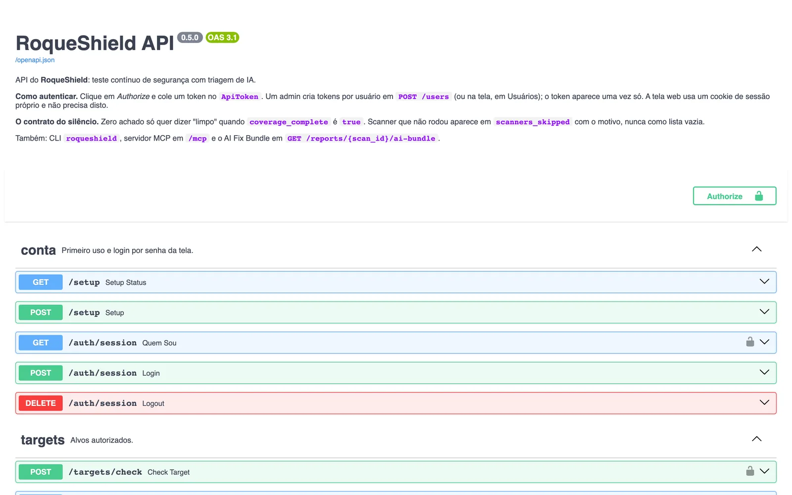

## CLI

`roqueshield` fala com um shield rodando, pela API. Dentro do container não precisa
configurar nada, ele usa o shield local e o `APP_TOKEN`:

```bash
docker exec roqueshield roqueshield status
```

Fora do container, o jeito mais fácil é a própria imagem, sem instalar nada:

```bash
docker run --rm -it --entrypoint roqueshield \
  -e ROQUESHIELD_URL=https://shield.exemplo -e ROQUESHIELD_TOKEN \
  roqueribeiro1988/roqueos-shield:<versão>-standalone status
```

Ou instale do repositório (Python 3.13 ou mais novo; não está no PyPI, e traz junto as
dependências do motor):

```bash
pip install "git+https://github.com/roqueribeiro/roqueos-shield@v<versão>"
```

Com um token criado em **Usuários**:

```bash
roqueshield login --server https://shield.exemplo   # pergunta o token, sem eco
roqueshield scan start https://app.exemplo --auth-ref CHG-123 --wait --fail-on high
roqueshield report <scan_id> --format bundle -o bundle.json
```

Códigos de saída para pipeline:

| Código | Quando |
| --- | --- |
| `0` | terminou e está limpo no limite do `--fail-on` |
| `1` | achado no `--fail-on` ou acima |
| `2` | erro de uso, de conexão ou credencial recusada |
| `3` | o scan falhou, a cobertura veio incompleta, ou o `--wait` estourou o `--prazo` (7200 s) |

O `3` vence: zero achado de scanner que não rodou nunca sai `0`.
`ROQUESHIELD_URL` e `ROQUESHIELD_TOKEN` substituem o `login` no CI.

## MCP

Para Claude Code, Claude Desktop ou Cursor, por stdio:

```bash
claude mcp add roqueshield \
  -e ROQUESHIELD_URL=https://shield.exemplo -e ROQUESHIELD_TOKEN=<token> \
  -- roqueshield mcp
```

Ou por HTTP, `POST /mcp` com o cabeçalho `X-API-Token`. Ferramentas: `list_scans`,
`get_scan`, `get_findings`, `get_ai_bundle`, `list_targets`, e `start_scan`.

O `start_scan` só aparece com as ações ligadas, e quem liga depende do transporte:
no `POST /mcp` é o servidor (`MCP_ALLOW_ACTIONS=true`); no stdio é o cliente
(`ROQUESHIELD_MCP_ACTIONS=1`), e o que o servidor controla é o papel do token. Para
um agente que só lê, dê a ele um token de papel `viewer` ou `auditor`: esses não
disparam scan por nenhum caminho.

Scan que falhou, veio incompleto ou ainda está rodando volta como erro com o motivo
(e os dados parciais), nunca como lista vazia.
